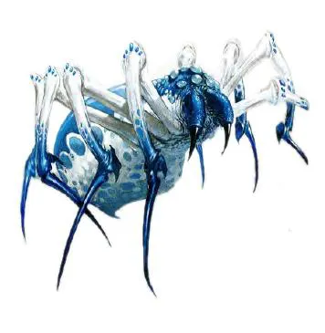

# Aranha Gigante

## Bloco de estatísticas: Aranha Gigante

*Besta Grande, imparcial*

**Classe de Armadura** 14 (armadura natural)  
**Pontos de Vida** 26 (4d10 + 4)  
**Deslocamento** 9 m, escalada 9 m

| FOR | DES | CON | INT | SAB | CAR |
| :---: | :---: | :---: | :---: | :---: | :---: |
| 14 (+2) | 16 (+3) | 12 (+1) | 2 (–4) | 11 (+0) | 4 (–3) |

**Perícias** Furtividade +7  
**Sentidos** percepção às cegas 3 m, visão no escuro 18 m, Percepção passiva 10  
**Idiomas** –  
**Nível de Desafio** 1 (200 XP)

***Escalada Aracnídea***. A aranha pode escalar superfícies difíceis, incluindo tetos de cabeça para baixo, sem precisar realizar um teste de habilidade.

***Sentido na Teia***. Quando em contato com uma teia, a aranha sabe a localização exata de qualquer outra criatura em contato com a mesma teia.

***Andar na Teia***. A aranha ignora restrições de movimento causadas por estar numa teia.

### Ações

***Mordida***. *Ataque Corpo-a-Corpo com Arma*: +5 para atingir, alcance 1,5 m, uma criatura. *Acerto*: 7 (1d8 + 3) de dano perfurante e o alvo deve realizar um teste de resistência de Constituição CD 11, sofrendo 9 (2d8) de dano de veneno se falhar na resistência ou metade desse dano se obtiver sucesso. Se o dano de veneno reduzir o alvo a 0 pontos de vida, o alvo estará estável, porém, envenenado, por 1 hora e paralisado enquanto estiver envenenado dessa forma.

***Teia (Recarrega 5–6)***. *Ataque à Distância com Arma*: +5 para atingir, alcance 9 m/ 18 m, uma criatura. *Acerto*: O alvo ficará impedido pela teia. Com uma ação, o alvo impedido pode realizar um teste de Força CD 12, rompendo a teia com sucesso. A teia também pode ser atacada e destruída (CA 10; 5 pv; vulnerabilidade a fogo; imune a dano de concussão, veneno e psíquico).

Para apanhar sua presa, uma **aranha gigante** cria teias elaboradas ou dispara fios pegajosos de teia de seu abdômen. As aranhas gigantes são mais comumente encontradas no subterrâneo, fazendo seus covis em tetos ou em fendas escuras cheias de teias. Tais covis estão, frequentemente, infestados de casulos prendendo vítimas anteriores.
