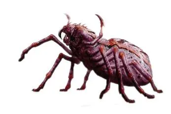

# Aranha Interplanar

## Bloco de estatísticas: Aranha Interplanar

*Monstruosidade Grande, imparcial*

**Classe de Armadura** 13 (armadura natural)  
**Pontos de Vida** 32 (5d10 + 5)  
**Deslocamento** 9 m, escalada 9 m

| FOR | DES | CON | INT | SAB | CAR |
| :---: | :---: | :---: | :---: | :---: | :---: |
| 15 (+2) | 15 (+3) | 12 (+1) | 6 (–2) | 10 (+0) | 6 (–2) |

**Perícias** Furtividade +6  
**Sentidos** visão no escuro 18 m, Percepção passiva 10  
**Idiomas** –  
**Nível de Desafio** 3 (700 XP)

***Escalada Aracnídea***. A aranha pode escalar superfícies difíceis, incluindo tetos de cabeça para baixo, sem precisar realizar um teste de habilidade.

***Salto Etéreo***. Com uma ação bônus, a aranha pode, magicamente, mudar do Plano Material para o Plano Etéreo, ou vice-versa.

***Andar na Teia***. A aranha ignora restrições de movimento causadas por estar numa teia.

### Ações

***Mordida***. *Ataque Corpo-a-Corpo com Arma*: +4 para atingir, alcance 1,5 m, uma criatura. *Acerto*: 7 (1d10 + 2) de dano perfurante e o alvo deve realizar um teste de resistência de Constituição CD 11, sofrendo 18 (4d8) de dano de veneno se falhar na resistência ou metade desse dano se obtiver sucesso. Se o dano de veneno reduzir o alvo a 0 pontos de vida, o alvo estará estável, porém, envenenado, por 1 hora e paralisado enquanto estiver envenenado dessa forma.

Uma **aranha interplanar** possui a habilidade mágica de entrar e sair do Plano Etéreo. Ela parece surgir de lugar nenhum e, rapidamente desaparece após atacar. Ela se movimenta no Plano Etéreo antes de voltar para o Plano Material, fazendo parecer que ela pode se teletransportar.
