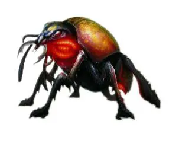

# Árvore Desperta

## Bloco de estatísticas: Árvore Desperta

*Planta Enorme, imparcial*

**Classe de Armadura** 13 (armadura natural)  
**Pontos de Vida** 59 (7d12 + 14)  
**Deslocamento** 6 m

| FOR | DES | CON | INT | SAB | CAR |
| :---: | :---: | :---: | :---: | :---: | :---: |
| 19 (+4) | 6 (–2) | 15 (+2) | 10 (+0) | 10 (+0) | 7 (–2) |

**Vulnerabilidade a Dano** fogo  
**Resistência a Dano** concussão, perfurante  
**Sentidos** Percepção passiva 10  
**Idiomas** um idioma conhecido pelo seu criador  
**Nível de Desafio** 2 (450 XP)

***Aparência Falsa.*** Enquanto a árvore permanecer imóvel, ela é indistinguível de uma árvore normal.

### Ações

***Pancada***. *Ataque Corpo-a-Corpo com Arma*: +6 para atingir, alcance 3 m, um alvo. *Acerto*: 14 (3d6 + 4) de dano de concussão.

Uma **árvore desperta** é uma árvore comum que adquiriu raciocínio e mobilidade através da magia *despertar* ou mágica similar.
