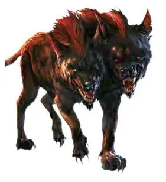

# Cão da Morte

## Bloco de estatísticas: Cão da Morte

*Monstruosidade Média, neutro e mau*

**Classe de Armadura** 12  
**Pontos de Vida** 39 (6d8 + 12)  
**Deslocamento** 12 m

| FOR | DES | CON | INT | SAB | CAR |
| :---: | :---: | :---: | :---: | :---: | :---: |
| 15 (+2) | 14 (+2) | 14 (+2) | 3 (–4) | 13 (+1) | 6 (–2) |

**Perícias** Furtividade +4, Percepção +5  
**Sentidos** visão no escuro 36 m, Percepção passiva 15  
**Idiomas** –  
**Nível de Desafio** 1 (200 XP)

***Duas Cabeças***. O cão tem vantagem e testes de Sabedoria (Percepção) e em testes de resistência contra ser amedrontado, atordoado, cegado, enfeitiçado, ensurdecido ou derrubado inconsciente.

### Ações

***Ataques Múltiplos***. O cão realiza dois ataques de mordida.

***Mordida***. *Ataque Corpo-a-Corpo com Arma*: +4 para atingir, alcance 1,5 m, um alvo. *Acerto*: 5 (1d6 + 2) de dano perfurante. Se o alvo for uma criatura, ele deve ser bem sucedido num teste de resistência de Constituição CD 12 contra doença, ou ficará envenenado até a doença ser curada. A cada 24 horas passadas, a criatura deve repetir o teste de resistência, reduzindo seu máximo de pontos de vida em 5 (1d10) se fracassar. Essa redução dura até a doença ser curada. A criatura morre se a doença reduzir seu máximo de pontos de vida a 0.

O **cão da morte** é um cão horrendo de duas cabeças que vaga por planícies, desertos e pelo Subterrâneo. O ódio queima no coração de um cão da morte e o gosto pela carne humanoide o leva a atacar viajantes e exploradores. A saliva do cão da morte carrega uma doença medonha que faz com que a carne da vítima apodreça lentamente, soltando-se dos ossos.
