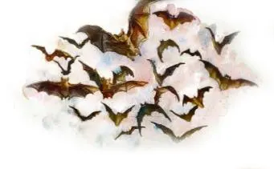

# Enxame de Piranhas

## Bloco de estatísticas: Enxame de Piranhas

*Enxame Médio de bestas Miúdas, imparcial*

**Classe de Armadura** 13  
**Pontos de Vida** 28 (8d8 – 8)  
**Deslocamento** 0 m, natação 12 m

| FOR | DES | CON | INT | SAB | CAR |
| :---: | :---: | :---: | :---: | :---: | :---: |
| 13 (+1) | 16 (+3) | 9 (–1) | 1 (–5) | 7 (–2) | 2 (–4) |

**Resistência a Dano** concussão, cortante, perfurante  
**Imunidade a Condição** agarrado, amedrontado, atordoado, caído, enfeitiçado, impedido, paralisado, petrificado  
**Sentidos** visão no escuro 18 m, Percepção passiva 8  
**Idiomas** –  
**Nível de Desafio** 1 (200 XP)

***Frenesi de Sangue***. O enxame tem vantagem nas jogadas de ataque corpo-a-corpo contra qualquer criatura que não esteja com todos os seus pontos de vida.

***Respirar na Água.*** O enxame pode respirar apenas em baixo d’água.

***Enxame.*** O enxame pode ocupar o espaço de outra criatura e vice-versa, e o enxame pode se mover através de qualquer abertura grande o suficiente para uma piranha Miúda. O enxame não pode recuperar pontos de vida ou ganhar pontos de vida temporários.

### Ações

***Mordidas***. *Ataque Corpo-a-Corpo com Arma*: +5 para atingir, alcance 0 m, uma criatura no espaço do enxame. *Acerto*: 14 (4d6) de dano perfurante, ou 7 (2d6) de dano perfurante se o enxame estiver com metade de seus pontos de vida ou menos.
