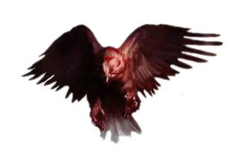

# Escorpião

## Bloco de estatísticas: Escorpião

*Besta Miúda, imparcial*

**Classe de Armadura** 11 (armadura natural)  
**Pontos de Vida** 1 (1d4 – 1)  
**Deslocamento** 3 m

| FOR | DES | CON | INT | SAB | CAR |
| :---: | :---: | :---: | :---: | :---: | :---: |
| 2 (–4) | 11 (+0) | 8 (–1) | 1 (–5) | 8 (–1) | 2 (–4) |

**Sentidos** percepção às cegas 3 m, Percepção passiva 9  
**Idiomas** –  
**Nível de Desafio** 0 (10 XP)

### Ações

***Ferrão***. *Ataque Corpo-a-Corpo com Arma*: +2 para atingir, alcance 1,5 m, uma criatura. *Acerto*: 1 de dano perfurante e o alvo deve realizar um teste de resistência de Constituição CD 9, sofrendo 4 (1d8) de dano de veneno se fracassar na resistência, ou metade desse dano se obtiver sucesso.
