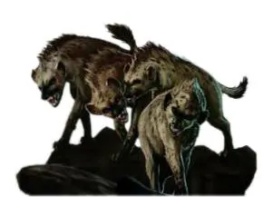

# Gorila Gigante

## Bloco de estatísticas: Gorila Gigante

*Besta Enorme, imparcial*

**Classe de Armadura** 12  
**Pontos de Vida** 157 (15d12 + 60)  
**Deslocamento** 12 m, escalada 12 m

| FOR | DES | CON | INT | SAB | CAR |
| :---: | :---: | :---: | :---: | :---: | :---: |
| 23 (+6) | 14 (+2) | 18 (+4) | 7 (–2) | 12 (+1) | 7 (–2) |

**Perícias** Atletismo +9, Percepção +4  
**Sentidos** Percepção passiva 14  
**Idiomas** –

**Nível de Desafio** 7 (2.900 XP)

### Ações

***Ataques Múltiplos***. O gorila realiza dois ataques de punho.

***Punho***. *Ataque Corpo-a-Corpo com Arma*: +9 para atingir, alcance 3 m, um alvo. *Acerto*: 22 (3d10 + 6) de dano de concussão.

***Rocha***. *Ataque à Distância com Arma*: +9 para atingir, distância 15/30 m, um alvo. *Acerto*: 30 (7d6 + 6) de dano de concussão.
