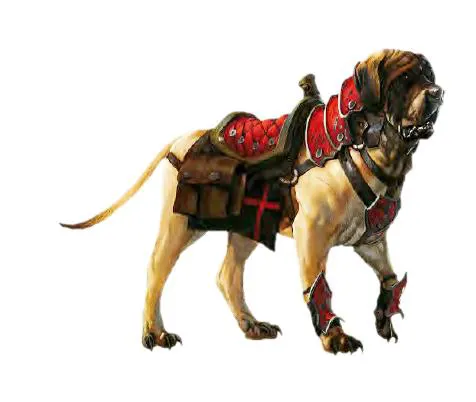

# Lobo Invernal

## Bloco de estatísticas: Lobo Invernal

*Monstruosidade Grande, neutro e mau*

**Classe de Armadura** 13 (armadura natural)  
**Pontos de Vida** 75 (10d10 + 20)  
**Deslocamento** 15 m

| FOR | DES | CON | INT | SAB | CAR |
| :---: | :---: | :---: | :---: | :---: | :---: |
| 18 (+4) | 13 (+1) | 14 (+2) | 7 (–2) | 12 (+1) | 8 (–1) |

**Perícias** Furtividade +3, Percepção +5  
**Imunidade à Dano** frio  
**Sentidos** Percepção passiva 15  
**Idiomas** Comum, Gigante, Lobo Invernal  
**Nível de Desafio** 3 (700 XP)

***Audição e Faro Aguçados***. O lobo tem vantagem em testes de Sabedoria (Percepção) relacionados à audição e ao olfato.

***Camuflagem de Neve***. O lobo tem vantagem em testes de Destreza (Furtividade) feitos em terrenos de neve.

***Táticas de Matilha***. O lobo tem vantagem nas jogadas de ataque contra uma criatura se, pelo menos, um dos aliados do lobo estiver a 1,5 metro da criaturas e não estiver incapacitado.

### Ações

***Mordida***. *Ataque Corpo-a-Corpo com Arma*: +6 para atingir, alcance 1,5 m, um alvo. *Acerto*: 11 (2d6 + 4) de dano perfurante. Se o alvo for uma criatura, ela deve ser bem sucedida num teste de resistência de Força CD 14 ou será derrubada no chão.

***Sopro Congelante (Recarrega 5–6)***. O lobo expele um jato de vento congelante num cone de 4,5 metros. Cada criatura na área deve realizar um teste de resistência de Destreza CD 12, sofrendo 18 (4d8) de dano de frio caso fracasse, ou metade desse dano caso obtenha sucesso.

O **lobo invernal** habita no ártico e é tão grande quanto um lobo atroz, mas possui pelagem branca como a neve e olhos azuis-claros. Os gigantes do gelo usam essas criaturas malignas como guardas e companheiros de caça, usando a arma de sopro mortal dos lobos contra seus adversários. Os lobos invernais se comunicam entre si usando grunhidos e latidos, mas eles falam Comum e Gigante bem o suficiente para realizar conversações simples.
