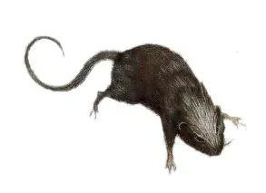

# Rato Gigante

## Bloco de estatísticas: Rato Gigante

*Besta Pequena, imparcial*

**Classe de Armadura** 12  
**Pontos de Vida** 7 (2d6)  
**Deslocamento** 9 m

| FOR | DES | CON | INT | SAB | CAR |
| :---: | :---: | :---: | :---: | :---: | :---: |
| 7 (–2) | 15 (+2) | 11 (+0) | 2 (–4) | 10 (+0) | 4 (–3) |

**Sentidos** visão no escuro 18 m, Percepção passiva 10  
**Idiomas** –  
**Nível de Desafio** 1/8 (25 XP)

***Faro Aguçado***. O rato tem vantagem em testes de Sabedoria (Percepção) relacionados ao olfato.

***Táticas de Matilha***. O rato tem vantagem nas jogadas de ataque contra uma criatura se, pelo menos, um dos aliados do rato estiver a 1,5 metro da criaturas e não estiver incapacitado.

### Ações

***Mordida***. *Ataque Corpo-a-Corpo com Arma*: +4 para atingir, alcance 1,5 m, um alvo. *Acerto*: 4 (1d4 + 2) de dano perfurante.

### Variação: Rato Gigante Infectado

Alguns ratos gigantes carregam doenças vis que eles podem transmitir através de suas mordidas. Um rato gigante infectado possui nível de desafio 1/8 (25 XP) e a seguinte ação, ao invés de seu ataque de mordida normal.

***Mordida***. *Ataque Corpo-a-Corpo com Arma*: +4 para atingir, alcance 1,5 m, um alvo. *Acerto*: 4 (1d4 + 2) de dano perfurante. Se o alvo for uma criatura, ele deve ser bem sucedido num teste de resistência de Constituição CD 10 ou contrairá uma doença. Até a doença ser curada, o alvo não pode recuperar pontos de vida, exceto por meios mágicos, e o máximo de pontos de vida do alvo é reduzido em 3 (1d6) a cada 24 horas. Se o máximo de pontos de vida do alvo cair a 0 com resultado dessa doença, ele morre.
