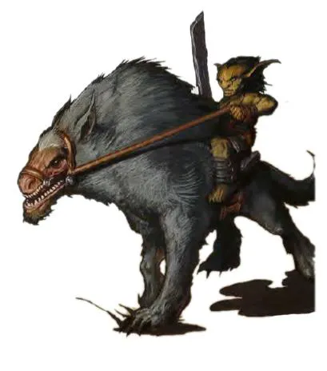

# Vespa Gigante

## Bloco de estatísticas: Vespa Gigante

*Besta Média, imparcial*

**Classe de Armadura** 12  
**Pontos de Vida** 13 (3d8)  
**Deslocamento** 3 m, voo 15 m

| FOR | DES | CON | INT | SAB | CAR |
| :---: | :---: | :---: | :---: | :---: | :---: |
| 10 (+0) | 14 (+2) | 10 (+9) | 1 (–5) | 10 (+0) | 3 (–4) |

**Sentidos** Percepção passiva 10  
**Idiomas** –  
**Nível de Desafio** 1/2 (100 XP)

### Ações

***Ferrão***. *Ataque Corpo-a-Corpo com Arma*: +4 para atingir, alcance 1,5 m, uma criatura. *Acerto*: 5 (1d6 + 2) de dano perfurante e o alvo deve realizar um teste de resistência de Constituição CD 11, sofrendo 10 (3d6) de dano de veneno se fracassar na resistência, ou metade desse dano se obtiver sucesso. Se o veneno reduzir os pontos de vida do alvo a 0, ele fica estável mas envenenado por 1 hora, mesmo após recuperar pontos de vida, e fica paralisado enquanto estiver envenenado dessa forma.
