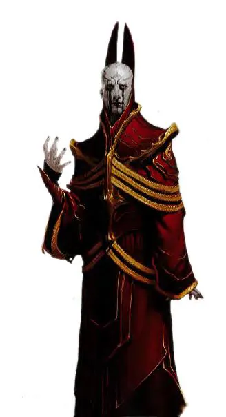

# Arquimago

## Bloco de estatísticas: Arquimago

*Humanoide Médio (qualquer raça), qualquer tendência*

**Classe de Armadura** 12 (15 com *armadura arcana*)  
**Pontos de Vida** 99 (18d8 + 18)  
**Deslocamento** 9 m

| FOR | DES | CON | INT | SAB | CAR |
| :---: | :---: | :---: | :---: | :---: | :---: |
| 10 (+0) | 14 (+2) | 12 (+1) | 20 (+5) | 15 (+2) | 16 (+3) |

**Testes de Resistência** Int +9, Sab +6  
**Perícias** Arcanismo +13, História +13  
**Resistência a Dano** dano de magias; concussão, cortante e perfurante não-mágico (devido a *pele de pedra*)  
**Sentidos** Percepção passiva 12  
**Idiomas** seis idiomas quaisquer  
**Nível de Desafio** 12 (8.400 XP)

***Conjuração***. O arquimago é um conjurador de 18° nível. Sua habilidade de conjuração é Inteligência (CD de resistência de magia 17, +9 para atingir com ataques com magia). Ele possui as seguintes magias de mago preparadas:

Truques (à vontade): *mãos mágicas, luz, prestidigitação, raio de* *fogo, toque chocante* 1° nível (4 espaços): *armadura arcana*, detectar magia, escudo* *arcano, mísseis mágicos* 2° nível (3 espaços): *detectar pensamentos, identificação, névoa* *obscurecente* 3° nível (3 espaços): *contramágica, relâmpago, voo* 4° nível (3 espaços): *banimento, escudo de fogo, pele de pedra** 5° nível (3 espaços): *cone de frio, muralha de energia, vidência* 6° nível (1 espaços): *globo de invulnerabilidade* 7° nível (1 espaços): *teletransporte* 8° nível (1 espaços): *limpar a mente** 9° nível (1 espaços): *parar o tempo*

**O arquimago conjura essas magias sobre si antes do combate.*

***Resistência à Magia***. O arquimago tem vantagem em testes de resistência contra magias e outros efeitos mágicos.

### Ações

***Adaga***. *Ataque Corpo-a-Corpo ou à Distância com Arma*: +6 para atingir, alcance 1,5 m ou distância 6/18 m, um alvo. *Acerto*: 4 (1d4 + 2) de dano perfurante.

**Arquimagos** são poderosos (e geralmente bem velhos) conjuradores dedicados ao estudo das artes arcanas. Os benévolos aconselham reis e rainhas, enquanto os malignos fazem o papel de tiranos e perseguem o caminho do lich. Aqueles que não são nem bons nem maus se enfurnam em torres remotas para praticar suas mágicas sem interrupção.

Um arquimago geralmente tem um ou mais arcanos aprendizes e a residência de um arquimago possui diversas proteções e guardiões mágicos para desencorajar os invasores.
