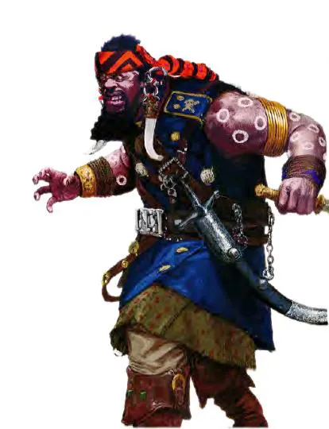

# Cavaleiro

## Bloco de estatísticas: Cavaleiro

*Humanoide Médio (qualquer raça), qualquer tendência*

**Classe de Armadura** 18 (placas)  
**Pontos de Vida** 52 (8d8 + 16)  
**Deslocamento** 9 m

| FOR | DES | CON | INT | SAB | CAR |
| :---: | :---: | :---: | :---: | :---: | :---: |
| 16 (+3) | 11 (+0) | 14 (+2) | 11 (+0) | 11 (+0) | 15 (+2) |

**Testes de Resistência** Con +4, Sab +2  
**Sentidos** Percepção passiva 10  
**Idiomas** um idioma qualquer (geralmente Comum)  
**Nível de Desafio** 3 (700 XP)

***Bravura***. O cavaleiro tem vantagem em testes de resistência para não ser amedrontado.

### Ações

***Ataques Múltiplos***. O cavaleiro realiza dois ataques corpo-a-corpo.

***Espada Grande***. *Ataque Corpo-a-Corpo com Arma*: +5 para atingir, alcance 1,5 m, um alvo. *Acerto*: 10 (2d6 + 3) de dano cortante.

***Besta Pesada***. *Ataque à Distância com Arma*: +2 para atingir, distância 30/120 m, um alvo. *Acerto*: 5 (1d10) de dano perfurante.

***Liderança (Recarrega após um Descanso Curto ou Longo)***. Por 1 minuto, o cavaleiro pode proferir um comando ou aviso especial para que qualquer criatura não-hostil que ele possa ver, a até 9 metros dele, realize uma jogada de ataque ou um teste de resistência. A criatura pode adicionar um d4 a jogada, considerando que ela possa ouvir e compreender o cavaleiro. Uma criatura pode ser beneficiada por apenas um dado de Liderança por vez. Esse efeito termina se o cavaleiro estiver incapacitado.

### Reações

***Aparar***. O cavaleiro adiciona 2 à sua CA contra um ataque corpo-a-corpo que poderia atingi-lo. Para tanto, o cavaleiro deve poder ver o atacante e estar empunhando uma arma corpo-a-corpo.

**Cavaleiros** são guerreiros que juraram servir governantes, ordens religiosas e causas nobres. A tendência de um cavaleiro determina até onde esse compromisso é honrado. Se realiza uma busca ou se patrulha um reino, um cavaleiro, muitas vezes, viaja com uma comitiva composta de escudeiros e mercenários que são plebeus.
