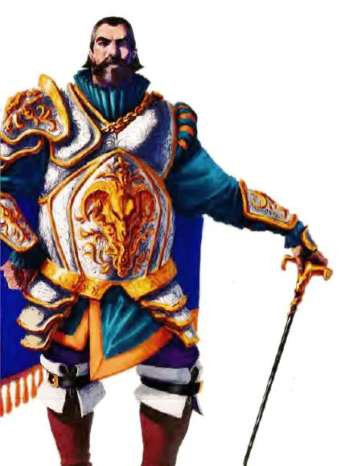

# Guerreiro Tribal

## Bloco de estatísticas: Guerreiro Tribal

*Humanoide Médio (qualquer raça), qualquer tendência*

**Classe de Armadura** 12 (gibão de peles)

**Pontos de Vida** 11 (2d8 + 2)  
**Deslocamento** 9 m

| FOR | DES | CON | INT | SAB | CAR |
| :---: | :---: | :---: | :---: | :---: | :---: |
| 13 (+1) | 11 (+0) | 12 (+1) | 8 (–1) | 11 (+0) | 9 (–1) |

**Sentidos** Percepção passiva 10  
**Idiomas** um idioma qualquer (geralmente Comum)  
**Nível de Desafio** 1/8 (25 XP)

***Táticas de Matilha***. O guerreiro tem vantagem nas jogadas de ataque contra uma criatura se, pelo menos, um dos aliados do guerreiro estiver a 1,5 metro da criaturas e não estiver incapacitado.

### Ações

***Lança***. *Ataque Corpo-a-Corpo ou à Distância com Arma*: +3 para atingir, alcance 1,5 m e distância 6/18 m, um alvo. *Acerto*: 4 (1d6 + 1) de dano perfurante, ou 5 (1d8 + 1) de dano perfurante se for usada com as duas mãos para realizar ataques corpo-a-corpo.

**Guerreiros tribais** vivem à margem da civilização, a maioria, frequentemente, subsistem da pesca e caça. Cada tribo age de acordo com os desejos do seu líder, que é o maior ou mais velho guerreiro da tribo, ou um membro da tribo abençoado pelos deuses.
