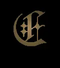
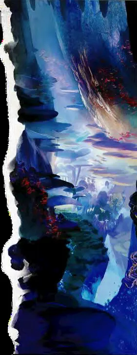
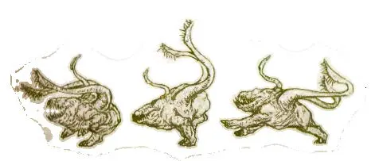
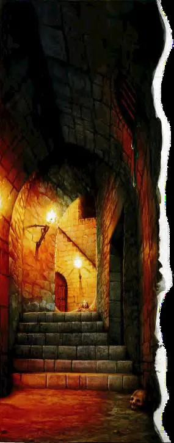

# Introdução

## Introdução

STE BESTIÁRIO É PARA CONTADORES DE HISTÓRIAS e criadores de mundos. Se você já pensou em mestrar um jogo de DUNGEONS & DRAGONS para seus amigos, mesmo uma única noite de aventura ou uma campanha duradoura, este tomo contém páginas e páginas de inspiração. É a sua loja de departamentos para construção tanto de criaturas malignas, quando benignas.

Algumas das criaturas que habitam os mundos de D&D possuem suas origens enraizadas na mitologia e literatura fantástica do mundo real. Outras criaturas são originais de D&D. Os monstros neste livro foram coletados de todas as edições anteriores do jogo. Aqui você encontrará bichos clássicos como o observador e a besta deslocadora assim como criaturas mais recentes como o chuul e ramo infectado. Bestas familiares se misturam com bestas estranhas, terríveis e grotescas. Na coletânea de monstros do passado, nós nos esforçamos para refletir a natureza multifacetada do jogo, com verrugas e tudo. Os monstros de D&D vem em todos os formatos e tamanhos, com histórias que não apenas nos arrepiam mas também nos fazem rir.

Se você for um Mestre experiente, alguns monstros descritos adiante podem surpreender você, já que nós consultamos os Manuais dos Monstros de outrora e inserimos factoides há muito esquecidos. Nós também adicionamos alguns fatos novos. Naturalmente, você pode fazer com estes monstros o que quiser. Nada do que dizemos aqui tem a intenção de reprimir sua criatividade. Se os minotauros no seu mundo são construtores de barcos e piratas, quem somos nós para questionar? É o seu mundo, no fim das contas.

## Como Usar Este Livro

A melhor coisa sobre ser um Mestre é que você pode inventar seu próprio mundo de fantasia e dar vida a ele e nada dá mais vida a um mundo de D&D que as criaturas que o habitam. Você pode ler a descrição de um monstro e se animar para criar uma aventura que gira em torno dele, ou você pode ter uma ideia incrível para uma masmorra e precise apenas dos monstros certos para povoa-la. É ai que o *Manual dos Monstros* entra.

O Manual dos Monstros é um dos três livros que forma a fundação do jogo de DUNGEONS & DRAGONS, os outros dois são o *Livro do Jogador* e o *Guia do Mestre*. O *Livro* *dos Monstros*, assim como o *Guia do Mestre*, são livros para os Mestres. Use-o para povoar suas aventuras de D&D com goblins traquinas, trogloditas fétidos, orcs selvagens e poderosos dragões além de uma verdadeira horda de seres rastejantes.

Instruções para criar encontros com monstros podem ser encontradas no *Guia do Mestre*. Aquele livro também contém tabelas de monstros errantes e outras maravilhas para ajudar você a usar os monstros neste livro de formas interessantes, assim como conselhos para modificar monstros e criar seus próprios.

Se você nunca mestrou uma aventura de D&D antes, nós recomendamos que você adquira o *Conjunto para* *Iniciantes de* DUNGEONS & DRAGONS, que demonstra como pegar uma porção de monstros e construir uma excitante aventura envolvendo-os.

## O Que É um Monstro

Um monstro é definido como qualquer criatura com que se possa interagir e potencialmente lutar e matar. Até algo tão inofensivo quanto um sapo ou tão benigno quanto um unicórnio é um monstro por definição. O termo também se aplica a humanos, elfos, anões e outros povos civilizados que pode ser aliados ou rivais dos personagens dos jogadores. A maioria dos monstros que atormentam os mundos de D&D, no entanto, são ameaças que devem ser impedidas: demônios tempestuosos, diabos coniventes, mortos-vivos sugadores de almas, elementais invocados – a lista continua.

Este livro contém monstros de todos os níveis prontos para jogar e fáceis de levar, e para quase todos os climas e terrenos imagináveis. Independentemente de sua aventura ser ambientada num pântano, masmorra ou nos outros planos de existência, existem criaturas neste livro para povoar esses ambientes.

### Onde os Monstros Habitam

Se você for novo no jogo de D&D, talvez não esteja familiarizado com os lugares estranhos e maravilhosos onde monstros podem ser encontrados e confrontados.

### Masmorras

Quando a maioria das pessoas pensam numa masmorra, imagens de celas escuras com barras de ferro e algemas vem à mente. No jogo de D&D, a palavra “masmorra” adquire um sentido mais amplo para incluir qualquer local fechado infestado de monstros. A maioria das masmorras se espalham em complexos subterrâneos. Aqui vão alguns outros exemplos:

- Uma torre de um mago abandonada no topo de uma colina solitária crivada por túneis infestados de goblins
- Uma pirâmide de faraó cheia de criptas assombradas com câmaras de tesouro secretas
- Uma cidade perdida na selva, envolta por vinhas e invadida por demônios e cultistas adoradores de demônios
- A tumba congelada de um rei gigante do gelo
- Um sistema de esgoto labiríntico, imundo, controlado por uma gangue de homens-rato.

### O Subterrâneo

Não existe masmorra maior que o Subterrâneo, o mundo inferior abaixo da superfície do mundo. Ele é um vasto reino subterrâneo onde monstros acostumados com a escuridão residem. Ele é um lugar cheio de cavernas escuras conectadas por túneis que levam sempre para baixo. Alguém poderia gastar a vida inteira (porém breve!) explorando o Subterrâneo e encontraria lugares como os seguintes:

- A prisão ou asilo de um devorador de mentes, cheia de escravos descerebrados e lunáticos delirantes
- Uma necrópole anã perdida contendo linhas e linhas de tumbas empoeiradas esperando para serem saqueadas
- Um posto de vigia fortificado cercado por armamentos, guardando a passagem para uma magnifica cidade drow
- Uma fenda subterrânea cheia de fungos gigantes e governada por um observador megalomaníaco ou um rei fomori

- Uma cadeia de ilhas rochosas em um vasto mar sem sol, casa de aboletes e kuo-toas insanos

### O Ambiente Selvagem

Nem todos os monstros espreitam no subterrâneo. Muitos deles habitam desertos, montanhas, pântanos, desfiladeiros, florestas e outros ambientes naturais. O ambiente selvagem pode ser tão perigoso quanto qualquer masmorra, particularmente quando não há onde se esconder! Alguns locais selvagens são tão memoráveis quanto qualquer masmorra:

- O ninho de um roca feito de cascos de navios despedaçados, construído no topo de uma montanha ou colina rochosa solitária
- Uma vasta tundra ártica que serve de território de caça para furiosos e yetis
- Uma floresta primitiva protegida por entes ou corrompida por gnolls adoradores de demônios
- Um pântano cheio de sapos, assombrado por um povo lagarto que venera um vil dragão negro
- Uma selva ilhada habitada por dinossauros e guerreiros tribais humanos

### Cidades e Vilas

Algumas das melhores aventuras desdobram-se sob o leito da civilização. Territórios urbanos propicia às aventuras chance de ficar ombro-a-ombro com os ricos e poderosos, bater de frente com a escória da sociedade e remover a máscara de civilidade para ver o monstruoso mal que espreita abaixo. Dentro de uma cidade ou vila medieval existem lugares tão mortais quanto em qualquer masmorra:

- Uma torre de relógio que serve como base para uma guilda de ladinos e assassinos kenkus
- Um covil de escravistas escondido em um orfanato controlado por uma rakshasa disfarçado como diretor
- Uma academia de magos infestada por corrupção e praticantes das artes necromânticas
- Um feudo nobre onde ricos cultistas adoradores de diabos se reúnem para realizar sacrifícios
- Um templo, sepultura ou museu vigiado dia e noite por constructos animados

### Ambiente Submerso

Nem todas as aventuras acontecem em terra firme. Este livro traz à tona diversas criaturas que assombram os oceanos do mundo, desde os diabólicos sahuagin até os pacíficos elfos aquáticos odiados por eles. Dentro deste domínio aquático estão muitos locais de aventura surpreendentes:

- Um cemitério submerso de navios infestado por tubarões, carniçais aquáticos e fantasmas raivosos
- O castelo de coral de um gigante da tempestade, lindo, porém, perigoso
- Uma cidade perdida no fundo do mar, envolta por uma bolha de ar mágica e comandada por uma rainha medusa
- Uma caverna de kraken ou o covil cavernoso de um dragão de bronze, cheio de tesouros ancestrais
- Um templo submerso de Sekolah, o deus maligno dos sahuagin

### Os Planos de Existência

O Abismo. Os Nove Infernos. A Cidade de Bronze. Tais locais distantes atraem aventureiros de alto nível para suas portas, desafiando os bravos e os temerários a derrotar seus mestres malignos e desvendar seus mistérios escondidos. Muitas criaturas poderosas e

estranhas vivem em outros planos de existência, desde os metódicos modrons até demônios homicidas. Quando se trata de locais interessantes para aventura, nem mesmo o céu é o limite quando você ultrapassa as barreiras do mundo:

- A fortaleza de um senhor das profundezas em Avernus, a primeira camada dos Nove Infernos
- Um castelo assombrado na Umbra que serve como covil de um dragão das sombras
- Uma tumba de uma rainha élfica em Faéria
- Um palácio de djinni no Plano Elemental do Ar, cheio de maravilhosos tesouros roubados
- O semiplano secreto de um lich, onde o arquimago morto-vivo esconde sua filactéria e grimório

Veja o *Guia do Mestre* para mais informações sobre os planos de existência.

### Quais Monstros Usar?

Muitos monstros habitam masmorras, enquanto outros vivem em desertos, florestas, labirintos e outros meio ambientes. Independentemente de qual meio ambiente um monstro tradicionalmente chama de casa, você pode colocá-lo onde quiser. No fim das contas, histórias de “peixe fora d’água” são memoráveis e, às vezes, é engraçado surpreender os jogadores com gricks escondidos nas areias do deserto ou uma dríade vivendo em um cogumelo gigante no Subterrâneo.

## Estatísticas

As estatísticas de um monstro, às vezes, se referem ao **bloco de estatísticas**, garantindo as informações essenciais que você precisa para controlar o monstro.

### Tamanho

Um monstro pode ser Miúdo, Pequeno, Médio, Grande, Enorme ou Imenso. A tabela Categorias de Tamanho mostra quanto espaço uma criatura de um tamanho em particular controla em combate. Veja o *Livro do Jogador* para mais informações sobre tamanho e espaço de criaturas.

> **Categorias de Tamanho**

| Tamanho | Espaço | Exemplos |
| --- | --- | --- |
| Miúdo | 0,75 m/0,75 m | Diabrete, sprite |
| Pequeno | 1,5 m/1,5 m | Rato gigante, goblin |
| Médio | 1,5 m/1,5 m | Orc, lobisomem |
| Grande | 3 m/3 m | Hipogrifo, ogro |
| Enorme | 4,5 m/4,5 m | Gigante do fogo, ente |
| Imenso | 6 m/6 m ou maior | Kraken, verme púrpura |

> **Modificando Criaturas**
>
> Apesar da versátil coletânea de monstros neste livro, você pode não encontrar a criatura perfeita para parte de uma aventura. Sinta-se à vontade para alterar uma criatura existente para torna-la em algo mais útil para você, talvez copiando uma ou duas características de um monstro diferente ou usando uma **variação** ou **modelo**, como os encontrados neste livro. Tenha em mente que modificar um monstro, incluindo quando você aplicar um modelo a ele, poderá alterar o nível de desafio do mesmo. Para conselhos de como personalizar criaturas e calcular o nível de desafio delas, veja o *Guia do Mestre*.

### Tipo

O tipo do monstro fala de sua natureza fundamental. Certas magias, itens mágicos, características de classe e outros efeitos no jogo interagem de formas especiais com criaturas de um tipo em particular. Por exemplo, uma *flecha assassina de dragões* causa dano extra não apenas em dragões, mas também em outras criaturas do tipo dragão, como tartarugas dragão e wyverns.

O jogo inclui os seguintes tipos de monstro, que não possuem regras próprias.

**Aberrações** são seres profundamente alienígenas. Muitas delas possuem habilidades mágicas inatas que vem da mente alienígena da criaturas e não das formas místicas do mundo. As aberrações quintessenciais são os aboletes, devoradores de mentes, observadores e slaads.

**Bestas** são criaturas não-humanoides que fazem parte da natureza da ecologia fantástica. Algumas delas possuem poderes mágicos, mas a maioria não possui inteligência e carece de qualquer sociedade ou idioma. As bestas incluem todas as variedades de animais ordinários, dinossauros e versões gigantes de animais.

**Celestiais** são criaturas nativas dos Planos Superiores. Muitos deles são servos de divindades, contratados como mensageiros ou agentes no reino mortal e em todos os planos. Os celestiais são bons por natureza, portanto, o celestial excepcional que extravia-se da tendência boa são terríveis raridades. Os celestiais incluem anjos, couatls e pégasos.

**Constructos** são construídos, não nascidos. Alguns são programados por seus criadores para seguirem um conjunto de instruções simples, enquanto outros são imbuídos de senciência e capacidade de pensamento independente. Os golens são os constructos icônicos. Muitas criaturas nativas do plano exterior de Mecânus, como os modrons, são constructos moldados a partir da matéria-prima do plano pela vontade de criaturas mais poderosas.

**Corruptores** são criaturas de perversidade que são nativas dos Planos Inferiores. Alguns são servos de divindades, mas a maioria trabalham sob a liderança de arquidiabos e príncipes demônios. Sacerdotes e magos malignos, às vezes, invocam corruptores para o mundo material para fazer seus pactos. Se um celestial maligno é raro, um corruptor bom é ainda mais incomum. Os corruptores incluem demônios, diabos, cães infernais, rakshasas e yugoloths.

**Dragões** são criaturas reptilianas grandes de origem antiga e poderes absurdos. Dragões verdadeiros, incluindo os dragões metálicos bons e os dragões cromáticos maus, são altamente inteligentes e possuem magia inata. Também estão nessa categoria criaturas remotamente relacionadas com os dragões verdadeiros, porém, menos poderosas, menos inteligentes e menos mágicas, como os wyverns e os pseudodragões.

**Elementais** são criaturas nativas dos planos elementais. Algumas criaturas deste tipo são não mais que apenas massas animadas dos seus respectivos elementos, incluindo as criaturas chamadas simplesmente de elementais. Outras possuem formas biológicas infundidas com energia elemental. As raças de gênios, incluindo os djinn e efreet, formam as civilizações mais importantes dos planos elementais. Outras criaturas elementais incluem os azers, caçadores invisíveis e anomalia da água.

**Fadas** são criaturas mágicas intimamente ligadas as forças da natureza. Elas habitam bosques crepusculares e florestas nebulosas. Em alguns mundos, elas são intimamente ligadas à Faéria, também chamada de Plano das Fadas. Algumas também são encontradas nos Planos Exteriores, particularmente nos planos de Arbórea e nas Terras Selvagens. As fadas incluem dríades, pixies e sátiros.

**Gigantes** são uma espécie similar a humanos extremamente altos. Eles são humanoides no formato, apesar de alguns terem múltiplas cabeças (ettins) ou deformações (fomoris). As seis variações de gigantes verdadeiros são os gigantes da colina, gigantes de pedra, gigantes do gelo, gigantes do fogo, gigantes das nuvens e gigantes da tempestade. Além desses, criaturas como ogros e trolls também são gigantes.

**Humanoides** são o povo padrão do mundo de D&D, tanto civilizado quanto selvagem, incluindo humanos e uma variedade tremenda de outras espécies. Eles possuem idioma e cultura, alguns poucos algumas habilidades mágicas inatas (apesar de a maioria dos humanoides ser capaz de aprender a conjurar) e uma forma bípede. As raças de humanoides mais comuns são as mais adequadas para serem personagens de jogador: humanos, anões, elfos e halflings. Quase tão numerosos, mas muito mais selvagens e brutais e, em sua maioria uniformemente malignos, são as raças de goblinoides (goblins, hobgoblins e bugbears), orcs, gnolls, povo lagarto e kobolds.

Uma variedade de humanoides aparece ao decorrer de todo este livro, mas as raças detalhadas no *Livro do* *Jogador* – com exceção do drow – são tratadas no apêndice B. Esse apêndice dá a você uma quantidade de blocos de estatísticas que você pode usar para fazer vários membros de outras raças.

**Limos** são criaturas gelatinosas que raramente possuem uma forma fixa. Eles são na maioria subterrâneos, habitando em cavernas e masmorras e se alimentando de restos, carniça ou criaturas azaradas o suficiente para ficarem em seus caminhos. Pudins negros e cubos gelatinosos estão dentre os limos mais reconhecíveis.

**Monstruosidades** são monstros no estrito senso – criaturas apavorantes que não são comuns, nem verdadeiramente naturais e quase nunca benignos. Alguns são resultado de experimentos mágicos que deram errado (como os ursos-coruja) e outros são produto de maldições terríveis (incluindo os minotauros e yuan-ti). Eles desafiam a categorização e, de certa forma, servem como categoria base para criaturas que não se encaixam em qualquer outro tipo.

**Mortos-vivos** foram uma vez criaturas vivas levados a um estado horrendo de morte-vida através da pratica de magia necromântica ou alguma maldição profana. Os mortos-vivos incluem corpos ambulantes, como vampiros e zumbis, assim como espíritos desencarnados, como fantasmas e espectros.

**Plantas**, no contexto, são criaturas vegetais, não flora ordinária. Muitas delas são ambulantes e algumas são carnívoras. As plantas quintessenciais são o arbusto errante e a ente. Criaturas fúngicas como o esporo de gás e o miconide também fazem parte dessa categoria.

### Descritor

Um monstro pode ter um ou mais descritores anexados ao seu tipo, entre parênteses. Por exemplo, um orc tem o tipo *humanoide (orc).* O descritor entre parênteses concede categorização adicional para certas criaturas. Os descritores não possuem regras próprias, mas algumas vezes no jogo, algum item mágico pode se referir a eles. Por exemplo, uma lança que seja especialmente eficiente na luta contra demônios poderia funcionar contra qualquer monstro que possua o descritor demônio.

### Tendência

A tendência de um monstro confere uma dica da disposição dele e de como ele se comporta em uma interação ou situação de combate. Por exemplo, um monstro caótico e mau pode ser difícil de se argumentar e deverá atacar os personagens à primeira vista, enquanto que um monstro neutro pode estar propenso a negociação. Veja o *Livro do Jogador* para descrições das diferentes tendências.

A tendência especificada no bloco de estatísticas de um monstro é a padrão. Sinta-se à vontade para afastar-se e mudar a tendência de um monstro para atender às necessidades da sua campanha. Se você deseja um dragão verde de tendência boa ou um gigante da tempestade mau, não existe nada que possa impedi-lo.

Algumas criaturas podem ter **qualquer tendência**. Em outras palavras, você escolhe a tendência do monstro. A linha tendência de alguns monstros indica uma propensão ou aversão à lei, caos, bem ou mal. Por exemplo, um furioso pode ter qualquer tendência caótica (caótico e bom, caótico e neutro ou caótico e mau), o que retrata sua natureza selvagem.

Muitas criaturas de baixa inteligência não possuem compreensão de lei ou ordem, bem ou mal. Elas não fazem escolhas éticas ou morais, ao invés disso, agem por instinto. Essas criaturas são **imparciais**, o que significa que elas não possuem uma tendência.

### Classe de Armadura

Um monstro que vista uma armadura ou carregue um escudo tem uma Classe de Armadura (CA) que leva sua armadura, escudo e Destreza em consideração. Do contrário, a CA de um monstro é baseada no seu modificador de Destreza e armadura natural, se possuir. Se um monstro tiver armadura natural, vestir armadura ou carregar um escudo, isso será descrito entre parênteses após o valor de CA dele.

### Pontos de Vida

Um monstro geralmente morre ou é destruído quando cai a 0 pontos de vida. Para mais sobre pontos de vida, veja o *Livro do Jogador*.

Os pontos de vida de um monstro são apresentados tanto numa expressão de dado quanto num valor numérico. Por exemplo, um monstro com 2d8 pontos de vida tem 9 pontos de vida na média (2 x 4½).

O tamanho de um monstro determina o dado usado para calcular seus pontos de vida, como mostrado na tabela Dado de Vida por Tamanho.

> **Pontos de Vida por Tamanho**

| Tamanho | Dado de Vida | PV Médio por Dado |
| --- | --- | --- |
| Miúdo | d4 | 2½ |
| Pequeno | d6 | 3½ |
| Médio | d8 | 4½ |
| Grande | d10 | 5½ |
| Enorme | d12 | 6½ |
| Imenso | d20 | 10½ |

O modificador de Constituição de um monstro também afeta o valor de pontos de vida que ele tem. Seu modificador é multiplicado pela quantidade de Dados de Vida que ele possui e o resultado é adicionado aos seus pontos de vida. Por exemplo, se um monstro tiver Constituição 12 (+1 de modificador) e 2d8 Dados de Vida, ele terá 2d8 + 2 pontos de vida (média 11).

### Deslocamento

O deslocamento de um monstro diz a você o quão longe ele pode se mover no turno dele. Para mais informações sobre deslocamento, veja o *Livro do Jogador*.

Todas as criaturas possuem um deslocamento de caminhada, chamado simplesmente de deslocamento do monstro. Criaturas que não possuírem uma forma de locomoção terrestre terão deslocamento de caminhada de 0 metros.

Algumas criaturas possuem um ou mais dos seguintes modos de deslocamento adicionais.

### Escavação

Um monstro que possua deslocamento de escavação pode usar seu deslocamento para se mover através de areia, terra, lama ou gelo. Um monstro não pode escavar através de rocha sólida, a não ser que ele tenha uma característica especial que o permita fazê-lo.

### Escalada

Um monstro que possua deslocamento de escalada pode usar todo ou parte do seu movimento para se mover em superfícies verticais. O monstro não precisa gastar movimento extra para escalar.

### Voo

Um monstro que possua deslocamento de voo pode usar todo ou parte do seu movimento para voar. Alguns monstros tem a habilidade de **planar**, o que os torna difíceis de derrubar no ar (como explicador nas regras de voo do *Livro do Jogador*). Tais monstros param de planar quando morrem.

### Natação

Um monstro que possua deslocamento de natação não precisa gastar movimento extra para nadar.

### Valores de Habilidade

Cada monstro possui seis valores de habilidade (Força, Destreza, Constituição, Inteligência, Sabedoria e Carisma) e seus modificadores correspondentes. Para mais informações sobre valores de habilidade e como eles são usados em jogo, veja o *Livro do Jogador*.

### Testes de Resistência

A linha Testes de Resistência é reservada a criaturas que são propensas a resistirem a certos tipos de efeitos. Por exemplo, uma criatura que não seja facilmente enfeitiçada ou amedrontada poderia receber um bônus em testes de resistência de Sabedoria. A maioria das criaturas não possuem bônus especiais em testes de resistência, em tais casos, essa seção é suprimida.

Um bônus de um teste de resistência é a soma do modificador de habilidade relevante do monstro e seu bônus de proficiência, que é determinado pelo nível de desafio do monstro (como mostrado na tabela Bônus de Proficiência por Nível de Desafio).

> **Bônus de Proficiência por Nível de Desafio**

**Bônus de** — **Bônus de**

| Desafio | Proficiência | Desafio | Proficiência |
| --- | --- | --- | --- |
| 0 | +2 | 14 | +5 |
| 1/8 | +2 | 15 | +5 |
| 1/4 | +2 | 16 | +5 |
| 1/2 | +2 | 17 | +6 |
| 1 | +2 | 18 | +6 |
| 2 | +2 | 19 | +6 |
| 3 | +2 | 20 | +6 |
| 4 | +2 | 21 | +7 |
| 5 | +3 | 22 | +7 |
| 6 | +3 | 23 | +7 |
| 7 | +3 | 24 | +7 |
| 8 | +3 | 25 | +8 |
| 9 | +4 | 26 | +8 |
| 10 | +4 | 27 | +8 |
| 11 | +4 | 28 | +8 |
| 12 | +4 | 29 | +9 |
| 13 | +5 | 30 | +9 |

### Perícias

A linha Perícias é reservada para monstros que sejam proficientes em uma ou mais perícias. Por exemplo, um monstro que seja muito perceptivo e furtivo deve ter bônus em testes de Sabedoria (Percepção) e Destreza (Furtividade).

Um bônus de perícia é a soma do modificador de habilidade relevante do monstro e seu bônus de proficiência, que é determinado pelo nível de desafio do monstro (como mostrado na tabela Bônus de Proficiência por Nível de Desafio). Outros modificadores podem ser aplicados. Por exemplo, um monstro pode ter um bônus acima do esperado (geralmente o dobro do bônus de proficiência dele) para representar o alto grau de especialização dele.

### Vulnerabilidades, Resistências

### E Imunidades

Algumas criaturas possuem vulnerabilidade, resistência ou imunidade a certos tipos de dano. Criaturas em particular possuem resistência ou imunidade até mesmo a dano de ataques não-mágicos (um ataque mágico é um ataque desferido por uma magia, um item mágico ou outra fonte mágica). Adicionalmente, algumas criaturas são imunes a certas condições.

### Sentidos

A linha Sentidos descreve o valor de Sabedoria (Percepção) passiva, assim como quaisquer sentidos especiais que o monstro possa ter. Sentidos especiais são descritos abaixo.

### Percepção Às Cegas

Um monstro com percepção às cegas pode perceber seus arredores sem depender de visão dentro de um raio específico.

Criaturas sem olhos, como grimlocks e limos cinzentos, geralmente possuem esse sentido especial, assim como criaturas com eco localização ou sentidos aguçados, como morcegos e dragões verdadeiros.

Se um monstro for naturalmente cego, ele terá uma nota entre parênteses nesse efeito, indicando que o raio da sua percepção às cegas define o alcance máximo da percepção dele.

> **Proficiências em Armadura, Arma e Ferramenta**
>
> Considera-se que uma criatura é proficiente com sua armadura, armas e ferramentas. Se você troca-las, você decide se a criatura será proficiente com seu novo equipamento. Por exemplo, um gigante da colina, geralmente não veste qualquer armadura e empunha uma clava grande. Você poderia equipar o gigante da colina com uma cota de malha e um machado grande no lugar e assumir que o gigante é proficiente com ambos, um ou o outro, ou nenhum. Veja o *Livro do Jogador* para regras sobre o uso de armadura ou armas sem proficiência.

### Visão no Escuro

Um monstro com visão no escudo pode ver na escuridão dentro de um raio especifico. O monstro pode ver na penumbra dentro do raio como se estivesse sob luz plena e na escuridão como se estivesse na penumbra. O monstro não consegue discernir cores na escuridão, apenas tons de cinza. Muitas criaturas que vivem no subterrâneo possuem esse sentido especial.

### Sentido Sísmico

Um monstro com sentido sísmico pode detectar e localizar a origem exata de vibrações dentro de um raio especifico, considerando que o monstro e a fonte das vibrações esteja em contato com o mesmo solo ou substância. O sentido sísmico não pode ser usado para detectar criaturas voadoras ou incorpóreas. Muitas criaturas escavadoras, como ankhegs e tríbulos brutais possuem esse sentido especial.

### Visão Verdadeira

Um monstro com visão verdadeira pode, dentro de um alcance específico, enxergar na escuridão total normal e mágica, ver criaturas e objetos invisíveis, detectar automaticamente ilusões visuais e ter sucesso em testes de resistência contra elas e perceber a forma original de um metamorfo ou de uma criatura que esteja transformada por magia. Além disso, a criatura pode ver no Plano Etéreo dentro do mesmo alcance.

### Idiomas

Os idiomas que um monstro pode falar são listados em ordem alfabética. Algumas vezes, um monstro pode compreender um idioma, mas não consegue fala-lo e isso é descrito nessa linha. Um “–” indica que a criatura nem fala nem compreende qualquer idioma.

### Telepatia

A telepatia é uma habilidade mágica que permite a um monstro se comunicar mentalmente com outra criatura dentro de um alcance especifico. A criatura contatada não precisa compartilhar um idioma com o monstro para se comunicar dessa forma, mas ela deve ser capaz de compreender pelo menos um idioma. Uma criatura sem telepatia pode receber e responder as mensagens telepáticas, mas não pode iniciar ou terminar uma conversação telepática.

Um monstro telepata não precisa ver a criatura contatada e pode terminar o contato telepático a qualquer momento. O contato é interrompido assim que as duas criaturas não estiverem mais dentro do alcance uma da outra ou se o monstro telepata contatar uma criatura diferente no alcance. Um monstro telepata pode iniciar ou terminar uma conversação sem usar uma ação, mas enquanto ele estiver incapacitado, ele não poderá iniciar um contato telepático e qualquer contato atual é terminado.

Uma criatura dentro de uma área de um *campo* *antimagia* ou em qualquer outro local onde magia não funcione, não pode enviar ou receber mensagens telepáticas.

### Desafio

O **nível de desafio** de um monstro conta a você o quão grande é a ameaça que esse monstro representa. Um grupo apropriadamente equipado e descansado de quatro aventureiros deveria ser capaz de derrotar um monstro que possua um nível de desafio igual ao seu nível sem sofrer quaisquer mortes. Por exemplo, um grupo de quatro personagens de 3° nível deveria considerar um monstro com nível de desafio 3 um desafio à altura, mas não um mortal.

Monstros que sejam significativamente mais fracos que personagens de 1° nível, possuem nível de desafio abaixo de 1. Monstros com nível de desafio 0 são insignificantes, exceto em grandes números; os que não possuem ataques efetivos não valem pontos de experiência, enquanto que os que possuem ataques valem 10 XP cada.

Alguns monstros representam um desafio superior, até mesmo para um grupo típico de 20° nível suportar. Esses monstros possuem nível de desafio de 21 ou maior e foram especificamente desenvolvidos para testar a perícia dos jogadores.

### Pontos de Experiência

O valor de pontos de experiência (XP) que um monstro vale é baseado no nível de desafio dele. Tipicamente, o XP é concedido por derrotar o monstro, apesar do Mestre poder, também, conceder XP por neutralizar a ameaça imposta por um monstro de outras maneiras.

A não ser que algo diga a você o contrário, um monstro invocado por uma magia ou outra habilidade mágica vale o XP indicado no seu bloco de estatísticas.

O *Guia do Mestre* explica como criar encontros usando orçamentos de XP, também ensina como ajustar a dificuldade de um encontro.

> **Pontos de Experiência por Nível de Desafio**

| Desafio | XP | Desafio | XP |
| --- | --- | --- | --- |
| 0 | 0 ou 10 | 14 | 11.500 |
| 1/8 | 25 | 15 | 13.000 |
| 1/4 | 50 | 16 | 15.000 |
| 1/2 | 100 | 17 | 18.000 |
| 1 | 200 | 18 | 20.000 |
| 2 | 450 | 19 | 22.000 |
| 3 | 700 | 20 | 25.000 |
| 4 | 1.100 | 21 | 33.000 |
| 5 | 1.800 | 22 | 41.000 |
| 6 | 2.300 | 23 | 50.000 |
| 7 | 2.900 | 24 | 62.000 |
| 8 | 3.900 | 25 | 75.000 |
| 9 | 5.000 | 26 | 90.000 |
| 10 | 5.900 | 27 | 105.000 |
| 11 | 7.200 | 28 | 120.000 |
| 12 | 8.400 | 29 | 135.000 |
| 13 | 10.000 | 30 | 155.000 |

### Traços Especiais

Traços especiais (que aparecem depois do nível de desafio do monstro, mas antes de quaisquer ações ou reações) são características que podem ser relevantes num encontro de combate e que requerem alguma explicação.

### Conjuração Inata

Um monstro com habilidade inata de conjurar magias possui o traço especial Conjuração Inata. A menos que seja descrito o contrário, uma magia inata de 1° nível ou superior é sempre conjurada no menor nível possível e não pode ser conjurada com níveis superiores. Se um monstro possui um truque onde seu nível influencie e nenhum nível for definido, use o nível de desafio do monstro.

Uma magia inata pode ter regras ou restrições especiais. Por exemplo, um drow arcano pode conjurar espontaneamente a magia *levitação*, mas a magia possui a restrição “pessoal apenas”, o que significa que a magia afeta apenas o drow arcano.

As magias inatas de um monstro não podem ser trocadas por outras magias. Se as magias inatas de um monstro não necessitarem de jogadas de ataque, nenhum bônus de ataque é mostrado nelas.

### Conjuração

Um monstro com a característica de classe Conjuração possui um determinado nível de conjurador e espaços de magia, os quais ele usa para conjurar suas magias de 1° nível e superiores (como explicado no *Livro do Jogador*). O nível de conjurador também é usado para quaisquer truques incluídos nessa característica.

O monstro possui uma lista de magias conhecidas ou preparadas de uma classe em particular. A lista deve, também, incluir magias de características dessa classe, como as da característica Domínio Divino do clérigo ou da característica Círculo Druídico do druida. O monstro é considerado membro dessa classe quando se sintonizar ou usar um item mágico que requeira sintonização com um membro de uma classe ou acesso a sua lista de magias.

Um monstro pode conjurar uma magia da sua lista com um nível superior, se ele possuir espaços de magia para tal. Por exemplo, um drow arcano com a magia de 3° nível *relâmpago* pode conjura-la como uma magia de 5° nível usando um dos seus espaços de magia de 5° nível.

Você pode mudar as magias que um monstro conhece ou tem preparadas, substituindo quaisquer magias na lista de magias de um monstro por magias diferentes de mesmo nível e da mesma lista de classe. Se você fizer isso, você pode fazer com que o monstro se torne uma ameaça maior ou menor que o sugerido pelo nível de desafio dele.

### Psionismo

Um monstro que conjure magias usando apenas o poder da mente dele possui o descritor psionismo adicionado a seu traço especial de Conjuração ou Conjuração Inata. Esse descritor não possui regras próprias, mas outras partes do jogo podem se referir a ele. Um monstro que possua esse descritor geralmente não requer quaisquer componentes para conjurar suas magias.

### Ações

Quando um monstro realiza sua ação, ele pode escolher entre as opções na seção Ações do seu bloco de estatísticas ou usar uma das ações disponíveis a todas as criaturas, como as ações de Disparada e Esconder-se, como descrito no *Livro do Jogador*.

### Ataques Corpo-a-Corpo e à Distância

As ações mais comuns que um monstro irá realizar em combate são ataques corpo-a-corpo e à distância. Esses podem ser ataques com magia ou ataques com arma, onde a “arma” pode ser um item manufaturado ou uma arma natural, como uma garra ou cauda com chifres. Para mais informações sobre os diferentes tipos de ataque, veja o *Livro do Jogador*.

***Criatura x Alvo***. O alvo de um ataque corpo-a-corpo ou à distância é, geralmente, tanto uma criatura quanto

um alvo, a diferença é que um “alvo” pode ser uma criatura ou um objeto.

***Atingir***. Qualquer dano causado ou outros efeitos que ocorrem como resultado de atingir um ataque num alvo são descritos após a notação “*Atingir*”. Você tem a opção de aplicar o dano médio ou rolar o dano; por essa razão, tanto o dano médio quando a expressão de dado são apresentadas.

***Errar***. Se um ataque possuir um efeito que ocorre caso ele erre, essa informação estará presente após a notação “*Errar*”.

### Ataques Múltiplos

Uma criatura que possa realizar múltiplos ataques no turno dela possui a habilidade Ataques Múltiplos. Uma criatura não pode usar os Ataques Múltiplos quando realiza um ataque de oportunidade, o qual deve ser um único ataque corpo-a-corpo.

### Munição

Um monstro carrega munição suficiente para realizar seus ataques à distância. Você pode assumir que o monstro possui 2d4 munições para ataques com armas de arremesso e 2d10 munições para armas de projétil, como arcos e bestas.

### Reações

Se o monstro puder fazer algo especial com sua reação, essa informação estará contida aqui. Se uma criatura não possuir uma reação especial, essa seção é suprimida.

### Uso Limitado

Algumas habilidades especiais possuem restrições na quantidade de veze que elas podem ser usadas.

***X/Dia***. A notação “X/Dia” significa que uma habilidade especial pode ser usada X vezes e que um monstro deve terminar um descanso longo para recuperar usos gastos. Por exemplo, “1/Dia” significa que uma habilidade especial pode ser usada uma vez e que o monstro deve terminar um descanso longo para poder usá-la novamente.

***Recarrega X–Y***. A notação “Recarrega X–Y” significa que um monstro pode usar uma habilidade especial uma vez e, então, essa habilidade tem uma chance aleatória de se recarregar durante cada rodada de combate subsequente. No início de cada um dos turnos do monstro, role um d6. Se o resultado for um dos números na notação de recarga, o monstro recupera o uso da sua habilidade especial. Essa habilidade também se recarrega quando o monstro termina um descanso curto ou longo.

Por exemplo, “Recarrega 5–6” significa que o monstro pode usar a habilidade especial uma vez. Então, no início do turno do monstro, ele recupera o uso da habilidade se rolar um 5 ou 6 num d6.

***Recarrega após um Descanso Curto ou Longo***. Essa notação significa que o monstro pode usar uma habilidade especial uma vez e então deve terminar um descanso curto ou longo para usá-la novamente.

> **Regras para Agarrão de Monstros**
>
> Muitos monstros possuem ataques especiais que os permite agarrar velozmente uma presa. Quando um monstro atinge com tais ataques, ele não precisa realizar um teste de habilidade adicional para determinar se o agarrão foi bem sucedido, a não ser que o ataque diga o contrário. Uma criatura agarrada pelo monstro pode usar sua ação para tentar escapar. Para tanto, ela deve ser bem sucedida num teste de Força (Atletismo) ou Destreza (Acrobacia) contra a CD de escape no bloco de estatísticas do monstro. Se nenhuma CD de escape for definida, assume-se que a CD seja 10 + o modificador de Força (Atletismo) do monstro.

### Equipamento

Um bloco de estatísticas raramente se refere a equipamento, além da armadura ou armas usadas por um monstro. Uma criatura costumeiramente veste roupas, portanto, assume-se que um humanoides esteja vestido apropriadamente.

Você pode equipar monstros com equipamentos e bugigangas adicionais se desejar, usando o capítulo de equipamento do *Livro do Jogador* como inspiração e você decide o quanto de equipamento de um monstro é recuperável após a criatura ser morta e também se qualquer equipamento ainda é útil. Uma armadura surrada feita para um monstro raramente é usável por mais alguém, por exemplo.

Se um monstro conjurador precisa de componentes materiais para conjurar suas magias, assume-se que ele possui os componentes materiais de que precisa para conjurar as magias no seu bloco de estatísticas.

## Criaturas Lendárias

Uma criatura lendária pode fazer coisas que as criaturas comuns não podem. Criaturas lendárias podem realizar ações especiais fora de seus turnos e, algumas podem exercer poderes sobre o meio ambiente, fazendo efeitos mágicos extraordinários ocorrerem nas suas redondezas.

Se uma criatura assumir a forma de uma criatura lendária, ela não ganha as ações lendárias, ações de covil ou efeitos regionais dessa forma.

### Ações Lendárias

Uma criatura lendária pode realizar um certo número de ações especiais – chamadas ações lendárias – fora do seu turno. Apenas uma opção de ação lendária pode ser usada por vez e apenas no final do turno de outra criatura. Uma criatura lendária recupera suas ações lendárias no início do turno dela. Ela pode abster-se de usar e não pode usa-la enquanto estiver incapacitado ou incapaz de realizar ações por outro motivo. Se estiver surpresa, ela não poderá usá-las antes do seu primeiro turno em combate.

### O Covil de uma Criatura Lendária

Uma criatura lendária pode ter uma seção descrevendo o covil dela e quaisquer efeitos especiais que ela possa criar enquanto estiver nele, tanto agindo por vontade própria quanto simplesmente por estar presente. Nem todas as criaturas lendárias possuem covis. Essa seção se aplica apenas à criaturas lendárias que passam muito tempo em seus covis e são mais prováveis de serem encontradas neles.

### Ações de Covil

Se uma criatura lendária possuir ações de covil, ela pode usá-las para sugar a magia ambiente no seu covil. Na contagem de iniciativa 20 (quebrando toda a sequência de iniciativa), a criatura pode usar uma de suas opções de ação de covil. Ela não pode fazer isso enquanto estiver incapacitada ou incapaz de realizar ações por outro motivo. Se estiver surpresa, ela não poderá usar uma dessas opções antes do seu primeiro turno em combate.

### Efeitos Regionais

A mera presença de uma criatura lendária pode gerar efeitos estranhos e surpreendentes no meio ambiente, como descrito nessa seção. Efeitos regionais terminam abruptamente ou se dissipam com o tempo quando a criatura lendária morre.
