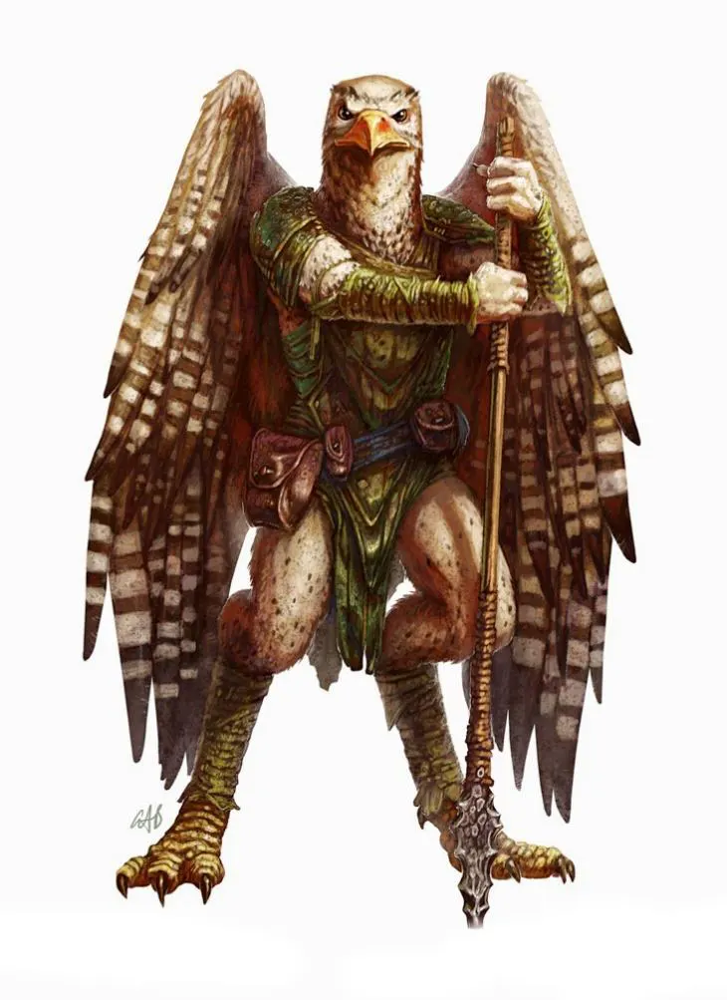

# Aarakocra

Aarakocras alcançam o Vórtice Uivante, uma tempestade interminável de poderosos ventos e rajadas de chuva que envolvem o tranquilo reino de Aaqa no Plano Elemental do Ar. Fazendo patronos aéreos, esses humanoides similares a pássaros guardam as fronteiras ventosas de seu lar contra invasores do Plano Elemental da Terra, como gárgulas, seus inimigos jurados.

***Inimigos do Mal Elemental***. A serviço dos Duques do Vento de Aaqa, aarakocras patrulham os planos em busca de templos de Mal Elemental. Eles espiam as criaturas elementais malignas e também lutam contra essas criaturas e depois relatam aos Duques do Vento.

No Plano Material, aarakocras criam ninhos nos topos das mais altas montanhas, especialmente em picos próximos de portais para o Plano Elemental do Ar. De tais alturas, aarakocras vigiam em busca de sinais de incursões elementais, assim como por ameaças que aparecerem no seu plano natal. Os aarakocras preferem viver suas vidas como o vento – aliviados e sempre em movimento – ainda que eles tenham que vigiar uma região por anos se isso for necessário para protege-la contra as incursões do Mal Elemental.

Os aarakocras não possuem conceito de fronteiras políticas ou de propriedade privada e o valor de gemas, ouro e outros metais preciosos significam pouco para os aarakocras. Aos olhos deles, uma criatura deve usar o que é necessário e então jogar fora o que restar ao vento, para que outros usem.

***Busca pelos Sete Estilhaços***. Os Duques do Vento de Aaqa vem de uma raça de seres elementais chamados vaati, que há muito governaram diversos mundos. Uma criatura chamada de Rainha do Caos surgiu e iniciou uma guerra interplanar contra o governo vaati. Para combater a ameaça, sete heróis vaati combinaram seus poderes para criar o poderoso *Bastão da Lei*. Em uma batalha contra o maior general da rainha, Mishka o Lobo Aranha, um vaati matou Mishka ao empurrar o bastão contra ele, como uma lança. O bastão se despedaçou em sete estilhaços que se espalharam pelo multiverso. Os aarakocras buscam sinais das localizações dos pedaços com o intuito de reconstruir o que agora é conhecido como o *Bastão das Sete Partes*.

> **Invocando Elementais do Ar**
>
> Cinco aarakocras a até 9 metros entre si, podem invocar magicamente um elemental do ar. Cada um dos cinco deve usar sua ação e movimento durante três turnos consecutivos para realizar uma dança aérea e devem manter a concentração enquanto o fazem (como se estivessem se concentrando numa magia). Quando todos os três tiverem terminado o terceiro turno de dança, o elemental aparecerá em um espaço desocupado a até 18 metros deles. Ele é amigável a eles e obedece os comando falados por eles. Ele permanece por 1 hora, até que todos os seus invocadores morram ou até que qualquer de seus invocadores dispense-o com uma ação bônus. Um invocador não pode realizar a dança novamente até ter terminado um descanso curto. Quando o elemental voltar ao Plano Elemental do Ar, qualquer aarakocra a até 1,5 metro dele pode retornar com ele.

## Bloco de estatísticas: Aarakocra

*Humanoide Médio (aarakocra), neutro e bom*

**Classe de Armadura** 12  
**Pontos de Vida** 13 (3d8)  
**Deslocamento** 6 m, voo 15 m

| FOR | DES | CON | INT | SAB | CAR |
| :---: | :---: | :---: | :---: | :---: | :---: |
| 10 (+0) | 14 (+2) | 10 (+0) | 11 (+0) | 12 (+1) | 11 (+0) |

**Perícias** Percepção +5  
**Sentidos** Percepção passiva 15  
**Idiomas** Aarakocra, Auran  
**Nível de Desafio** 1/4 (50 XP)

***Ataque de Mergulho***. Se o aarakocra estiver voando e mergulhar, pelo menos 9 metros, em linha reta em direção de um alvo e então atingi-lo com um ataque corpo-a-corpo armado, o ataque causa 3 (1d6) de dano extra ao alvo.

### Ações

***Garra***. *Ataque Corpo-a-Corpo com Arma*: +4 para atingir, alcance 1,5 m, um alvo. *Acerto*: 4 (1d4 + 2) de dano cortante.

***Azagaia***. *Ataque à Distância com Arma*: +4 para atingir, alcance 1,5 m ou 9/36 m, um alvo. *Acerto*: 5 (1d6 + 2) de dano perfurante.
