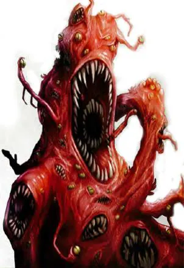

# Abocanhador Matraqueante

De todos os terrores criados por magos tolos, os abocanhadores matraqueantes estão dentre os mais apavorantes e depravados. Essa criatura é a combinação de olhos, bocas e matéria liquefeita de suas vítimas anteriores. Levadas à insanidade pela destruição de seus corpos e absorção pelo abocanhador, essas vítimas balbuciam loucuras incoerentes, forçadas a consumir tudo ao alcance.

## Bloco de estatísticas: Abocanhador Matraqueante

*Aberração Média, neutro*

**Classe de Armadura** 9  
**Pontos de Vida** 67 (9d8 + 27)  
**Deslocamento** 3 m, natação 3 m

| FOR | DES | CON | INT | SAB | CAR |
| :---: | :---: | :---: | :---: | :---: | :---: |
| 10 (+0) | 8 (–1) | 16 (+3) | 3 (–4) | 10 (+0) | 6 (–2) |

**Imunidade a Condição** caído  
**Sentidos** visão no escuro 18 m, Percepção passiva 10  
**Idiomas** –  
**Nível de Desafio** 2 (450 XP)

***Solo Aberrante***. O solo num raio de 3 metros do abocanhador é similar a uma massa de terreno difícil. Cada criatura que comece seu turno nessa área deve ser bem sucedida num teste de resistência de Força CD 10, ou terá seu deslocamento reduzido a 0 até o início do próximo turno dela.

***Tagarelice***. O abocanhador balbucia incoerentemente quando ele vê qualquer criatura e não está incapacitado. Cada criatura que começar seu turno a até 6 metros do abocanhador e puder ouvi-lo, deve ser bem sucedida num teste de resistência de Sabedoria CD 10. Se falhar, a criatura não poderá realizar reações até o início do próximo turno dela e joga um d8 para determinar o que ela faz nesse turno. Entre 1 e 4, a criatura não faz nada. Entre 5 e 6, a criatura não realiza qualquer ação ou reação e usa seu movimento para se mover em uma direção determinada aleatoriamente. Entre 7 e 8, a criatura realiza um ataque corpo-a-corpo contra uma criatura determinada aleatoriamente dentro do seu alcance ou não faz nada se não puder realizar tal ataque.

### Ações

***Ataques Múltiplos***. O abocanhador matraqueante realiza um ataque de mordida e, se puder, usa sua Cusparada Cegante.

***Mordida***. *Ataque Corpo-a-Corpo com Arma*: +2 para atingir, alcance 1,5 m, uma criatura. *Acerto*: 17 (5d6) de dano perfurante. Se o alvo for Médio ou menor, ele deve ser bem sucedido num teste de resistência de Força CD 10 ou será derrubado no chão. Se o alvo for morto por esse dano, ele será absorvido pelo abocanhador.

***Cusparada Cegante (Recarrega 5–6)***. O abocanhador cospe uma bolha química num ponto que ele possa ver a até 4,5 metros dele. A bolha explode em um clarão de luz cegante no impacto. Cada criatura a até 1,5 metro do clarão deve ser bem sucedida num teste de resistência de Destreza CD 13 ou ficará cega até o final do próximo turno do abocanhador.

***Forma Ameboide***. O corpo do abocanhador matraqueante é uma forma amorfa de bocas e olhos que se impulsionam deslizando para a frente, fixando diversas bocas ao solo e puxando as massa adiante. Apesar de se mover lentamente, ele pode nadar na água, lema e areia movediça facilmente.

***Bocas da Loucura***. Quando um abocanhador matraqueante sente sua presa, suas bocas começam a murmurar e tagarelar, cada uma com uma voz diferente: grave ou aguda, gemendo ou ululando, gritando em agonia ou êxtase. Essa tagarelice cacofônica sobrepõe os sentidos de qualquer criatura que ouvir, fazendo a maioria fugir aterrorizada. Outros são dominados pela loucura ou permanecem paralisados, fixados na horrenda criatura enquanto ela desliza adiante para consumi-los.

***Consome Tudo***. Impelido a devorar qualquer criatura ao alcance, um abocanhador matraqueante escoa sobre suas vítimas paralisadas pelo seu discurso louco, as inúmeras vozes silenciam temporariamente, enquanto ele morte e engole carne viva. O monstro liquefaz rocha quando em contato, dificultando a fuga de criaturas que superem sua tagarelice.

Um abocanhador matraqueante não deixa nada de sua presa para trás. No entanto, mesmo quando o último pedaço do corpo da vítima é consumido, seus olhos e boca emergem a superfície, prontos para se juntar ao cântico de tormento matraqueante que dá as boas-vindas à próxima refeição do monstro.
