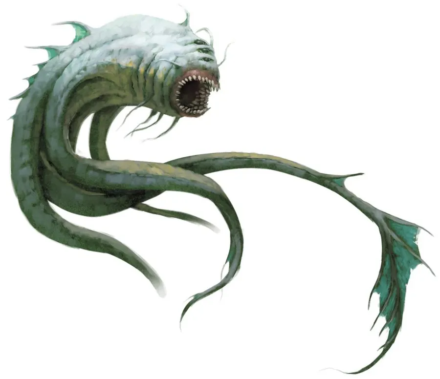

# Abolete

## Bloco de estatísticas: Abolete

*Aberração Grande, leal e mau*

**Classe de Armadura** 17 (armadura natural)  
**Pontos de Vida** 135 (18d10 + 36)  
**Deslocamento** 3 m, natação 12 m

| FOR | DES | CON | INT | SAB | CAR |
| :---: | :---: | :---: | :---: | :---: | :---: |
| 21 (+5) | 9 (–1) | 15 (+2) | 18 (+4) | 15 (+2) | 18 (+4) |

**Testes de Resistência** Con +6, Int +8, Sab +6  
**Perícias** História +12, Percepção +10  
**Sentidos** visão no escuro 36 m, Percepção passiva 20  
**Idiomas** Dialeto Subterrâneo, telepatia 36 m  
**Nível de Desafio** 10 (5.900 XP)

***Anfíbio***. O abolete pode respirar ar e água.

***Nuvem Mucosa***. Quando estiver submerso, o abolete fica envolto por um muco transformador. Uma criatura que toque o abolete ou que atinja ele com um ataque corpo-a-corpo estando a até 1,5 metro dele deve ser bem sucedida num teste de resistência de Constituição CD 14. Se fracassar, a criatura fica adoecida por 1d4 horas. A criatura adoecida só pode respirar sob a água.

***Sondagem Telepática***. Se uma criatura se comunicar telepaticamente com o abolete, o abolete descobre os maiores desejos da criatura se o abolete puder vê-la.

### Ações

***Ataques Múltiplos***. O abolete realiza três ataques de tentáculos.

***Cauda***. *Ataque Corpo-a-Corpo com Arma*: +0 para atingir, alcance 3 m, um alvo. *Acerto*: 15 (3d6 + 5) de dano de concussão.

***Escravizar (3/Dia)***. O abolete afeta uma criatura que ele possa ver a até 9 metros dele. O alvo deve ser bem sucedido num teste de resistência de Sabedoria CD 14, ou ficará magicamente enfeitiçado pelo abolete até que ele morra ou esteja em um plano de existência diferente do alvo. O alvo enfeitiçado está sob o controle do abolete e não pode realizar reações e, o abolete e o alvo, podem se comunicar telepaticamente um com o outro a qualquer distância. Sempre que o alvo enfeitiçado sofrer dano, ele pode repetir o teste de resistência. Se for bem sucedido, o efeito termina. Não mais de uma vez a cada 24 horas, o alvo também pode repetir o teste de resistência quando ele estiver a pelo menos 1,5 quilômetro de distância do abolete.

***Tentáculo***. *Ataque Corpo-a-Corpo com Arma*: +9 para atingir, alcance 3 m, um alvo. *Acerto*: 12 (2d6 + 5) de dano de concussão. Se o alvo for uma criatura, ele deve ser bem sucedido num teste de resistência de Constituição CD 14 ou ficará adoecido. A doença não causa nenhum efeito por 1 minuto e pode ser removida por qualquer magia que cure doenças. Após 1 minuto, a pele da criatura adoecida se torna translucida e viscosa, a criatura não pode recuperar pontos de vida a não ser que esteja submersa e a doença só pode ser removida por *cura completa* ou por outra mágica de curar doenças de 6° nível ou superior. Quando a criatura estiver fora de um corpo de água, ela sofre 6 (1d12) de dano de ácido a cada 10 minutos, a menos que a pele dela seja umedecida antes de 10 minutos se passarem.

### Ações Lendárias

O abolete pode realizar 3 ações lendárias, escolhidas dentre as opções abaixo. Apenas uma ação lendária pode ser usada por vez e apenas no final do turno de outra criatura. O abolete recupera as ações lendárias gastas no começo do turno dele.

**Chicotear com a Cauda**. O abolete realiza um ataque de cauda.  
**Detectar**. O abolete realiza um teste de Sabedoria (Percepção).  
**Dreno Psíquico (Custa 2 Ações)**. Uma criatura enfeitiçada pelo abolete sofre 10 (3d6) de dano psíquico e o abolete recupera uma quantidade de pontos de vida igual ao dano sofrido pela criatura.

## Abolete

Antes da chegada dos deuses, os aboletes espreitavam nos oceanos primordiais e em lagos subterrâneos. Eles chegaram com suas mentes e tomaram controle das formas de vida florescentes do reino mortal, fazendo dessas criaturas seus escravos. Sua dominação os torna similares a deuses. Então, os verdadeiros deuses apareceram, esmagando o império abolete e libertando seus escravos.

Os aboletes nunca esqueceram.

***Memórias Eternas***. Os aboletes possuem memórias impecáveis. Eles passam seus conhecimentos e experiências de geração em geração. Então, a injuria da derrota deles pelos deuses permanece perfeitamente preservada em suas mentes.

A mente dos aboletes são preciosos conhecimentos antigos, relembrando de momentos da pré-história com perfeita clareza. Eles tramaram pacientemente e intrincadamente através das eras. Poucas criaturas podem conceber a extensão dos planos de um abolete.

***Deuses no Lago***. Os aboletes habitam ambientes aquáticos, incluindo abismos oceânicos, lagos profundos e o Plano Elemental da Água. Nesses domínios e nas terras adjacentes, os aboletes são como deuses, demandando veneração e obediência dos seus subordinados. Quando eles consomem outras criaturas, os aboletes adicionam o conhecimento e as experiências de suas prezas às suas memórias eternas.

Os aboletes usam seus poderes telepáticos para ler a mente de criaturas e descobrir seus desejos. Um abolete usa esse conhecimento para ganhar a lealdade da criatura, prometendo satisfazer tais necessidades em troca de obediência. Dentro do seu covil, o abolete pode, posteriormente, usar seus poderes para enganar os sentidos, fornecendo às criaturas, como seus seguidores, a ilusão das recompensas prometidas.

***Inimigos dos Deuses***. A queda do poder dos aboletes está escrita com total claramente em suas memórias impecáveis, pois os aboletes nunca morrem de verdade. Se o corpo de um abolete for destruído, seu espírito retorna para o Plano Elemental da Água, onde um novo corpo se funde a ele ao longo de dias ou meses.

Em última análise, os aboletes sonham em destituir os deuses e recuperar o controle sobre o mundo. Os aboletes tiveram incalculáveis eras para tramar e preparar seus planos para uma perfeita execução.

### O Covil do Abolete

O covil de um abolete em lagos subterrâneos ou nas profundezas rochosas do oceano, frequentemente é cercado pelas ruínas de uma antiga cidade abolete caída. Um abolete passa a maior parte de sua existência submerso, emergindo ocasionalmente para lidar com visitantes ou adoradores dementes.

### Ações de Covil

Quando estiver lutando dentro de seu covil, um abolete pode invocar a magia ambiente para realizar ações de covil. No valor de iniciativa 20 (quebrando toda a sequência de iniciativa), o abolete realiza uma ação de covil fazendo um dos efeitos a seguir:

- O abolete conjura *força fantasmagórica* (nenhum componente é necessário) em qualquer quantidade de criaturas que ele possa ver, a até 18 metros dele. Enquanto mantiver a concentração nesse efeito, o abolete não pode realizar outras ações de covil. Se um alvo for bem sucedido no teste de resistência ou se o efeito terminar para ele, o alvo ficará imune a ação de covil *força fantasmagórica* do abolete pelas próximas 24 horas, apesar de tal criatura poder escolher ser afetada.
- Poças de água a até 27 metros do abolete formam marés agarradoras. Qualquer criatura no solo a até 6 metros de tais poças deve ser bem sucedida num teste de resistência de Força CD 14, ou será puxada 6 metros para dentro da água e ficará caída. O abolete não pode usar essa ação de covil novamente até ter usado uma ação diferente.
- A água no covil do abolete magicamente se transforma um condutor para a ira da criatura. O abolete pode afetar qualquer número de criaturas dentro da água que ele possa ver a até 27 metros dele. Um alvo deve ser bem sucedido num teste de resistência de Sabedoria CD 14 ou sofrerá 7 (2d6) de dano psíquico. O abolete não pode usar essa ação de covil novamente até ter usado uma ação diferente.

### Efeitos Regionais

A região contendo o covil de um abolete é deformada pela presença da criatura, o que cria um ou mais dos seguintes efeitos:

- Superfícies subterrâneas a até 1,5 quilômetro do covil de um abolete fica viscosa e úmida se torna terreno difícil.
- Fontes de água a até 1,5 quilômetro do covil ficam sobrenaturalmente poluídas. Os inimigos do abolete que beberem dessa água vomitarão dentro de minutos.
- Com uma ação, o abolete pode criar uma imagem ilusória de si mesmo a até 1,5 quilômetro do seu covil. A cópia pode aparecer em qualquer lugar que o abolete já tenha visto anteriormente ou em qualquer lugar que uma criatura enfeitiçada pelo abolete possa ver atualmente. Uma vez criada, a imagem dura enquanto o abolete mantiver a concentração, como se ele estivesse se concentrando em uma magia. Apesar da imagem ser intangível, ela se parece, emite sons e se move como o abolete. O abolete pode sentir, falar e usar telepatia da posição da imagem como se estivesse presente nessa posição. Se a imagem sofrer qualquer dano, ela desaparece.

Se o abolete morrer, os primeiros dois efeitos desvanecem dentro de 3d10 dias.
