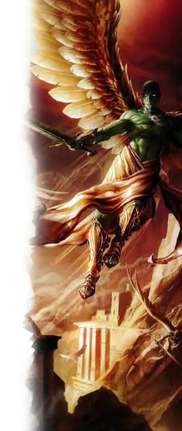
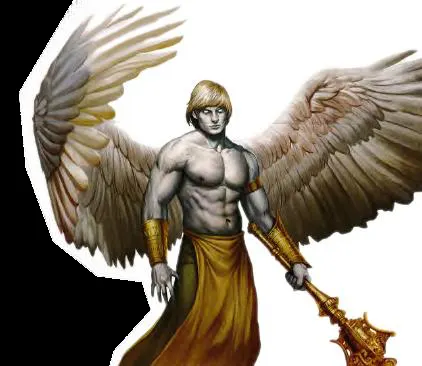
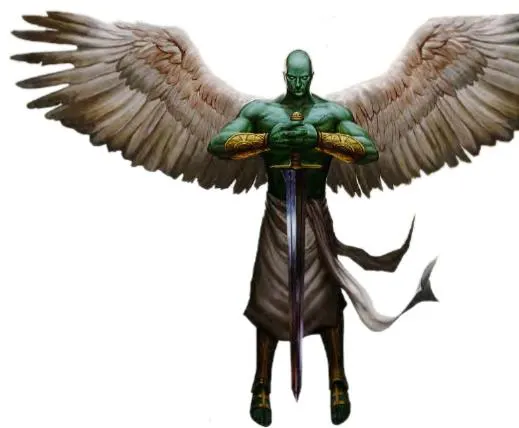
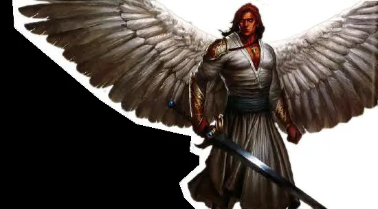

# Anjos

Um anjo é um agente celestial enviado para os planos para promover as ordens do seu deus para a felicidade ou desgraça. Sua beleza e presença sublimes podem levar espectadores boquiabertos a se ajoelharem perante eles. Ainda assim, anjos também são destruidores e o aparecimento deles prenuncia a condenação com a mesma frequência que sinaliza a esperança.

***Fragmentos do Divino***. Anjos são formados pela essência astral da benevolência dos deuses e são, portanto, seres divinos de grande poder e premonição.

Os anjos agem como a vontade dos seus deuses com devoção incansável. Até mesmo divindades caóticas e boas comandam anjos leais e bons, sabendo que a dedicação dos anjos a ordens permite que eles executem os comandos divinos da melhor forma. Um anjo segue um único propósito condutor, como decretado por sua divindade. No entanto, um anjo é incapaz de seguir comandos que desviem-no do caminho da lei e do bem.

Um anjo mata criaturas malignas sem remorso. Como a incorporação da lei e do bem, um anjo praticamente nunca se engana em seus julgamentos. Essa qualidade pode criar um sentimento de superioridade em um anjo, um sentimento que vem à tona quando a tarefa de um anjo entra em conflito com os objetivos de outra criatura. O anjo numa aquiesce ou desiste. Quando um anjo é enviado para ajudar os mortais, ele é enviado não para servir, mas para comandar. Os deuses do bem, portanto, enviam seus anjos entre os mortais apenas em resposta as mais terríveis circunstâncias.

***Anjos Caídos***. O compasso moral de um anjo garante a ele um sentimento de infalibilidade que pode, as vezes, leva-lo a sua ruína. Os anjos são, geralmente, muito sábios para cair em uma enganação simplória mas, as vezes, o orgulho pode levar um a cometer um ato maligno. Independentemente de intencional ou acidental, tal ato é uma mancha permanente que marca o anjo como um pária.

Anjos caídos mantem seus poderes, mas perdem sua conexão com as divindades a partir das quais eles foram feitos. A maioria dos anjos caídos tomam o seu banimento como pessoal, rebelando-se contra os poderes que eles serviram buscando domínio sobre uma seção do Abismo ou um lugar entre outros caídos na hierarquia dos Nove Infernos. Zariel, o soberano da primeira camada dos Nove Infernos, é uma criatura dessas. Ao invés de se rebelar, alguns anjos caídos resignam-se a uma existência isolada no Plano Material, vivendo disfarçados de simples eremitas. Se forem redimidos, eles podem se tornar aliados poderosos dedicados à justiça e ao serviço compassivo.

***Natureza Imortal***. Um anjo não precisa comer, beber ou dormir.

### Deva

Devas são anjos que agem como mensageiros ou agentes divinos no Plano Material, na Umbra e em Faéria e que podem assumir uma forma apropriada ao reino para o qual foram enviados.

Lendas contam sobre anjos que assumiram formas mortais por anos, trazendo ajuda, esperança e coragem ao povo de bom coração. Um deva pode assumir qualquer forma, apesar de preferirem se parecer com mortais como um humanoide ou animal inócuo. Quando as circunstância requerem que ele acabe com seu disfarce, um deva se mostra como uma bela criatura similar a um humanoide com pele prateada. Seus cabelos e olhos brilham com um esplendor sobrenatural e grandes asas plumadas brotam de suas escápulas.

## Bloco de estatísticas: Deva

*Celestial Médio, leal e bom*

**Classe de Armadura** 17 (armadura natural)  
**Pontos de Vida** 136 (16d8 + 64)  
**Deslocamento** 9 m, voo 27 m

| FOR | DES | CON | INT | SAB | CAR |
| :---: | :---: | :---: | :---: | :---: | :---: |
| 18 (+4) | 18 (+4) | 18 (+4) | 17 (+3) | 20 (+5) | 20 (+5) |

**Testes de Resistência** Sab +9, Car +9  
**Perícias** Intuição +9, Percepção +9  
**Resistência a Dano** radiante; concussão, perfurante e cortante de ataques não-mágicos  
**Imunidade a Condição** enfeitiçado, exausto, amedrontado  
**Sentidos** visão no escuro 36 m, Percepção passiva 19  
**Idiomas** todos, telepatia 36 m  
**Nível de Desafio** 10 (5.900 XP)

***Armas Angelicais***. Os ataques armados do deva são mágicos. Quando o deva atinge com qualquer arma, a arma causa 4d8 de dano radiante (incluso no ataque) extra.

***Conjuração Inata***. A habilidade de conjuração de um deva é Carisma (CD de resistência de magia 17). O deva pode conjurar, inatamente, as seguintes magias, necessitando apenas de componentes verbais:

À vontade: *detectar bem e mal* 1/dia cada: *comunhão, reviver os mortos*

***Resistência à Magia***. O deva possui vantagem nos testes de resistência contra magias e outros efeitos mágicos.

### Ações

***Ataques Múltiplos***. O deva realiza dois ataques corpo-a-corpo.

***Maça***. *Ataque Corpo-a-Corpo com Arma*: +8 para atingir, alcance 1,5 m, um alvo. *Acerto*: 7 (1d6 + 4) de dano de concussão mais 18 (4d8) de dano radiante.

***Toque Curativo (3/Dia)***. O deva toca outra criatura. O alvo recupera magicamente 20 (4d8 + 2) pontos de vida e é libertado de qualquer maldição, doença, veneno, cegueira ou surdez.

***Alterar Forma***. O deva magicamente se metamorfoseia em um humanoide ou besta que tenha um nível de desafio igual ou inferior ao dele ou volta para a sua forma verdadeira. Ele reverte para sua forma verdadeira se morrer. Qualquer equipamento que ele esteja vestindo ou carregando é absorvido ou utilizado pela nova forma (à escolha do deva). Em uma nova forma, o deva mantem suas estatísticas de jogo e a habilidade de falar, mas sua CA, tipos de movimento, Força, Destreza e sentidos especiais são substituídos pelos da nova forma e ele ganha quaisquer estatísticas e capacidades (exceto características de classe, ações lendárias e ações de covil) que a nova forma possua e que ele não tenha.

### Planetário

Os planetários agem como as armas dos deuses que servem, apresentando uma representação tangível da força de suas divindades. Um planetário pode evocar chuva para aliviar uma seca ou pode liberar uma praga de insetos para devorar colheitas. Os ouvidos celestiais de um planetário detectam cada falsidade e seus olhos radiantes veem através de toda enganação.

Planetários são musculosos, carecas e possuem uma pele num tom verde opalescente e asas plumadas brancas. Eles são bem mais altos que a maioria dos humanoides, brandindo imensas espadas graciosamente. Às vezes, enviados para ajudar mortais poderosos em tarefas importantes do bem, os planetários gostam especialmente das missões que envolvam combater corruptores.

## Bloco de estatísticas: Planetário

*Celestial Grande, leal e bom*

**Classe de Armadura** 19 (armadura natural)  
**Pontos de Vida** 200 (16d10 + 112)  
**Deslocamento** 12 m, voo 36 m

| FOR | DES | CON | INT | SAB | CAR |
| :---: | :---: | :---: | :---: | :---: | :---: |
| 24 (+7) | 20 (+5) | 24 (+7) | 19 (+4) | 22 (+6) | 25 (+7) |

**Testes de Resistência** Con +12, Sab +11, Car +12  
**Perícias** Percepção +11  
**Resistência a Dano** radiante; concussão, perfurante e cortante de ataques não-mágicos  
**Imunidade a Condição** enfeitiçado, exausto, amedrontado  
**Sentidos** visão verdadeira 36 m, Percepção passiva 21  
**Idiomas** todos, telepatia 36 m  
**Nível de Desafio** 16 (15.000 XP)

***Armas Angelicais***. Os ataques armados do planetário são mágicos. Quando o planetário atinge com qualquer arma, a arma causa 5d8 de dano radiante (incluso no ataque) extra.

***Consciência Divina***. O planetário sabe quando ouve uma mentira.

***Conjuração Inata***. A habilidade de conjuração de um planetário é Carisma (CD de resistência de magia 20). O planetário pode conjurar, inatamente, as seguintes magias, sem necessidade de componentes materiais:

À vontade: *detectar bem e mal, invisibilidade* (pessoal apenas) 3/dia cada: *barreira de lâminas, coluna de chamas, dissipar o* *bem e mal*, *reviver os mortos* 1/dia cada: *comunhão, controlar o clima, praga de insetos*

***Resistência à Magia***. O planetário possui vantagem nos testes de resistência contra magias e outros efeitos mágicos.

### Ações

***Ataques Múltiplos***. O planetário realiza dois ataques corpo-a-corpo.

***Espada Grande***. *Ataque Corpo-a-Corpo com Arma*: +12 para atingir, alcance 1,5 m, um alvo. *Acerto*: 21 (4d6 + 7) de dano cortante mais 22 (5d8) de dano radiante.

***Toque Curativo (4/Dia)***. O planetário toca outra criatura. O alvo recupera magicamente 30 (6d8 + 3) pontos de vida e é libertado de qualquer maldição, doença, veneno, cegueira ou surdez.

### Solar

Um solar é similar a um deus em sua glória e poder. No campo de batalha, a espada do solar sobrevoa o combate a sua vontade e uma única flecha do arco de um solar pode levar um alvo a morte ao contato. A força celestial de um solar é tão grandiosa que até mesmo os príncipes demônios tremem perante seus comandos ressonantes.

Dizem que existem apenas vinte e quatro solares. Os poucos solares conhecidos são comissários de divindades especificas. O restante em um estado de contemplação, esperam o momento em quem seus serviços serão solicitados para afastar alguma ameaça cósmica a causa do bem.

## Bloco de estatísticas: Solar

*Celestial Grande, leal e bom*

**Classe de Armadura** 21 (armadura natural)  
**Pontos de Vida** 243 (18d10 + 144)  
**Deslocamento** 15 m, voo 45 m

| FOR | DES | CON | INT | SAB | CAR |
| :---: | :---: | :---: | :---: | :---: | :---: |
| 26 (+8) | 22 (+6) | 26 (+8) | 25 (+7) | 25 (+7) | 30 (+10) |

**Testes de Resistência** Int +14, Sab +14, Car +17  
**Perícias** Percepção +14  
**Resistência a Dano** radiante; concussão, perfurante e cortante de ataques não-mágicos  
**Imunidade a Dano** necrótico, veneno  
**Imunidade a Condição** enfeitiçado, exausto, amedrontado, envenenado  
**Sentidos** visão verdadeira 36 m, Percepção passiva 24  
**Idiomas** todos, telepatia 36 m  
**Nível de Desafio** 21 (33.000 XP)

***Armas Angelicais***. Os ataques armados do solar são mágicos. Quando o solar atinge com qualquer arma, a arma causa 6d8 de dano radiante (incluso no ataque) extra.

***Conjuração Inata***. A habilidade de conjuração de um solar é Carisma (CD de resistência de magia 25). O solar pode conjurar, inatamente, as seguintes magias, sem necessidade de componentes materiais:

À vontade: *detectar bem e mal, invisibilidade* (pessoal apenas) 3/dia cada: *barreira de lâminas, coluna de chamas, dissipar o bem* *e mal*, *ressurreição* 1/dia cada: *comunhão, controlar o clima*

***Consciência Divina***. O solar sabe quando ouve uma mentira.

***Resistência à Magia***. O solar possui vantagem nos testes de resistência contra magias e outros efeitos mágicos.

### Ações

***Ataques Múltiplos***. O solar realiza dois ataques com espada grande.

***Espada Grande***. *Ataque Corpo-a-Corpo com Arma*: +15 para atingir, alcance 1,5 m, um alvo. *Acerto*: 22 (4d6 + 8) de dano cortante mais 27 (6d8) de dano radiante.

***Arco Longo Assassino***. *Ataque à Distância com Arma*: +13 para atingir, distância 45/180 m, um alvo. *Acerto*: 15 (2d8 + 6) de dano perfurante mais 27 (6d8) de dano radiante. Se o alvo for uma criatura com 100 ou menos pontos de vida, ele deve ser bem sucedido num teste de resistência de Constituição CD 15 ou morrerá.

***Espada Voadora***. O solar libera sua espada grande para que ela flutue magicamente em um espaço desocupado a 1,5 metro dele. Se o solar puder ver a espada, ele pode comanda-la mentalmente com uma ação bônus, para que ela voe até 15 metros e também realize um ataque contra um alvo ou retorne para as mãos do solar. Se a espada flutuante for alvo de qualquer efeito, ela é considerada como sendo empunhada pelo solar.

***Toque Curativo (4/Dia)***. O solar toca outra criatura. O alvo recupera magicamente 40 (8d8 + 4) pontos de vida e é libertado de qualquer maldição, doença, veneno, cegueira ou surdez.

### Ações Lendárias

O solar pode realizar 3 ações lendárias, escolhidas dentre as opções abaixo. Apenas uma ação lendária pode ser usada por vez e apenas no final do turno de outra criatura. O solar recupera as ações lendárias gastas no começo do turno dele.

**Explosão Ardente (Custa 2 Ações)**. O solar emite energia divina mágica. Cada criatura, à escolha dele, num raio de 3 metros deve realizar um teste de resistência de Destreza CD 23, sofrendo 14 (4d6) de dano de fogo mais 14 (4d6) de dano radiante se falhar na resistência ou metade desse dano se obtiver sucesso.  
**Olhar Cegante (Custa 3 Ações)**. O solar afeta uma criatura que ele possa ver a até 9 metros dele. Se o alvo puder vê-lo, ele deve ser bem sucedido num teste de resistência de Constituição CD 15 ou ficará cego até alguma magia como *restauração menor* remover a cegueira.  
**Teletransporte**. O solar teletransporta-se magicamente, juntamente com qualquer equipamento que ele esteja vestindo ou carregando, para um espaço desocupado, a até 36 metros, que ele possa ver.
