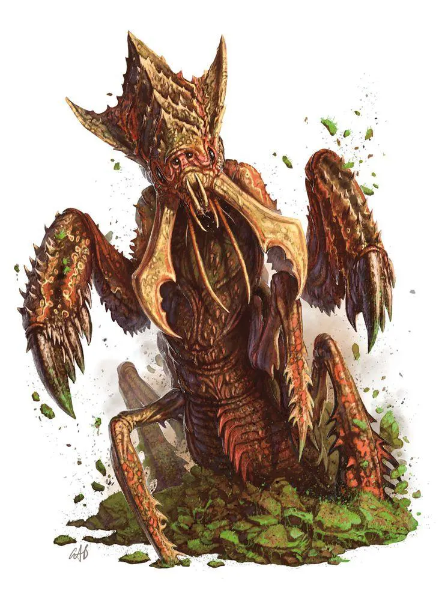

# Ankheg

Um ankheg lembra um enorme inseto cheio de pernas, suas longas antenas convulsionam em resposta a qualquer movimento a sua volta. Suas pernas terminam em ganchos afiados adaptados para esburacar e destroçar suas presas e suas poderosas mandíbulas podem cortar uma árvore pequena ao meio.

***Espreitadores na Terra***. Os ankhegs usam suas poderosas mandíbulas para cavar sinuosos túneis nas profundezas do solo. Quando ele caça, um ankheg se enterra, esperando embaixo da superfície até que suas antenas detectem movimento acima. Então, ele emerge da terra e agarra sua presa com suas mandíbulas, esmagando e dilacerando ao mesmo tempo que secreta enzimas ácidas digestivas. Essas enzimas ajudam a dissolver a vítima para facilitar o engolimento, mas o ankheg também pode cuspir ácido para derrubar inimigos.

***Tormento de Campos e Florestas***. Apesar dos ankhegs receberem uma certa porção dos seus nutrientes do solo que eles escavam, eles devem suplementar sua dieta com carne fresca. Pastagens cheias de gado e florestas com numerosos presas são os campos de caça preferidos do ankheg. Por isso, os ankhegs são o tormento de fazendeiros e patrulheiros em todos os cantos.

***Túneis Terrestres***. À medida que ele se escava a terra, o ankheg deixa um túnel estreito e parcialmente desmoronado no caminho. Nesses túneis, pode-se encontrar os restos de quitina das patas do ankheg, ovos eclodidos ou restos mortais de suas vítimas, incluindo moedas ou outros tesouros espalhados durante o ataque da criatura.

## Bloco de estatísticas: Ankheg

*Monstruosidade Grande, imparcial*

**Classe de Armadura** 14 (armadura natural), 11 quando enterrado  
**Pontos de Vida** 39 (6d10 + 6)  
**Deslocamento** 9 m, escavação 3 m

| FOR | DES | CON | INT | SAB | CAR |
| :---: | :---: | :---: | :---: | :---: | :---: |
| 17 (+3) | 11 (+0) | 13 (+1) | 1 (–5) | 13 (+1) | 6 (–2) |

**Sentidos** visão no escuro 18 m, sentido sísmico, Percepção passiva 11  
**Idiomas** –  
**Nível de Desafio** 2 (450 XP)

### Ações

***Mordida***. *Ataque Corpo-a-Corpo com Arma*: +5 para atingir, alcance 1,5 m, um alvo. *Acerto*: 10 (2d6 + 3) de dano cortante mais 3 (1d6) de dano de ácido. Se o alvo for uma criatura Grande ou menor, ela será agarrada (CD 13 para escapar). Até o agarrão terminar, o ankheg pode morder apenas a criatura agarrada e tem vantagem nas jogadas de ataque para fazê-lo.

***Rajada de Ácido (Recarrega 6)***. O ankheg cospe ácido em uma linha de 9 metros de comprimento e 1,5 metro de largura, considerando que não haja qualquer criatura agarrada. Cada criatura na linha deve realizar um teste de resistência de Destreza CD 13, sofrendo 10 (3d6) de dano de ácido se falhar na resistência, ou metade desse dano se obtive sucesso.
