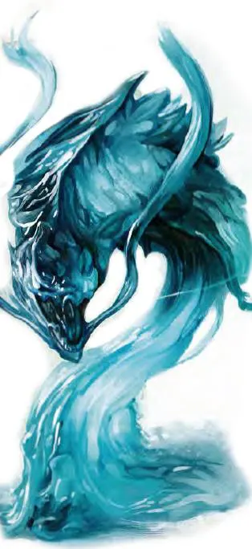

# Anomalia da Água

Uma anomalia da água é um guardião elemental vinculado a um local cheio de água especifico, como uma piscina ou fonte. Invisível enquanto está imerso na água, seu corpo serpentino torna-se claro apenas quando ele emerge para atacar, usando suas espirais para esmagar qualquer criatura diferente do seu invocador e aqueles que o invocador declarar fora dos limites. Quando é morta, uma anomalia da água torna-se uma poça inanimada de água.

***Anomalias Boas e Más***. Como a maioria dos elementais, uma anomalia da água não tem conceito de bem ou mal. No entanto, uma anomalia da água vinculada a uma fonte de água sagrada ou profana começa a tomar a natureza desse lugar, tornando-se neutro e bom ou neutro e mau.

Uma anomalia da água neutra e boa tenta afugentar os intrusos ao invés de mata-los, enquanto que uma anomalia da água maligna mata suas vítimas por prazer e pode se voltar contra seu invocador. Uma anomalia da água perde sua tendência maligna se a água for purificada com a magia *purificar alimentos*.

***Natureza Elemental***. Uma anomalia da água não precisa respirar, comer, beber ou dormir.

## Bloco de estatísticas: Anomalia da Água

*Elemental Grande, neutro*

**Classe de Armadura** 13  
**Pontos de Vida** 58 (9d10 + 9)  
**Deslocamento** 0 m, natação 18 m

| FOR | DES | CON | INT | SAB | CAR |
| :---: | :---: | :---: | :---: | :---: | :---: |
| 17 (+3) | 16 (+3) | 13 (+1) | 11 (+0) | 10 (+0) | 10 (+0) |

**Resistência a Dano** fogo; concussão, perfurante e cortante de ataques não-mágicos  
**Imunidade a Dano** veneno  
**Imunidade a Condição** agarrado, caído, envenenado, exausto, impedido, inconsciente, paralisado  
**Sentidos** percepção às cegas 9 m, Percepção passiva 10  
**Idiomas** compreende Aquan, mas não pode falar  
**Nível de Desafio** 3 (700 XP)

***Invisível na Água***. A anomalia da água é invisível enquanto estiver totalmente imersa em água.

***Vínculo com a Água***. A anomalia da água morre se abandonar a água a qual foi vinculada ou se a água for destruída.

### Ações

***Constrição***. *Ataque Corpo-a-Corpo com Arma*: +5 para atingir, alcance 3 m, uma criatura. *Acerto*: 13 (3d6 + 3) de dano de concussão. Se o alvo for Médio ou menor, ele será agarrado (CD 13 para escapar) e puxado 1,5 metro para a anomalia da água. Até que esse agarrão termine, o alvo está impedido e a anomalia da água tentará afoga-lo e a anomalia da água não pode constringir outro alvo.
