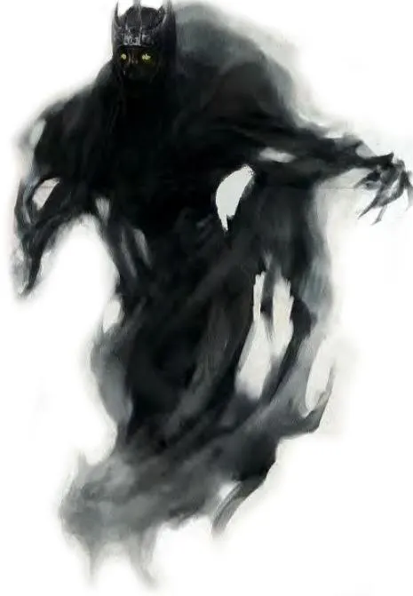

# Aparição

Uma aparição é a encarnação da malícia, concentrada em uma forma incorpórea que busca extinguir toda a vida. A criatura é impregnada de energia negativa e sua mera passagem pelo mundo deixa as plantas próximas negras e murchas. Animais fogem ante sua presença. Até mesmo pequenas chamas se extinguem pela sucção de esquecimento da horrenda existência da aparição.

***Esquecimento Vil***. Quando um humanoide mortal vive uma vida aviltada ou realiza um pacto diabólico, ele condena sua alma a danação eterna nos Planos Inferiores. No entanto, as vezes a alma se torna tão impregnada de energia negativa que ela sucumbi a si mesma e deixa de existir um instante antes de embarcar numa terrível vida após a morte. Quando isso ocorre, o espírito se torna uma aparição desalmada – um vácuo maléfico preso no plano onde ele morreu. Praticamente nada da vida anterior da aparição é preservado; em sua nova forma, ela existe apenas para aniquilar outras vidas.

***Desprovido de Corpo***. Uma aparição pode se mover através de criaturas e objetos sólidos tão facilmente quando uma criatura mortal se move na neblina.

Uma aparição pode manter algumas poucas memórias de sua vida mortal como ecos sombrios. No entanto, até mesmo os eventos e emoções mais marcantes tornam-se nada além de vagas impressões, tão efêmeros quanto a fraca lembrança de um sonho. Uma aparição pode parar para observar algo que a fascinava em vida, ou ela pode reduzir a sua ira ao reconhecer uma amizade passada. Tais momentos ocorrem raramente, no entanto, já que a maioria das aparições desprezam o que elas foram como um lembrete do que elas se tornaram.

***Comandantes Mortos-Vivos***. Uma aparição pode criar um servo morto-vivo de um espírito de uma criatura humanoide que tenha sofrido recentemente uma morte violenta. Esse fragmento de aflição se torna um espectro, rancoroso de tudo que vive.

As aparições, às vezes, comandam as legiões de mortos, conspirando para a danação das criaturas vivas. Quando elas emergem de suas tumbas para a batalha, vida e esperança murcham perante ela. Mesmo que o exército de uma aparição seja forçado a recuar, as terras ocupadas por suas forças ficam tão devastadas e estéreis que os que vivem nelas geralmente ficam famintos e morrem.

***Natureza Morta-Viva***. Uma aparição não precisa respirar, comer, beber ou dormir.

## Bloco de estatísticas: Aparição

*Morto-vivo Médio, neutro e mau*

**Classe de Armadura** 13  
**Pontos de Vida** 67 (9d8 + 27)  
**Deslocamento** 0 m, voo 18 m (planar)

| FOR | DES | CON | INT | SAB | CAR |
| :---: | :---: | :---: | :---: | :---: | :---: |
| 6 (–2) | 16 (+3) | 16 (+3) | 12 (+1) | 14 (+2) | 15 (+2) |

**Resistência a Dano** ácido, elétrico, fogo, frio, trovejante; concussão, perfurante e cortante de ataques não-mágicos que não sejam de prata  
**Imunidade a Dano** necrótico, veneno  
**Imunidade a Condição** agarrado, caído, enfeitiçado, envenenado, exausto, impedido, inconsciente, paralisado, petrificado  
**Sentidos** visão no escuro 18 m, Percepção passiva 12  
**Idiomas** os idiomas que ela conhecia em vida  
**Nível de Desafio** 5 (1.800 XP)

***Movimento Incorpóreo***. A aparição pode se mover através de criaturas e objetos como se eles fossem terreno difícil. Ela sofre 5 (1d10) de dano de energia se terminar seu turno dentro de um objeto.

***Sensibilidade à Luz Solar***. Enquanto estiver sob luz solar, a aparição tem desvantagem nas jogadas de ataque, assim como em testes de Sabedoria (Percepção) relacionados a visão.

### Ações

***Drenar Vida***. *Ataque Corpo-a-Corpo com Magia*: +6 para atingir, alcance 1,5 m, uma criatura. *Acerto*: 21 (4d8 + 3) de dano necrótico. O alvo deve ser bem sucedido num teste de resistência de Constituição CD 14 ou seu máximo de pontos de vida será reduzido em um valor igual ao dano sofrido. Essa redução dura até o alvo terminar um descanso longo. O alvo morre se esse efeito reduzir seu máximo de pontos de vida a 0.

***Criar Espectro***. A aparição afeta um humanoide a até 3 metros dela, que esteja morto a não mais de 1 minuto e tenha morrido violentamente. O espírito do alvo se ergue como um espectro no espaço do seu corpo ou no espaço desocupado mais próximo. O espectro está sob o controle da aparição. A aparição não pode ter mais de sete espectros sob seu controle ao mesmo tempo.
