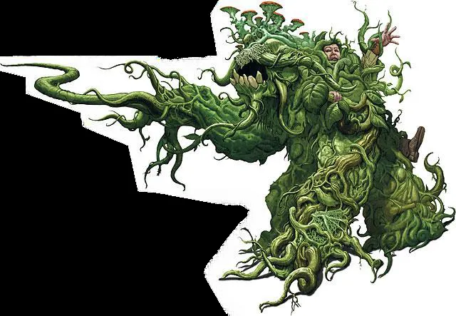

# Arbusto Errante

Um arbusto errante, às vezes chamado apenas de errante, vagam lentamente por pântanos desolados, charcos lúgubres e florestas tropicais, consumindo qualquer matéria orgânica em seu caminho. Este amontoado podre de vegetação animada tem aproximadamente a altura de um humano e meio, terminando em uma “cabeça” sem rosto no topo.

***Devoradores que Consomem Tudo***. Um arbusto errante se alimenta de qualquer material orgânico, consumindo incansavelmente plantas enquanto se move e devorando animais que não conseguem escapar dele. Apenas a raridade e lentidão do arbusto errante previne que ele destrua um ecossistema inteiro. Mesmo assim, a presença deles incomoda o ambiente natural das plantas e vida animal e uma calma inquietante permeia os pântanos e florestas assombrados por esses horrores insaciáveis.

***Caçadores Ocultos***. Compostos de folhas, vinhas, raízes e outros compostos naturais apodrecidos de pântanos e florestas, errantes podem se misturar ao seus ambientes. Já que eles se movem lentamente, eles raramente tentam perseguir e pegar presas. Ao invés disso, eles permanecem parados, sustentando-se absorvendo nutrientes das suas redondezas enquanto esperam as presas virem até eles. Quando uma criatura passa próximo ou pousa sobre um arbusto errante, o monstro ganha vida, agarrando e absorvendo a presa desavisada.

***Gerados por Relâmpagos***. Um arbusto errante é resultado de um fenômeno em que relâmpagos ou magia feérica revigora o que outrora foi uma planta pantanosa comum. À medida que a planta renasce para sua segunda vida, ela sufoca a vida de planas e animais a sua volta, cobrindo seus corpos numa pilha ao redor de suas raízes. Essas raízes, eventualmente, se desprendem do solo, direcionando o amontoado trôpego em busca de novas fontes de alimento.

***A Erva que Anda***. O instinto que guia o arbusto errante é um pedúnculo de raiz central, entocada em algum lugar dentro da forma maciça. Os restos do errante consistem em um amontoado apodrecido que, ao mesmo tempo, ele acumula e alimenta, o qual protege o pedúnculo de raiz que o anima para esmagar e sufocar a vida de qualquer criatura.

A densa massa do corpo do arbusto errante encolhe-se sob o efeito de frio e fogo. A eletricidade revigora o pedúnculo de raiz, fortalecendo o arbusto errante e potencializando seu ímpeto consumidor.

Independentemente de sua forma monstruosa, o arbusto errante é uma planta viva que necessita de ar e suprimentos. Apesar de ela não dormir como os animais fazem, ela pode ficar adormecida por dias antes de se erguer para caçar comida.

***A Ameaça que Ressurge***. Se um arbusto errante enfrentar a derrota perante um oponente avassalador, o pedúnculo de raiz pode fingir-se de morto, desmoronando os restos do errante. Se não for morto subsequentemente, o pedúnculo de raiz reativa os restos do errante, lentamente recompondo seu corpo inteiro, então, mais uma vez, se ergue para consumir tudo o que puder. Desta maneira, as infestações do arbusto errante que se pensava terem sido destruídos a muito, podem ocorrer novamente e novamente.

## Bloco de estatísticas: Arbusto Errante

*Planta Grande, imparcial*

**Classe de Armadura** 15 (armadura natural)  
**Pontos de Vida** 136 (16d10 + 48)  
**Deslocamento** 6 m, natação 6 m

| FOR | DES | CON | INT | SAB | CAR |
| :---: | :---: | :---: | :---: | :---: | :---: |
| 18 (+4) | 8 (–1) | 16 (+3) | 5 (–3) | 10 (+0) | 5 (–3) |

**Perícias** Furtividade +2  
**Resistência a Dano** frio, fogo  
**Imunidade a Dano** elétrico  
**Imunidade a Condição** cego, surdo, exausto  
**Sentidos** percepção às cegas 18 m (cego além desse raio), Percepção passiva 10  
**Idiomas** –  
**Nível de Desafio** 5 (1.800 XP)

***Absorção de Eletricidade***. Sempre que o arbusto errante for alvo de dano elétrico, ele não sofrerá nenhum dano e recuperará uma quantidade de pontos de vida igual ao dano elétrico causado.

### Ações

***Ataques Múltiplos***. O arbusto errante realiza dois ataques de pancada. Se ambos os ataques atingirem um alvo Médio ou menor, o alvo estará agarrado (CD 14 para escapar) e o arbusto errante usa seu Engolfar nele.

***Pancada***. *Ataque Corpo-a-Corpo com Arma*: +7 para atingir, alcance 1,5 m, um alvo. *Acerto*: 13 (2d8 + 4) de dano de concussão.

***Engolfar***. O arbusto errante engolfa uma criatura Média ou menor que ele tenha agarrado. A criatura engolfada está cega, impedida e incapaz de respirar e deve ser bem sucedida num teste de resistência de Constituição CD 14 no início de cada turno do errante ou sofrerá 13 (2d8 + 4) de dano de concussão. Se o errante se mover a criatura engolfada se move com ele. O errante pode ter apenas uma criatura engolfada por vez.
