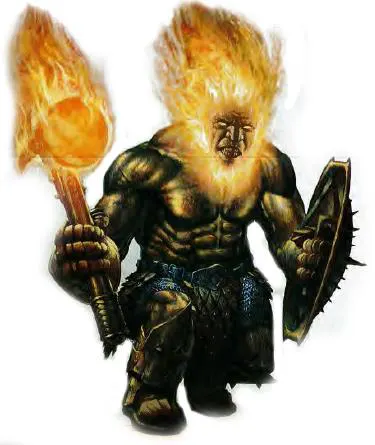

# Azer

Nativos do Plano Elemental do Fogo, os azers são mestres da forja, mineiros peritos e inimigos jurados dos efreet. Em relação à aparência e maneiras, um azer assemelhasse a um anão, mas só na fachada. Sob sua pele de aparência metálica, um azer é um ser de fogo, que por fora se manifesta em seu cabelo e barba flamejantes.

***Construídos, Não Nascidos***. Os azers não se reproduzem. Cada um deles é construído de bronze por outro azer e imbuído com uma porção da chama interior do construtor. Cada azer é esculpido com características únicas. Esse processo de construção limita o crescimento populacional dos azers e é a razão principal para essas criaturas continuarem raras.

***Habitantes Vulcânicos***. Os azers habitam em reinos nas fronteiras entre o Plano Elemental da Terra e o Plano Elemental do Fogo – uma cadeia de montanha e vulcões cujos cumes erguem-se como sequencias de fortalezas. Sob os picos das montanhas, abaixo de caldeiras vulcânicas e entre rios de magma, os azers extraem metal incandescente e gemas brilhantes da terra. Esquadrões de azers patrulham as passagens e túneis para seu reino rechaçando as investidas de salamandras cujos mestres efreet ordenam ataques contra os reinos azer.

***Inimigos dos Efreet***. Há muito tempo, os efreet e os azers eram aliados. Os azers ajudaram a criar a Cidade de Bronze, forjando aquele lar dos efreet em um dos lugares mais maravilhosos já criados. Quando os azers terminaram o trabalho deles, os efreet os traíram, realizando uma tentativa falha de escravizar os azers e de proteger os segredos da cidade. Apesar das incursões ocasionais e conflitos, no entanto, os dois lados abstiveram-se, até agora, de um conflito direto. Os azers acreditam que apenas a ameaça de serem reveladas as passagens escondidas para a Cidade de Bronze mantem os efreet em xeque.

***Mestres do Metal e das Gemas***. Os azers são artesãos memoráveis e criam trabalhos maravilhosos com as gemas e metais preciosos encontrados no habitat vulcânico. Eles avaliam o valor de tais tesouros acima de todas as outras coisas, por vezes, enviando grupos para os planos em busca de metais e gemas raros.

Quando os azers são evocados através de magia para o Plano Material, em geral é para ajudar a forjar um elaborado item mágico ou obra de arte, pois dizem que sua perícia com tal ofício é incomparável.

***Fogo Vivo***. Um azer não precisa comer, beber ou dormir.

## Bloco de estatísticas: Azer

*Elemental Médio, leal e neutro*

**Classe de Armadura** 17 (armadura natural, escudo)  
**Pontos de Vida** 39 (6d8 + 12)  
**Deslocamento** 9 m

| FOR | DES | CON | INT | SAB | CAR |
| :---: | :---: | :---: | :---: | :---: | :---: |
| 17 (+3) | 12 (+1) | 15 (+2) | 12 (+1) | 13 (+1) | 10 (+0) |

**Testes de Resistência** Con +4  
**Imunidade a Dano** fogo, veneno  
**Imunidade a Condição** envenenado  
**Sentidos** Percepção passiva 11  
**Idiomas** Ígneo  
**Nível de Desafio** 2 (450 XP)

***Armas Ardentes***. Quando um azer atinge com uma arma corpo-a-corpo de metal, ele causa 3 (1d6) de dano de fogo extra (incluso no ataque).

***Corpo Ardente***. Uma criatura que toque o azer ou atinja ele com um ataque corpo-a-corpo a até 1,5 metro dele, sofre 5 (1d10) de dano de fogo.

***Iluminação***. O azer emite luz plena num raio de 3 metros e penumbra por mais 3 metros adicionais.

### Ações

***Martelo de Guerra***. *Ataque Corpo-a-Corpo com Arma*: +5 para atingir, alcance 1,5 m, um alvo. *Acerto*: 7 (1d8 + 3) de dano de concussão ou 8 (1d10 + 3) de dano de concussão se for usado com duas mãos para realizar ataques corpo-a-corpo, mais 3 (1d6) de dano de fogo.
