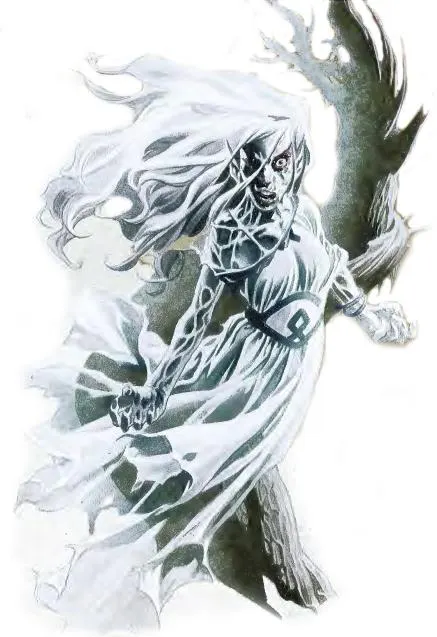

# Banshee

Quando a noite cai, viajantes desafortunados ouvem um choros baixos da morta desamparada. Esse espírito lamentável é uma banshee, uma criatura rancorosa formada a partir do espírito de uma elfa.

As banshees parecem esquálidas formas luminosas que lembram vagamente suas características mortais. O rosto de uma banshee está envolto em um emaranhado de cabelos, o corpo vestido com trapos esfarrapados que vibram à medida que ela se move.

***Ira Divina***. As banshees são os mortos-vivos remanescentes de elfas que, abençoadas com grande beleza, fracassaram em usar sua dádiva para trazer alegria ao mundo. Ao invés disso, elas usaram sua beleza para corromper e controlar os outros. As elfas afetadas pela maldição da banshee não experimentam qualquer alegria, sentindo apenas angústia na presença dos vivos. À medida que a maldição cobra seu preço, suas mentes e corpos decaem, até que a morte complete suas transformações em monstros mortos-vivos.

***Limite do Sofrimento***. Uma banshee torna-se eternamente limitada ao lugar de seu falecimento, incapaz de se aventurar a mais de sete quilômetros e meio desse lugar. Ela é forçada a reviver cada momento de sua vida com perfeita memória, ainda assim se recusa a aceitar a responsabilidade por sua ruína.

***Cobiçadoras da Beleza***. A vaidade que inspirou a criação da maldição da banshee persiste na morte-vida. Essas criaturas cobiçam belos objetos: joias finas, pinturas, estátuas e outros objetos de arte. Ao mesmo tempo, uma banshee abomina qualquer superfície espelhada, pois não consegue suportar ver o horror de sua própria existência. Um único vislumbre de si mesma é suficiente para levar a banshee à fúria.

***Natureza Morta-Viva***. Uma banshee não precisa respirar, comer, beber ou dormir.

## Bloco de estatísticas: Banshee

*Morto-vivo Médio, caótico e mau*

**Classe de Armadura** 12  
**Pontos de Vida** 58 (13d8)  
**Deslocamento** 0 m, voo 12 m (planar)

| FOR | DES | CON | INT | SAB | CAR |
| :---: | :---: | :---: | :---: | :---: | :---: |
| 1 (–5) | 14 (+2) | 10 (+0) | 12 (+1) | 11 (+0) | 17 (+3) |

**Testes de Resistência** Sab +2, Car +5  
**Resistência a Dano** ácido, elétrico, fogo, frio, trovejante; concussão, perfurante e cortante de ataques não-mágicos  
**Imunidade a Condição** agarrado, caído, enfeitiçado, envenenado, exausto, impedido, inconsciente, paralisado, petrificado  
**Sentidos** visão no escuro 18 m, Percepção passiva 10  
**Idiomas** Comum, Élfico  
**Nível de Desafio** 4 (1.100 XP)

***Detectar Vida***. A banshee pode sentir magicamente a presença de criaturas vivas a até 7,5 quilômetros de distância. Ela sabe a direção geral delas, mas não sua localização exata.

***Movimento Incorpóreo***. A banshee pode se mover através de criaturas e objetos como se eles fossem terreno difícil. Ela sofre 5 (1d10) de dano de energia se terminar seu turno dentro de um objeto.

### Ações

***Toque Corruptor***. *Ataque Corpo-a-Corpo com Magia*: +4 para atingir, alcance 1,5 m, um alvo. *Acerto*: 12 (3d6 + 2) de dano necrótico.

***Aspecto Horripilante***. Cada criatura não morta-viva a até 18 metros da banshee que puder vê-la, deve ser bem sucedida num teste de resistência de Sabedoria CD 13 ou ficará amedrontada por 1 minuto. Um alvo amedrontado pode repetir o teste de resistência no final de cada um dos seus turnos, com desvantagem se a banshee estiver na sua linha de visão, terminando o efeito sobre si, se obtiver sucesso. Se o alvo for bem sucedido no teste, ou o se o efeito terminar nele, ele fica imune ao Aspecto Horripilante da banshee pelas próximas 24 horas.

***Grito (1/Dia)***. A banshee libera um grito lúgubre, considerando que ela não esteja sob a luz do sol. Esse grito não produz efeito em constructos e mortos-vivos. Todas as outras criaturas a até 9 metros dela, que puderem ouvi-la, devem realizar um teste de resistência de Constituição CD 13. Se falhar, uma criatura cai a 0 pontos de vida. Se obtiver sucesso, a criatura sofre 10 (3d6) de dano necrótico.
