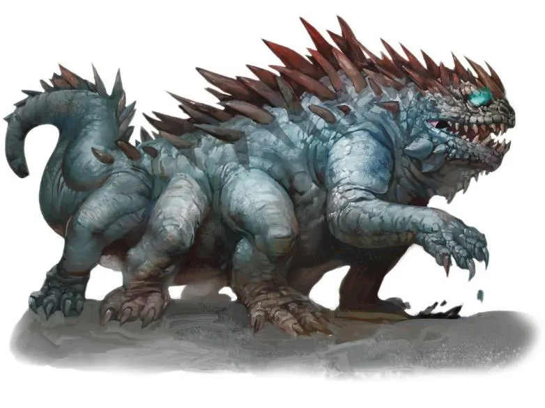

# Basilisco

Viajantes, às vezes encontram objetos que se parecem com pedaços de esculturas de pedra extremamente realistas de animais selvagens. As partes que faltam parecem ter sido arrancadas a dentada. Exploradores experientes reconhecem esses restos como avisos, sabendo que o basilisco que as criou possivelmente esteja próximo.

***Predadores Adaptáveis***. Os basiliscos sobrevivem em climas áridos, temperados ou tropicais. Eles repousam em cavernas ou em outros locais abrigados. Na maioria das vezes, os basiliscos são encontrados no subterrâneo.

Um basilisco que nascer e crescer em cativeiro pode ser domesticado e treinado. Um basilisco treinado sabe como evitar o encontro dos seus olhos com os do seu mestre para protege-lo do seu olhar, mas isso faz dele uma besta guardiã assustadora. Devido a esse uso, os ovos de basilisco são extremamente valorizados.

***Olhar Pétreo***. Os basiliscos são lentos para caçar criaturas, mas eles não precisam perseguir presas. Fitar o olhar sobrenatural de um basilisco pode ser o suficiente para ser afetado por uma rápida transformação, transformando a vítima em pedra porosa. Os basiliscos, com suas poderosas mandíbulas, são capazes de consumir a pedra. A pedra volta a forma orgânica no esôfago do basilisco.

Alguns alquimistas dizem saber como processar o esôfago do basilisco e os fluidos contidos dentro dele. Manuseado corretamente, o esôfago produz um óleo que pode retornar criaturas petrificadas em carne e à vida. Infelizmente, para tais vítimas, quaisquer partes perdidas na forma de pedra continua faltando se a criatura for revivida. A revivificação usando o óleo é impossível se uma parte vital da criatura petrificada, como sua cabeça, estiver faltando.

## Bloco de estatísticas: Basilisco

*Monstruosidade Média, imparcial*

**Classe de Armadura** 15 (armadura natural)  
**Pontos de Vida** 52 (8d8 + 16)  
**Deslocamento** 6 m

| FOR | DES | CON | INT | SAB | CAR |
| :---: | :---: | :---: | :---: | :---: | :---: |
| 16 (+3) | 8 (–1) | 15 (+2) | 2 (–4) | 8 (–1) | 7 (–2) |

**Sentidos** visão no escuro 18 m, Percepção passiva 9  
**Idiomas** –  
**Nível de Desafio** 3 (700 XP)

***Olhar Petrificante***. Se uma criatura começar seu turno a até 9 metros do basilisco e ambos puderem se ver, o basilisco pode forçar a criatura a realizar um teste de resistência de Constituição CD 12 se ele não estiver incapacitado. Se falhar na resistência, a criatura magicamente começa a se transformar em pedra e fica impedida. Ela deve repetir o teste de resistência no final do próximo turno dela. Se obtiver sucesso, e efeito termina. Se fracassar, a criatura é petrificada até ser liberta pela magia *restauração maior* ou outro efeito mágico. Uma criatura que não esteja surpresa pode desviar seu olhar para evitar o teste de resistência no início do turno dela. Se ela o fizer, ela não poderá ver o basilisco até o início do próximo turno dela, quando ela poderá desviar seu olhar novamente. Se olhar para o basilisco nesse meio tempo, ela deve imediatamente realizar a resistência. Se o basilisco ver seu reflexo a até 9 metros sob luz plena, ele confundirá a si mesmo com um rival e usará seu olhar em si próprio.

### Ações

***Mordida***. *Ataque Corpo-a-Corpo com Arma*: +5 para atingir, alcance 1,5 m, um alvo. *Acerto*: 10 (2d6 + 3) de dano perfurante mais 7 (2d6) de dano de veneno.

