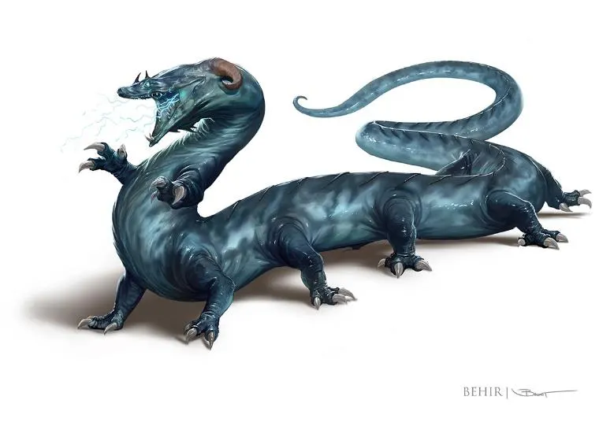

# Behir

O sinuoso behir rasteja pelo solo e escala pelas paredes para alcançar suas presas. Seu sopro elétrico pode incinerar a maioria das criaturas, até mesmo oponentes mais poderosos são constringidos em seu corpo enrolado e devorados vivos.

A forma monstruosa do behir lembra uma combinação de uma centopeia com um crocodilo. Sua pele escamada vai da coloração ultramarina até azul escuro, esmaecendo para o azul claro em sua parte inferior.

***Predadores de Caverna***. Os behirs repousam em lugares inacessíveis para outras criaturas, preferindo locais onde intrusos precisem realizar uma escalada lancinante para alcança-los. Abismos profundos, cavernas elevadas em paredes de penhascos e cavernas alcançadas apenas se espremendo, túneis sinuosos são locais privilegiados para o behir efetuar uma emboscada. As dozes patas do behir permitem que ele perambule pelo seu covil com facilidade. Quando não está escalando, ele se move ainda mais rápido dobrando suas pernas para fora de seu corpo e deslizando como uma cobra.

Os behirs engolem suas presas inteiras, depois disso eles entram num período de hibernação enquanto as digerem. Enquanto estiver hibernando, um behir escolhe um local escondido onde os intrusos no seu covil possam não percebe-lo.

***Adversários dos Dragões***. Numa época a muito esquecida, gigantes e dragões se engajaram numa guerra aparentemente interminável. Gigantes da tempestade criaram os primeiros behirs como armas contra os dragões e os behirs guardaram um ódio natural pelos seres dracônicos.

Um behir nunca faz seu covil numa área que ele saiba ser habitada por um dragão. Se um dragão tentar estabelecer seu covil dentro de algumas dezenas de quilômetros do covil de um behir, o behir é compelido a matar o dragão ou a afugenta-lo. Apenas se o dragão se mostrar muito poderoso para se enfrentar, um behir irá desistir, buscando um novo local para seu covil o mais longe possível.

## Bloco de estatísticas: Behir

*Monstruosidade Enorme, neutro e mau*

**Classe de Armadura** 17 (armadura natural)  
**Pontos de Vida** 168 (16d12 + 64)  
**Deslocamento** 15 m, escalada 12 m

| FOR | DES | CON | INT | SAB | CAR |
| :---: | :---: | :---: | :---: | :---: | :---: |
| 23 (+6) | 16 (+3) | 18 (+4) | 7 (–2) | 14 (+2) | 12 (+1) |

**Perícias** Furtividade +7, Percepção +6  
**Imunidade a Dano** elétrico  
**Sentidos** visão no escuro 27 m, Percepção passiva 16  
**Idiomas** Dracônico  
**Nível de Desafio** 11 (7.200 XP)

### Ações

***Ataques Múltiplos***. O behir realiza dois ataques: um com sua mordida e um de constrição.

***Mordida***. *Ataque Corpo-a-Corpo com Arma*: +10 para atingir, alcance 3 m, um alvo. *Acerto*: 22 (3d10 + 6) de dano perfurante.

***Constrição***. *Ataque Corpo-a-Corpo com Arma*: +10 para atingir, alcance 1,5 m, uma criatura Grande ou menor. *Acerto*: 17 (2d10 + 6) de dano de concussão mais 17 (2d10 + 6) de dano cortante. O alvo fica agarrado (CD 16 para escapar) se o behir ainda não estiver constringindo uma criatura e o alvo é impedido até o agarrão terminar.

***Sopro Elétrico (Recarrega 5–6)***. O behir expele uma linha de eletricidade de 6 metros de comprimento por 1,5 metro de largura. Cada criatura na linha deve realizar um teste de resistência de Destreza CD 16, sofrendo 66 (12d10) de dano elétrico se falhar na resistência ou metade desse dano se obtiver sucesso.

***Engolir***. O behir realiza um ataque de mordida contra um alvo Médio ou menor que esteja agarrando. Se o ataque atingir, o alvo também será engolido e o agarrão termina. Enquanto estiver engolido, o alvo estará cego e impedido, ele terá cobertura total contra ataques e outros efeitos de fora do behir e sofre 21 (6d6) de dano ácido no começo de cada turno do behir. Um behir pode ter apenas uma criatura engolida por vez. Se o behir sofrer 30 de dano ou mais em um único turno por uma criatura engolida, o behir deve ser bem sucedido num teste de resistência de Constituição CD 14 no final desse turno ou regurgitará a criatura, que cairá em um espaço a até 3 metros do behir. Se o behir morrer, uma criatura engolida não estará mais impedida por ele e poderá escapar do corpo usando 4,5 metro de movimento, estando caída ao sair.

