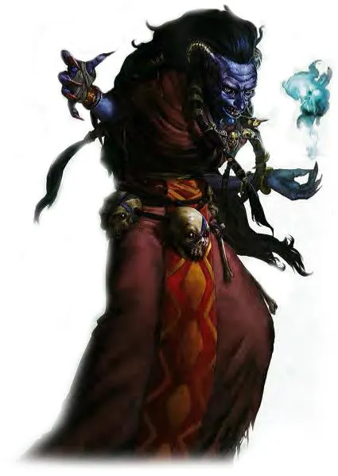
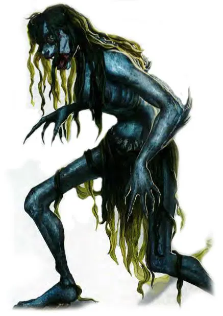
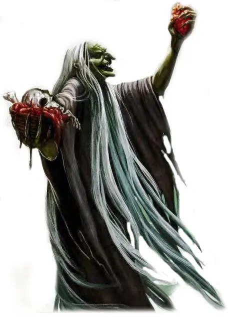

# Bruxas

As bruxas representam tudo que é mal e cruel. Apesar de elas se parecem com velhas enrugadas, não existe nada mortal sobre essas criaturas monstruosas, cujas formas refletem apenas a perversidade em seus corações.

***Faces da Maldade***. Seres ancestrais com origens em Faéria, as bruxas são úlceras no mundo mortal. Seus rostos enrugados são emoldurados por longos cabelos desgrenhados, pústulas e verrugas horrendas pontilham sua pele manchada e seus longos e finos dedos terminam em garras que podem cortar a carne ao toque. Suas vestes simples estão sempre esfarrapadas e sujas.

> **Convenção de Bruxas**
>
> Quando as bruxas tem que trabalhar juntas, elas formam convenções, apesar da natureza egoísta delas. Uma convenção é feita por bruxas de quaisquer tipos, todas sendo consideradas iguais dentro do grupo. No entanto, cada uma das bruxas continua a desejar mais poder pessoal. Uma convenção consiste em três bruxas, portanto, qualquer discussão entre duas bruxas pode ser decidida pela terceira. Se mais de três bruxas se juntarem, como poderia acontecer se duas convenções entrassem em conflito, o resultado geralmente é o caos.
>
> ***Conjuração Partilhada***. Enquanto todos os três membros da convenção de bruxas estiverem a até 9 metros um do outro, eles podem conjurar as seguintes magias da lista de magias de mago, mas devem partilhar o espaço de magia entre eles:
>
> 1° nível (4 espaços): *identificação, raio adoecente* 2° nível (3 espaços): *imobilizar pessoa, localizar objeto* 3° nível (3 espaços): *rogar maldição, contramágica, relâmpago* 4° nível (3 espaços): *assassino fantasmagórico, metamorfose* 5° nível (2 espaços): *contato extraplanar, vidência* 6° nível (1 espaço): *ataque visual*
>
> Para conjurar essas magias, cada bruxa é considerada um conjurador de 12° nível que usa Inteligência como habilidade de conjuração. A magia tem CD 12 + o modificador de Inteligência da bruxa e o bônus de ataque da magia é 4 + o modificador de Inteligência da bruxa.
>
> ***Olho de Bruxa***. Uma convenção de bruxas pode construir um item mágico chamado *olho de bruxa*, que é feito a partir de um olho de verdade envernizado e, muitas vezes, preso a um pingente ou outro item que se possa vestir. O *olho de bruxa* geralmente é confiado a um lacaio para que ele guarde e transporte. Uma bruxa em uma convenção pode realizar uma ação para ver o que o *olho de bruxa* vê se ambos estiverem no mesmo plano de existência. Um *olho de bruxa* tem CA 10, 1 ponto de vida e visão no escuro com alcance de 18 metros de raio. Se for destruído, cada membro da convenção sofre 3d10 de dano psíquico e fica cego por 24 horas. Uma convenção de bruxas pode ter apenas um *olho de bruxa* por vez e criar um novo requer que todos os três membros da convenção realizem um ritual. O ritual leva 1 hora e as bruxas não podem realiza-lo enquanto estiverem cegas. Durante o ritual, se as bruxas fizerem qualquer ação diferente da realização do ritual, elas devem começa-lo novamente.

Todas as bruxas possuem poderes mágicos e algumas tem afinidade com conjuração. Elas podem alterar suas formas ou amaldiçoar seus inimigos e sua arrogância as inspira a ver sua magia como uma provocação à magia dos deuses, blasfemando em todas as oportunidades.

As bruxas se intitulam de formas obscuramente excêntricas, reivindicando alcunhas como Morwen Negra, Peggy Pé de Porco, Vovó Titchwillow, Nana Shug, Ethel Podre ou Auntie Dente de Verme.

***Maternidade Monstruosa***. As bruxas se propagam ao raptar e devorar infantes humanos. Após usurpar um bebê do seu berço ou do ventre da mãe a bruxa devora a pobre criança. Uma semana depois, a bruxa dá a luz a uma filha que se parece humana até seu décimo terceiro aniversário, que é quando a criança se transforma em uma imagem cuspida de sua mãe bruxa.

As bruxas, às vezes criam as filhas que elas geram, criando convenções. Uma bruxa também pode retornar a criança para seus pais de luto, apenas para ver das sombras a criança crescer até se tornar um horror.

***Barganhas Obscuras***. Arrogantes ao extremo, bruxas acreditam serem as mais espertas das criaturas e elas tratam todos os outros como inferiores. Mesmo assim, uma bruxa está aberta a negociar com mortais contanto que esses mortais mostrem o devido respeito e deferência. Ao longo de suas longas vidas, as bruxas acumulam muito conhecimento da sabedoria local, das criaturas sombrias e da magia que elas tem o prazer de negociar.

As bruxas gostam de assistir os mortais trazerem suas próprias ruínas e barganhar com uma bruxa é sempre perigoso. Os termos de tais barganhas geralmente envolvem demandas para comprometer princípios ou desistir de algo estimado – especialmente se a coisa perdida diminuir ou invalidar algum conhecimento adquirido através da barganha.

***Uma Natureza Imunda***. As bruxas adoram o macabro e enfeitam seus trajes com coisas mortas e acentuam sua aparência com ossos, pedaços de carne e imundícies. Elas ostentam manchas e criam feridas para produzir pranto e carne supurada. Criaturas atraentes causam nojo em uma bruxa, o que pode “ajudar” tais criaturas ao desfigura-las e transforma-las.

Esse abraço perturbador e desagradável estende-se a todos os aspectos da vida de uma bruxa. Uma bruxa poderia voar em uma caveira mágica gigante, pousando em uma árvore moldada para se parecer com um enorme corpo sem cabeça. Outra pode viajar com uma coletânea de monstros e escravos mantidos enjaulados e disfarçados através de ilusão para enganar criaturas desatentas que se aproximem. As bruxas afiam seus dentes em mós e torcem tecidos intestinais de suas vítimas, reagindo com satisfação ao horror provocado por suas ações.

***Irmandade Obscura***. As bruxas mantem contato umas com as outras e partilham conhecimento. Através de tais contatos, é como se cada bruxa soubesse de cada outra bruxa que exista. As bruxas não se gostam, mas elas respeitam um código de conduta eterno. As bruxas anunciam sua presença antes de cruzarem o território de outra bruxa, trazendo presentes quando adentram na residência de outra bruxa e não quebram promessas dados por outras bruxas – contanto que a promessa não tenha sido feita com os dedos cruzados.

Alguns humanoides cometem o erro de pensar que os códigos de conduta das bruxas se aplicam a todas as criaturas. Quando confronta tais indivíduos, um bruxa pode achar divertido enrolar o tolo por um tempo antes de ensiná-lo uma lição permanente.

***Covis Sombrios***. As bruxas habitam em florestas escuras e retorcidas, charnecas desoladas, costas litorâneas tempestuosas e pântanos sombrios. Com o tempo, a paisagem ao redor do covil de uma bruxa começa a refletir a ansiedade da criatura de tal forma que a própria terra pode atacar e matar invasores. Árvores retorcidas pelas trevas atacam transeuntes, enquanto que vinhas serpenteiam por debaixo da terra para enrolar e puxas as criaturas, uma por vez. Nevoeiros fedorentos de poluição tornam o ar venenoso e ocultam poças de areia movediça e sumidouros que consomem os andarilhos desatentos.

### Bruxa da Noite

Astutas e subversivas, bruxas da noite querem ver a virtuosidade se tornar vilania: amor se torna obsessão, bondade em ódio, devoção em desrespeito e generosidade em egoísmo. As bruxas da noite sentem um prazer perverso em corromper os mortais.

As bruxas da noite certa vez foram criaturas de Faéria, mas sua obscenidade fez com que fossem exiladas para o Hades há muito tempo atrás, onde elas se degeneraram em corruptores. As bruxas da noite, há muito tempo se espalharam pelos Planos Inferiores.

***Traficante de Almas***. Enquanto um humanoide dorme, a bruxa da noite pode ficar sobre a pessoa etereamente e invadir seus sonhos. Qualquer criatura com visão verdadeira pode ver a forma espectral da bruxa sobre sua presa. A bruxa etérea enche a cabeça de sua vítima com dúvidas e temores, na esperança de leva-la a

## Bloco de estatísticas: Bruxa da Noite

*Corruptor Médio, neutro e mau*

**Classe de Armadura** 17 (armadura natural)  
**Pontos de Vida** 112 (15d8 + 45)  
**Deslocamento** 9 m

| FOR | DES | CON | INT | SAB | CAR |
| :---: | :---: | :---: | :---: | :---: | :---: |
| 18 (+4) | 15 (+2) | 16 (+3) | 16 (+3) | 14 (+2) | 16 (+3) |

**Perícias** Enganação +7, Furtividade +6, Intuição +6, Percepção +6  
**Resistência a Dano** fogo, frio; concussão, perfurante e cortante de ataques não-mágicos que não sejam de prata  
**Imunidade a Condição** enfeitiçado  
**Sentidos** visão no escuro 36 m, Percepção passiva 16  
**Idiomas** Abissal, Comum, Infernal, Primordial  
**Nível de Desafio** 5 (1.800 XP)

***Conjuração Inata***. A habilidade de conjuração de uma bruxa é Carisma (CD de resistência de magia 14, +6 para atingir com ataques de magia). Ela pode conjurar, inatamente, as seguintes magias, sem necessidade de componentes materiais:

À vontade: *detectar magia, mísseis mágicos* 2/dia cada: *viagem planar* (pessoal apenas)*, raio do* *enfraquecimento, sono*

***Resistência à Magia***. A bruxa possui vantagem nos testes de resistência contra magias e outros efeitos mágicos.

### Ações

***Garras (Forma de Bruxa Apenas)***. *Ataque Corpo-a-Corpo com* *Arma*: +7 para atingir, alcance 1,5 m, um alvo. *Acerto*: 13 (2d8 + 4) de dano cortante.

***Mudar Forma***. A bruxa magicamente se metamorfoseia em uma fêmea humanoide Pequena ou Média ou de volta para sua forma verdadeira. As estatísticas de jogo dela são as mesmas em cada forma. Qualquer equipamento que ela esteja usando ou carregando é transformado. Ela volta a sua forma verdadeira se morrer.

***Forma Etérea***. A bruxa magicamente entra no Plano Etéreo do Plano Material ou vice-versa. Para fazê-lo, a bruxa deve ter uma *pedra-coração* consigo.

***Pesadelo Assombrado (1/Dia)***. Quando estiver no Plano Etéreo, a bruxa toca magicamente um humanoide dormindo no Plano Material. Uma magia *proteção contra o bem e mal* conjurada no alvo previne esse contato, assim como um *círculo mágico*. Enquanto o contato durar, o alvo terá terríveis visões. Se essas visões durarem por pelo menos 1 hora, o alvo não recebe qualquer benefício pelo descanso e seu máximo de pontos de vida é reduzido em 5 (1d10). Se esse efeito reduzir o máximo de pontos de vida do alvo a 0, o alvo morre e, se o alvo for mau, sua alma é aprisionada na sacola de almas da bruxa. A redução no máximo de pontos de vida do alvo dura até ser removida pela magia *restauração maior* ou uma magia similar.

### Itens da Bruxa da Noite

Uma bruxa da noite carrega dois itens mágicos muito raros que ela mesma deve construir. Se quaisquer desses objetos for perdido, a bruxa da noite não medirá esforços para recuperá-lo, já que a criação de um novo demanda tempo e esforço.

***Pedra-Coração***. Essa gema negra e lustrosa permite que uma bruxa da noite torne-se etérea enquanto a possuir. O toque da *pedra-coração* também cura qualquer doença. Construir uma *pedra-coração* leva 30 dias.

***Sacola de Almas***. Quando um humanoide maligno morre como resultado do Pesadelo Assombrado da bruxa da noite, a bruxa coleta a alam nesse saco preto feito de pele costurada. Uma *sacola de almas* pode conter apenas uma alma maligna por vez e apenas a bruxa da noite que construiu a sacola pode coletar uma alma com ela. Construir uma *sacola de alma* requer 7 dias e um sacrifício humanoide (do qual a pele é usada para fazer a sacola).

realizar atos malignos no mundo quando despertar. A bruxa continua suas visitas noturnas até a vítima finalmente morrer durante o sono. Se a bruxa levar a vítima a cometer feitos malignos, ela prende a alma corrompida em sua *sacola de almas* (veja a nota “Itens da Bruxa da Noite”) para transporta-la para o Hades.

***Convenções***. Uma bruxa da noite que faça parte de uma convenção (veja a nota “Convenção de Bruxas”) tem um nível de desafio de 7 (2.900 XP).

### Bruxa do Mar

As bruxas do mar vivem em covis submersos funestos e poluídos, cercados por merrows e outros monstros aquáticos.

A beleza leva a bruxa do mar a ter acessos de raiva. Quando confrontada por algo belo, a bruxa pode simplesmente atacar ou desfigurar a coisa. Se uma coisa bela traz esperanças, a bruxa quer que ela cause desespero. Se ela inspira coragem, a bruxa quer que cause medo.

## Bloco de estatísticas: Bruxa do Mar

*Fada Média, caótico e mau*

**Classe de Armadura** 14 (armadura natural)  
**Pontos de Vida** 52 (7d8 + 21)  
**Deslocamento** 9 m, natação 12 m

| FOR | DES | CON | INT | SAB | CAR |
| :---: | :---: | :---: | :---: | :---: | :---: |
| 16 (+3) | 13 (+1) | 16 (+3) | 12 (+1) | 12 (+1) | 13 (+1) |

**Sentidos** visão no escuro 18 m, Percepção passiva 11  
**Idiomas** Aquan, Comum, Gigante  
**Nível de Desafio** 2 (450 XP)

***Anfíbio***. A bruxa pode respirar ar e água.

***Aparência Horripilante***. Qualquer humanoide que começar seu turno a até 9 metros da bruxa e puder vê-la em sua verdadeira forma, deve realizar um teste de resistência de Sabedoria CD 11. Se falhar na resistência, a criatura fica amedrontada por 1 minuto. A criatura pode repetir o teste de resistência no final de cada um dos seus turnos, com desvantagem se a bruxa estiver na sua linha de visão, terminando o efeito sobre si, se obtiver sucesso. Se a criatura for bem sucedido no teste, ou o se o efeito terminar nela, ela fica imune à Aparência Horripilante da bruxa pelas próximas 24 horas.

A não ser que o alvo esteja surpreso ou que a revelação da aparência verdadeira da bruxa tenha sido repentina, o alvo pode desviar seu olhar e evitar o teste de resistência inicial. Até o início do seu próximo turno, uma criatura que esteja desviando o olhar terá desvantagem nas jogadas de ataque contra a bruxa.

### Ações

***Garras***. *Ataque Corpo-a-Corpo com Arma*: +5 para atingir, alcance 1,5 m, um alvo. *Acerto*: 10 (2d6 + 3) de dano cortante.

***Olhar Mortal***. A bruxa afeta uma criatura amedrontada que ela possa ver, a até 9 metros dela. Se o alvo puder ver a bruxa, ele deve ser bem sucedido num teste de resistência de Sabedoria CD 11 contra essa magia ou cairá a 0 pontos de vida.

***Aparência Ilusória***. A bruxa encobre a si mesma e a tudo que ela esteja vestindo ou carregando com uma ilusão mágica que faz com que ela se pareça com uma criatura feia de tamanho similar ao seu e de formato humanoide. O efeito termina se a bruxa usar uma ação bônus para termina-lo ou se ela morrer. As mudanças forjadas por esse efeito falham em se manter durante uma inspeção física. Por exemplo, a bruxa pode parecer não possuir garras, mas alguém que toque a mão dela poderá sentir as garras. Do contrário, uma criatura deve realizar uma ação para inspecionar visualmente a ilusão e passar num teste de Inteligência (Investigação) CD 16 para perceber que a bruxa está disfarçada.

***Feia por Dentro e por Fora***. As bruxas do mar são, de longe, as mais feias dentre as bruxas, com escamas viscosas cobrindo sua pele pálida. O cabelo de uma bruxa do mar lembra algas marinhas, cobrindo seu corpo emaciado e seus olhos vítreos parecem tão sem vida quanto os de uma boneca. Apesar da bruxa do mar poder esconder sua forma verdadeira através de um véu de ilusão, a bruxa é amaldiçoada para se parecer feia eternamente. Sua forma ilusória parece desfigurada, na melhor das hipóteses.

***Convenções***. Uma bruxa do mar que faça parte de uma convenção (veja a nota “Convenção de Bruxas”) tem um nível de desafio de 4 (1.100 XP).

### Bruxa Verde

As miseráveis e odiosas bruxas verdes habitam em florestas moribundas, pântanos solitários e charcos nebulosos, fazendo seus lares em cavernas. As bruxas verdes adoram manipular outras criaturas para que façam suas vontades, mascarando suas intenções atrás de camadas de enganação. Elas atraem suas vítimas para si ao imitar vozes clamando por socorro ou dispersando visitantes desatentos ao imitar o grito de bestas ferozes.

***Obcecada por Tragédia***. As bruxas verdes deleitam-se com as falhas e tragédias de outras criaturas. Elas se alegram ao levar as pessoas ao desânimo e ver esperança se transformar em desespero, e não apenas para os indivíduos, mas também para nações inteiras.

***Convenções***. Uma bruxa verde que faça parte de uma convenção (veja a nota “Convenção de Bruxas”) tem um nível de desafio de 5 (1.800 XP).

## Bloco de estatísticas: Bruxa Verde

*Fada Média, neutro e mau*

**Classe de Armadura** 17 (armadura natural)  
**Pontos de Vida** 82 (11d8 + 33)  
**Deslocamento** 9 m

| FOR | DES | CON | INT | SAB | CAR |
| :---: | :---: | :---: | :---: | :---: | :---: |
| 18 (+4) | 12 (+1) | 16 (+3) | 13 (+1) | 14 (+2) | 14 (+2) |

**Perícias** Arcanismo +3, Enganação +4, Furtividade +3, Percepção +4  
**Sentidos** visão no escuro 18 m, Percepção passiva 14  
**Idiomas** Comum, Dracônico, Silvestre  
**Nível de Desafio** 3 (700 XP)

***Anfíbio***. A bruxa pode respirar ar e água.

***Conjuração Inata***. A habilidade de conjuração de uma bruxa é Carisma (CD de resistência de magia 12). Ela pode conjurar, inatamente, as seguintes magias, sem necessidade de componentes materiais:

À vontade: *globos de luz, ilusão menor, zombaria viciosa*

***Mimetismo***. A bruxa pode imitar sons de animais e vozes humanoides. Uma criatura que ouvir os sons pode dizer que são imitações se for bem sucedido num teste de Sabedoria (Intuição) CD 14.

### Ações

***Garras***. *Ataque Corpo-a-Corpo com Arma*: +6 para atingir, alcance 1,5 m, um alvo. *Acerto*: 13 (2d8 + 4) de dano cortante.

***Aparência Ilusória***. A bruxa encobre a si mesma e a tudo que ela esteja vestindo ou carregando com uma ilusão mágica que faz com que ela se pareça com uma criatura de tamanho similar ao seu e de formato humanoide. O efeito termina se a bruxa usar uma ação bônus para termina-lo ou se ela morrer. As mudanças forjadas por esse efeito falham em se manter durante uma inspeção física. Por exemplo, a bruxa pode parecer ter uma pele lisa, mas alguém que a toque poderá sentir sua carne rugosa. Do contrário, uma criatura deve realizar uma ação para inspecionar visualmente a ilusão e passar num teste de Inteligência (Investigação) CD 20 para perceber que a bruxa está disfarçada.

***Passagem Invisível***. A bruxa magicamente torna-se invisível até que ela ataque ou conjure uma magia ou até que a concentração dela termina (como se estivesse se concentrando em uma magia). Enquanto estiver invisível, ela não deixa qualquer evidencia física de sua passagem, portanto ela só pode ser rastreada através de magia. Qualquer equipamento que ela esteja vestindo ou carregando fica invisível com ela.
