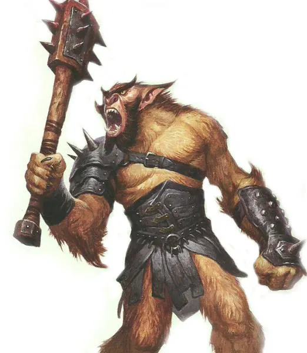

# Bugbears

Os bugbears nasceram para a batalha e mutilação. Sobrevivendo de assaltos e caçadas, eles oprimem os fracos e desprezam ser chefiados, mas o amor deles por carnificina significa que eles irão lutar por mestres poderosos se derramamento de sangue e tesouros forem assegurados.

***Goblinoides***. Os bugbears são, muitas vezes, encontrados na companhia de seus primos, hobgoblins e goblins. Bugbears geralmente escravizam os goblins que eles encontram e eles oprimem os hobgoblins forçando-os a darem seu ouro e suprimentos em troca de seus serviços como batedores e tropa de choque. Mesmo quando pagos, os bugbears são os aliados mais inconstantes, mesmo assim os goblins e hobgoblins entendem que não importa o quanto os bugbears drenem dos recursos de uma tribo, essas criaturas são uma força poderosa.

***Seguidores de Hruggek***. Os bugbears veneram Hruggek, um deus menor que reside no plano de Aqueronte. Na ausência de seus parentes goblinoides, os bugbears formam bandos dispersos, cada um liderado pelo membro mais brutal. Os bugbears acreditam que quando eles morrem, seus espíritos tem uma chance de lutar ao lado de Hruggek. Eles tentam provar seu valor derrotando o máximo de inimigos possível.

***Mercenários Emboscadores***. Independentemente de sua compleição intimidante, os bugbears se movem surpreendentemente furtivos. Eles gostam de elaborar emboscadas e fogem quando superados. Eles são mercenários confiáveis, desde que sejam supridos com comida, bebida e tesouros, porém, um bugbears esquece de qualquer vínculo quando sua vida está por um fio. Um membro ferido de um bando de bugbears será deixado para trás para ajudar o resto do bando a escapar. Mais tarde, esse bugbears irá ajudar seus perseguidores a rastrear seus antigos companheiros se fazer isso salvar sua vida.

## Bloco de estatísticas: Bugbear

*Humanoide Médio (goblinoide), caótico e mau*

**Classe de Armadura** 16 (gibão de peles, escudo)  
**Pontos de Vida** 27 (5d8 + 5)  
**Deslocamento** 9 m

| FOR | DES | CON | INT | SAB | CAR |
| :---: | :---: | :---: | :---: | :---: | :---: |
| 15 (+2) | 14 (+2) | 13 (+1) | 8 (–1) | 11 (+0) | 9 (–1) |

**Perícias** Furtividade +6, Sobrevivência +2  
**Sentidos** visão no escuro 18 m, Percepção passiva 10  
**Idiomas** Comum, Goblin  
**Nível de Desafio** 1 (200 XP)

***Ataque Surpresa***. Se o bugbears surpreender uma criatura e atingi-la com um ataque durante a primeira rodada de combate, o alvo sofre 7 (2d6) de dano extra nesse ataque.

***Brutamontes***. Um ataque corpo-a-corpo com arma causa um dado extra de dano quando o bugbears atinge com ele (incluso no ataque).

### Ações

***Maça Estrela***. *Ataque Corpo-a-Corpo com Arma*: +4 para atingir, alcance 1,5 m, um alvo. *Acerto*: 11 (2d8 + 2) de dano perfurante.

***Azagaia***. *Ataque Corpo-a-Corpo ou à Distância com Arma*: +4 para atingir, alcance 1,5 m ou distância 9/36 m, um alvo. *Acerto*: 9 (2d6 + 2) de dano perfurante corpo-a-corpo ou 5 (1d6 +2) de dano perfurante à distância.

## Bloco de estatísticas: Bugbear Comandante

*Humanoide Médio (goblinoide), caótico e mau*

**Classe de Armadura** 17 (camisão de malha, escudo)  
**Pontos de Vida** 65 (10d8 + 20)  
**Deslocamento** 9 m

| FOR | DES | CON | INT | SAB | CAR |
| :---: | :---: | :---: | :---: | :---: | :---: |
| 17 (+3) | 14 (+2) | 14 (+2) | 11 (+0) | 12 (+1) | 11 (+0) |

**Perícias** Furtividade +6, Intimidação +2, Sobrevivência +3  
**Sentidos** visão no escuro 18 m, Percepção passiva 11  
**Idiomas** Comum, Goblin  
**Nível de Desafio** 3 (700 XP)

***Ataque Surpresa***. Se o bugbears surpreender uma criatura e atingi-la com um ataque durante a primeira rodada de combate, o alvo sofre 7 (2d6) de dano extra nesse ataque.

***Brutamontes***. Um ataque corpo-a-corpo com arma causa um dado extra de dano quando o bugbears atinge com ele (incluso no ataque).

***Coração de Hruggek***. O bugbear tem vantagem em testes de resistência contra ser amedrontado, atordoado, enfeitiçado, envenenado, paralisado ou posto para dormir.

### Ações

***Ataques Múltiplos***. O bugbear realiza dois ataques corpo-a-corpo.

***Maça Estrela***. *Ataque Corpo-a-Corpo com Arma*: +5 para atingir, alcance 1,5 m, um alvo. *Acerto*: 12 (2d8 + 3) de dano perfurante.

***Azagaia***. *Ataque Corpo-a-Corpo ou à Distância com Arma*: +5 para atingir, alcance 1,5 m ou distância 9/36 m, um alvo. *Acerto*: 10 (2d6 + 3) de dano perfurante corpo-a-corpo ou 6 (1d6 +3) de dano perfurante à distância.
