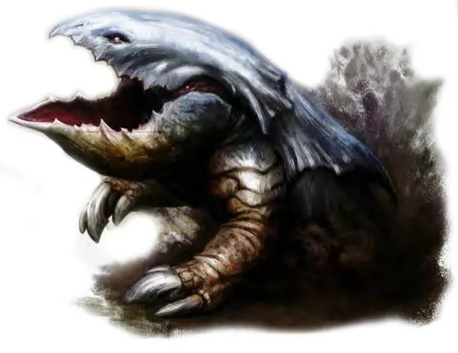

# Bulette

Um bulette é um predador robusto que aterroriza quaisquer locais que ele habitar. Também chamado de “tubarão terrestre”, ele vive apenas para comer. Irascíveis e vorazes, bulettes não temem nenhuma outra criatura e eles atacam sem receio de superioridade numérica ou força.

***Caçadores Subterrâneos***. Os bulettes usam suas poderosas garras para criar túneis na terra quando eles caçam. Ignorando obstruções, eles arrancam árvores, causam deslizamentos de terra em encostas soltas e deixam buracos para trás. Quando as vibrações no solo e pedras alertam um bulette de movimentação, ele emerge da superfície, com suas mandíbulas bem abertas ao atacar.

***Monstro Errante***. Um bulette vagueia por terras temperadas, se alimentando de quaisquer animais e humanoides que encontrar pelo caminho. Essas criaturas tem aversão a carne anã e élfica, apesar de eles geralmente matarem-nos antes de perceberem o que eles são. Um bulette adora a carne de halfling mais que todas e não pode ficar mais feliz do que quando persegue halflings gorduchos por todo um campo aberto.

Um bulette não possui covil, mas perambula por um território de caça de até quarenta e cinco quilômetros de extensão. Seu único critério para o território é a disponibilidade de comida e, quando tiver comido tudo na área, um bulette segue adiante. Essas criaturas muitas vezes se instalam em assentamentos humanoides, aterrorizando-os até que seus residentes fujam em pânico ou até o bulette ser morto.

Todas as criaturas evitam os bulettes, que considera qualquer coisa que se mova como comida – até mesmo outros predadores e bulettes. Os bulettes se juntam apenas para acasalar, resultando num sanguinário ato de garras e dentes que, geralmente termina com a morte e consumo do macho.

***Criação Arcana***. Alguns sábios acreditam que o bulette é resultado de experimentos de um mago louco no cruzamento de tartarugas e tatus com infusões de pus de demônio. Acreditava-se que os bulettes haviam sido extintos diferentes vezes, mas após anos sem ser avistado, a criatura inevitavelmente reaparece. Devido a seus filhotes nunca serem vistos, alguns sábios suspeitam que os bulettes mantem ninhos secretos enterrados dos quais os adultos emergem para o mundo.

## Bloco de estatísticas: Bulette

*Monstruosidade Grande, imparcial*

**Classe de Armadura** 17 (armadura natural)  
**Pontos de Vida** 94 (9d10 + 45)  
**Deslocamento** 12 m, escavação 12 m

| FOR | DES | CON | INT | SAB | CAR |
| :---: | :---: | :---: | :---: | :---: | :---: |
| 19 (+4) | 11 (+0) | 21 (+5) | 2 (–4) | 10 (+0) | 5 (–3) |

**Perícias** Percepção +6  
**Sentidos** visão no escuro 18 m, sentido sísmico 18 m, Percepção passiva 16  
**Idiomas** –  
**Nível de Desafio** 5 (1.800 XP)

***Salto Parado***. O salto em distância do bulette é de até 9 metros e seu salto em altura é de até 4,5 metros, com ou sem uma corrida inicial.

### Ações

***Mordida***. *Ataque Corpo-a-Corpo com Arma*: +7 para atingir, alcance 1,5 m, um alvo. *Acerto*: 30 (4d12 + 4) de dano perfurante.

***Salto Mortal***. Se o bulette pular pelo menos 4,5 metros como parte do seu movimento, ele pode então, usar sua ação para aterrissar em pé num espaço contendo uma ou mais criaturas. Cada uma dessas criaturas deve ser bem sucedida num teste de resistência de Força ou Destreza (à escolha do alvo) CD 16 ou será derrubado no chão e sofrerá 14 (3d6 + 4) de dano de concussão mais 14 (3d6 + 4) de dano cortante. Se obtiver sucesso na resistência, a criatura sofre apenas metade desse dano, não fica caída no chão e é empurrada 1,5 metro para longe do espaço do bulette para um espaço desocupado à escolha da criatura. Se não houver nenhum espaço desocupado ao alcance, a criatura, ao invés, fica caída no espaço do bulette.
