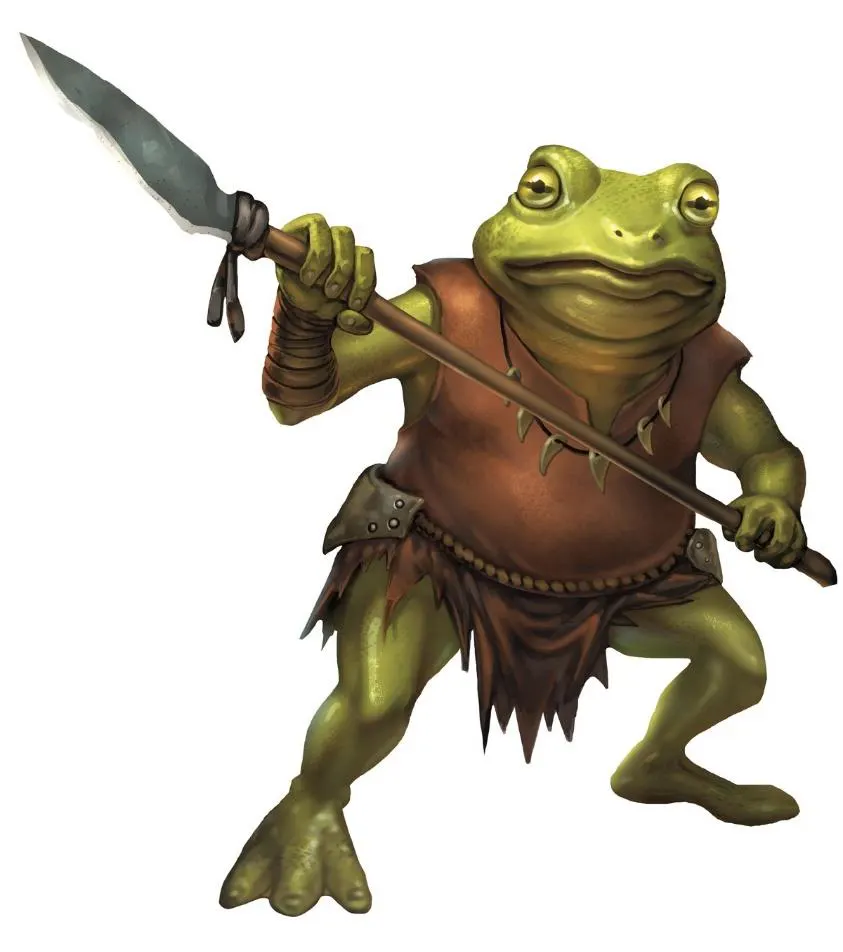

# Bullywug

A vida como um bullywug é desagradável, brutal e molhada. Esses humanoides anfíbios com cabeça de sapo devem ficar constantemente úmidos, habitando florestas chuvosas, brejos e cavernas úmidas. Sempre famintos e completamente malignos, bullywugs subjugam oponentes com superioridade numérica quando podem, mas eles fogem de ameaças sérias em busca de presas mais fáceis.

Os bullywugs tem pele verde, cinza ou mosqueada de amarelo que varia entre tons de cinza, verde e marrom, permitindo que eles se mesclem com seus arredores. Eles vestem armaduras rudes e empunham armas simples e podem desferir uma poderosa mordida nos inimigos que se aproximarem demais.

***Aristocracia Corrupta***. Bullywugs consideram-se os governantes por direito dos pântanos. Eles seguem um tipo de etiqueta quando lidam com forasteiros e uns com os outros, sujeitos aos caprichos e desejos de seu líder – um autodenominado senhor do estrume. Os bullywug apresentam-se com títulos de sonoridade grandiosa, fazendo grandes apresentações ao se curvar e bajular ante seus superiores e competem interminavelmente para ganhar as graças de seus superiores.

Um bullywug tem duas maneiras de avançar entre os de sua espécie. Ele pode tanto matar seus rivais, mas deve tomar cuidado para manter seus atos criminosos em segredo, quanto pode encontrar um tesouro ou item mágico e apresenta-lo como tributo ou sinal de reverência ao seu suserano. Um bullywug que assassinar seus rivais sem cautela provavelmente será executado, por isso é mais comum para os bullywug realizarem assaltos contra caravanas e assentamentos, com o objetivo de adquirir bugigangas preciosas para impressionar seus senhores e cair nas suas graças. Invariavelmente, essas mercadorias finas são reduzidas a entulhos imundos através de abuso e negligência. Quando um presente perde seu brilho, um senhor bullywug, invariavelmente, exige que seus súditos tragam mais tesouros em sua homenagem.

***Diplomacia Rebelde***. Bullywugs adoram ordenar aqueles que invadem seus territórios mais que tudo. Seus guerreiros tentam capturar os intrusos ao invés de simplesmente matá-los.

Os cativos são arrastados perante o rei ou rainha – um bullywug de tamanho excepcionalmente grande – e forçados a suplicar por misericórdia. Subornos, tesouros e bajulação podem iludir o governante bullywug a deixar os cativos partirem, mas não antes de tentar impressionar seus “convidados” com a majestade de seus tesouros e reino. Acometidos por um profundo complexo de inferioridade, senhores bullywug se imaginam como reis e rainhas mas, anseiam desesperadamente pelo medo e respeito dos forasteiros.

***Aliados Anfíbios***. Os bullywugs falam um idioma que permite que eles se comuniquem por extensas áreas ao coaxarem como sapos. Notícias sobre intrusos ou outros eventos no pântano se espalham em minutos através desse sistema de comunicação rude.

Conceitos simples do idioma são compreendidos por sapos e rãs. Bullywugs usam essa capacidade para formar fortes elos com sapos gigantes, os quais eles treinam como guardiões e caçadores. Espécimes maiores às vezes são usadas como montaria também. A habilidade dos sapos de engolir criaturas inteiras concede ao bando de caça bullywug uma maneira fácil de levar suas presas de volta para suas vilas.

## Bloco de estatísticas: Bullywug

*Humanoide Médio (bullywug), neutro e mau*

**Classe de Armadura** 15 (gibão de peles, escudo)  
**Pontos de Vida** 11 (2d8 + 2)  
**Deslocamento** 6 m, natação 12 m

| FOR | DES | CON | INT | SAB | CAR |
| :---: | :---: | :---: | :---: | :---: | :---: |
| 12 (+1) | 12 (+1) | 13 (+1) | 7 (–2) | 10 (+0) | 7 (–2) |

**Perícias** Furtividade +3  
**Sentidos** Percepção passiva 10  
**Idiomas** Bullywug  
**Nível de Desafio** 1/4 (50 XP)

***Anfíbio***. O bullywug pode respirar ar e água.

***Camuflagem Pantanosa***. O bullywug tem vantagem em testes de Destreza (Furtividade) feitos para se esconder em terreno pantanoso.

***Falar com Sapos e Rãs***. O bullywug pode comunicar conceitos simples para sapos e rãs quando ele fala Bullywug.

***Salto Parado***. O salto em distância do bullywug é de até 6 metros e seu salto em altura é de até 3 metros, com ou sem uma corrida inicial.

### Ações

***Ataques Múltiplos***. O bullywug realiza dois ataques: um com sua mordida e um com sua lança.

***Mordida***. *Ataque Corpo-a-Corpo com Arma*: +3 para atingir, alcance 1,5 m, um alvo. *Acerto*: 3 (1d4 + 1) de dano de concussão.

***Lança***. *Ataque Corpo-a-Corpo ou à Distância com Arma*: +3 para atingir, alcance 1,5 m ou distância 6/18 m, um alvo. *Acerto*: 4 (1d6 + 1) de dano perfurante ou 5 (1d8 + 1) de dano perfurante se usada com as duas mãos para realizar um ataque corpo-a-corpo.
