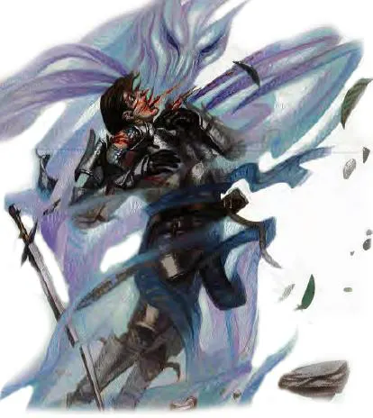

# Caçador Invisível

## Bloco de estatísticas: Caçador Invisível

*Elemental Médio, neutro*

**Classe de Armadura** 14  
**Pontos de Vida** 104 (16d8 + 32)  
**Deslocamento** 15 m, voo 15 m (planar)

| FOR | DES | CON | INT | SAB | CAR |
| :---: | :---: | :---: | :---: | :---: | :---: |
| 16 (+3) | 19 (+4) | 14 (+2) | 10 (+0) | 15 (+2) | 11 (+0) |

**Perícias** Furtividade +10, Percepção +8  
**Resistência a Dano** concussão, perfurante e cortante de ataques não-mágicos  
**Imunidade a Dano** veneno  
**Imunidade a Condição** agarrado, caído, envenenado, exausto, impedido, inconsciente, paralisado  
**Sentidos** visão no escuro 18 m, Percepção passiva 18  
**Idiomas** Auran, compreende Comum mas não pode falar  
**Nível de Desafio** 6 (2.300 XP)

***Invisibilidade***. O caçador é invisível.

***Rastreador Impecável***. O caçador recebe uma presa do seu invocador. O caçador sabe a direção e distância da presa, contanto que ambos estejam no mesmo plano de existência. O caçador também sabe a localização do seu invocador.

### Ações

***Ataques Múltiplos***. O caçador realiza dois ataques de pancada.

***Pancada***. *Ataque Corpo-a-Corpo com Arma*: +6 para atingir, alcance 1,5 m, um alvo. *Acerto*: 10 (2d6 + 3) de dano de concussão.

Um caçador invisível é um elemental do ar que foi invocado do seu plano de origem e transformado através de magia poderosa. Seu único propósito é caçar criaturas e recuperar objetos para seu invocador. Quando ele é derrotado ou a magia que o prende expira, um caçador invisível desaparece em uma lufada de vento.

***Caçador Direcionado***. Quando um caçador invisível é criado, ele permanece do lado do seu invocador até que lhe seja dada uma tarefa para realizar. Caso a atribuição não envolva caçar ou matar uma criatura específica ou recuperar um objeto, a magia que criou o caçador invisível termina e o elemental é libertado. Do contrário, ele completa a tarefa, então retornando para o seu invocador para mais comandos, obrigado a servir até a magia que o prende expirar. Se seu invocador morrer nesse período, o caçador invisível desaparece depois de completar a tarefa.

Um caçador invisível, na melhor das hipóteses, é um servo disposto. Ele se ressente de qualquer obrigação que lhe é atribuída. Uma missão que requeira um tempo significativo pode levar o caçador invisível a perverter a intenção do comando a menos que esse seja redigido cuidadosamente.

***Ameaça Oculta***. Os caçadores invisíveis são compostos de ar e são naturalmente invisíveis. Uma criatura pode ouvir e sentir um caçador invisível passando, mas o elemental permanece invisível até mesmo ao atacar. Uma magia que permita alguém ver o invisível revela apenas o vago contorno do caçador invisível.

***Natureza Elemental***. Um caçador invisível não precisa respirar, comer, beber ou dormir.
