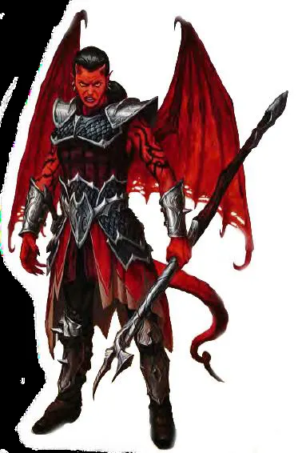

# Cambion

## Bloco de estatísticas: Cambion

*Corruptor Médio, qualquer tendência maligna*

**Classe de Armadura** 19 (brunea)  
**Pontos de Vida** 82 (11d8 + 33)  
**Deslocamento** 9 m, voo 18 m

| FOR | DES | CON | INT | SAB | CAR |
| :---: | :---: | :---: | :---: | :---: | :---: |
| 18 (+4) | 18 (+4) | 16 (+3) | 14 (+2) | 12 (+1) | 16 (+3) |

**Testes de Resistência** For +7, Con +6, Int +5, Car +6  
**Perícias** Enganação +6, Furtividade +7, Intimidação +6, Percepção +4  
**Resistência a Dano** elétrico, fogo, frio, veneno; concussão, cortante e perfurante de ataques não-mágicos  
**Sentidos** visão no escuro 18 m, Percepção passiva 14  
**Idiomas** Abissal, Comum, Infernal  
**Nível de Desafio** 5 (1.800 XP)

***Bênção Infernal***. A CA do cambion inclui seu bônus de Carisma.

***Conjuração Inata***. A habilidade de conjuração de um cambion é Carisma (CD de resistência de magia 14). Ele pode conjurar, inatamente, as seguintes magias, sem necessidade de componentes materiais:

Um cambion é o descendente de um corruptor (geralmente uma súcubo ou incubo) e de um humanoide (geralmente um humano). Os cambions herdam aspectos de ambos os pais, mas seus chifres, asas de couro e caudas grossas são características de seu parentesco extraplanar.

***Nascido para ser Mau***. Cambions tornam-se adultos desumanos cuja crueldade e perversão horroriza até o mais devotado pai mortal. Mesmo na juventude, um cambion identifica seu lugar de direito como um soberano entre os mortais. Ele pode orquestrar ataques a cidades e vilas, reunindo bandos de humanoides e diabos menores para servi-lo.

***Peões dos Poderosos***. Um cambion obrigado a servir seu pai demoníaco o faz por admiração ou por temor, mas também com a expectativa de que um dia irá ascender a um lugar de destaque. Os cambions que cresceram nos Nove Infernos servem como soldados, emissários e servos pessoais para diabos maiores. No Abismo, um cambion possui apenas a autoridade que ele conseguiu reunir por puro poder e força de vontade.

***Prole de Graz’zt***. O senhor demônio Graz’zt adora procriar com humanoides que fizeram pactos com demônios e ele é pai de muitos cambions que ajudaram-no a semear o caos em todo multiverso. Esses cambions são caracterizados por uma pele negra como carvão, cascos fendidos, mãos com seis dedos e uma beleza sobrenatural.

3/dia cada: *alterar-se, comando, detectar magia* 1/dia: *viagem planar* (pessoal apenas)

### Ações

***Ataques Múltiplos***. O cambion realiza dois ataques corpo-a-corpo ou usa seu Raio de Fogo duas vezes.

***Lança***. *Ataque Corpo-a-Corpo com Arma*: +7 para atingir, alcance 1,5 m ou distância 6 m/18 m, um alvo. *Acerto*: 7 (1d6 + 4) de dano perfurante ou 8 (1d8 + 4) de dano perfurante se usado com duas mãos para realizar um ataque corpo-a-corpo, mais 3 (1d6) de dano de fogo.

***Raio de Fogo***. *Ataque à Distância com Magia*: +7 para atingir, distância 36 m, um alvo. *Acerto*: 10 (3d6) de dano de fogo.

***Charme Demoníaco***. Um humanoide que o cambion possa ver, a até 9 metros, deve ser bem sucedido num teste de resistência de Sabedoria CD 14 ou ficará magicamente enfeitiçado por 1 dia. O alvo enfeitiçado obedece aos comandos falados pelo cambion. Se o alvo sofrer qualquer ferimento do cambion ou de outra criatura ou se receber um comando suicida do cambion, o alvo pode repetir o teste de resistência, terminando o efeito se obtiver sucesso. Se o teste de resistência do alvo for bem sucedido, ou se o efeito terminar nele, a criatura fica imune ao Charme Demoníaco do cambion pelas próximas 24 horas.
