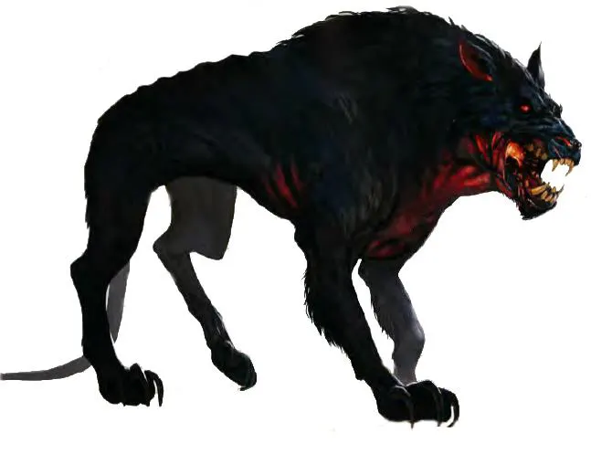

# Cão Infernal

Corruptores monstruosos cuspidores de fogo que tomaram a forma de cachorros, cães infernais são encontrados nos campos de batalha de Aqueronte e por todos os Planos Inferiores. No Plano Material, os cães infernais são vistos com mais frequência a serviço de diabos, gigantes do fogo e outras criaturas malignas que os utilizam como animais de guarda e companheiros.

***Fome Abrasadora***. Cães infernais caçam em matilhas, alimentando-se de qualquer criatura que pareça comestível. Eles evitam oponentes potencialmente perigosos preferindo se focar em presas mais fracas com suas mordidas ferozes e hálito flamejante, demonstrando uma determinação incansável enquanto perseguem sua presa até seu amargo fim.

Quando os cães infernais se alimentam, a carne que eles consomem alimenta o fogo infernal que queima dentro deles. Quando um cão infernal morre, o fogo consome os restos da criatura em uma erupção de fumaça esvoaçante e de brasas ardentes, não deixando nada para trás além de tufos chamuscados de pelo negro.

Maligno ao Extremo. Cães infernais são mais espertos que as bestas mundanas e sua natureza leal torna-os ótimos para seguir ordens. No entanto, a disposição ao mal de um cão infernal significa que a criatura não pode ser treinada para mais nada além de um assassino implacável. Se um cão infernal não tiver permissão de praticar sua fome malévola, ele rapidamente abandona ou volta-se contra seu mestre.

## Bloco de estatísticas: Cão Infernal

*Corruptor Médio, leal e mau*

**Classe de Armadura** 15 (armadura natural)  
**Pontos de Vida** 45 (7d8 + 14)  
**Deslocamento** 15 m

| FOR | DES | CON | INT | SAB | CAR |
| :---: | :---: | :---: | :---: | :---: | :---: |
| 17 (+3) | 12 (+1) | 14 (+2) | 6 (–2) | 13 (+1) | 6 (–2) |

**Perícias** Percepção +5  
**Imunidade a Dano** fogo  
**Sentidos** visão no escuro 18 m, Percepção passiva 15  
**Idiomas** compreende Infernal mas não pode falar  
**Nível de Desafio** 3 (700 XP)

***Audição e Faro Aguçados***. O cão tem vantagem em testes de Sabedoria (Percepção) relacionados à audição e ao olfato.

***Táticas de Matilha***. O cão tem vantagem nas jogadas de ataque contra uma criatura se, pelo menos, um dos aliados do cão estiver a 1,5 metro da criaturas e não estiver incapacitado.

### Ações

***Mordida***. *Ataque Corpo-a-Corpo com Arma*: +5 para atingir, alcance 1,5 m, um alvo. *Acerto*: 7 (1d8 + 3) de dano perfurante mais 7 (2d6) de dano de fogo.

***Sopro de Fogo (Recarrega 5–6)***. O cão expele fogo num cone de 4,5 metros. Cada criatura na área deve realizar um teste de resistência de Destreza CD 12, sofrendo 21 (6d6) de dano de fogo se falhar na resistência, ou metade desse dano se obtiver sucesso.

