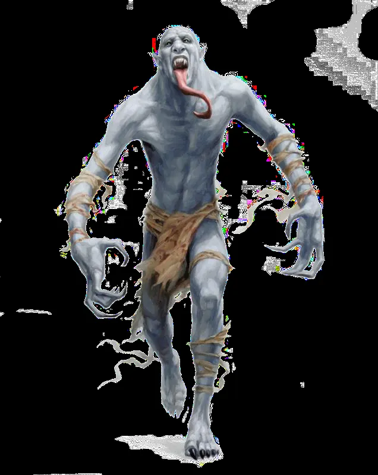

# Carniçais

Carniçais vagam pela noite em bandos, conduzidos por uma fome insaciável por carne humanoide.

***Devoradores de Carne***. Como vermes ou besouros de carniça, carniçais se desenvolvem em locais conhecidos pela decadência e morte. Um carniçal assombra qualquer lugar onde ele possa engolir carne e órgãos em decomposição. Quando ele não pode se alimentar dos mortos, ele persegue criaturas vivas e tenta torna-las cadáveres. Embora eles não recebam qualquer nutrição dos cadáveres que eles devoram, os carniçais são impulsionados por uma fome interminável que os compele a consumir. A carne morta-viva de um carniçal nunca apodrece e esse monstro pode permanecer em uma cripta ou tumba por incontáveis eras sem se alimentar.

***Origens Abissais***. Carniçais registram suas origens do Abismo. Doresain, o primeiro da espécie, foi um elfo adorador de Orcus. Voltando-se contra seu próprio povo, ele fez um banquete de carne humanoide em honra ao Príncipe Demônio da Morte-Vida. Como recompensa por seu serviço, Orcus transformou Doresain no primeiro carniçal. Dorisain serviu Orcus fielmente no Abismo, criando carniçais a partir dos outros servos do senhor demoníaco até uma incursão de Yeenoghu, o Senhor Gnoll demoníaco, rapitar Doresain do seu domínio abissal. Quando Orcus não interveio em nome dele, Doresain rogou aos deuses élficos por salvação e eles tiveram pena dele e o ajudaram a escapar da destruição certa. Desde então, os elfos se tornaram imunes ao toque paralisante dos carniçais.

***Lívidos***. Orcus, às vezes, infunde um carniçal com uma forte dose de energia abissal, tornando-os lívidos. Ao passo que carniçais não são mais que bestas selvagens, um lívido é esperto e pode inspirar um bando de carniçais a seguir seus comandos.

## Bloco de estatísticas: Carniçal

*Morto-vivo Médio, caótico e mau*

**Classe de Armadura** 12  
**Pontos de Vida** 22 (5d8)  
**Deslocamento** 9 m

| FOR | DES | CON | INT | SAB | CAR |
| :---: | :---: | :---: | :---: | :---: | :---: |
| 13 (+1) | 15 (+2) | 10 (+0) | 7 (–2) | 10 (+0) | 6 (–2) |

**Imunidade a Dano** veneno  
**Imunidade a Condição** enfeitiçado, envenenado, exausto  
**Sentidos** visão no escuro 18 m, Percepção passiva 10  
**Idiomas** Comum  
**Nível de Desafio** 1 (200 XP)

### Ações

***Mordida***. *Ataque Corpo-a-Corpo com Arma*: +2 para atingir, alcance 1,5 m, uma criatura. *Acerto*: 9 (2d6 + 2) de dano perfurante.

***Garras***. *Ataque Corpo-a-Corpo com Arma*: +4 para atingir, alcance 1,5 m, um alvo. *Acerto*: 7 (2d4 + 2) de dano cortante. Se o alvo for uma criatura diferente de um elfo ou morto-vivo, ela deve ser bem sucedida num teste de resistência de Constituição CD 10 ou ficará paralisada por 1 minuto. O alvo pode repetir o teste de resistência ao final de cada um dos seus turnos, terminando o efeito sobre si caso obtenha sucesso.

## Bloco de estatísticas: Lívido

*Morto-vivo Médio, caótico e mau*

**Classe de Armadura** 13  
**Pontos de Vida** 36 (8d8)  
**Deslocamento** 9 m

| FOR | DES | CON | INT | SAB | CAR |
| :---: | :---: | :---: | :---: | :---: | :---: |
| 16 (+3) | 17 (+3) | 10 (+0) | 11 (+0) | 10 (+0) | 8 (–1) |

**Resistência a Dano** necrótico  
**Imunidade a Dano** veneno  
**Imunidade a Condição** enfeitiçado, envenenado, exausto  
**Sentidos** visão no escuro 18 m, Percepção passiva 10  
**Idiomas** Comum  
**Nível de Desafio** 2 (450 XP)

***Fedor***. Qualquer criatura que comece seu turno a até 1,5 metro do lívido deve ser bem sucedida num teste de resistência de Constituição CD 10 ou ficará envenenada até o início do próximo turno dela. Se obtiver sucesso no teste de resistência, a criatura fica imune ao Fedor do lívido por 24 horas.

***Proteção contra Expulsão***. O lívido e quaisquer carniçais a até 9 metros dele possuem vantagem em testes de resistência contra efeitos de expulsar mortos-vivos.

### Ações

***Mordida***. *Ataque Corpo-a-Corpo com Arma*: +3 para atingir, alcance 1,5 m, uma criatura. *Acerto*: 12 (2d8 + 3) de dano perfurante.

***Garras***. *Ataque Corpo-a-Corpo com Arma*: +5 para atingir, alcance 1,5 m, um alvo. *Acerto*: 10 (2d6 + 3) de dano cortante. Se o alvo for uma criatura diferente de um elfo ou morto-vivo, ela deve ser bem sucedida num teste de resistência de Constituição CD 10 ou ficará paralisada por 1 minuto. O alvo pode repetir o teste de resistência ao final de cada um dos seus turnos, terminando o efeito sobre si caso obtenha sucesso.
