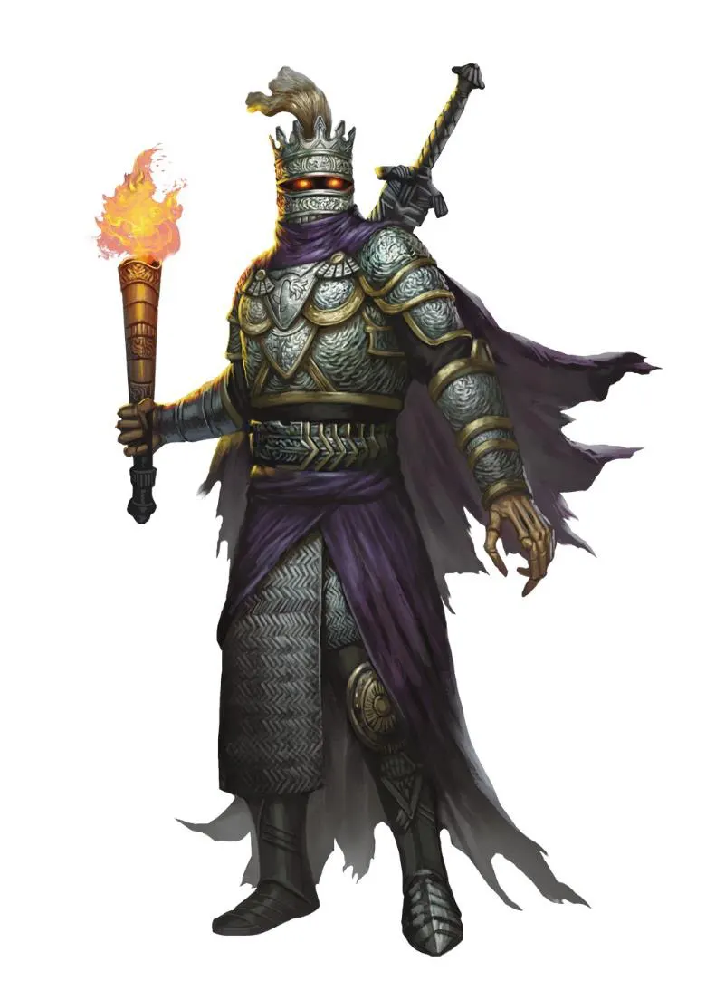

# Cavaleiro da Morte

Quando um paladino que caiu em desgraça morre sem buscar redenção, os poderes das trevas podem transformar o que foi certa vez um cavaleiro mortal em uma detestável criatura morta-viva. Um cavaleiro da morte é um guerreiro esquelético vestido em uma armadura de placas assustadora. Embaixo do seu elmo, pode-se ver a caveira do cavaleiro com pontos luminosos malévolos queimando em suas órbitas.

***Poder Místico***. O cavaleiro da morte mantem a habilidade de conjurar magias divinas. No entanto, nenhum cavaleiro da morte pode usar sua magia para curar. Um cavaleiro da morte também atrai e comando mortos-vivos inferiores, embora cavaleiros da morte que sirvam corruptores poderosos possam ter seguidores corruptores no lugar. Cavaleiros da morte geralmente utilizam cavalos esqueletos e pesadelos como montarias.

***Imortal até ser Redimido***. Um cavaleiro da morte pode se reerguer novamente, mesmo após ter sido destruído. Apenas quando ele se reparar por uma vida de maldade ou encontrar a redenção poderá finalmente escapar do seu purgatório de morte-vida e, finalmente, perecer.

***Natureza Morta-Viva***. Uma cavaleiro da morte não precisa respirar, comer, beber ou dormir.

> **Lorde Soth**
>
> Lorde Soth começou a cair em desgraça com um ato de heroísmo, salvando uma elfa chamada Isolde de um ogro. Soth e Isolde se apaixonaram, mas Soth já era casado. Ele ordenou que um servo desse cabo de sua esposa e foi acusado de assassinato, mas fugiu com Isolde. Quando seu castelo sucumbiu ao cerco, ele orou por orientação e lhe foi dito que ele deveria se redimir de seus erros completando uma tarefa, mas os crescentes temores sobre a infidelidade de Isolde o fizeram abandonar a tarefa. Por sua missão não ter sido completada, um enorme cataclismo varreu a terra. Quando Isolda deu à luz a um filho, Soth recusou-se a crer que a criança fosse sua e matou ambos. Todos foram incinerados em um incidente que varreu o castelo, mesmo assim, Soth não encontrou descanso na morte, tornando-se um cavaleiro da morte.

## Bloco de estatísticas: Cavaleiro da Morte

*Morto-vivo Médio, caótico e mau*

**Classe de Armadura** 20 (placas, escudo)  
**Pontos de Vida** 180 (19d8 + 95)  
**Deslocamento** 9 m

| FOR | DES | CON | INT | SAB | CAR |
| :---: | :---: | :---: | :---: | :---: | :---: |
| 20 (+5) | 11 (+0) | 20 (+5) | 12 (+1) | 16 (+3) | 18 (+4) |

**Testes de Resistência** Des +6, Sab +9, Car +10  
**Imunidade a Dano** necrótico, veneno  
**Imunidade a Condição** enfeitiçado, envenenado, exausto  
**Sentidos** visão no escuro 36 m, Percepção passiva 13  
**Idiomas** Abissal, Comum  
**Nível de Desafio** 17 (18.000 XP)

***Conjuração***. O cavaleiro é um conjurador de 19° nível. Sua habilidade de conjuração é Carisma (CD de resistência de magia 18, +10 para atingir com ataques com magia). Ele possui as seguintes magias de paladino preparadas:

1° nível (4 espaços): *comando, duelo compelido, destruição* *lancinante* 2° nível (3 espaços): *arma mágica, imobilizar pessoa* 3° nível (3 espaços): *arma elemental, dissipar magia* 4° nível (3 espaços): *banimento, destruição estonteante* 5° nível (2 espaços): *onda destrutiva* (necrótico)

***Marechal Morto-vivo***. A não ser que o cavaleiro esteja incapacitado, ele e as criaturas mortas-vivas à sua escolha a até 9 metros dele tem vantagem em testes de resistência contra características que expulsem mortos-vivos.

***Resistência à Magia***. O cavaleiro possui vantagem nos testes de resistência contra magias e outros efeitos mágicos.

### Ações

***Ataques Múltiplos***. O cavaleiro realiza três ataques com espada longa.

***Espada Longa***. *Ataque Corpo-a-Corpo com Arma*: +11 para atingir, alcance 1,5 m, um alvo. *Acerto*: 9 (1d8 + 5) de dano cortante ou 10 (1d10 + 5) de dano cortante se usada com as duas mãos, mais 18 (4d8) de dano necrótico.

***Orbe de Fogo Infernal (1/Dia)***. O cavaleiro arremessa uma bola de fogo mágico que explode num ponto que ele possa ver, a até 36 metros dele. Cada criatura numa esfera de 6 metros, centrada no ponto, deve realizar um teste de resistência de Destreza. A esfera se espalha, dobrando esquinas. Uma criatura sofre 35 (10d6) de dano de fogo e 35 (10d6) de dano necrótico se falhar na resistência, ou metade desse dano se obtiver sucesso.

### Reações

***Aparar***. O cavaleiro adiciona 6 à sua CA contra um ataque corpo-a-corpo que poderia atingi-lo. Para tanto, o cavaleiro deve poder ver o atacante e estar empunhando uma arma corpo-a-corpo.
