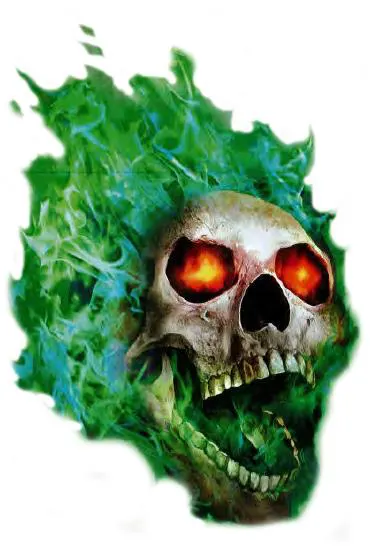

# Caveira Flamejante

Chamas esverdeadas e loucura ardem, ecoando segue uma gargalhada vinda de um crânio sem corpo enquanto ele patrulha seus domínios. Quando a caveira flamejante morta-viva encontra invasores, ela explode os intrusos com raios cauterizantes dos seus olhos e magias terríveis convocadas dos recessos sombrios de sua memória.

Conjuradores das trevas criaram as caveiras flamejantes a partir dos restos mortais de magos. Quando o ritual é completado, chamas verdes emergem da caveira para completar sua medonha transformação.

***Legado de Vida***. Uma caveira flamejante lembra-se vagamente de sua vida anterior. Apesar de ela poder falar com sua antiga voz e poder relembrar dos principais eventos do seu passado, ela não passa de um eco do seu eu anterior. No entanto, sua transformação em morto-vivo garante a ela acesso total à magia que ela portava em vida, permitindo que ela conjure magias enquanto ignora os componentes materiais e somáticos que ela não pode mais realizar.

***Eternamente Limitada***. Inteligente e vigilante, uma caveira flamejante serve seu criador protegendo o local de um tesouro escondido, uma câmara secreta ou um indivíduo especifico. Uma caveira flamejante mantem as diretivas dadas quando é criada e ela interpreta esses comando ao pé da letra. Um mestre de uma caveira flamejante deve formar suas instruções com cuidado para garantir que a criatura realize suas tarefas apropriadamente.

***Mortalha de Chamas***. O fogo que envolve a caveira flamejante queima continuamente, concedendo a luz plena que a criatura controla. Ela usa essas chamas como arma, focando-a para disparar raios ardentes de suas órbitas oculares.

***Rejuvenescimento Místico***. Os fragmentos de uma caveira flamejante se juntam a não ser que eles sejam salpicados com água benta ou alvos da magia *dissipar* *magia* ou *remover maldição*. Se ela não puder mais atender aos seus propósitos, a caveira flamejante reformada não tem obrigação com mais ninguém e torna-se autônoma.

***Natureza Morta-Viva***. Uma caveira flamejante não precisa respirar, comer, beber ou dormir.

## Bloco de estatísticas: Caveira Flamejante

*Morto-vivo Miúdo, neutro e mau*

**Classe de Armadura** 13  
**Pontos de Vida** 40 (9d4 + 18)  
**Deslocamento** 0 m, voo 12 m (planar)

| FOR | DES | CON | INT | SAB | CAR |
| :---: | :---: | :---: | :---: | :---: | :---: |
| 1 (–5) | 17 (+3) | 14 (+2) | 16 (+3) | 10 (+0) | 11 (+0) |

**Perícias** Arcanismo +5, Percepção +2  
**Resistência a Dano** elétrico, necrótico, perfurante  
**Imunidade a Dano** fogo, frio, veneno  
**Imunidade a Condição** amedrontado, caído, enfeitiçado, envenenado, exausto  
**Sentidos** visão no escuro 18 m, Percepção passiva 12  
**Idiomas** Comum  
**Nível de Desafio** 4 (1.100 XP)

***Conjuração***. A caveira flamejante é um conjurador de 5° nível. Sua habilidade de conjuração é Inteligência (CD de resistência de magia 13, +5 para atingir com ataques com magia). Ele possui as seguintes magias de mago preparadas:

Truques (à vontade): *mãos mágicas* 1° nível (3 espaços): *escudo arcano, mísseis mágicos* 2° nível (2 espaços): *esfera flamejante, nublar* 3° nível (1 espaços): *bola de fogo*

***Iluminação***. A caveira flamejante emite ou penumbra num raio de 4,5 metros ou luz plena num raio de 4,5 metros e penumbra por mais 4,5 metros adicionais. Ela pode trocar entre essas opções com uma ação.

***Resistência à Magia***. A caveira flamejante possui vantagem nos testes de resistência contra magias e outros efeitos mágicos.

***Rejuvenescimento***. Se a caveira flamejante for destruída, ela recupera todos os seus pontos de vida em 1 hora, a não ser que água benta seja aspergida sobre seus restos ou a magia *dissipar* *magia* ou *remover maldição* seja conjurada nela.

### Ações

***Ataques Múltiplos***. A caveira flamejante usa o Raio de Fogo duas vezes.

***Raio de Fogo***. *Ataque à Distância com Magia*: +5 para atingir, distância 9 m, um alvo. *Acerto*: 10 (3d6) de dano de fogo.
