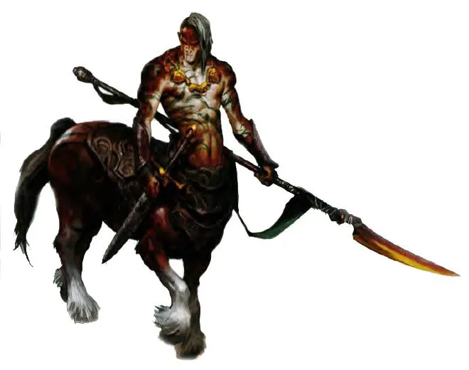

# Centauro

Andarilhos reclusos e leitores de presságios do ambiente selvagem, centauros evitam conflitos, mas lutam ferozmente quando pressionados. Eles vagam pela vastidão selvagem, mantendo-se distantes das fronteiras, leis e da companhia de outras criaturas.

***Nômades da Vastidão Selvagem***. Tribos de centauros espalharam-se por terras de climas leves até quentes, onde o centauro precisa apenas de pelagens leves ou peles oleosas para lidar com as intempéries. Eles são caçadores- coletores e raramente constroem abrigos ou se quer usam tendas.

Migrações de centauros alcançam continentes e levam décadas para se repetir, por isso que uma tribo de centauros pode não voltar pelo mesmo caminho por gerações. Esses padrões variados pode levar a conflitos quando centauros encontram assentamentos de outras criaturas ao longo de suas rotas tradicionais.

***Colonos Relutantes***. Um centauro que não consiga manter o ritmo com o resto de sua tribo é deixado para trás. Centauros como estes desparecem na vastidão selvagem e nunca mais são vistos novamente. Aqueles que conseguem se virar com a perda da sua tribo instalam residência entre outras raças. Assentamentos em fronteiras valorizam o conhecimento natural dos centauros residentes. Muitas comunidades dessas devem sua sobrevivência à intuição e presciência de um centauro.

Independentemente de sua natureza reclusa, centauros negociam com elfos e com caravanas de outros humanoides benevolentes que eles encontram durante suas andanças. Um comerciante poderia salvar a vida de um centauro ferido ou velho demais para realizar longas viagens, escoltando-o para um assentamento onde ele possa viver pacificamente pelo resto dos seus dias.

## Bloco de estatísticas: Centauro

*Monstruosidade Grande, neutro e bom*

**Classe de Armadura** 12  
**Pontos de Vida** 45 (6d10 + 12)  
**Deslocamento** 15 m

| FOR | DES | CON | INT | SAB | CAR |
| :---: | :---: | :---: | :---: | :---: | :---: |
| 18 (+4) | 14 (+2) | 14 (+2) | 9 (–1) | 13 (+1) | 11 (+0) |

**Perícias** Atletismo +6, Percepção +3, Sobrevivência +3  
**Sentidos** Percepção passiva 13  
**Idiomas** Élfico, Silvestre  
**Nível de Desafio** 2 (450 XP)

***Investida***. Se o centauro se mover, pelo menos, 9 metros em linha reta até um alvo e então atingi-lo com um ataque de lança montada no mesmo turno, o alvo sofre 10 (3d6) de dano perfurante extra.

### Ações

***Ataques Múltiplos***. O centauro realiza dois ataques: um com sua lança montada e outro com seus cascos ou dois com o arco longo.

***Lança Montada***. *Ataque Corpo-a-Corpo com Arma*: +6 para atingir, alcance 3 m, um alvo. *Acerto*: 9 (1d10 + 4) de dano perfurante.

***Cascos***. *Ataque Corpo-a-Corpo com Arma*: +6 para atingir, alcance 1,5 m, um alvo. *Acerto*: 11 (2d6 + 4) de dano de concussão.

***Arco Longo***. *Ataque à Distância com Arma*: +4 para atingir, distância 45/180 m, um alvo. *Acerto*: 6 (1d8 + 2) de dano perfurante.

