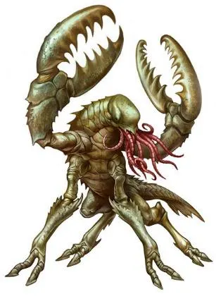

# Chuul

Sobreviventes do antigo império abolete, chuuls são crustáceos que os aboletes modificaram e dotaram com senciência. Eles seguem as diretivas arraigadas dos seus criadores, como eles tem feito desde a aurora dos tempos.

***Lembranças Primitivas***. Nas eras primitivas, aboletes governavam um vasto império espalhado pelos oceanos do mundo. Nesses dias, os aboletes usaram magia poderosa e dobraram as mentes das criaturas nascentes do reino mortal. No entanto, eles estavam presos a água e não podiam exercer sua vontade além dela sem servos. Por esse motivo, eles criaram os chuul.

Perfeitamente obedientes, os chuul capturam criaturas racionais e magias ao comando dos aboletes. Os chuul foram feitos para durar pelas eras do mundo, aumentando de tamanho e força à medida que o tempo passa. Quando o império abolete ruiu com a ascensão dos deuses, os chuuls ficaram à deriva. No entanto, essas criaturas continua a fazer o que faziam para os aboletes, lentamente capturando humanoides, coletando tesouros, acumulando magias e consolidando poder.

***Guardiões Incansáveis***. Um chuul continua guardando as ruínas do antigo império abolete. Eles se mantem em silêncio cumprindo os comandos de eras passadas. Rumores e mapas antigos às vezes trazem caçadores de tesouro para essas ruínas, mas a recompensa por sua ousadia é a morte.

Sejam quais forem as riquezas trazidas pelos exploradores consigo, contribui para o tesouro guardado pelos chuuls. Os chuuls podem sentir magia à distância. Esse sentido se junta com o impulso inato que os leva a matar exploradores, tomar seus pertences e enterra-los em locais secretos ordenados pelos aboletes eras atrás.

***Servos em Espera***. Apesar do império abolete ancestral ter sucumbido há muitas eras, os elos psíquicos entre eles e seus servos criados permanecem intactos. Os chuuls que entram em contato com aboletes imediatamente assumem seus antigos papeis. Tais chuuls direcionam sua compulsão por servir aos sinistros propósitos do abolete.

## Bloco de estatísticas: Chuul

*Aberração Grande, caótico e mau*

**Classe de Armadura** 16 (armadura natural)  
**Pontos de Vida** 93 (11d10 + 33)  
**Deslocamento** 9 m, natação 9 m

| FOR | DES | CON | INT | SAB | CAR |
| :---: | :---: | :---: | :---: | :---: | :---: |
| 19 (+4) | 10 (+0) | 16 (+3) | 5 (–3) | 11 (+0) | 5 (–3) |

**Perícias** Percepção +4  
**Imunidade a Dano** veneno  
**Imunidade a Condição** envenenado  
**Sentidos** visão no escuro 18 m, Percepção passiva 14  
**Idiomas** compreendem Dialeto Subterrâneo, mas não podem falar  
**Nível de Desafio** 4 (1.100 XP)

***Anfíbio***. O chuul pode respirar ar e água.

***Sentir Magia***. O chuul sente magia a até 36 metros dele, à vontade. Esse traço, no mais, funciona como a magia *detectar* *magia*, mas não é mágico por si próprio.

### Ações

***Ataques Múltiplos***. O chuul realiza dois ataques de pinça. Se o chuul estiver agarrando uma criatura, ele também pode usar seus tentáculos uma vez.

***Pinças***. *Ataque Corpo-a-Corpo com Arma*: +6 para atingir, alcance 3 m, um alvo. *Acerto*: 11 (2d6 + 4) de dano de concussão. O alvo fica agarrado (CD 14 para escapar) se for uma criatura Grande ou menor e o chuul não tenha duas outras criaturas agarradas.

***Tentáculos***. Uma criatura agarrada pelo chuul deve ser bem sucedida num teste de resistência de Constituição CD 13 ou ficará envenenada por 1 minuto. Até esse veneno acabar, o alvo fica paralisado. O alvo pode repetir o teste de resistência ao final de cada um dos seus turnos, terminando o efeito em si caso obtenha sucesso.

