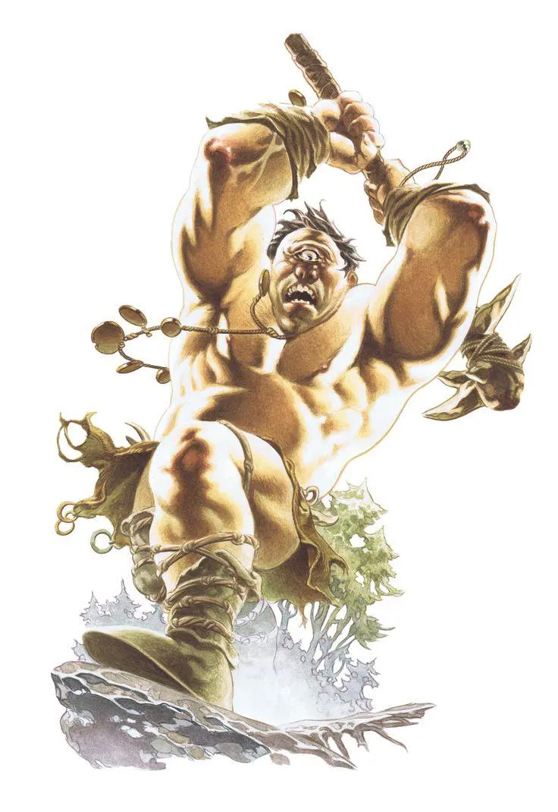

# Ciclope

Ciclopes são gigantes de um olho só passam suas existências miseráveis em terras selvagens. Isolacionistas por natureza, eles evitam contato com outras raças e tentam expulsar estranhos em seu território.

***Não-Religiosos***. Lendas contam que os ciclopes são as crias de um dos deuses dos gigantes, mas essas criaturas dão pouca atenção a quaisquer divindades. Eles veem pouca vantagem em orar e detestam rituais, os quais eles consideram complexos e exóticos. No entanto, um ciclope que ganhe benefícios diretos de algum local de poder divino ou que seja ameaçado por uma força ou criatura sobrenatural, fará reverências enquanto o benefício ou ameaça existir.

***Simplórios***. Apesar de serem razoavelmente inteligentes, os ciclopes vivem uma vida simples, reclusos, criando animais para alimentação. Eles preferem viver sozinhos ou em pequenos grupos familiares, alojando-se em cavernas, ruínas ou em estruturas rudimentares construídas com pedra seca por eles mesmos. Os ciclopes mantém seus rebanhos com eles durante à noite, selando a entrada de seus lares com pedregulhos, servindo como um celeiro.

Um ciclope fica entocado por um dia de jornada de outro ciclope, assim eles podem se encontrar para trocar mercadorias ou buscar fêmeas. Eles constroem armas e ferramentas de madeira e pedra, mas usarão metal quando puderem encontrar. Apesar dos ciclopes entenderem a língua Gigante, eles não escrevem e falam pouco, usando grunhidos e gestos para suas interações uns com os outros.

Os ciclopes não usam dinheiro para negocias, mas eles valorizam ouro, conchas e outros objetos brilhantes e coloridos, como joias. Um ciclope irá usar um colar ornado com penas e moedas de prata, mas também com taças de estanho, talheres e outros metais estragados.

***Estúpidos***. Ciclopes não são grandes pensadores ou estrategistas. Lentos para aprender e presos aos seus meios tradicionais, eles tem dificuldade em inovar. Apesar de serem ameaças terríveis em combate devido ao seu tamanho e força, eles podem, frequentemente, ser enganados por inimigos espertos.

Ciclopes podem ser intimidados e impressionados com demonstrações óbvias de magia. Rudes com pouca exposição à magia, eles podem ser levados ao erro por bruxos, clérigos e outros conjuradores de figuras divinas poderosas. No entanto, seu sentimento de orgulho os faz reagir com violência sanguinária vingativa quando eles descobrem que o indivíduo que eles imaginavam ser um “deus” é um mero mortal.

## Bloco de estatísticas: Ciclope

*Gigante Enorme, caótico e neutro*

**Classe de Armadura** 14 (armadura natural)  
**Pontos de Vida** 138 (12d12 + 60)  
**Deslocamento** 9 m

| FOR | DES | CON | INT | SAB | CAR |
| :---: | :---: | :---: | :---: | :---: | :---: |
| 22 (+6) | 11 (+0) | 20 (+5) | 8 (–1) | 6 (–2) | 10 (+0) |

**Sentidos** Percepção passiva 8  
**Idiomas** Gigante  
**Nível de Desafio** 6 (2.300 XP)

***Percepção de Profundidade Ruim***. O ciclope tem desvantagem em qualquer jogada de ataque contra um alvo a mais de 9 metros de distância dele.

### Ações

***Ataques Múltiplos***. O ciclope realiza dois ataques com clava grande.

***Clava Grande***. *Ataque Corpo-a-Corpo com Arma*: +9 para atingir, alcance 3 m, um alvo. *Acerto*: 19 (3d8 + 6) de dano de concussão.

***Rocha***. *Ataque à Distância com Arma*: +9 para atingir, distância 9/36 m, um alvo. *Acerto*: 28 (4d10 + 6) de dano de concussão.
