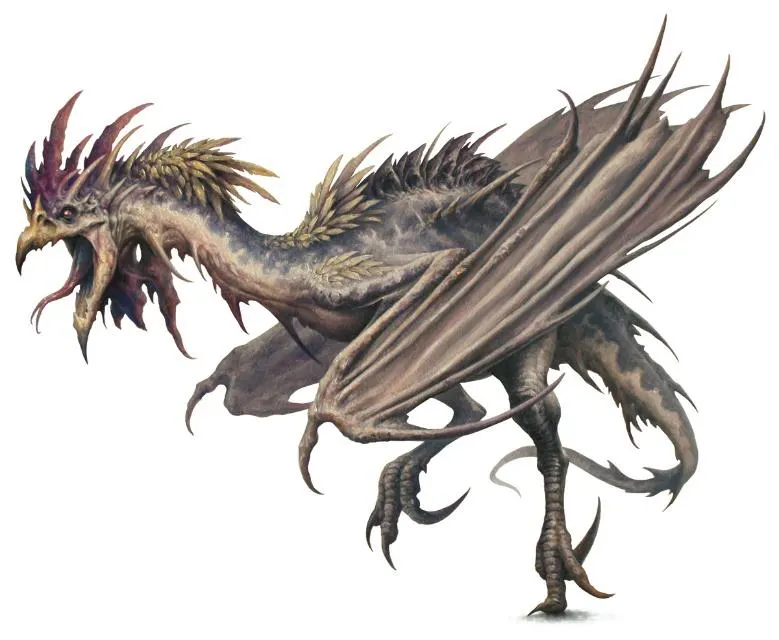

# Cocatriz

## Bloco de estatísticas: Cocatriz

*Monstruosidade Pequena, imparcial*

**Classe de Armadura** 11  
**Pontos de Vida** 27 (6d6 + 6)  
**Deslocamento** 6 m, voo 12 m

| FOR | DES | CON | INT | SAB | CAR |
| :---: | :---: | :---: | :---: | :---: | :---: |
| 6 (–2) | 12 (+1) | 12 (+1) | 2 (–4) | 13 (+1) | 5 (–3) |

**Sentidos** visão no escuro 18 m, Percepção passiva 11  
**Idiomas** –  
**Nível de Desafio** 1/2 (100 XP)

### Ações

***Bicada***. *Ataque Corpo-a-Corpo com Arma*: +3 para atingir, alcance 1,5 m, uma criatura. *Acerto*: 3 (1d4 + 1) de dano perfurante e o alvo deve ser bem sucedido num teste de resistência de Constituição CD 11 para não ser magicamente petrificado. Se falhar na resistência, a criatura começa a virar pedra e fica impedida. Ela deve repetir o teste de resistência no final do próximo turno dela. Se obtiver sucesso, o efeito acaba. Se fracassar, a criatura fica petrificada por 24 horas.

A cocatriz se parece com um hibrido de um lagarto, um pássaro e um morcego e é infame por sua habilidade de transformar pedra em carne. Esses onívoros tem uma dieta que consistem em frutos, nozes, flores e pequenos animais como insetos, camundongos e sapos – coisas que elas podem engolir inteiras. Elas não seriam nada ameaçadoras se não fosse pela sua ferocidade em resposta à mínima visão de perigo. Uma cocatriz voa na face de qualquer ameaça, grasnindo e batendo loucamente suas asas enquanto sua cabeça bica freneticamente. O menor arranhão da bicada de uma cocatriz pode trazer a ruína às suas vítimas, lentamente transformando-as em pedra a partir da ferida.
