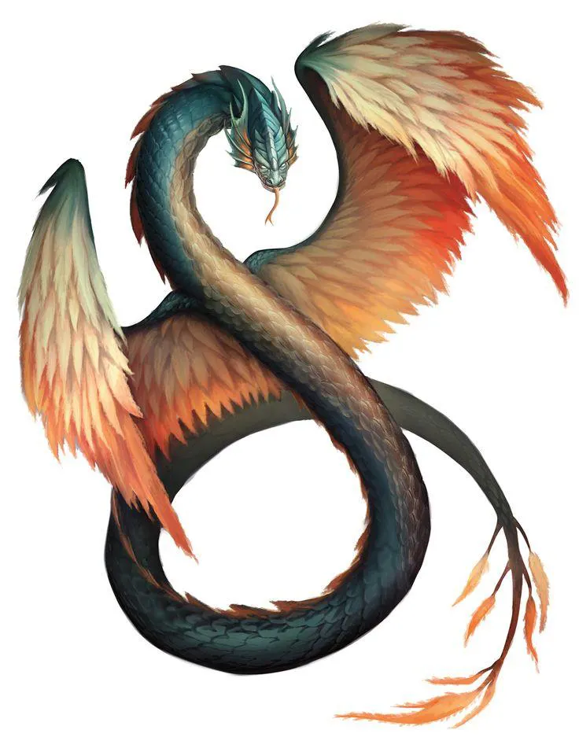

# Couatl

Couatls são seres serpentinos benevolentes de vasto intelecto e perspicácia. Suas asas coloridas brilhantes e modo gentil exprimem suas origens celestiais.

***Zeladores Divinos***. Os couatls foram criados para serem guardiões e zeladores por um deus benevolente que não é cultuado desde a aurora dos tempos e que agora é esquecido de todos, exceto dos próprios couatls. Muitos dos mandatos divinos dados a esses seres foram há muito tempo cumpridos ou não. No entanto, um número de couatls permanecem zelando pelos poderes ancestrais, aguardando o cumprimento da profecia ou salvaguardando os herdeiros das criaturas que eles costumavam guiar e proteger. Independentemente da tarefa do couatl, ele prefere permanecer escondido, revelando-se apenas como último recurso.

***Contadores da Verdade***. Um couatl não pode mentir, mas ele pode omitir informações, respondendo perguntas vagamente ou levando outros a tirarem conclusões precipitadas se isso for necessário para proteger algo, para manter promessas ou para esconder o segredo de sua existência.

***Antigos e Raros***. Um couatl pode viver por erras sem sustento, até mesmo sobrevivendo sem ar, mas essas criaturas podem morrer de doenças ou com a passagem do tempo. Um couatl pode sentir seu fim se aproximar um século antes, mas ele não tem qualquer intuição do jeito que irá falecer.

Se um couatl já tiver cumprido o que lhe foi designado, ele aceita seu destino. No entanto, caso sua morte iminente ponha em risco o cumprimento de seus objetivos, ele buscará ativamente outro couatl com o qual possa produzir descendentes.

O ritual de acasalamento dos couatls é uma bela e elaborada dança de magia e luz, resultando em um ovo em formato de gema do qual um novo couatl chocará. O pai que procurou o parceiro criará o couatl recém-nascido e o instruirá dos seus deveres, assim ele poderá completar qualquer que seja a tarefa que o seu pai deixou incompleta.

## Bloco de estatísticas: Couatl

*Celestial Médio, leal e bom*

**Classe de Armadura** 19 (armadura natural)  
**Pontos de Vida** 97 (13d8 + 39)  
**Deslocamento** 9 m, voo 27 m

| FOR | DES | CON | INT | SAB | CAR |
| :---: | :---: | :---: | :---: | :---: | :---: |
| 16 (+3) | 20 (+5) | 17 (+3) | 18 (+4) | 20 (+5) | 18 (+4) |

**Testes de Resistência** Con +5, Sab +7, Car +6  
**Resistência a Dano** radiante  
**Imunidade a Dano** psíquico; concussão, cortante e perfurante de ataques não-mágicos  
**Sentidos** visão verdadeira 36 m, Percepção passiva 15  
**Idiomas** todos, telepatia 36 m  
**Nível de Desafio** 4 (1.100 XP)

***Armas Mágicas***. Os ataques com armas do couatl são mágicos.

***Conjuração Inata***. A habilidade de conjuração de uma couatl é Carisma (CD de resistência de magia 14). Ele pode conjurar, inatamente, as seguintes magias, necessitando apenas de componentes verbais:

À vontade: *detectar mal e bem, detectar magia, detectar* *pensamentos* 3/dia cada: *bênção, criar alimentos, curar ferimentos, escudo* *arcano, proteção contra veneno, restauração menor, santuário* 1/dia cada: *restauração maior*, *sonho, vidência*

***Mente Protegida***. O couatl é imune à vidência e a qualquer efeito que possa sentir suas emoções, ler seus pensamentos ou detectar sua localização.

### Ações

***Mordida***. *Ataque Corpo-a-Corpo com Arma*: +8 para atingir, alcance 1,5 m, uma criatura. *Acerto*: 8 (1d6 + 5) de dano perfurante e o alvo deve ser bem sucedido num teste de resistência de Constituição CD 13 ou ficará envenenado por 24 horas. Até esse veneno acabar, o alvo ficará inconsciente. Outra criatura pode usar uma ação para sacudir o alvo até acordá-lo.

***Constrição***. *Ataque Corpo-a-Corpo com Arma*: +6 para atingir, alcance 3 m, uma criatura Média ou menor. *Acerto*: 10 (2d6 + 3) de dano de concussão e o alvo fica agarrado (CD 15 para escapar). Até esse agarrão terminar, o alvo fica impedido e o couatl não pode constringir outro alvo.

***Mudança de Forma***. O couatl magicamente se metamorfoseia em um humanoide ou besta que tenha um nível de desafio igual ou inferior ao seu ou pode voltar para sua forma verdadeira. Ele reverte a sua forma verdadeira quando morre. Qualquer equipamento vestido ou carregado é absorvido ou vestido pela nova forma (à escolha do couatl). Na nova forma, o couatl mantem suas estatísticas de jogo e a capacidade de falar, mas sua CA, tipos de movimento, Força, Destreza e outras ações são substituídos pelos da nova forma e ele ganha quaisquer estatísticas e capacidades (exceto características de classe, ações lendárias e ações de covil) que a nova forma tenha e ele não. Se a nova forma tiver um ataque de mordida, o couatl pode usar sua mordida nessa forma.
