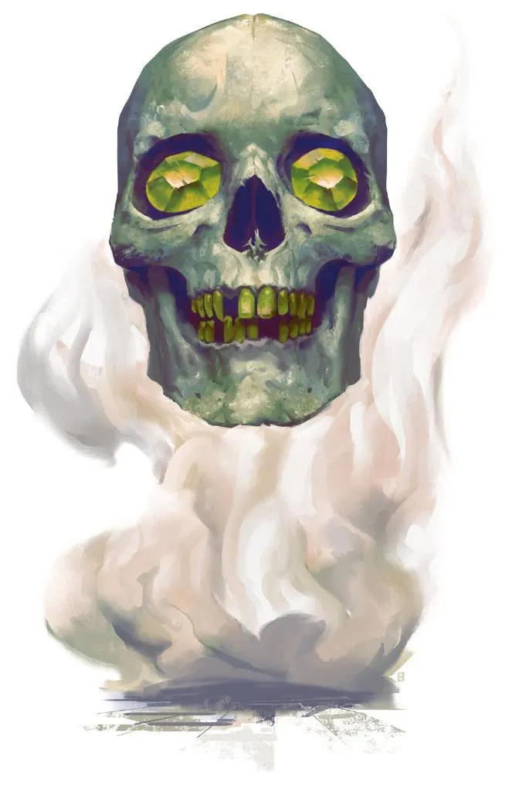

# Demilich

## Bloco de estatísticas: Demilich

*Morto-vivo Miúdo, neutro e mau*

**Classe de Armadura** 20 (armadura natural)  
**Pontos de Vida** 80 (20d4)  
**Deslocamento** 0 m, voo 9 m (planar)

| FOR | DES | CON | INT | SAB | CAR |
| :---: | :---: | :---: | :---: | :---: | :---: |
| 1 (–5) | 20 (+5) | 10 (+0) | 20 (+5) | 17 (+3) | 20 (+5) |

**Testes de Resistência** Con +6, Int +11, Sab +9, Car +11  
**Resistência a Dano** concussão, cortante e perfurante de ataques mágicos  
**Imunidade a Dano** necrótico, psíquico, veneno; concussão, cortante e perfurante de ataques não-mágicos  
**Imunidade a Condição** amedrontado, atordoado, caído, enfeitiçado, envenenado, exausto, paralisado, petrificado  
**Sentidos** visão verdadeira 36 m, Percepção passiva 13  
**Idiomas** –  
**Nível de Desafio** 18 (20.000 XP)

***Anulação***. Se o demilich for alvo de um efeito que permita que ele faça um teste de resistência para reduzir o dano à metade, ao invés disso ele não sofre nenhum dano se obtiver sucesso no teste de resistência e sofre metade do dano se falhar.

***Imunidade à Expulsão***. O demilich é imune a efeitos de expulsar mortos-vivos.

***Resistência Lendária (3/Dia)***. Se o demilich fracassar num teste de resistência, ele pode escolher obter sucesso, ao invés disso.

### Ações

***Drenar Vida***. O demilich afeta até três criatura que ele possa ver, a até 3 metros dele. Cada alvo deve ser bem sucedido num teste de resistência de Constituição CD 19 ou sofrerá 21 (6d6) de dano necrótico e o demilich recupera uma quantidade de pontos de vida equivalente ao total de dano causado a todos os alvos.

***Uivo (Recarrega 5–6)***. O demilich emite um uivo descomunal. Cada criatura a até 9 metros do demilich que puder ouvir o uivo deve ser bem sucedida num teste de resistência de Constituição CD 15 ou cairá a 0 pontos de vida. Se obtiver sucesso na resistência, a criatura fica amedrontada até o final do próximo turno dela.

### Ações Lendárias

O demilich pode realizar 3 ações lendárias, escolhidas dentre as opções abaixo. Apenas uma ação lendária pode ser usada por vez e apenas no final do turno de outra criatura. O demilich recupera as ações lendárias gastas no começo do turno dele.

**Drenar Energia (Custa 2 Ações).** Cada criatura a até 9 metros do demilich deve realizar um teste de resistência de Constituição CD 15. Se falhar na resistência, o máximo de pontos de vida da criatura é magicamente reduzido em 10 (3d6). Se o máximo de pontos de vida de uma criatura for reduzido a 0 por esse efeito, a criatura morre. O máximo de pontos de vida de uma criatura pode ser restaurado pela magia *restauração* *maior* ou uma magia similar.  
**Maldição Vil (Custa 3 ações)**. O demilich afeta uma criatura que ele possa ver, a até 9 metros dele. O alvo deve ser bem sucedido num teste de resistência de Sabedoria CD 15 ou será magicamente amaldiçoado. Até a maldição terminar, o alvo tem desvantagem nas jogadas de ataque e testes de resistência. O alvo pode repetir o teste de resistência no final de cada um dos seus turnos, terminando a maldição se obtiver sucesso.  
**Nuvem de Poeira**. O demilich magicamente espalha seus restos poeirentos. Cada criatura a até 3 metros do demilich, incluindo os dentro de corredores, devem ser bem sucedida em um teste de resistência de Constituição CD 15 ou ficará cega até o final do próximo turno do demilich. Uma criatura que seja bem sucedida no teste de resistência fica imune a esse efeito até o final do próximo turno do demilich.  
**Voo**. O demilich voa até metade do seu deslocamento de voo.

## Demilich

A imortalidade concedida a um lich dura apenas enquanto ele alimentar sua filactéria com almas mortais. Se ele falhar em cumprir essa tarefa, seus ossos se tornam pó até restar apenas sua caveira. Esse “demilich” contém apenas uma fração da força vital malevolente do lich – apenas o suficiente para, caso perturbado, esses restos ergam-se no ar e assumam uma forma fantasmagórica. A caveira então, emite um uivo apavorante que pode matar os de coração fraco e deixar os outros tremendo de medo. Se deixada em paz, ela volta ao repousa e torna-se o pedaço vazio de sua existência.

Alguns liches buscam se tornar demiliches, pois isso significa o fim da existência que esperavam preservar ao se tornarem mortos-vivos. No entanto, o tempo pode desgastar a razão e memória do lich, fazendo-o fugir para sua tumba remota e esquecer de alimentar-se de almas. As magias que eles conheciam desaparecem de suas mentes e ele não canaliza mais a energia arcana que portava quando um lich. No entanto, mesmo apenas como uma caveira, ele ainda é um inimigo mortal e enfadonho.

***Existência Duradoura***. Mesmo depois que um lich é reduzido ao estado de demilich, sua filactéria sobrevive. Enquanto sua filactéria permanecer intacta, o demilich não pode ser destruído permanentemente. Sua caveira se reconstrói após 1d10 dias, restaurando a criatura ao seu estado miserável. Se ele tiver a presença de consciência para fazê-lo, um demilich pode restaurar seu poder anterior ao alimentar sua filactéria com pelo menos uma alma. Fazer isso restaura o demilich a sua forma de lich, reconstituindo seu corpo morto-vivo.

***Natureza Morta-Viva***. Um demilich não precisa respirar, comer, beber ou dormir. A vontade de sobreviver de um demilich é tão forte que ele sempre tem o máximo de pontos de vida por Dado de Vida, ao invés da média de pontos de vida.

### O Covil do Demilich

Um demilich esconde seus restos mortais e tesouros em uma tumba labiríntica guardada por monstros e armadilhas. No coração do labirinto descansa a caveira do demilich e o pó dos seus outros ossos.

Em sua cripta, um demilich tem acesso às ações de covil e à usos adicionais de suas ações lendárias. Seu covil inteiro também possui características únicas. Um demilich em seu covil tem um nível de desafio 20 (25.000 XP).

### Ações de Covil

No valor de iniciativa 20 (quebrando toda a sequência de iniciativa), o demilich rola um d20. Em um resultado 11 ou superior, o demilich realiza uma ação de covil fazendo um dos efeitos a seguir. Ele não pode usar o mesmo efeito em duas rodadas consecutivas:

- A tumba treme violentamente por um instante. Cada criatura no chão da tumba deve ser bem sucedida num teste de resistência de Destreza CD 19 ou caíra no chão.
- O demilich afeta uma criatura que ele possa ver, a até 18 metros dele. Um *campo antimagia* preenche o espaço do alvo, movendo-se com ele até a contagem de iniciativa 20, na próxima rodada.
- O demilich afeta qualquer número de criaturas que ele possa ver, a até 9 metros dele. Nenhum alvo pode recuperar pontos de vida até a contagem de iniciativa 20, na próxima rodada.

### Traços do Covil

A tumba de um demilich pode ter qualquer ou todos os seguintes efeitos ativos:

- A primeira vez que uma criatura não-maligna entrar na área da tumba, a criatura sofre 16 (3d10) de dano necrótico.
- Os monstros na tumba tem vantagem em testes de resistência para não serem enfeitiçados ou amedrontados e contra características que expulsem mortos-vivos.
- A tumba é protegida contra viagem mágica de criaturas não autorizadas pelo demilich. Tais criaturas não podem se teletransportar para dentro ou para fora da área da tumba ou usar viagem planar para entrar ou sair. Efeitos que permitem teletransporte ou viagem planar funcionam dentro da tumba, contanto que eles não sejam usados para sair ou entrar na área da tumba.

Se o demilich for destruído, esses efeitos desaparecem num período de 10 dias.

> **Acererak e Seus Discípulos**
>
> A transformação em um demilich não é um fim amargo para todos os liches que experimentam isso. Feita como uma escolha consciente, o caminho do demilich torna-se o próximo passo em uma evolução sombria. O lich Acererak – um poderoso mago, demonologista e infame mestre da Tumba dos Horrores – antecipou sua própria transformação, preparando-se para ela ao colocar gemas encantadas nas orbitas oculares de seu crânio e dentes. Cada uma dessas gemas de alma possui o poder de capturar as almas para que ele possa alimentar sua filactéria. Acererak abandonou seu corpo físico, aceitando que ele apodrecesse e se dissolvesse em pó enquanto ele viajava pelos planos como uma consciência desencarnada. Caso a caveira, que é seu último resto físico, seja perturbada, suas gemas irão reivindicar as almas dos intrusos insolentes de sua tumba, magicamente transferindo-as para sua filactéria. Liches que seguiram o caminho de Acererak acreditam que, ao ficarem livres de seus corpos, eles podem continuar suas buscas por poder além do mundo mortal. Como seu patrono fez, eles preservam seus restos dentro de câmaras bem guardadas, usando gemas de alma para manter suas filactérias e destruir os aventureiros que perturbarem seus covis. Acererak ou outro demilich como ele possui nível de desafio 21 (33.000 XP) ou 23 (50.000 XP) em seu covil, e ganha as seguintes opções de ação adicionais.
>
> ***Aprisionar Alma***. O demilich afeta uma criatura que ele possa ver, a até 9 metros dele. O alvo deve realizar um teste de resistência de Carisma CD 19. Se falhar na resistência, a alma do alvo é magicamente aprisionada dentro de uma das gemas do demilich. Enquanto a alma estiver presa, o corpo do alvo e todo o equipamento que ele carregava deixam de existir. Em um sucesso na resistência, o alvo sofre 24 (7d6) de dano necrótico e, caso esse dano reduz o alvo a 0 pontos de vida, sua alma será aprisionada como se ele tivesse falhado no teste de resistência. Uma alma aprisionada em uma gema por 24 horas é devorada e deixa de existir. Se o demilich cair a 0 pontos de vida, ele é destruído e torna-se pó, deixando suas gemas para trás. Esmagar as gemas liberta qualquer alma dentro dela, nesse momento, o corpo do alvo se reconstrói em um espaço desocupado próximo da gema para o mesmo estado que tinha quando foi aprisionado.
