# Demônios

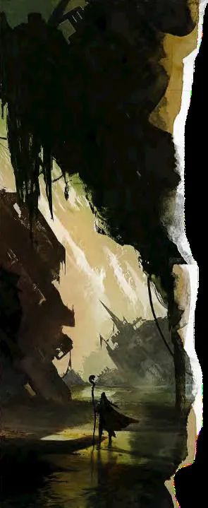

Gerados nas Camadas Infinitas do Abismo, os demônios são a encarnação do caos e mal – maquinas de destruição apenas contidas em formas monstruosas. Não possuindo qualquer compaixão, empatia ou misericórdia, eles existem apenas para destruir.

***Prole do Caos***. O Abismo cria demônios como extensões de si mesmo, formando corruptores espontaneamente a partir de imundície e carnificina. Alguns são monstruosidades únicas, enquanto outros representam deformações uniformes praticamente idênticas entre si. Outros demônios (como os manes) são criados a partir de almas mortais afugentadas ou amaldiçoadas pelos deuses ou que, de alguma outra forma, foram aprisionadas no Abismo.

***Elevação Caprichosa***. Demônios respeitam o poder, e apenas o poder. Um demônio maior comanda turbas barulhentas de demônios menores porquê ele pode destruir qualquer demônio menor que ouse recusar seus comandos. A posição de um demônio aumenta com o sangue que ele derrama; quanto mais inimigos caírem perante ele, mais alta ela se torna.

Um demônio pode ser gerado como um manes, então se tornar um dretch e, eventualmente, se transformar em um vrock após um tempo incontável gasto lutando e sobrevivendo no Abismo. Tais elevações são raras, no entanto, a maioria dos demônios é destruída antes de adquirirem poder significativo. Os maiores dentre esses que sobrevivem compõem as fileiras dos lordes demônios que ameaçam partir o Abismo em pedaços com suas guerras intermináveis.

Ao gastar poder mágico considerável, lordes demônios podem elevar demônios menores a formas maiores, embora tais promoções nunca resultem dos feitos ou realizações de um demônio. Ao invés, um lorde demônio pode perverter um manes em um quasit quando ele necessita de um espião invisível ou tornar um exército de dretches em hezrous quando estiverem marchando contra um lorde rival. Lordes demônios raramente elevam demônios às maiores categorias, temerosos de, inadvertidamente, criarem rivais ao seu próprio poder.

***Invasões Abissais***. Onde quer que perambulem pelo Abismo, os demônios buscam portais para outros planos. Eles almejam a chance de escaparem dos seus reinos nativos e espalharem sua influência sombria pelo multiverso, desfazendo os trabalhos dos deuses, derrubando civilizações e reduzindo o cosmos a desespero e ruínas.

Algumas das lendas mais obscuras do reino mortal são feitas em volta da destruição causada por demônios que se desgarraram pelo mundo. Quando acontece, até mesmo nações engajadas em conflitos amargos colocarão suas diferenças de lado para ajudar a conter uma erupção de demônios ou para selar as brechas abissais antes que mais demônios escapem.

***Sinais de Corrupção***. Demônios carregam a mácula da corrupção com eles e sua mera presença muda o mundo para pior. As plantas murcham e morrem em áreas onde brechas abissais e demônios surgem. Animais afastam-se dos locais onde um demônio tenha realizado um assassinato. O local de uma infestação demoníaca pode ser poluído com um fedor que nunca se extingue, por áreas de frio intenso ou calor escaldante ou por sombras permanentes que marcam os locais onde os corruptores se mantiveram.

***Maldade Eterna***. Fora do Abismo, a morte é o menor dos estorvos que nenhum demônio teme. Armas mundanas não podem parar esses corruptores e muitos demônios são resistentes a energia das mais potentes magias. Quando um herói sortudo consegue derrubar um demônio em combate, o corruptor dissolve em uma poça de pus. Ele, então, instantaneamente se reforma no Abismo, com sua mente e essência intactos mesmo que seu ódio esteja inflamado. A única forma de destruir verdadeiramente um demônio é busca-lo no Abismo e mata-lo lá.

***Essência Protegida***. Um demônio poderoso pode seguir passos para salvaguardar sua essência vital, usando métodos secretos e metais abissais para criar um amuleto onde parte da essência é armazenada. Se a forma abissal do demônio for destruída, o amuleto permite que o corruptor se reforme no tempo e local escolhido por ele.

Conseguir um amuleto demoníaco é uma empreendimento perigoso e, apenas buscar tal dispositivo arrisca chamar a atenção do demônio que o criou. Uma criatura possuindo um amuleto demoníaco pode exigir favores do demônio o qual a essência vital está contida no amuleto – ou infligir dores terríveis se o corruptor resistir. Se um amuleto for destruído, o demônio que o criou é aprisionado no Abismo por um ano e um dia.

***Cultos Demoníacos***. Independentemente dos riscos sombrios envolvidos em negociar com corruptores, o reino mortal é cheio de criaturas que cobiçam os poderes demoníacos. Lordes demônios manipulam esses servos mortais a realizarem atos de depravação cada vez maiores, aprofundando as ambições dos lordes demônios em troca de magia e outras vantagens. No entanto, um demônio considera quaisquer mortais a seu serviço como ferramentas para se usar e depois descartas a seus caprichos, consignando suas almas mortais ao Abismo.

***Invocação de Demônios***. Poucos atos são mais perigosos que invocar um demônio e, até mesmo arcanos que barganham espontaneamente com diabos temem os corruptores do Abismo. Apesar dos demônios desejarem semear o caos no Plano Material, eles não mostram qualquer gratidão quando trazidos a ele, vociferando contra suas prisões e exigindo a libertação.

Aqueles que se arriscam em invocar um demônio o fazem para tirar informações dele, obriga-lo a servir ou envia-lo em uma missão que apenas uma criatura de absoluta maldade poderia completar. Preparação é a chave e, invocadores experientes sabem as magias especificas e itens mágicos que podem forçar um demônio a se curvar à vontade de outrem. Se um único erro for cometido, um demônio que se liberte não mostrará misericórdia enquanto faz do seu invocador a primeira vítima de sua ira.

***Tomos sobre Demônios***. *O Livro da Escuridão* *Perversa*, os *Pergaminhos Negros de Ahm* e o *Demonomicon de Iggwilv* são as maiores autoridades sobre assuntos demoníacos. Esses tomos antigos descrevem técnicas que podem aprisionar a essência de um demônio no Plano Material, colocando-a dentro de uma arma, ídolo ou peça de joalheria e prevenindo que o corruptor retorne para o Abismo.

Um objeto que prende um demônio deve ser especialmente preparado com encantamentos profanos e sangue inocente. Ele irradia uma maldade palpável, resfriando e corrompendo o ar a seu redor. Uma criatura que porte tal objeto experimenta sonhos inquietantes e impulsos perversos, mas é capaz de controlar o demônio cuja essência está aprisionada dentro do objeto. Destruir o objeto liberta o demônio, que imediatamente buscará vingança contra seu aprisionador.

***Possessão Demoníaca***. Não importa o quão seguro é o elo, um demônio poderoso frequentemente encontra uma forma de escapar do objeto que o aprisiona. Quando uma essência demoníaca emerge do seu receptáculo, ela pode possuir um hospedeiro mortal. Às vezes, um corruptor emprega de furtividade para esconder uma possessão bem sucedida. Outras vezes, ele libera toda a fúria demoníaca que o governa através de sua nova forma.

Enquanto o demônio permanecer possuindo seu hospedeiro, a alma do hospedeiro correra risco de ser dragada para o Abismo com o demônio se ela for exorcizada da carne ou se o hospedeiro morrer. Se um demônio possuir uma criatura e o objeto que aprisiona o demônio for destruído, a possessão irá durar até que magia poderosa seja usada para conduzir o espírito demoníaco para fora do hospedeiro.

### Lordes Demônios

O poder caótico do Abismo recompensa demônios de crueldade e talento particulares com bênção das trevas, transformando-nos em corruptores únicos cujo poder pode rivalizar os deuses. Esses lordes demônios governam através de esperteza ou força bruta, esperando pelo dia em que reivindicação o prêmio de controle absoluto sobre todo o Abismo.

***Recompensa para Estrangeiros***. Apesar da maioria dos lordes demônios terem ascendido das vastas e incontáveis turbas de demônios que tumultuam através do Abismo, o plano também recompensa estrangeiros que conquistaram quaisquer de suas infinitas camadas. A deusa élfica Lolth tornou-se uma lorde demoniza após Corellon Larethian joga-la no Abismo por trair a raça élfica. Sábios afirmam que o Príncipe das Trevas Graz’zt, originou-se de algum outro plano antes de usurpar seu título abissal de outro lorde demônio há muito esquecido.

***Poder e Controle***. O maior sinal do poder de um lorde demônio é sua habilidade de remodelar um reino abissal. Uma camada do Abismo controlada por um lorde demônio tornasse o reflexo distorcido da personalidade perversa desse corruptor e lordes demônios, raras vezes, saem de seus reinos, por medo de permitir que outra criatura remodele e confisque ele.

Assim como outros demônios, lordes demônios que morram em outros planos tem sua essência retornada ao Abismo, onde ela se reforma em um novo corpo. Da mesma maneira, um lorde demônio que morra no Abismo é permanente destruído. A maioria dos lordes demônios mantem uma porção de suas essências armazenadas em segurança longe para prevenir tal destino.

### Bafomé

O lorde demônio Bafomé, também conhecido como Rei Chifrudo e o Príncipe das Bestas, governa sobre os minotauros e outras criaturas selvagens. Se ele tivesse feito do seu jeito, a civilização teria ruído e todas as raças teriam abraçado sua selvageria animal básica.

O Príncipe das Bestas se parece com um minotauro enorme de pelagem negra, chifres de ferro, olhos vermelhos e uma boca cheia de sangue pingando. Sua coroa de ferro tem as cabeças em decomposição de seus inimigos, enquanto que sua armadura negra é um conjunto de cravos e serras em forma de caveiras. Ele carrega uma glaive enorme chamada Decepadora de Corações, mas muitas vezes jogasse na briga para enfrentar seus inimigos com chifres e cascos.

### Demogorgon

A Besta Sibilante e suposto Príncipe dos Demônios, Demogorgon anseia nada menos que desfazer a ordem do multiverso. Uma reunião insana de características e direcionamentos, o Príncipe dos Demônios inspira medo e ódio dentre outros demônios e lordes demônios.

Demogorgon tem a altura três vezes maior que a de um humano, seu corpo é tão sinuoso quanto o de uma serpente e tão poderoso quanto de um gorila. Tentáculos com ventosas tomam o lugar dos seus braços. Seu torso inferior sáurio termina em pés palmados com garras e uma cauda bifurcada tem suas pontas armadas com cruéis lâminas. O Príncipe dos Demônios tem duas cabeças de babuíno sinistras, ambas loucas. É exatamente o conflito entre as duas metades de sua natureza dupla que mantem as ambições do lorde demônio em xeque.

### Graz’zt

O lorde demônio Graz’zt aparenta ser uma figura sombriamente bela de aproximadamente 2,75 metros. Aqueles que se referem ao Príncipe Negro como o mais humanoides dos lordes demônios subestimam imensamente a capacidade para o mal no intrigante coração dele.

Graz’zt é uma espécie fisicamente marcante, cuja natureza demoníaca é mostrada em sua pele cor de ébano, orelhas pontudas, presas amareladas, coroa de chifres e mãos com seis dedos. Ele se deleita em elegância, pompa e alcança seus desejos decadentes através de seus subordinados e consortes, dentre os quais os íncubos e as súcubos são geralmente os favoritos.

### Juiblex

O lorde demônio das gosmas e limos, Juiblex é uma massa de fluidos nocivos que espreita nas profundezas abissais. O miserável Lorde Sem Face não se importa com cultistas ou servos mortais e seu único desejo é transformar todas as criaturas em cópias disformes do seu eu horrendo.

Em seu estado de descanso, Juiblex se espalha em uma massa tóxica, borbulhando e enchendo o ar com um profundo fedor. Nas raras ocasiões em que criaturas confrontam o lorde demônio, Juiblex ergue-se em um cone tremulante de lodo estriado com veias negras e esverdeadas. Olhos vermelhos sinistros flutuam dentro do corpo gelatinoso, enquanto pseudópodes de gosma pingando chicoteiam avidamente qualquer criatura que eles consigam alcançar.

### Lolth

A Rainha Demoníaca das Aranhas é a matrona maligna dos drow. Cada pensamento seu é tocado por malícia e a profundidade da sua perversidade pode surpreender até mesmo sua mais fiel sacerdotisa. Ela orienta seus fiéis enquanto tece tramas dos mundos do Plano Material, esperando pelo momento em que suas adeptas drow trarão esses mundos para o seu controle.

Lolth tem a aparência de uma flexível e arrogante drow matriarca quando ela se manifesta para suas seguidoras no reino mortal, o que ela faz com rara frequência. Quando um batalha se inicia – ou se ela tiver uma razão para lembrar suas seguidoras de que devem temê-la – a parte inferior do corpo de Lolth se transforma em uma enorme aranha demoníaca, com patas espinhadas e mandíbulas que podem partes os inimigos.

### Orcus

Conhecido como o Príncipe Demônio dos Mortos-Vivos e o Senhor Sangrento, o lorde demônio Orcus é venerado pelos mortos-vivos e pelas criaturas vivas que canalizam o poder da morte-vida. Uma entidade introspectiva e niilista, Orcus anseia fazer do multiverso um lugar de morte e trevas, para sempre imutável, exceto por sua vontade. O Príncipe Demônio dos Mortos-Vivos é uma criatura suja e corpulenta, com um torso humanoide, poderosas pernas de bode e a cabeça dessecada de um carneiro. A parte superior do seu corpo ulceroso fede a doença, mas sua cabeça decadente e olhos vermelhos brilhantes parecem de uma criatura que já está morta. Grandes asas negras de morcego brotam de suas costas, provocando um mal cheiro no ar quando batem.

Orcus empunha um artefato malévolo conhecido como o *Cetro de Orcus*, um bastão similar a uma maça de obsidiana com um crânio humanoide na ponta. Ele cerca-se de mortos-vivos e criaturas vivas fora de seu controle são anátemas para ele.

### Yeenoghu

Conhecido como Senhor Gnoll e a Besta da Carnificina, o lorde demônio Yeenoghu tem apetite por chacina e destruição sem sentido. Os gnolls são seus instrumentos mortais e ele os leva a cometer atrocidades cada vez maiores em seu nome. Deliciando-se com tristeza e desespero, o Senhor Gnoll anseia tornar o mundo em uma vastidão desértica em que os últimos gnolls sobreviventes irão se destruir pelo direito de banquetear-se dos mortos.

Yeenoghu tem a aparência de um enorme e assustador gnoll com uma crina de espinhos negros e olhos que queimam com chamas esmeralda. Sua armadura é uma miscelânea de escudos e peitorais adquiridos de seus oponentes caídos e decorado com as peles esfoladas desses oponentes. Yeenoghu pode convocar um mangual triplo que ele chama de *Açougueiro*, o qual ele empunha causando efeitos letais ou ergue girando no ar durante a batalha enquanto destroça seus inimigos com dentes e garras.

### Outros Lordes Demônios

Ninguém sabe o número total de lordes demônios que permeiam o Abismo. Devido às profundezas infinitas desse plano, demônios poderosos constantemente ascendem a lordes demônios e caem com a mesma velocidade. Entre os lordes demônios cujo poder durou tempo suficiente para os demonologistas nomearem-nos estão Fraz-Urb’luu, o Príncipe da Enganação; Kostchtchie, o Príncipe da Ira; Pazuzu, Príncipe dos Reinos Aéreos Inferiores; e Zuggtmoy, Senhora dos Fungos.

### Tipos de Demônio

Demonologistas organizaram a distribuição caótica de demônios em amplas categorias de poder conhecidas como tipos. A maioria dos demônios se encaixam em um dos seis tipos principais, onde os mais fracos categorizam-se como Tipo 1 e os mais fortes como Tipo 6. Os demônios fora dos seis tipos principais são categorizados como demônios menores e lordes demônios.

> **Demônios por Tipo**

| Tipo | Exemplos |
| --- | --- |
| 1 | barlgura, demônio das sombras, vrock |
| 2 | chasme, hezrou |
| 3 | glabrezu, yochlol |
| 4 | nalfeshnee |
| 5 | marilith |
| 6 | balor, goristro |

### Balor

Figuras de maldade ancestral e terrível, balors comandam como generais sobre os exércitos demoníacos, almejando crescer em poder à medida que destroem quaisquer criaturas que se oponham a eles.

Empunhando um chicote flamejante e uma espada longa que canaliza o poder da tormenta, o poder de batalha de um balor é alimentado por ódio e raiva. Ele canaliza sua fúria demoníaca em seus espasmos mortais, sucumbindo em uma explosão de fogo que pode destruir até o mais resistente dos oponentes.

### Barlgura

O barlgura representa a selvageria e brutalidade do Abismo. Barlguras juntam-se em bandos para derrubar os inimigos mais resistentes, guardando troféus horrendos de suas vitorias e decorando seu território com tais objetos.

Um barlgura parece um orangotango poderoso com uma terrível fisionomia caída e presas saltando de sua mandíbula. Medindo pouco mais de 2,40 metros, ele possui ombros largos e pesa 325 quilos. Ele se move como um macaco pelo solo, mas escala com grande velocidade e agilidade.

### Chasme

Esse demônio repugnante lembra o cruzamento indescritível de um humanoide com um mosquito. Um chasme se equilibra sobre quatro patas finas que podem se prender em paredes e tetos. Um zumbido precede a aproximação de um chasme, infligindo uma terrível letargia nos inimigos que fiquem expostos ao ataque.

Os modestos chasmes servem a mestres mais poderosos como interrogadores ou capatazes. Um chasme vive para distribuir tortura e punição, e tem um talento especial para detectar demônios que tenha desertado de seus senhores. Capturar e trazer de volta tais traidores permite que o chasme atormente a vítima sem medo de represálias.

### Demônio das Sombras

Quando o corpo de um demônio é destruído, mas o corruptor é impedido de se reformar no Abismo, sua essência, às vezes, toma uma forma vagamente física. Essas sombras demoníacas existem fora da hierarquia abissal padrão, já que sua criação resulta, na maioria das vezes, de magia mortal, não de transformação ou promoção.

Todas as sombras demoníacas desaparecem na escuridão e elas podem rastejar sem fazer barulho. Um demônio das sombras usa suas garras insubstanciais para banquetear-se de suas vítimas, saboreando de suas memórias e bebendo de suas dúvidas. A luz plena oprime esse corruptor e mostra sua forma distinta, que é uma mancha de escuridão em forma de criatura humanoide alada cuja parte inferior do corpo segue até se tornar nada e cujas garras dilaceram a mente da vítima.

***Natureza Sombria***. Um demônio das sombras não precisa respirar, comer, beber ou dormir.

### Dretch

Dretches estão entre os demônios mais fracos – criaturas repulsivas e auto aversivas condenadas a passar a eternidade num estado perpétuo de descontentamento. A baixa inteligência deles torna os dretches incapazes de qualquer coisa além das mais simples tarefas. No entanto, o que lhes falta em potencial, lhes sobra em pura maldade. Os dretches espremem-se em turbas, expressando seu descontentamento com um estrondo inquietante de gritos, rosnados e gemidos.

### Glabrezu

Um glabrezu tem grande prazer em destruir os mortais através da tentação e essas criaturas estão dentre os poucos demônios que oferecem seus serviços para as criaturas tolas o bastante para invoca-los.

Apesar dos glabrezus serem devastadores em combate, eles preferem tentar suas vítimas para leva-las à ruína, usando poder ou riqueza como isca. Engajado em artimanha, trapaça e barganhas malignas, um glabrezu esconde riquezas que são usadas para cumprir promessas feitas a invocadores desatentos e mortais de vontade fraca. No entanto, caso sua tentativa de seduzir ou enganar falhar, um glabrezu tem a força para lutar e ganhar.

### Goristro

O goristro lembra um minotauro abissal medindo mais de seis metros de altura. Quando sob o controle de um lorde demônio, os goristros são formidáveis maquinas de cerco vivas e bestas apreciadas. Goristros possuem uma astúcia preternatural quando andam por passagens labirínticas e corredores inconstantes, perseguindo inimigos em uma caçada terrível.

Um goristro brutamontes, às vezes, carrega um palanquim com demônios menores montados sobre seus ombros, muito parecido com elefantes carregando cavaleiros sobre suas costas.

### Hezrou

Os hezrous servem como soldados de infantaria nas hordas demoníacas do Abismo. Apesar de serem fisicamente poderosos, eles são fracos de mente e os hezrous podem ser facilmente convencidos a se sacrificarem por demônios mais poderosos. Quando eles avançam para atacar no coração das forças inimigas, seu fedor terrível pode nausear até o mais vigoroso dos oponentes.

### Manes

Almas de criaturas malignas que desceram para os Planos Inferiores são transformadas em manes – a forma mais baixa da espécie demoníaca. Esses corruptores miseráveis atacam qualquer não-demônio que verem e são chamados ao Plano Material por aqueles que buscam semear a morte e o caos.

Orcus, o Príncipe dos Mortos-Vivos, detêm o poder de transformar manes em monstros mortos-vivos, geralmente carniçais e sombras. Outros lordes demônios alimentam-se de manes, destruindo-os completamente. Do contrário, matar um manes faz com que ele se dissipe em uma nuvem fétida de vapor que se reforma em outro manes após um dia.

> **Nomes Verdadeiros de Demônios**
>
> Apesar de todos os demônios terem nomes comuns, cada lorde demônio e cada demônio de tipo 1 dos 6 possui um nome verdadeiro que ele guarda em segredo. Um demônio pode ser forçado a revelar seu nome verdadeiro se estiver enfeitiçado e dizem existir antigos pergaminhos e tomos com listas de nomes verdadeiros dos mais poderosos demônios. Um mortal que descubra o nome verdadeiro de um demônio pode usar magia de invocação poderosa para convocar o demônio do Abismo e exercer certo grau de controle sobre ele. Porém, a maioria dos demônios trazidos ao Plano Material dessa forma fazem tudo que podem para causar estragos e semear discórdia e conflito.

### Marilith

Terrível de se encarar, uma marilith tem a parte inferior do corpo de uma grande serpente e o torso superior de uma humanoide com seis braços.

Empunhando uma espada assustadora em cada uma de suas seis mãos, uma marilith é um oponente devastador ao qual poucos conseguem se comparar em batalha. Essas demonizas possuem mentes afiadas, um senso tático muito apurado e elas são capazes de liderar uma unidade de outros demônios em uma causa comum. As mariliths são, muitas vezes, encontradas como capitãs na vanguarda de uma horda demoníaca, onde elas abraçam qualquer oportunidade de investir na linha de frente da batalha.

### Nalfeshnee

O nalfeshnee é um dos demônios mais grotescos – uma mistura corpulenta de gorila e javali medindo duas vezes à altura de um humano, com asas plumadas que parecem muito pequenas para o seu corpo inchado. Essas características brutais escondem uma inteligência e astúcia excepcionais.

Os nalfeshnees são devastadores em combate, usando suas asas para planar sobre as fileiras frontais e alcançar adversários vulneráveis que podem ser despachados com pouco esforço. Do meio da batalha, eles comandam telepaticamente os demônios menores abaixo, mesmo quando eles inspiram um sentimento de pavor que força seus oponentes a se dispersar e fugir.

Os nalfeshnees alimentam-se de ódio e desespero, mas eles desejam a carne humanoide, acima de tudo. Eles mantêm as suas despensas cheias de humanoides raptados do Plano Material, então devoram essas criaturas vivas durante elaborados banquetes. Considerando-se refinados e cultos, nalfeshnees usam talheres manchados e enferrujados durante o jantar.

### Quasit

Os quasits infestam os Planos Inferiores. Fisicamente fracos, eles se mantêm às sombras para tramar travessuras e maldades. Demônios mais poderosos usam os quasits como espiões e mensageiros quando eles não os devoram ou os estraçalham para passar o tempo.

Um quasit pode assumir formas animais, mas sua verdadeira forma assemelha-se a um humanoide verde de 60 centímetros de altura com um rabo farpado e chifres. Os quasit tem garras nos pés e mãos e essas garras podem transmitir um veneno irritante. Ele prefere estar invisível quando ataca.

### Vrock

Os vrocks são corruptores obtusos e caprichosos que vivem apenas para causar dor e carnificina. Um vrock se parece com um híbrido gigante de um humanoide e um abutre, seu corpo deformado, bestial e suas asas largas fedem a carniça.

Vrocks devoram carne humanoide sempre que podem, atordoando presas em potencial com um guincho ensurdecedor, então mergulham investindo com bico e garras. Os vrocks podem sacudir suas asas, liberando nuvens de esporos tóxicos.

Cobiçando coisas bonitas, os vrocks voltam-se uns contra os outros pela chance de reivindicar joias baratas ou pedras ornamentadas. Apesar do seu apego a tesouros, vrocks são difíceis de subornar, não vendo razão para barganhar quando eles podem simplesmente pegar o que querem do corpo de um possível barganhador.

### Yochlol

As yochlols são as Serviçais de Lolth – extensões da vontade da Rainha Aranha dedicadas a agirem como espiãs, capatazes e agentes de vilania. Elas atendem sua deusa nos Fossos de Teias Demoníacas, mas Lolth, às vezes, envia as yochlols para o Plano Material para guardar seus templos e ajudar suas sacerdotisas mais devotadas. As yochlols não são criadas fora do reino de das Teias Demoníacas de Lolth e não servem nenhum lorde demônio, exceto sua rainha.

Fora do Abismo, uma yochlol pode assumir a aparência de uma drow ou aranha monstruosa para esconder sua forma demoníaca. Em sua verdadeira forma, a corruptora parece um pilar de limo amarelado com um único olho malévolo. Na sua forma verdadeira e de drow, o toque de uma yochlol carrega o mesmo veneno da mordida de sua forma de aranha.

> **Variação: Invocação de Demônios**
>
> Alguns demônios podem ter uma opção de ação que os permite invocar outros demônios.
>
> ***Invocar Demônio (1/Dia)***. O demônio escolhe o que invocar e tenta uma invocação mágica.

 — Um balor tem 50 por cento de chance de invocar 1d8 vrocks,

> 1d6 hezrous, 1d4 glabrezus, 1d3 nalfeshnees, 1d2 mariliths ou um goristro.

 — Um barlgura tem 30 por cento de chance de invocar um

> barlgura.

 — Um chasme tem 30 por cento de chance de invocar um

> chasme.

 — Um glabrezu tem 30 por cento de chance de invocar 1d3

> vrocks, 1d2 hezrous ou um glabrezu.

 — Uma marilith tem 50 por cento de chance de invocar 1d6

> vrocks, 1d4 hezrous, 1d3 glabrezus, 1d2 nalfeshnees ou uma marilith.

 — Um nalfeshnee tem 50 por cento de chance de invocar 1d4

> vrocks, 1d3 hezrous, 1d2 glabrezus ou um nalfeshenee.

 — Um vrock tem 30 por cento de chance de invocar 2d4

> dretches ou um vrock.

 — Uma yochlol tem 50 por cento de chance de invocar uma

> yochlol.
>
> Um demônio invocado aparece num espaço desocupado a até 18 metros do invocador, agindo como um aliado dele e não pode invocar outros demônios. Ele permanece por 1 minuto, até seu invocador morrer ou até seu invocador dispensa-lo com uma ação.

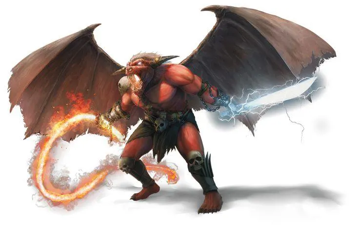

## Bloco de estatísticas: Balor

*Corruptor Enorme (demônio), caótico e mau*

**Classe de Armadura** 19 (armadura natural)  
**Pontos de Vida** 262 (21d12 + 126)  
**Deslocamento** 12 m, voo 24 m

| FOR | DES | CON | INT | SAB | CAR |
| :---: | :---: | :---: | :---: | :---: | :---: |
| 26 (+8) | 15 (+2) | 22 (+6) | 20 (+5) | 16 (+3) | 22 (+6) |

**Testes de Resistência** For +14, Con +12, Sab +9, Car +12  
**Resistência a Dano** elétrico, frio; concussão, cortante e perfurante de ataques não-mágicos  
**Imunidade a Dano** fogo, veneno  
**Imunidade a Condição** envenenado  
**Sentidos** visão verdadeira 36 m, Percepção passiva 13  
**Idiomas** Abissal, telepatia 36 m  
**Nível de Desafio** 19 (22.000 XP)

***Armas Mágicas***. Os ataques com armas do balor são mágicos.

***Aura Flamejante***. No começo de cada turno do balor, cada criatura a até 1,5 metro dele sofre 10 (3d6) de dano de fogo e objetos inflamáveis na aura que não estejam sendo vestidos ou carregados incendeiam. Uma criatura que toque o balor ou o atinja com um ataque corpo-a-corpo enquanto estiver a 1,5 metro dele, sofre 10 (3d6) de dano de fogo.

***Espasmos de Morte***. Quando um balor morre, ele explode e cada criatura a até 9 metros dele deve realizar um teste de resistência CD 20, sofrendo 70 (20d6) de dano de fogo se falhar na resistência ou metade desse dano se obtiver sucesso. A explosão incendeia objetos inflamáveis na área que não estejam sendo vestidos ou carregados e destrói as armas do balor.

***Resistência à Magia***. O balor possui vantagem nos testes de resistência contra magias e outros efeitos mágicos.

### Ações

***Ataques Múltiplos***. O balor realiza dois ataques: um com sua espada longa e um com seu chicote.

***Espada Longa***. *Ataque Corpo-a-Corpo com Arma*: +14 para atingir, alcance 3 m, um alvo. *Acerto*: 21 (3d8 + 8) de dano cortante mais 13 (3d8) de dano elétrico. Se o balor atingir um acerto crítico, ele joga os dados de dano três vezes, ao invés de duas.

***Chicote***. *Ataque Corpo-a-Corpo com Arma*: +14 para atingir, alcance 6 m, um alvo. *Acerto*: 15 (2d6 + 8) de dano cortante mais 10 (3d6) de dano de fogo e o alvo deve ser bem sucedido num teste de resistência de Força CD 20 ou será puxado para 4,5 metros em direção do balor.

***Teletransporte***. O balor teletransporta-se magicamente, junto com todo o equipamento que esteja vestindo ou carregando, para até 36 metros de distância, num espaço desocupado, que ele possa ver.

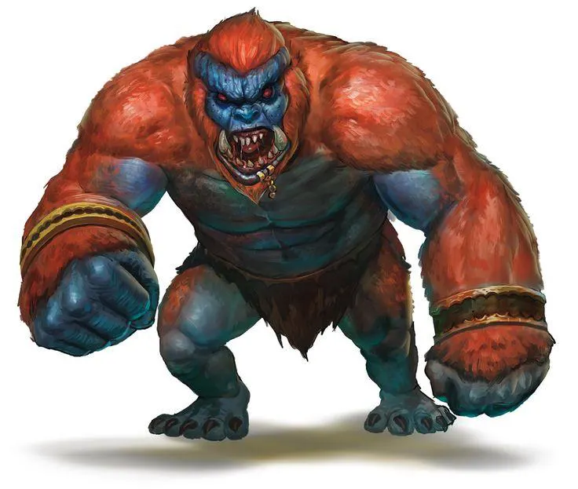

## Bloco de estatísticas: Barlgura

*Corruptor Grande (demônio), caótico e mau*

**Classe de Armadura** 15 (armadura natural)  
**Pontos de Vida** 68 (8d10 + 24)  
**Deslocamento** 12 m, escalada 12 m

| FOR | DES | CON | INT | SAB | CAR |
| :---: | :---: | :---: | :---: | :---: | :---: |
| 18 (+4) | 15 (+2) | 16 (+3) | 7 (–2) | 14 (+2) | 9 (–1) |

**Testes de Resistência** Des +5, Con +6  
**Perícias** Furtividade +5, Percepção +5  
**Resistência a Dano** elétrico, fogo, frio  
**Imunidade a Dano** veneno  
**Imunidade a Condição** envenenado  
**Sentidos** percepção às cegas 9 m, visão no escuro 36 m, Percepção passiva 15  
**Idiomas** Abissal, telepatia 36 m  
**Nível de Desafio** 5 (1.800 XP)

***Conjuração Inata***. A habilidade de conjuração de uma barlgura é Sabedoria (CD de resistência de magia 13). Ele pode conjurar, inatamente, as seguintes magias, sem necessidade de componentes materiais: 1/dia cada: *constrição, força fantasmagórica* 2/dia cada: *disfarçar-se, invisibilidade* (pessoal apenas)

***Descuidado***. No começo do seu turno, o barlgura pode receber vantagem em todas as jogadas de ataque corpo-a-corpo que ele realizar durante esse turno, mas todas as jogadas de ataque contra ele tem vantagem até o início do seu próximo turno.

***Salto em Corrida***. O salto em distância de um barlgura é de 12 metros e seu salto em altura é de 6 metros quando ele realizar uma corrida antes.

### Ações

***Ataques Múltiplos***. O barlgura realiza três ataques: um com sua mordida e dois com seus punhos.

***Mordida***. *Ataque Corpo-a-Corpo com Arma*: +7 para atingir, alcance 1,5 m, um alvo. *Acerto*: 11 (2d6 + 4) de dano perfurante.

***Punho***. *Ataque Corpo-a-Corpo com Arma*: +7 para atingir, alcance 1,5 m, um alvo. *Acerto*: 9 (1d10 + 4) de dano de concussão.

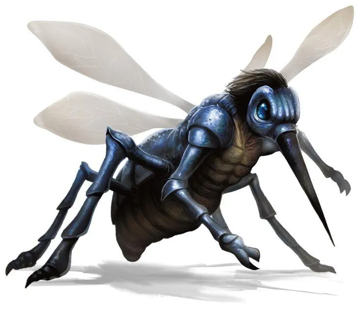

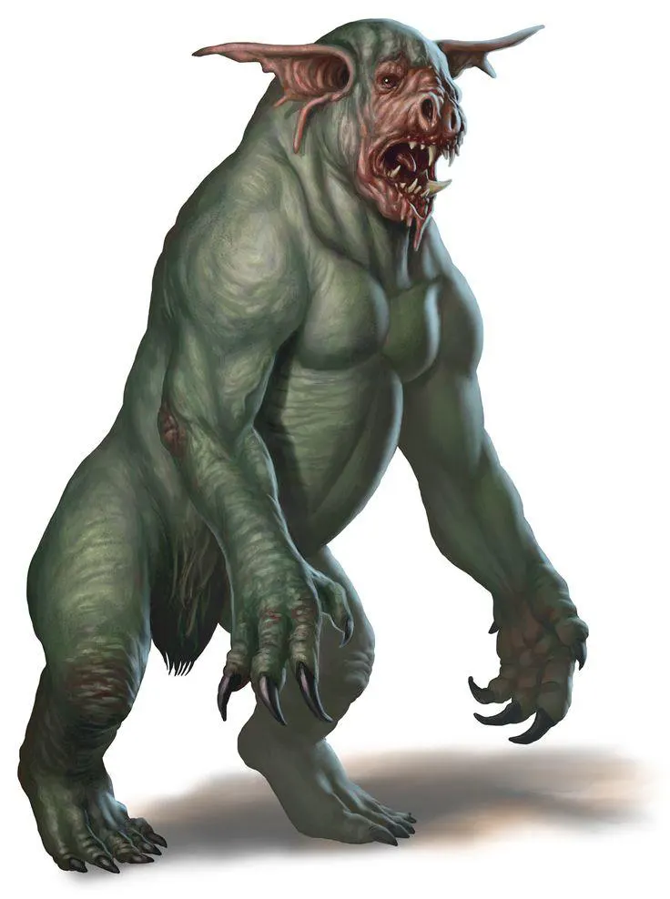

## Bloco de estatísticas: Chasme

*Corruptor Grande (demônio), caótico e mau*

**Classe de Armadura** 15 (armadura natural)  
**Pontos de Vida** 84 (13d10 + 13)  
**Deslocamento** 6 m, voo 18 m

| FOR | DES | CON | INT | SAB | CAR |
| :---: | :---: | :---: | :---: | :---: | :---: |
| 15 (+2) | 15 (+2) | 12 (+1) | 11 (+0) | 14 (+2) | 10 (+0) |

**Testes de Resistência** Des +5, Sab +5  
**Perícias** Percepção +5  
**Resistência a Dano** elétrico, fogo, frio  
**Imunidade a Dano** veneno  
**Imunidade a Condição** envenenado  
**Sentidos** percepção às cegas 3 m, visão no escuro 36 m, Percepção passiva 15  
**Idiomas** Abissal, telepatia 36 m  
**Nível de Desafio** 6 (2.300 XP)

***Escalada Aracnídea***. O chasme pode escalar superfícies difíceis, incluindo andar de cabeça para baixo em tetos, sem precisar realizar um teste de habilidade.

***Resistência à Magia***. O chasme possui vantagem nos testes de resistência contra magias e outros efeitos mágicos.

***Zumbido***. O chasme produz um zumbido terrível ao qual demônios são imunes. Qualquer outra criatura que começar seu turno a até 9 metros do chasme, deve ser bem sucedida em um teste de resistência de Constituição CD 12 ou cairá inconsciente por 10 minutos. Uma criatura que não puder ouvir o zumbido é automaticamente bem sucedida na resistência. O efeito na criatura acaba se ela sofrer dano ou se outra criatura realizar uma ação para jogar água benta nela. Se o teste de resistência de uma criatura for bem sucedido ou se o efeito terminar nela, ela fica imune ao zumbido pelas próximas 24 horas.

### Ações

***Picada***. *Ataque Corpo-a-Corpo com Arma*: +5 para atingir, alcance 1,5 m, uma criatura. *Acerto*: 16 (4d6 + 2) de dano perfurante mais 24 (7d6) de dano necrótico e o máximo de pontos de vida do alvo é reduzido num valor igual ao dano necrótico sofrido. Se esse efeito reduzir o máximo de pontos de vida de uma criatura a 0, a criatura morre. Essa redução no máximo de pontos de vida de uma criatura dura até a criatura terminar um descanso longo ou até ela ser afetada pela magia *restauração maior*.

## Bloco de estatísticas: Dretch

*Corruptor Pequeno (demônio), caótico e mau*

**Classe de Armadura** 11 (armadura natural)  
**Pontos de Vida** 18 (4d6 + 4)  
**Deslocamento** 6 m

| FOR | DES | CON | INT | SAB | CAR |
| :---: | :---: | :---: | :---: | :---: | :---: |
| 11 (+0) | 11 (+0) | 12 (+1) | 5 (–3) | 8 (–1) | 3 (–4) |

**Resistência a Dano** elétrico, fogo, frio  
**Imunidade a Dano** veneno  
**Imunidade a Condição** envenenado  
**Sentidos** visão no escuro 36 m, Percepção passiva 9  
**Idiomas** Abissal, telepatia 36 m (funciona apenas com criaturas que compreendam Abissal)  
**Nível de Desafio** 1/4 (50 XP)

### Ações

***Ataques Múltiplos***. O dretch realiza dois ataques: um com sua mordida e um com suas garras.

***Mordida***. *Ataque Corpo-a-Corpo com Arma*: +2 para atingir, alcance 1,5 m, um alvo. *Acerto*: 3 (1d6) de dano perfurante.

***Garras***. *Ataque Corpo-a-Corpo com Arma*: +2 para atingir, alcance 1,5 m, um alvo. *Acerto*: 5 (2d4) de dano cortante.

***Nuvem Fétida (1/Dia)***. Um gás esverdeado nojento se estende do dretch num raio de 3 metros. O gás se espalha, dobrando esquinas e sua área é de escuridão leve. Ela dura por 1 minuto ou até que um vento forte a disperse. Qualquer criatura que comece seu turno na área deve ser bem sucedida num teste de resistência de Constituição CD 11 ou ficará envenenada até o início do próximo turno dela. Enquanto estiver envenenada dessa forma, o alvo só pode realizar uma ação ou uma ação bônus no seu turno, mas não ambas, e não pode realizar reações.

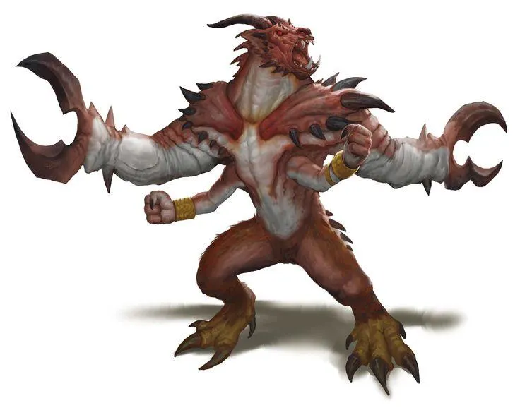

## Bloco de estatísticas: Glabrezu

*Corruptor Grande (demônio), caótico e mau*

**Classe de Armadura** 17 (armadura natural)  
**Pontos de Vida** 157 (15d10 + 75)  
**Deslocamento** 12 m

| FOR | DES | CON | INT | SAB | CAR |
| :---: | :---: | :---: | :---: | :---: | :---: |
| 20 (+5) | 15 (+2) | 21 (+5) | 19 (+9) | 17 (+3) | 16 (+3) |

**Testes de Resistência** For +9, Con +9, Sab +7, Car +7  
**Resistência a Dano** elétrico, fogo, frio; concussão, cortante e perfurante de ataques não-mágicos  
**Imunidade a Dano** veneno  
**Imunidade a Condição** envenenado  
**Sentidos** visão verdadeira 36 m, Percepção passiva 13  
**Idiomas** Abissal, telepatia 36 m  
**Nível de Desafio** 9 (5.000 XP)

***Conjuração Inata***. A habilidade de conjuração de um glabrezu é Inteligência (CD de resistência de magia 16). Ele pode conjurar, inatamente, as seguintes magias, sem necessidade de componentes materiais:

À vontade: *detectar magia, dissipar magia,* *escuridão* 1/dia cada: *confusão, palavra de poder atordoar, voo*

***Resistência à Magia***. O glabrezu possui vantagem nos testes de resistência contra magias e outros efeitos mágicos.

### Ações

***Ataques Múltiplos***. O glabrezu realiza quatro ataques: dois com suas pinças e dois com seus punhos. Alternativamente, ele pode realizar dois ataques com as pinças e conjurar uma magia.

***Pinça***. *Ataque Corpo-a-Corpo com Arma*: +9 para atingir, alcance 3 m, um alvo. *Acerto*: 16 (2d10 + 5) de dano de concussão. Se o alvo for uma criatura Média ou menor, ela ficará agarrada (CD 15 para escapar). O glabrezu tem duas pinças, cada uma delas pode agarrar apenas um alvo.

***Punhos***. *Ataque Corpo-a-Corpo com Arma*: +9 para atingir, alcance 1,5 m, um alvo. *Acerto*: 16 (2d4 + 2) de dano de concussão.

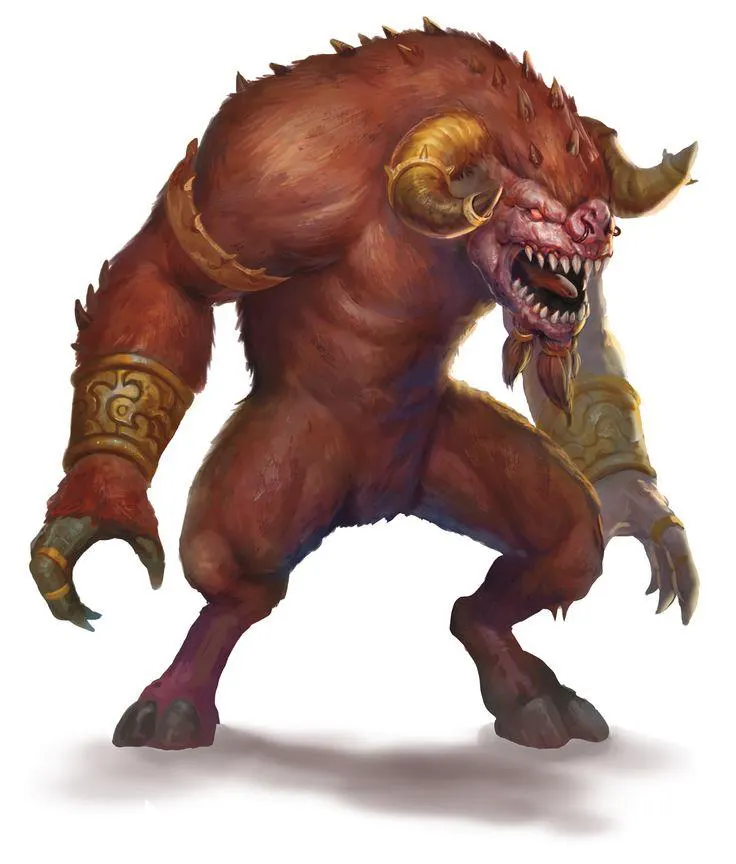

## Bloco de estatísticas: Goristro

*Corruptor Enorme (demônio), caótico e mau*

**Classe de Armadura** 19 (armadura natural)  
**Pontos de Vida** 310 (23d12 + 161)  
**Deslocamento** 12 m

| FOR | DES | CON | INT | SAB | CAR |
| :---: | :---: | :---: | :---: | :---: | :---: |
| 25 (+7) | 11 (+0) | 25 (+7) | 6 (–2) | 13 (+1) | 14 (+2) |

**Testes de Resistência** For +13, Des +6, Con +13, Sab +7  
**Resistência a Dano** elétrico, fogo, frio; concussão, cortante e perfurante de ataques não-mágicos  
**Imunidade a Dano** veneno  
**Imunidade a Condição** envenenado  
**Sentidos** visão no escuro 36 m, Percepção passiva 17  
**Idiomas** Abissal  
**Nível de Desafio** 17 (18.000 XP)

***Investida***. Se o goristro se mover, pelo menos, 4,5 metros em linha reta até um alvo e então atingi-lo com um ataque de chifres no mesmo turno, o alvo sofre 38 (7d10) de dano perfurante extra. Se o alvo for uma criatura, ele deve ser bem sucedido num teste de resistência de Força CD 21 ou será empurrado 6 metros e caíra no chão.

***Lembrança Labiríntica***. O goristro pode lembrar perfeitamente de qualquer caminho que ele tenha feito.

***Monstro de Cerco***. O goristro causa o dobro do dano a objetos e estruturas.

***Resistência à Magia***. O goristro possui vantagem nos testes de resistência contra magias e outros efeitos mágicos.

### Ações

***Ataques Múltiplos***. O goristro realiza três ataques: dois com seus punhos e um com seu casco.

***Punho***. *Ataque Corpo-a-Corpo com Arma*: +13 para atingir, alcance 3 m, um alvo. *Acerto*: 20 (3d8 + 7) de dano de concussão.

***Casco***. *Ataque Corpo-a-Corpo com Arma*: +13 para atingir, alcance 1,5 m, um alvo. *Acerto*: 23 (3d10 + 7) de dano de concussão. Se o alvo for uma criatura, ele deve ser bem sucedido num teste de resistência de Força CD 21 ou cairá no chão.

***Chifres***. *Ataque Corpo-a-Corpo com Arma*: +13 para atingir, alcance 3 m, um alvo. *Acerto*: 45 (7d10 + 7) de dano perfurante.

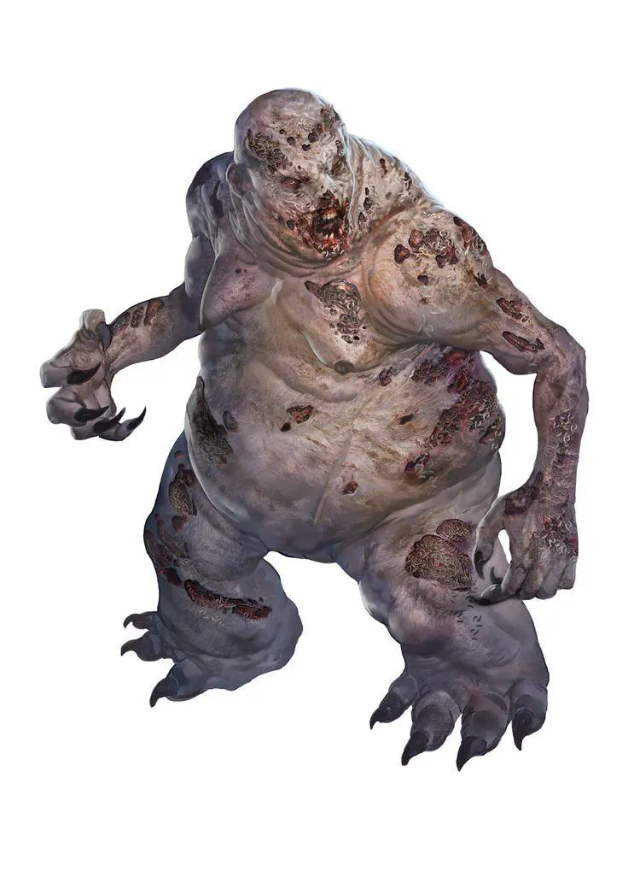

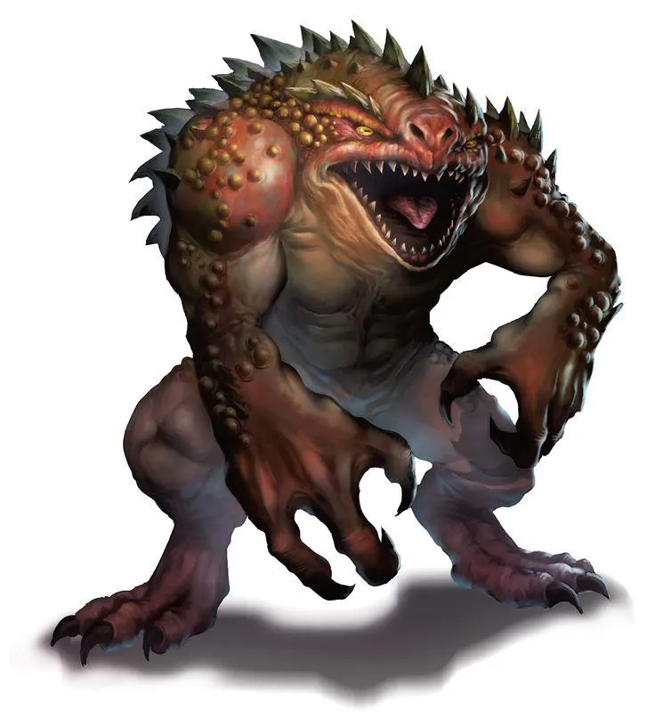

## Bloco de estatísticas: Hezrou

*Corruptor Grande (demônio), caótico e mau*

**Classe de Armadura** 16 (armadura natural)  
**Pontos de Vida** 136 (13d10 + 65)  
**Deslocamento** 9 m

| FOR | DES | CON | INT | SAB | CAR |
| :---: | :---: | :---: | :---: | :---: | :---: |
| 19 (+4) | 17 (+3) | 20 (+5) | 5 (–3) | 12 (+1) | 13 (+1) |

**Testes de Resistência** For +7, Con +8, Sab +4  
**Resistência a Dano** elétrico, fogo, frio; concussão, cortante e perfurante de ataques não-mágicos  
**Imunidade a Dano** veneno  
**Imunidade a Condição** envenenado  
**Sentidos** visão no escuro 36 m, Percepção passiva 11  
**Idiomas** Abissal, telepatia 36 m  
**Nível de Desafio** 8 (3.900 XP)

***Fedor***. Qualquer criatura que comece seu turno a até 3 metros do hezrou deve ser bem sucedida num teste de resistência de Constituição CD 14 ou ficará envenenada até o início do próximo turno dela. Se obtiver sucesso na resistência, a criatura fica imune ao fedor do hezrou por 24 horas.

***Resistência à Magia***. O goristro possui vantagem nos testes de resistência contra magias e outros efeitos mágicos.

### Ações

***Ataques Múltiplos***. O hezrou realiza três ataques: um com sua mordida e dois com suas garras.

***Mordida***. *Ataque Corpo-a-Corpo com Arma*: +7 para atingir, alcance 1,5 m, um alvo. *Acerto*: 15 (2d10 + 4) de dano perfurante.

***Garras***. *Ataque Corpo-a-Corpo com Arma*: +7 para atingir, alcance 1,5 m, um alvo. *Acerto*: 11 (2d6 + 4) de dano cortante.

## Bloco de estatísticas: Manes

*Corruptor Pequeno (demônio), caótico e mau*

**Classe de Armadura** 9  
**Pontos de Vida** 9 (2d6 + 2)  
**Deslocamento** 6 m

| FOR | DES | CON | INT | SAB | CAR |
| :---: | :---: | :---: | :---: | :---: | :---: |
| 10 (+0) | 9 (–1) | 13 (+1) | 3 (–4) | 8 (–1) | 4 (–3) |

**Resistência a Dano** elétrico, fogo, frio  
**Imunidade a Dano** veneno  
**Imunidade a Condição** amedrontado, enfeitiçado, envenenado  
**Sentidos** visão no escuro 36 m, Percepção passiva 9  
**Idiomas** compreende Abissal mas não pode falar  
**Nível de Desafio** 1/8 (25 XP)

### Ações

***Garras***. *Ataque Corpo-a-Corpo com Arma*: +2 para atingir, alcance 1,5 m, um alvo. *Acerto*: 5 (2d4) de dano cortante.

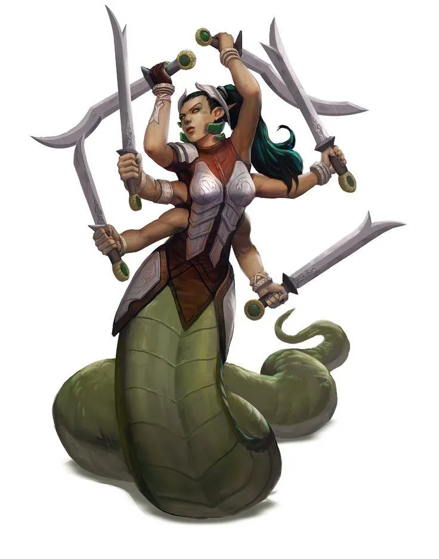

## Bloco de estatísticas: Marilith

*Corruptor Grande (demônio), caótico e mau*

**Classe de Armadura** 18 (armadura natural)  
**Pontos de Vida** 189 (18d10 + 90)  
**Deslocamento** 12 m

| FOR | DES | CON | INT | SAB | CAR |
| :---: | :---: | :---: | :---: | :---: | :---: |
| 18 (+4) | 20 (+5) | 20 (+5) | 18 (+4) | 16 (+3) | 20 (+5) |

**Testes de Resistência** For +9, Con +10, Sab +8, Car +10  
**Resistência a Dano** elétrico, fogo, frio; concussão, cortante e perfurante de ataques não-mágicos  
**Imunidade a Dano** veneno  
**Imunidade a Condição** envenenado  
**Sentidos** visão verdadeira 36 m, Percepção passiva 13  
**Idiomas** Abissal, telepatia 36 m  
**Nível de Desafio** 16 (15.000 XP)

***Armas Mágicas***. Os ataques com armas da marilith são mágicos.

***Resistência à Magia***. A marilith possui vantagem nos testes de resistência contra magias e outros efeitos mágicos.

***Reativa***. A marilith pode realizar uma reação em cada turno em um combate.

### Ações

***Ataques Múltiplos***. A marilith realiza sete ataques: seis com suas espadas longas e um com sua cauda.

***Espada Longa***. *Ataque Corpo-a-Corpo com Arma*: +9 para atingir, alcance 1,5 m, um alvo. *Acerto*: 13 (2d8 + 4) de dano cortante.

***Cauda***. *Ataque Corpo-a-Corpo com Arma*: +9 para atingir, alcance 3 m, uma criatura. *Acerto*: 15 (2d10 + 4) de dano de concussão. Se o alvo for Médio ou menor, ele ficará agarrado (CD 19 para escapar). Até o agarrão acabar, o alvo está impedido, a marilith pode, automaticamente, atingir o alvo com sua cauda e a marilith não pode realizar ataques de cauda contra outros alvos.

***Teletransporte***. A marilith teletransporta-se magicamente, junto com todo o equipamento que esteja vestindo ou carregando, para até 36 metros de distância, num espaço desocupado, que ela possa ver.

### Reações

***Aparar***. A marilith adiciona 5 à sua CA contra um ataque corpo-a-corpo que poderia atingi-la. Para tanto, a marilith deve poder ver o atacante e estar empunhando uma arma corpo-a-corpo.

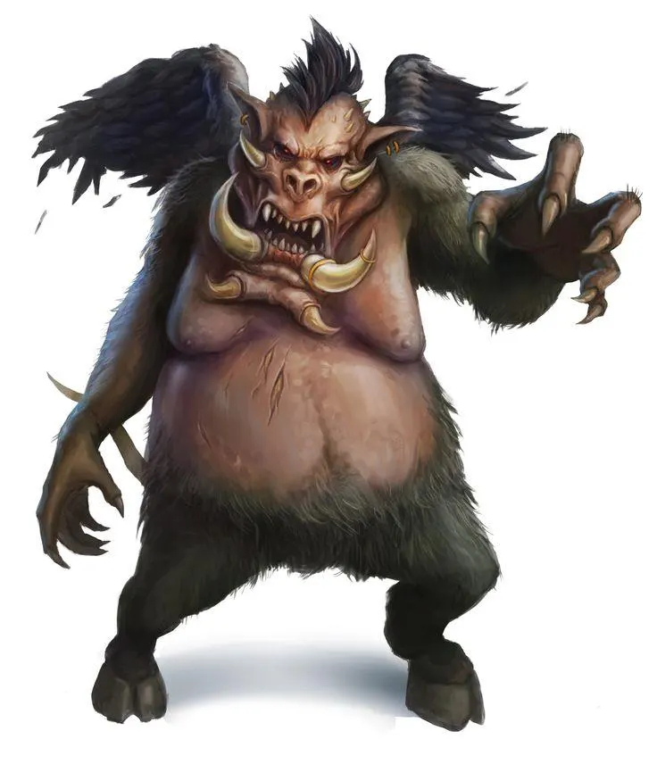

## Bloco de estatísticas: Nalfeshnee

*Corruptor Grande (demônio), caótico e mau*

**Classe de Armadura** 18 (armadura natural)  
**Pontos de Vida** 185 (16d10 + 96)  
**Deslocamento** 6 m, voo 9 m

| FOR | DES | CON | INT | SAB | CAR |
| :---: | :---: | :---: | :---: | :---: | :---: |
| 21 (+5) | 10 (+0) | 22 (+6) | 19 (+4) | 12 (+1) | 15 (+2) |

**Testes de Resistência** Con +11, Int +9, Sab +6, Car +7  
**Resistência a Dano** elétrico, fogo, frio; concussão, cortante e perfurante de ataques não-mágicos  
**Imunidade a Dano** veneno  
**Imunidade a Condição** envenenado  
**Sentidos** visão verdadeira 36 m, Percepção passiva 11  
**Idiomas** Abissal, telepatia 36 m  
**Nível de Desafio** 13 (10.000 XP)

***Resistência à Magia***. O nalfeshnee possui vantagem nos testes de resistência contra magias e outros efeitos mágicos.

### Ações

***Ataques Múltiplos***. O nalfeshnee usa seu Nimbo de Pavor se puder. Então ele realiza três ataques: um com sua mordida e dois com suas garras.

***Mordida***. *Ataque Corpo-a-Corpo com Arma*: +10 para atingir, alcance 1,5 m, um alvo. *Acerto*: 32 (5d10 + 5) de dano perfurante.

***Garra***. *Ataque Corpo-a-Corpo com Arma*: +10 para atingir, alcance 3 m, um alvo. *Acerto*: 15 (3d6 + 5) de dano cortante.

***Nimbo de Pavor (Recarrega 5–6)***. O nalfeshnee magicamente emite uma luz cintilante, multicolorida. Cada criatura a até 4,5 metros dele, que puder ver a luz, deve ser bem sucedido num teste de resistência de Sabedoria CD 15 ou ficará amedrontada por 1 minuto. Uma criatura pode repetir o teste de resistência no final de cada um dos seus turno, terminando o efeito se for bem sucedida. Se o teste de resistência de uma criatura for bem sucedido ou se ela terminar o efeito nela, a criatura fica imune ao Nimbo de Pavor do nalfeshnee pelas próximas 24 horas.

***Teletransporte***. O nalfeshnee teletransporta-se magicamente, junto com todo o equipamento que esteja vestindo ou carregando, para até 36 metros de distância, num espaço desocupado, que ele possa ver.

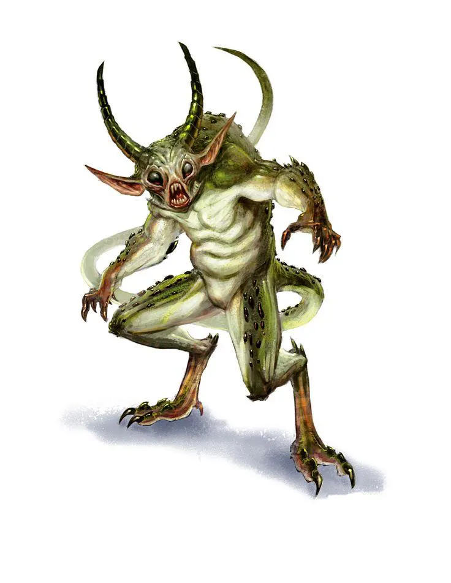

### Variação: Familiar Quasit

Conjuradores mortais interessados em familiares extraplanares acham os quasits fáceis de invocar e ansiosos para servir. O quasit faz o papel do servo bajulador. Ele serve bem ao seu mestre, mas ele leva o mortal a realizar atos cada vez mais caóticos e malignos. Tais quasits tem a seguinte característica.

***Familiar***. O quasit pode servir a outra criatura como um familiar, formando um vínculo telepático com um mestre voluntário. Quando ambos estiverem ligados, o mestre pode sentir o que o quasit sente, contanto que eles estejam a até 1,5 quilômetro um do outro. Enquanto o quasit estiver a até 3 metros de seu mestre, o mestre partilha da Resistência à Magia do quasit. A qualquer momento e por qualquer razão, o quasit pode acabar com seu serviço como familiar, acabando com o vínculo telepático.

## Bloco de estatísticas: Quasit

*Corruptor Miúdo (demônio, metamorfo), caótico e mau*

**Classe de Armadura** 13  
**Pontos de Vida** 7 (3d4)  
**Deslocamento** 12 m

| FOR | DES | CON | INT | SAB | CAR |
| :---: | :---: | :---: | :---: | :---: | :---: |
| 5 (–3) | 17 (+3) | 10 (+0) | 7 (–2) | 10 (+0) | 10 (+0) |

**Perícias** Furtividade +5  
**Resistência a Dano** frio, fogo, elétrico; concussão, cortante e perfurante de ataques não-mágicos  
**Imunidade a Dano** veneno  
**Sentidos** visão no escuro 36 m Percepção passiva 10  
**Idiomas** Abissal, Comum  
**Nível de Desafio** 1 (200 XP)

***Metamorfo***. O quasit pode usar sua ação para se metamorfosear nas formas de besta de um morcego (deslocamento 3 m, voo 12 m), centopeia (12 m, escalada 12 m) ou sapo (12 m, natação 12 m), ou em sua forma de demônio. Suas estatísticas são as mesmas em todas as formas, no entanto, seu ataque é diferente em algumas delas. Qualquer equipamento carregado não será transformado. Se for morto, o quasit volta a sua forma de demônio.

***Resistência à Magia***. O quasit tem vantagem em testes de resistência contra magias e outros efeitos mágicos.

### Ações

***Assustar (1/dia).*** Uma criatura, à escolha do quasit, a até 6 metros dele, deve ser bem sucedida num teste de resistência de Sabedoria CD 10 ou ficará amedrontada por 1 minuto. O alvo pode repetir o teste de resistência no final de cada um dos seus turnos, com desvantagem se o quasit estiver em sua linha de visão, terminando o efeito prematuramente se obtiver sucesso.

***Garras (Mordida em Forma de Besta)***. *Ataque Corpo-a-Corpo* *com Arma*: +5 para atingir, alcance 1,5 m, um alvo. *Acerto*: 5 (1d4 + 3) de dano perfurante. Se o alvo por uma criatura, ela deve ser bem sucedida num teste de resistência de Constituição CD 10 ou sofrerá 5 (2d4) de dano de veneno e ficará envenenado por 1 minuto. A criatura pode repetir o teste de resistência no final de cada um dos seus turnos, terminando o efeito prematuramente se obtiver sucesso.

***Invisibilidade***. O quasit fica invisível até ele atacar, usar Assustar ou sua concentração acabar. Qualquer coisa que o quasit invisível estiver carregando ou vestindo fica invisível contanto que permaneça em contato com ele.

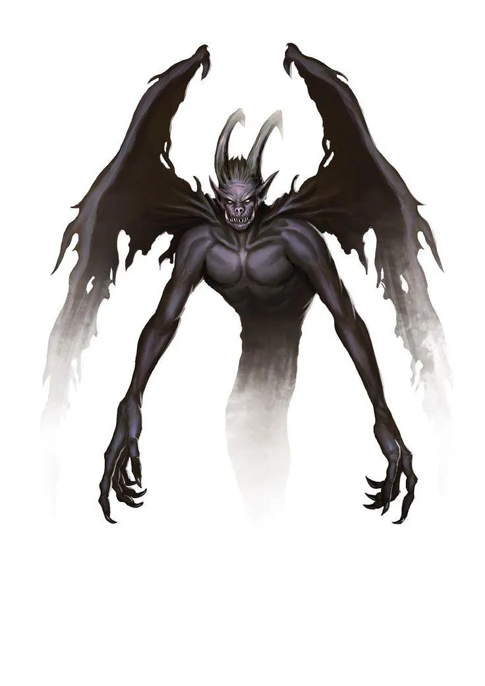

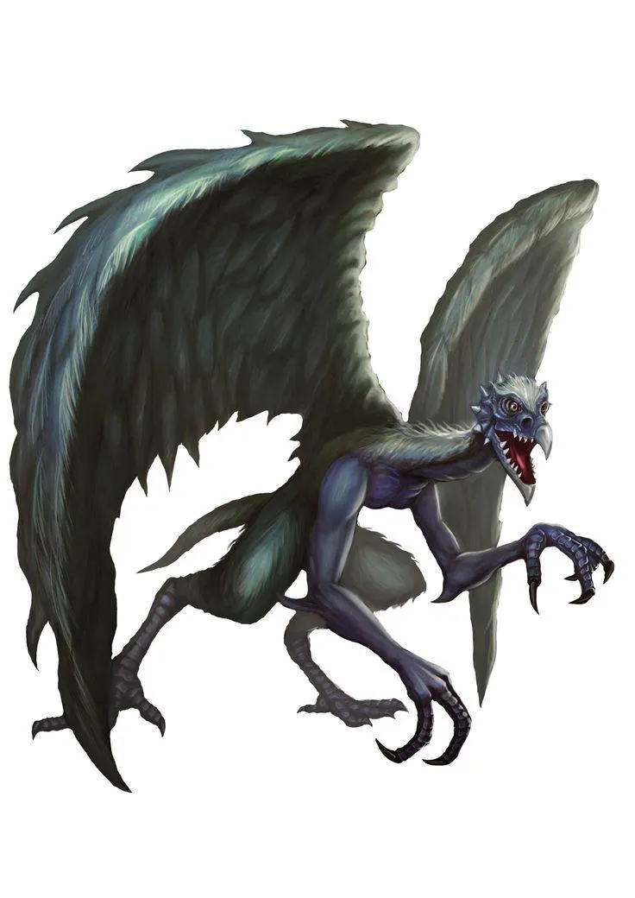

## Bloco de estatísticas: Demônio das Sombras

*Corruptor Médio (demônio), caótico e mau*

**Classe de Armadura** 13  
**Pontos de Vida** 66 (12d8 + 12)  
**Deslocamento** 9 m, voo 9 m

| FOR | DES | CON | INT | SAB | CAR |
| :---: | :---: | :---: | :---: | :---: | :---: |
| 1 (–5) | 17 (+3) | 12 (+1) | 14 (+2) | 13 (+1) | 14 (+2) |

**Testes de Resistência** Des +5, Car +4  
**Perícias** Furtividade +7  
**Vulnerabilidade a Dano** radiante  
**Resistência a Dano** ácido, fogo, necrótico, trovejante; concussão, cortante e perfurante de ataques não-mágicos  
**Imunidade a Dano** elétrico, frio, veneno  
**Imunidade a Condição** agarrado, caído, envenenado, exausto, impedido, paralisado, petrificado  
**Sentidos** visão no escuro 36 m, Percepção passiva 11  
**Idiomas** Abissal, telepatia 36 m  
**Nível de Desafio** 4 (1.100 XP)

***Movimento Incorpóreo***. O demônio pode se mover através de criaturas e objetos como se eles fossem terreno difícil. Ele sofre 5 (1d10) de dano de energia se terminar seu turno dentro de um objeto.

***Sensibilidade à Luz***. Enquanto estiver sob luz plena, o demônio tem desvantagem nas jogadas de ataque, assim como em testes de Sabedoria (Percepção) relacionados a visão.

***Furtividade Sombria***. Enquanto estiver na penumbra ou escuridão, o demônio pode realizar a ação de Esconder-se com uma ação bônus.

### Ações

***Garras***. *Ataque Corpo-a-Corpo com Arma*: +5 para atingir, alcance 1,5 m, uma criatura. *Acerto*: 10 (2d6 + 3) de dano psíquico ou, se a sombra tiver vantagem na jogada de ataque, 17 (4d6 + 3) de dano psíquico.

## Bloco de estatísticas: Vrock

*Corruptor Grande (demônio), caótico e mau*

**Classe de Armadura** 15 (armadura natural)  
**Pontos de Vida** 104 (11d10 + 44)  
**Deslocamento** 12 m, voo 18 m

| FOR | DES | CON | INT | SAB | CAR |
| :---: | :---: | :---: | :---: | :---: | :---: |
| 17 (+3) | 15 (+2) | 18 (+4) | 8 (–1) | 13 (+1) | 8 (–1) |

**Testes de Resistência** Des +5, Sab +4, Car +2  
**Resistência a Dano** elétrico, fogo, frio; concussão, cortante e perfurante de ataques não-mágicos  
**Imunidade a Dano** veneno  
**Imunidade a Condição** envenenado  
**Sentidos** visão no escuro 36 m, Percepção passiva 11  
**Idiomas** Abissal, telepatia 36 m  
**Nível de Desafio** 6 (2.300 XP)

***Resistência à Magia***. O vrock tem vantagem em testes de resistência contra magias e outros efeitos mágicos.

### Ações

***Ataques Múltiplos***. O vrock realiza dois ataques: um com seu bico e um com suas garras.

***Bico***. *Ataque Corpo-a-Corpo com Arma*: +6 para atingir, alcance 1,5 m, um alvo. *Acerto*: 10 (2d6 + 3) de dano perfurante.

***Garras***. *Ataque Corpo-a-Corpo com Arma*: +6 para atingir, alcance 1,5 m, um alvo. *Acerto*: 14 (2d10 + 3) de dano cortante.

***Esporos (Recarrega 6)***. Uma nuvem de esporos tóxicos, com 4,5 metros de raio, estende-se do vrock. Os esporos se espalham, dobrando esquinas. Cada criatura na área deve ser bem sucedida num teste de resistência de Constituição CD 14 ou ficará envenenada. Enquanto estiver envenenado dessa forma, um alvo sofre 5 (1d10) de dano de veneno no início de cada um dos seus turnos. Um alvo pode repetir o teste de resistência em cada um dos seus turnos, terminando o efeito sobre si, se obtiver sucesso. Esvaziar um frasco de água benta no alvo também termina o efeito.

***Guincho Atordoante (1/Dia)***. O vrock emite um grito horripilante. Cada criatura a até 6 metros dele, que puder ouvi-lo e que não seja um demônio, deve ser bem sucedida num teste de resistência de Constituição CD 14 ou ficará atordoada até o final do próximo turno do vrock.

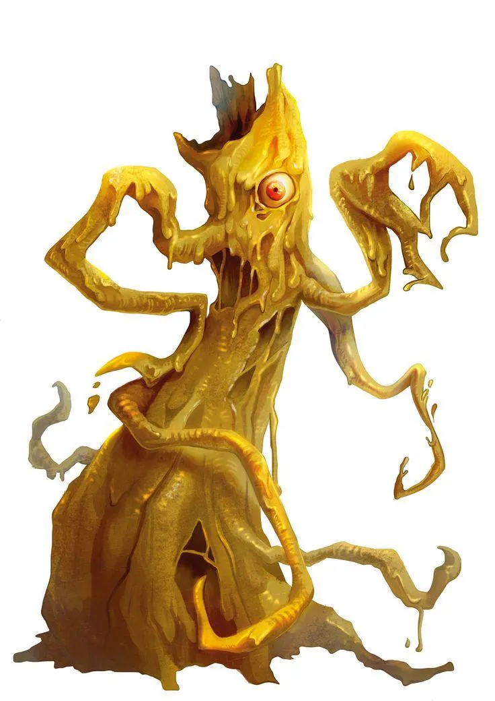

## Bloco de estatísticas: Yochlol

*Corruptor Médio (demônio), caótico e mau*

**Classe de Armadura** 15 (armadura natural)  
**Pontos de Vida** 136 (16d8 + 64)  
**Deslocamento** 9 m, escalada 9 m

| FOR | DES | CON | INT | SAB | CAR |
| :---: | :---: | :---: | :---: | :---: | :---: |
| 15 (+2) | 14 (+2) | 18 (+4) | 13 (+1) | 15 (+2) | 15 (+2) |

**Testes de Resistência** Des +6, Int +5, Sab +6, Car +6  
**Perícias** Enganação +10, Intuição +6  
**Resistência a Dano** elétrico, fogo, frio; concussão, cortante e perfurante de ataques não-mágicos  
**Imunidade a Dano** veneno  
**Imunidade a Condição** envenenado  
**Sentidos** visão no escuro 36 m, Percepção passiva 12  
**Idiomas** Abissal, Élfico, Subcomum  
**Nível de Desafio** 10 (5.900 XP)

***Andar na Teia***. A yochlol ignora as restrições de movimento causadas por estar enredada.

***Conjuração Inata***. A habilidade de conjuração de uma yochlol é Carisma (CD de resistência de magia 14). A yochlol pode conjurar, inatamente, as seguintes magias, sem necessidade de componentes materiais:

À vontade: *detectar pensamentos, teia* 1/dia: *dominar pessoa*

***Metamorfo***. A yochlol pode usar sua ação para se metamorfosear em uma forma semelhante a uma drow ou aranha gigante, ou voltar para sua verdadeira forma. Suas estatísticas são as mesmas em todas as formas. Qualquer equipamento vestido ou carregado não é transformado. Ela reverte para sua forma verdadeira quando morre.

***Escalada Aracnídea***. A yochlol pode escalar superfícies difíceis, incluindo andar de cabeça para baixo em tetos, sem precisar realizar um teste de habilidade.

***Resistência à Magia***. A yochlol possui vantagem nos testes de resistência contra magias e outros efeitos mágicos.

### Ações

***Ataques Múltiplos***. A yochlol realiza dois ataques corpo-a-corpo.

***Pancada (Mordida em Forma de Aranha)***. *Ataque Corpo-a-* *Corpo com Arma*: +6 para atingir, alcance 1,5 m (3 m em forma de demoniza), um alvo. *Acerto*: 5 (1d6 + 2) de dano de concussão (perfurante em forma de aranha) mais 21 (6d6) de dano de veneno.

***Forma de Névoa***. A yochlol se transforma em uma névoa tóxica ou reverte a sua forma verdadeira. Qualquer equipamento vestido ou carregado também é transformado. Ela reverte a sua forma verdadeira se morrer. Enquanto estiver na forma de névoa, a yochlol está incapacitada e não pode falar. Ela tem deslocamento de voo 9 m, pode planar e pode passar por qualquer espaço que não seja hermético. Ela tem vantagem em testes de resistência de Força, Destreza e Constituição e é imune a dano não-mágico. Enquanto estiver na forma de névoa, a yochlol pode entrar no espaço de uma criatura e parar nele. Cada vez que essa criatura começar o turno no mesmo espaço da yochlol, ela deve ser bem sucedida num teste de resistência de Constituição CD 14 ou ficará envenenada até o início do seu próximo turno. Enquanto estiver envenenado dessa forma, o alvo está incapacitado.
