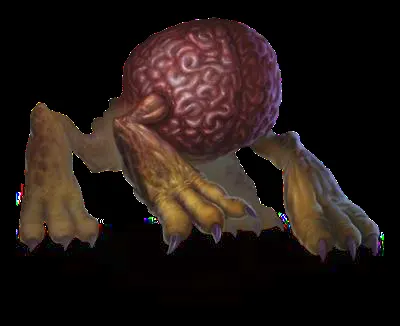

# Devorador de Intelecto

Um devorador de intelecto assemelha-se a um cérebro ambulante protegido por uma cobertura rugosa e com um conjunto de pernas bestiais com garras. Essa aberração imunda se alimenta da inteligência de criaturas racionais, assumindo o controle do corpo de uma vítima em favor de seus mestres devoradores de mentes.

***Criação Ilitide***. Os devoradores de mentes geraram os devoradores de intelecto para servir como caçadores ambulantes do Subterrâneo. Criar um devorador de intelecto requer a remoção do cérebro de um escravo, submetendo-o a um terrível ritual. À medida que ele criar pernas, o cérebro torna-se um predador inteligente tão distorcido e maligno quanto seus mestres.

***Mestres Mortais das Marionetes***. Um devorador de intelecto consome a mente e memórias de uma criatura, então, tornando a o corpo do hospedeiro em uma marionete sob seu controle. Um devorador de intelecto, tipicamente, usa seu hospedeiro-marionete para atrair outros para os domínios do devorador de mentes para serem escravizados ou consumidos.

## Bloco de estatísticas: Devorador de Intelecto

*Aberração Miúda, leal e mau*

**Classe de Armadura** 12  
**Pontos de Vida** 21 (6d4 + 6)  
**Deslocamento** 12 m

| FOR | DES | CON | INT | SAB | CAR |
| :---: | :---: | :---: | :---: | :---: | :---: |
| 6 (–2) | 14 (+2) | 13 (+1) | 13 (+1) | 11 (+0) | 10 (+0) |

**Perícias** Furtividade +4, Percepção +2  
**Resistência a Dano** concussão, cortante e perfurante de ataques não-mágicos  
**Imunidade a Condição** cego  
**Sentidos** percepção às cegas 18 m (cego além desse raio), Percepção passiva 12  
**Idiomas** compreende o Dialeto Subterrâneo, mas não pode falar, telepatia 18 m  
**Nível de Desafio** 2 (450 XP)

***Detectar Senciência***. O devorador de intelecto pode sentir a presença e localização de qualquer criatura a até 90 metros dele que possua Inteligência 3 ou maior, independentemente de barreiras interpostas, a não ser que a criatura esteja protegida pela magia *limpar a mente*.

### Ações

***Ataques Múltiplos***. O devorador de intelecto realiza um ataque com suas garras e usa Devorar Intelecto.

***Garras***. *Ataque Corpo-a-Corpo com Arma*: +4 para atingir, alcance 1,5 m, um alvo. *Acerto*: 7 (2d4 + 2) de dano cortante.

***Devorar Intelecto***. O devorador de intelecto afeta uma criatura que ele possa ver a até 3 metros dele, e que possua um cérebro. O alvo deve ser bem sucedido num teste de resistência de Inteligência CD 12 contra essa mágica ou sofrerá 11 (2d10) de dano psíquico. Também, no caso de um fracasso, role 3d6; Se o total igualar ou exceder o valor de Inteligência do alvo, esse valor é reduzido a 0. O alvo fica atordoado até recuperar, pelo menos, um ponto de Inteligência.

***Ladrão de Corpo***. O devorador de intelecto inicia uma disputa de Inteligência com um humanoide incapacitado a até 1,5 metro dele que não esteja protegido por *proteção contra o bem e mal*. Caso vença a disputa, o devorador de intelecto magicamente consome o cérebro do alvo, teletransportando-se para o crânio dele e tomando o controle do corpo do alvo. Enquanto estiver dentro de uma criatura, o devorador de intelecto tem cobertura total contra ataques e outros efeitos originados do lado de fora do hospedeiro. O devorador de intelecto mantem seus valores de Inteligência, Sabedoria e Carisma, assim como a capacidade de compreender o Dialeto Subterrâneo, sua telepatia e suas características. No mais, ele adota as estatísticas do alvo. Ele sabe tudo que a criatura sabe, incluindo magias e idiomas. Se o corpo do hospedeiro morrer, o devorador de intelecto é obrigado a sair. A magia *proteção contra o bem e mal* conjurada num corpo impele o devorador de intelecto para fora. O devorador de intelecto também é forçado a sair se o alvo recuperar seu cérebro devorado por meio de um *desejo*. Ao gastar 1,5 metro do seu deslocamento, o devorador de intelecto pode, voluntariamente, sair do corpo, teletransportando-se para um espaço desocupado a 1,5 metro dele. O corpo então, morre, a não ser que seu cérebro seja restaurado em 1 rodada.
