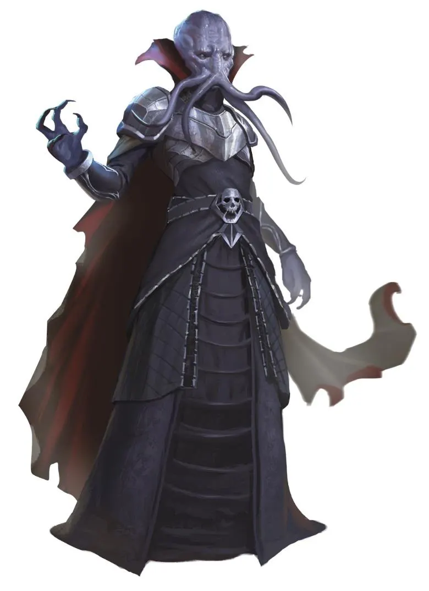

# Devorador de Mentes

Devoradores de mentes, também chamados de ilitides, são o flagelo das criaturas racionais em incontáveis mundos. Tiranos psiônicos, escravistas e viajantes interdimensionais, eles são pérfidos mentores que ceifaram raças inteiras para seus próprios fins distorcidos. Quatro tentáculos serpenteiam de suas cabeças de polvo, flexionando-se em antecipação faminta quando criaturas racionais estão próximas.

Em eras passados, os ilitides controlavam impérios espalhados por muitos mundos. Eles subjugavam e, consequentemente perverteram, raças inteiras de escravos humanoides, incluindo os githyanki e os githzerai, os grimlocks e os kuo-toa. Unidos por uma consciência coletiva, as tramas ilitides são tão abrangentes e malignas quanto suas mentes insondáveis podem conceber.

Desde a queda de seus impérios, ilitides reunidos no Plano Material tem residido no Subterrâneo.

***Comandantes Psiônicos***. Devoradores de mentes possuem poderes psiônicos que permite a eles controlar as mentes de criaturas como trogloditas, grimlocks, quaggoths e ogros. Os ilitides preferem se comunicar por telepatia e usam sua telepatia quando emitem comandos aos seus escravos.

Quando um ilitide encontra uma forte resistência, ele evita o combate inicial à medida que ordena aos seus escravos que ataquem. Como extensões físicas dos pensamentos do ilitide, esses escravos interpõem-se entre o devorador de mentes e seus inimigos, sacrificando suas vidas para que seu mestre possa escapar.

***Colônias de Mente Coletivas***. Devoradores de mentes solitários são como bastardos e párias. A maioria dos ilitides pertencem a uma colônia de devoradores de mentes irmãos, devotados a um cérebro ancião – um maciço ser em forma de cérebro que reside em uma piscina de salmoura próximo do centro da comunidade de devoradores de mentes. Dessa piscina, um cérebro ancião, telepaticamente, decreta seus desejos a cada devorador de mentes individual a até sete quilômetros e meio dele, para tanto, ele é capaz de manter múltiplas conversas mentais ao mesmo tempo.

***Fome da Mente***. Os ilitides subsistem do cérebro de humanoides. O cérebro prove as enzimas, hormônios e energia psíquica necessárias para que eles sobrevivam. Um ilitide saudável, com uma dieta rica em cérebros, secreta um fino muco lustroso que cobre sua pele cor de malva.

Um ilitide experimenta uma euforia enquanto devora o cérebro de um humanoide, junto com suas memórias, personalidade e medos mais íntimos. Os devoradores de mentes irão, às vezes, colher um cérebro ao invés de devora-lo, usando-o como parte de algum experimento alienígena ou transformando-o em um devorador de intelecto.

## Bloco de estatísticas: Devorador de Mentes

*Aberração Média, leal e mau*

**Classe de Armadura** 15 (peitoral)  
**Pontos de Vida** 71 (13d8 + 13)  
**Deslocamento** 9 m

| FOR | DES | CON | INT | SAB | CAR |
| :---: | :---: | :---: | :---: | :---: | :---: |
| 11 (+0) | 12 (+1) | 12 (+1) | 19 (+4) | 17 (+3) | 17 (+3) |

**Testes de Resistência** Int +7, Sab +6, Car +6  
**Perícias** Arcanismo +7, Enganação +6, Furtividade +4, Intuição +6, Percepção +6, Persuasão +6  
**Sentidos** visão no escuro 36 m, Percepção passiva 16  
**Idiomas** Dialeto Subterrâneo, Subcomum, telepatia 36 m  
**Nível de Desafio** 7 (2.900 XP)

***Conjuração Inata***. A habilidade de conjuração do devorador de mentes é Inteligência (CD de resistência de magia 15). Ele pode conjurar, inatamente, as seguintes magias, sem necessidade de quaisquer componentes:

À vontade: *detectar pensamentos, levitação* 1/dia cada: *dominar monstro, viagem planar* (pessoal apenas)

***Resistência à Magia***. O devorador de mentes possui vantagem nos testes de resistência contra magias e outros efeitos mágicos.

### Ações

***Tentáculos***. *Ataque Corpo-a-Corpo com Arma*: +7 para atingir, alcance 1,5 m, uma criatura. *Acerto*: 15 (2d10 + 4) de dano psíquico. Se o alvo for Médio ou menor, ele está agarrado (CD 15 para escapar) e deve ser bem sucedido em um teste de resistência de Inteligência CD 15 ou ficará atordoado até esse agarrão acabar.

***Extrair Cérebro***. *Corpo-a-Corpo com Arma*: +7 para atingir, alcance 1,5 m, um humanoide incapacitado agarrado pelo devorador de mentes. *Acerto*: o alvo sofre 55 (10d10) de dano perfurante. Se esse dano reduzir os pontos de vida do alvo a 0, o devorador de mentes mata o alvo, extrai e devora seu cérebro.

***Rajada Mental (Recarrega 5–6)***. O devorador de mentes, magicamente, emite energia psíquica num cone de 18 metros. Cada criatura na área deve ser bem sucedida num teste de resistência de Inteligência CD 15 ou sofrerá 22 (4d8 + 4) de dano psíquico e ficará atordoada por 1 minuto. Uma criatura pode repetir o teste de resistência no final de cada um dos seus turnos, terminando o efeito nela se obtiver sucesso.

### Qualith

Nas raras ocasiões que os devoradores de mentes precisam escrever alguma coisa, eles o fazem em Qualith. Esses sistema de escrita tátil (similar ao braile) é lido através dos tentáculos do ilitide. O Qualith é escrito em quatro linhas de estrofes e é tão alienígena em sua construção que não-ilitides devem recorrer a magia para discernir seu sentido. Embora o Qualith possa ser usado para manter registros, ilitides, na maioria das vezes, usam-no para marcar portais ou outras superfícies com avisos ou instruções.

### Variação: Devoradores de Mentes Arcanistas

Alguns poucos devoradores de mentes suplementam seus poderes psiônicos com magias arcanas. No entanto, eles são considerados como desviantes pelos seus pares ilitides e, geralmente são evitados. Um devorador de mentes arcanista tem nível de desafio 8 (3.900 XP) e o seguinte traço.

***Conjuração***. O devorador de mentes é um conjurador de 10° nível. Sua habilidade de conjuração é Inteligência (CD de resistência de magia 15, +7 para atingir com ataques com magia). Ele possui as seguintes magias de mago preparadas:

Truques (à vontade): *globos de luz, mãos mágicas, proteção* *contra lâminas, toque chocante* 1° nível (4 espaços): *detectar magia, disfarçar-se, escudo arcano,* *sono* 2° nível (3 espaços): *invisibilidade, nublar, raio do* *enfraquecimento* 3° nível (3 espaços): *clarividência, enviar mensagem, relâmpago* 4° nível (3 espaços): *confusão, terreno alucinógeno* 5° nível (2 espaços): *muralha de energia, telecinésia*
