# Diabos

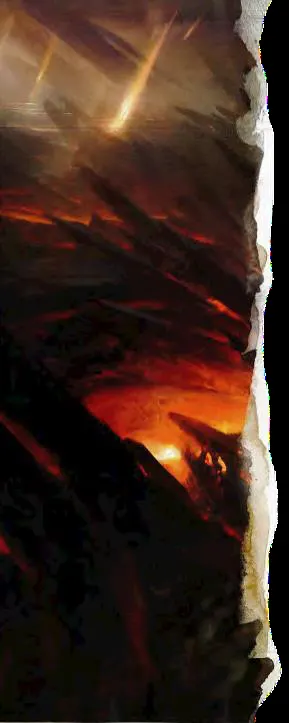

Diabos personificam a tirania, com uma sociedade totalitária dedicada a dominação da vida mortal. A sombra dos Nove Infernos de Baator estende-se muito além do multiverso, e Asmodeu, o senhor sombrio de Nessus, ambiciona subjugar o cosmo para satisfazer sua sede de poder. Para tanto, ele deve continuamente expandir seus exércitos infernais, enviando seus servos para o reino mortal para corromper as almas das quais novos diabos são criados.

***Senhores da Tirania***. Diabos vivem para conquistar, escravizar e oprimir. Eles tem um prazer sádico em exercer autoridade sobre os fracos e, qualquer criatura que desafie a autoridade de um diabo enfrenta uma punição rápida e cruel. Cada interação é uma oportunidade para um diabo mostrar seu poder e todos os diabos tem uma compreensão apurada de como usar e abusar desse poder.

Os diabos conhecem as fraquezas que afligem os mortais inteligentes e eles usam esse conhecimento para levar os mortais à tentação e trevas, transformando as criaturas em escravos de sua própria corrupção. Os diabos no Plano Material usam sua influência para manipular governantes humanoides, eventualmente levando-os a realizar ações tirânicas.

***Obediência e Ambição***. Em conformidade com sua tendência leal, os diabos obedecem mesmo quando eles invejam ou detestam seus superiores, sabendo que sua obediência será recompensada. A hierarquia dos Nove Infernos depende dessa lealdade inabalável, sem a qual esse plano corruptor se tornaria tão anárquico quanto o Abismo.

Ao mesmo tempo, ela está na natureza dos diabos para maquinar, criando neles um desejo de comandar que eclipsa o contentamento deles em serem subordinados. Essa ambição singular é ainda mais forte dentre os arquidiabos apontados por Asmodeu para governar as nova camadas dos Nove Infernos. Esses corruptores de alta patente são os únicos diabos que sempre provam do verdadeiro poder, do qual eles precisam como a mais doce ambrosia.

***Negociantes das Trevas e Traficantes de Almas***. Os diabos estão confinados aos Planos Inferiores, mas eles podem viajar além desses planos por meio de portais ou poderosa mágica de invocação. Eles amam barganhar com mortais que buscam ganhar algum benefício ou prêmio, mas um mortal que faça tais barganhas deve ser prudente. Diabos são negociantes astutos e, possivelmente, impiedosos na aplicação dos termos de um acordo. Além disso, um contrato com até mesmo o menos dos diabos é aplicado pela vontade de Asmodeu. Qualquer criatura mortal que quebrar um contrato desse, tem sua alma confiscada instantaneamente, sendo subtraída para os Nove Infernos.

Possuir a alma da criatura é possuir controle absoluto sobre essa criatura e, a maioria dos diabos não aceitarão qualquer outra moeda de troca por seus poderes e bênçãos diabólicos que eles possam oferecer. Uma alma normalmente é confiscada quando um mortal more naturalmente, já que os diabos são imortais e podem esperar anos para que um contrato se concretize. Se um contrato permitir que um diabo reivindique uma alma mortal antes da morte, ele pode, instantaneamente, retornar aos Nove Infernos com a alma em sua posse. Apenas a intervenção divina pode libertar uma alma após um diabo tê-la reivindicado.

### A Hierarquia Infernal

Os Nove Infernos possuem uma rígida hierarquia que define cada aspecto de sua sociedade. Asmodeu é o governante supremo de todos os diabos e, a única criatura nos Nove Infernos com os poderes de um deus menor. Adorado no Plano Material, Asmodeu inspira os cultos de humanoides malignos que levam seu nome. Nos Nove Infernos, ele comanda cortes de senhores das profundezas generais, que, por sua vez, comandam legiões de subordinados.

Um tirano supremo, um enganador brilhante e um mestre da sutileza, Asmodeu protege seu trono ao manter seus amigos perto e seus inimigos ainda mais perto. Ele delega muitos assuntos de governo a senhores das profundezas e arquidiabos menores que fazem parta da burocracia infernal dos Nove Infernos, mesmo quando ele sabe que esses poderosos diabos conspiram para usurpar o Trono de Baator do qual ele governa. Asmodeu elege os arquidiabos e ele pode despojar qualquer membro da hierarquia infernal do cargo e posição quando ele desejar.

Se morrer fora dos Nove Infernos, um diabo desaparece em uma nuvem de fumaça sulfurosa e se dissolve numa poça de pus, instantaneamente retornando para sua camada natal, onde ele se reforma com força total. Os diabos que morrem nos Nove Infernos são destruídos para sempre – um destino que o próprio Asmodeu teme.

***Arquidiabos***. Os arquidiabos incluem todos os governantes atuais e os depostos dos Nove Infernos (veja a tabela Camadas e Lordes dos Nove Infernos), assim como os duques e duquesas que possuem cortes neles, que atendem-nos como conselheiros e esperam para suplanta-los. Cada arquidiabos é um ser único cuja aparência reflete sua natureza maligna em particular.

***Diabos Maiores***. Os diabos maiores incluem senhores das profundezas, erínias, diabos de chifres e diabos do gelo que comandam os demônios menores e assistem os arquidiabos.

***Diabos Menores***. Os diabos menores incluem numerosas fileiras de corruptores, incluindo os diabretes, diabos das correntes, diabos dos espinhos, diabos barbados, diabos farpados e diabos dos ossos.

***Lêmures***. A forma mais inferior de diabo, os lêmures são as almas atormentadas e distorcidas de mortais malignos e corruptos. Um lêmure morto nos Nove Infernos é permanentemente destruído caso seja morto com uma arma abençoada ou caso seu corpo disforme seja aspergido com água benta antes que ele possa retornar à vida.

***Promoção e Rebaixamento***. Quando a alma de um mortal maligno mergulha nos Nove Infernos, ela toma a forma de um desprezível lêmure. Os arquidiabos e diabos maiores tem o poder de promover lêmures a diabos menores. Arquidiabos pode promover diabos menores a diabos maiores e, apenas Asmodeu pode promover diabos maiores a posição de arquidiabo. Essa promoção diabólica invoca uma breve e dolorosa transformação, pela qual as memórias do diabo passam intactas de uma forma para a seguinte.

Promoções de baixo nível geralmente são baseadas em necessidade, como quando um senhor das profundezas promove lêmures em diabretes para ganhar espiões invisíveis sob seu comando. Promoções de alto nível são, na maioria das vezes, baseadas em mérito, como quando um diabo dos ossos que se sobressaia em batalha é transformado em um diabo de chifres por um arquidiabos a quem ele serve. Um diabo raramente é promovido em mais de um degrau de uma vez na hierarquia de formas infernais.

O rebaixamento é a punição habitual por falha ou desobediência entre os diabos. Arquidiabos e diabos maiores podem rebaixar um diabo menor em um lêmure, o qual perde todas as suas memórias de sua existência anterior. Um arquidiabo pode rebaixar um diabo maior para a posição de diabo menor, porém, diabos rebaixados mantem suas memórias – e podem buscar vingança caso a severidade do rebaixamento seja exagerada. Nenhum diabo pode promover ou rebaixar outro diabo que não tenha lhe jurado fidelidade, impedindo arquidiabos rivais de rebaixar os servos mais poderosos uns dos outros. Já que todos os diabos juram fidelidade a Asmodeu, ele pode rebaixar livremente qualquer outro diabo, transformando-o na forma infernal que desejar.

> **Hierarquia Infernal**

1. lêmure — **Diabos maiores**

> 8. Diabo de chifres

| Diabos menores | 9. Erínia |
| --- | --- |
| 2. Diabrete | 10. Diabo do gelo |
| 3. Diabo dos espinhos | 11. Senhor das profundezas |

> 4. Diabo barbado

| 5. Diabo farpado | Arquiduques |
| --- | --- |
| 6. Diabo das correntes | 12. Duque ou duquesa |
| 7. Diabo dos ossos | 13. Arquiduque ou arquiduquesa |

> **Nomes Verdadeiros de Diabos e Talismãs**
>
> Apesar de todos os diabos terem nomes comuns, cada diabo de posição acima do lêmure possui um nome verdadeiro que ele guarda em segredo. Um diabo pode ser forçado a revelar seu nome verdadeiro se estiver enfeitiçado e dizem existir antigos pergaminhos e tomos com listas de nomes verdadeiros de certos diabos. Um mortal que descubra o nome verdadeiro de um diabo pode usar magia de invocação poderosa para convocar o diabo dos Nove Infernos obrigado a servir. A obrigação também pode ser realizada com a ajuda de um talismã diabólico. Cada uma dessas relíquias ancestrais é inscrita com o nome verdadeiro de um diabo que ela controla e é banhada no sangue de um sacrifício digno – geralmente alguém amado pelo criador – quando criada. Independente de como foi invocado, um diabo trazido ao Plano Material geralmente ressente por ter sido obrigado a servir. Portanto, o diabo aproveita cada oportunidade de corromper seu invocador para que a alma dele termine nos Nove Infernos. Apenas diabretes estão verdadeiramente dispostos a serem invocados, e eles facilmente comprometem-se em servir como familiares de invocadores, mas eles ainda fazem o possível para corromper aqueles que o invocaram.

### Os Nove Infernos

Os Nove Infernos são um único plano compreendendo nove camadas separadas (veja a tabela Camadas e Lordes dos Nove Infernos). As oito primeiras camadas são governadas por arquidiabos que respondem ao maior arquidiabos de todos: Asmodeu, o Arquiduque de Nessus, a nona camada. Para chegar a mais profunda camada dos Nove Infernos, deve-se passar por todas as oito camadas acima, em ordem. O meio mais rápido de fazê-lo é através do Rio Estige, que imerge cada vez mais fundo à medida que flui de uma camada para a seguinte. Apenas os aventureiros mais corajosos podem suportar o tormento e horror dessa jornada.

> **Variação: Invocação de Diabos**
>
> Alguns diabos podem ter uma opção de ação que os permite invocar outros diabos.
>
> ***Invocar Diabo (1/Dia)***. O diabo escolhe o que invocar e tenta uma invocação mágica.

 — Um **diabo barbado** tem 30 por cento de chance de invocar

> um diabo barbado.

 — Um **diabo de chifres** em 30 por cento de chance de invocar

> um diabo de chifres.

 — Um **diabo do gelo** tem 60 por cento de chance de invocar um

> diabo do gelo.

 — Um **diabo dos ossos** tem 40 por cento de chance de invocar

> 2d6 diabos dos espinhos ou um diabo dos ossos.

 — Um **diabo farpado** tem 30 por cento de chance de invocar um

> diabo farpado.

 — Uma **erínia** tem 50 por cento de chance de invocar 3d6 diabos

> dos espinhos, 1d6 diabos barbados ou uma erínia.

 — Um **senhor das profundezas** invoca 2d4 diabos barbados, 1d4

> diabos farpados ou uma erínia sem chance de falha.
>
> Um diabo invocado aparece num espaço desocupado a até 18 metros do invocador, agindo como um aliado dele e não pode invocar outros diabos. Ele permanece por 1 minuto, até seu invocador morrer ou até seu invocador dispensa-lo com uma ação.

### Diabo Barbado (Barbazu)

Diabos barbados servem os arquidiabos como tropas de choque, lutando ombro a ombro e festejando a gloria da batalha. Eles respondem com violência a qualquer desrespeito, real ou imaginário, regozijando-se de violência à medida que suas glaives infernais com dentes de serra escavam um caminho através de seus oponentes.

### Diabo das Correntes (Kyton)

Esses corruptores ameaçadores vestem correntes como uma mortalha. Guiando diabos menores ante ele som seu olhar assustador, um diabo das correntes anima as correntes que cobrem seu corpo assim como correntes inanimadas próximas, das quais brotam ganchos, lâminas e cravos para eviscerar inimigos.

Diabos das correntes agem como carcereiros e torturadores sádicos nos reinos infernais, saboreando a dor como modo de vida para infligi-la em outros. Eles são convocados para atormentar as almas mortais aprisionadas nos Nove Infernos, infligindo sua fúria sádica nos lêmures repugnantes nos quais essas almas se manifestam.

### Diabo de Chifres (Malebranche)

Diabos de chifres são preguiçosos ao ponto da beligerância e relutantes em se colocar no caminho do perigo. Além disso, eles odeiam e temem qualquer criatura mais forte que eles. Quando eles são provocados ou hostilizados o suficiente, a fúria desses corruptores pode ser aterrorizante.

Um malebranche é tão alto quanto um ogro e estão revestidos por escamas tão duras quanto o ferro. A infantaria aérea das legiões infernais, os diabos de chifres seguem ordens ao pé da letra. Suas enormes asas e vastos chifres criam uma presença intimidadora à medida que eles caem do céu e atacam com garfos mortais e chicotadas com a cauda.

### Diabo do Gelo (Gelugon)

Encontrados com mais frequência nas frias camadas de Estigia e Cánia, os diabos do gelo servem como comandantes dos exércitos infernais nos Nove Infernos, atormentando diabos menores como uma válvula de escape para sua raiva e ressentimento. Cobiçando o poder dos seus superiores senhores das profundezas. Diabos do gelo trabalham por promoção incessantemente, chacinando seus inimigos nos Nove Infernos e reivindicando o máximo de almas que puderem para os seus mestres arquidiabos.

Lembrando um inseto bípede gigante, um diabo do gelo possui mãos e pés com garras, poderosas mandíbulas e uma longa cauda coberta por espinhos afiados como navalhas. Alguns carregam lanças farpadas pelas quais o toque gelado pode deixar um oponente totalmente indefeso em combate.

### Diabo dos Ossos (Osyluth)

Guiados pelo ódio, cobiça e inveja, diabos dos ossos agem como capatazes cruéis nos Nove Infernos. Eles colocam os diabos mais fracos para trabalhar, tendo um prazer especial em ver corruptores que os desafiam serem rebaixados. Ao mesmo tempo, eles almejam a promoção e tem uma inveja profunda dos seus superiores, tentando bajular, embora fazer isso os irrite.

Um diabo dos ossos parece um humanoide descascado, com pele seca esticada ao longo de sua estrutura óssea. Ele possui uma assustadora cabeça de caveira, um rabo de escorpião e um odor terrível de decomposição ergue-se no ar a sua volta. Apesar de serem devastadores em combate com suas garras, os diabos dos ossos também empunham armas de haste feitas de ossos, as quais eles usam para subjugar seus inimigos antes de atingi-los com suas caudas venenosas.

### Diabo dos Espinhos (Spinagon)

Menores que a maioria dos outros diabos, spinagons agem como mensageiros e espiões para diabos maiores e arquidiabos. Eles são os olhos e ouvidos dos Nove Infernos e, mesmo corruptores que desprezam a frágil ameaça de um diabo dos espinhos, os tratam com um pouco de respeito.

O corpo e cauda de um diabo dos espinhos são cobertos de espinhos e eles conseguem usar suas caudas espinhosas como armas à distância. Os espinhos explodem em chamas ao impacto.

Quando não estão entregando mensagens ou coletando inteligência, os diabos dos espinhos servem nas legiões infernais com artilharia aérea, sobrepujando de sua relativa fraqueza ao se juntarem em turbas para subjugar seus oponentes. Embora anseiem por promoção e poder, os diabos dos espinhos são covardes por natureza e eles rapidamente se dispersarão se uma luta se voltar contra eles.

### Diabo Farpado (Hamatula)

Criaturas de ganância e desejo desenfreados, diabos farpados agem como guardas dos habitantes mais poderosos dos Nove Infernos e de seus cofres. Lembrando um humanoide alto coberto por farpas, espinhos e ganchos, um diabo farpado possui olhos brilhantes que estão sempre vigilantes a objetos e criatura que podem clamar por isso. Esses corruptores acolhem qualquer chance de lutar quando a vitória promete recompensas.

Diabos barbados são conhecidos por uma prontidão que os torna difíceis de serem surpreendidos e eles realizam suas tarefas sem tédio ou distração. Eles usam suas garras afiadas como armas e arremessam bolas de chamas nos oponentes que tentam fugir deles.

### Diabrete

Diabretes são encontrados por todos os Planos Inferiores, entregando mensagens para seus mestres infernais, espionando rivais ou enganando e corrompendo mortais. Um diabrete irá servir orgulhosamente um mestre maligno de qualquer espécie, mas não se deve confiar que eles concluam tarefas com velocidade ou eficiência.

Um diabrete pode assumir formas animais à vontade, mas em seu estado natural ele se parece com um humanoide diminuto de pele avermelhada com rabo farpado, pequenos chifres e asas de couro. Ele ataca enquanto invisível, golpeando com seu ferrão venenoso.

### Erínia

Os mais belos e atraentes dentre todos os diabos menores e maiores, as erínias são guerreiras violentas e disciplinadas. Descendo dos céus, elas trazem morte rápida às criaturas que tenha injustiçado seus mestres ou desafiado os decretos de Asmodeu. As erínias parecem com humanoides, com corpos esculturais e grandes asas plumadas. A maioria veste armaduras estilizadas, elmos com chifres e carregam espadas e arcos exóticos. Algumas poucas também usam *cordas de enredamento* para amarrar oponentes mais poderosos.

Lendas contam que as primeiras erínias foram anjos que caíram dos Planos Superiores devido à tentação ou crime. As erínias sempre estão dispostas a conseguir vantagem por serem confundidas com celestiais em suas missões de conquista e corrupção.

### Lêmure

Um lêmure nasce quando uma alma mortal é distorcida pelo mal e banida para os Nove Infernos pela eternidade. O tipo de diabo mais baixo, os lêmures são repugnantes criaturas disformes condenadas a sofrer tormentos até serem promovidas a uma forma de diabo superior, na maioria das vezes um diabrete.

> **Camadas e Lordes dos Nove Infernos**

**Nome da** — **Arquiduque ou** — **Governante**

| Camada | Camada | Arquiduquesa | Anterior |
| --- | --- | --- | --- |
| 1 | Avernus | Zariel | Bel, Tiamat |
| 2 | Dis | Dispater | – |
| 3 | Minauros | Mamon | – |
| 4 | Flegetonte | Belial e Fierna | – |
| 5 | Estigia | Levisto | Gerião |
| 6 | Malebolgia | Glacia | Malagard, Moloque |
| 7 | Maladomini | Belzebu | – |
| 8 | Cánia | Mefistófeles | – |
| 9 | Nessus | Asmodeu | – |

Um lêmure lembra uma massa derretida de carne com uma cabeça e torso vagamente humanoides. Uma expressão permanente de angustia toma conta de sua face, sua boca torpe balbucia, mesmo que ele não possa falar.

### Senhor das Profundezas

Os incontestados senhores de quase todos os outros diabos, senhores das profundezas atendem aos arquiduques e arquiduquesas dos Nove Infernos e cumprem seus desejos. Esses poderosos diabos são os generais dos Nove Infernos, liderando as legiões infernais em batalha.

Com um senso de superioridade e direto inflados, senhores das profundezas formam uma aristocracia grotesca no reino infernal. Esses tiranos autoritários e manipuladores conspiram para eliminar qualquer coisa que fique entre eles e seus desejos, mesmo quando estão negociando as perigosas políticas circinais dos Nove Infernos.

Um senhor das profundezas é um monstro largo com uma cauda preênsil e enormes asas que ele envolve ao seu redor como um manto. Escamas rígidas cobrem seu corpo e seu estômago secreta um veneno que pode derrubar até a mais poderosa das criaturas mortais. Assustador em batalha, um senhor das profundezas escolhe os oponentes mais poderosos para um combate um contra um, demonstrando sua superioridade e uma arrogância que o impede de reconhecer qualquer chance de derrota.

> **Variação: Familiar Diabrete**
>
> Diabretes podem ser encontrados a serviço de conjuradores mortais, agindo como conselheiros, espiões e familiares. Um diabrete incita seu mestre a realizar atos malignos, sabendo que a alma do mortal é um prêmio que o diabrete reivindicar ao final. Diabretes mostram uma lealdade incomum por seus mestres e um diabrete pode ser bem perigoso se seu mestre for ameaçado. Tais diabretes possuem a seguinte característica.
>
> ***Familiar***. O diabrete pode fazer um contrato para servir a outra criatura como um familiar, formando um vínculo telepático com um mestre voluntário. Quando ambos estiverem ligados, o mestre pode sentir o que o diabrete sente, contanto que eles estejam a até 1,5 quilômetro um do outro. Enquanto o diabrete estiver a até 3 metros de seu mestre, o mestre partilha da Resistência à Magia do diabrete. Se o mestre violar os termos do contrato, o diabrete pode acabar com seu serviço como familiar, acabando com o vínculo telepático.
>
> **Habitantes Primitivos** Diabos dos Espinhos, diabretes, erínias Diabos barbados, diabos dos espinhos, diabretes, erínias Diabos barbados, diabos das correntes, diabo dos espinhos, diabretes Diabos barbados, diabos dos espinhos, diabos dos ossos, diabretes Diabos do gelo, diabos dos ossos, diabretes, erínias Diabos barbados, diabos de chifres, diabos dos ossos, diabretes Diabos barbados, diabos dos chifres, diabos dos ossos, diabretes Diabos do gelo, diabos dos chifres, diabretes, senhores do abismo Todos os diabos

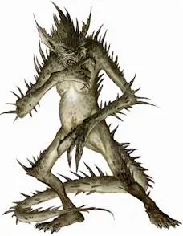

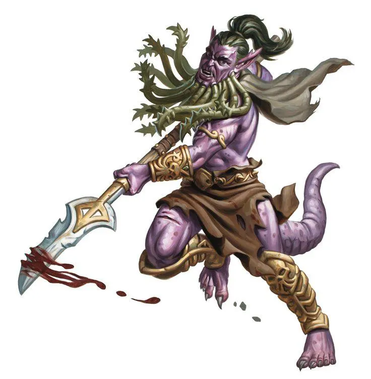

## Bloco de estatísticas: Diabo Farpado

*Corruptor Médio (diabo), leal e mau*

**Classe de Armadura** 15 (armadura natural)  
**Pontos de Vida** 110 (13d8 + 52)  
**Deslocamento** 9 m

| FOR | DES | CON | INT | SAB | CAR |
| :---: | :---: | :---: | :---: | :---: | :---: |
| 16 (+3) | 17 (+3) | 18 (+4) | 12 (+1) | 14 (+2) | 14 (+2) |

**Testes de Resistência** For +6, Con +7, Sab +5, Car +5  
**Perícias** Enganação +5, Intuição +5, Percepção +8  
**Resistência a Dano** frio; concussão, cortante e perfurante de ataques não-mágicos que não sejam de prata  
**Imunidade a Dano** fogo, veneno  
**Imunidade a Condição** envenenado  
**Sentidos** visão no escuro 36 m, Percepção passiva 18  
**Idiomas** Infernal, telepatia 36 m  
**Nível de Desafio** 5 (1.800 XP)

***Couro Farpado***. No começo de cada um dos seus turnos, o diabo farpado causa 5 (1d10) de dano perfurante a qualquer criatura agarrando ele.

***Resistência à Magia***. O diabo possui vantagem nos testes de resistência contra magias e outros efeitos mágicos.

***Visão Diabólica***. Escuridão mágica não impede a visão no escuro do diabo.

### Ações

***Ataques Múltiplos***. O diabo realiza três ataques corpo-a-corpo: um com sua cauda e dois com suas garras. Alternativamente, ele pode usar seu Arremessar Chamas duas vezes.

***Garra***. *Ataque Corpo-a-Corpo com Arma*: +6 para atingir, alcance 1,5 m, um alvo. *Acerto*: 6 (1d6 + 3) de dano perfurante.

***Cauda***. *Ataque Corpo-a-Corpo com Arma*: +6 para atingir, alcance 1,5 m, um alvo. *Acerto*: 10 (2d6 + 3) de dano perfurante.

***Arremessas Chamas***. *Ataque à Distância com Magia*: +5 para atingir, distância 45 m, um alvo. *Acerto*: 10 (3d6) de dano de fogo. Se o alvo for um objeto inflamável que não esteja sendo vestido ou carregado, ele pega fogo.

## Bloco de estatísticas: Diabo Barbado

*Corruptor Médio (diabo), leal e mau*

**Classe de Armadura** 13 (armadura natural)  
**Pontos de Vida** 52 (8d8 + 16)  
**Deslocamento** 9 m

| FOR | DES | CON | INT | SAB | CAR |
| :---: | :---: | :---: | :---: | :---: | :---: |
| 16 (+3) | 15 (+2) | 15 (+2) | 9 (–1) | 11 (+0) | 11 (+0) |

**Testes de Resistência** For +5, Con +4, Sab +2  
**Resistência a Dano** frio; concussão, cortante e perfurante de ataques não-mágicos que não sejam de prata  
**Imunidade a Dano** fogo, veneno  
**Imunidade a Condição** envenenado  
**Sentidos** visão no escuro 36 m, Percepção passiva 10  
**Idiomas** Infernal, telepatia 36 m  
**Nível de Desafio** 3 (700 XP)

***Resistência à Magia***. O diabo possui vantagem nos testes de resistência contra magias e outros efeitos mágicos.

***Resolução***. O diabo não pode ser amedrontado enquanto puder ver uma criatura aliada a até 9 metros dele.

***Visão Diabólica***. Escuridão mágica não impede a visão no escuro do diabo.

### Ações

***Ataques Múltiplos***. O diabo realiza dois ataques: um com sua barba e um com sua glaive.

***Barba***. *Ataque Corpo-a-Corpo com Arma*: +5 para atingir, alcance 1,5 m, uma criatura. *Acerto*: 6 (1d8 + 2) de dano perfurante e o alvo deve ser bem sucedido num teste de resistência de Constituição CD 12 ou ficará envenenado por 1 minuto. Enquanto estiver envenenado dessa forma, o alvo não pode recuperar pontos de vida. O alvo pode repetir o teste de resistência no final de cada um dos turnos dele, terminando o efeito se for bem sucedido.

***Glaive***. *Ataque Corpo-a-Corpo com Arma*: +5 para atingir, alcance 3 m, um alvo. *Acerto*: 9 (1d10 + 3) de dano cortante. Se o alvo for uma criatura diferente de um morto-vivo ou um constructo, ele deve ser bem sucedido num teste de resistência de Constituição CD 12 ou perderá 5 (1d10) pontos de vida no início de cada turno dele devido a um ferimento infernal. Cada vez que o diabo atingir o alvo com esse ataque, o dano causado pelo ferimento aumenta em 5 (1d10). Qualquer criatura pode usar uma ação para estancar o ferimento com um teste bem sucedido de Sabedoria (Medicina) CD 12. O ferimento também se fecha se o alvo receber cura mágica.

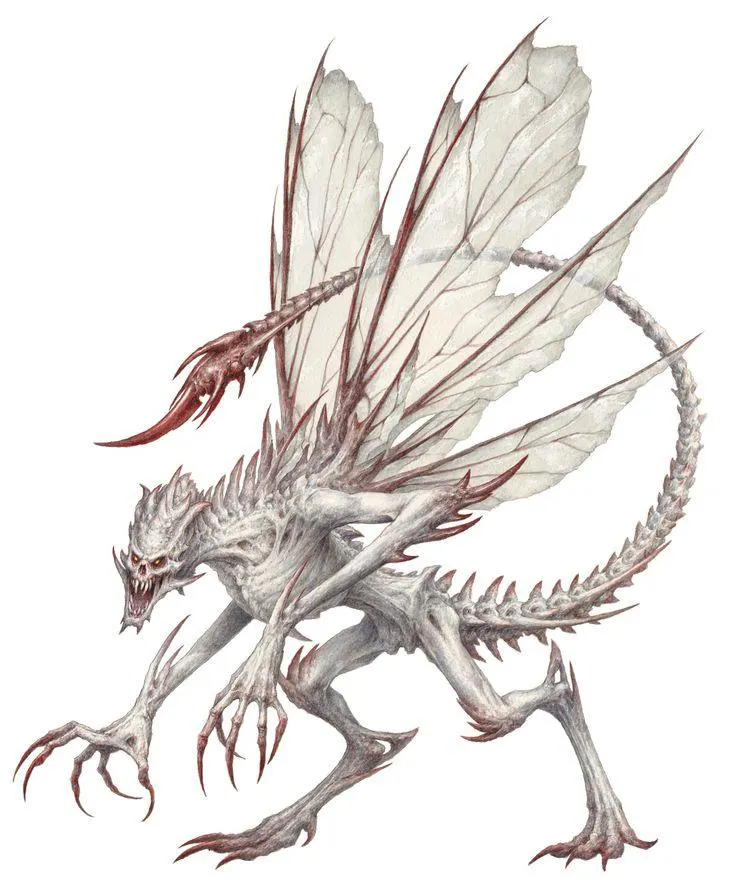

### Variação: Diabo dos Ossos com Arma de Haste

Alguns diabos dos ossos possuem as seguintes opções.

***Ataques Múltiplos***. O diabo realiza dois ataques: um com sua arma de haste com gancho e um com seu ferrão.

***Arma de Haste com Gancho***. *Ataque Corpo-a-Corpo com* *Arma*: +8 para atingir, alcance 3 m, um alvo. *Acerto*: 17 (2d12 + 4) de dano perfurante. Se o alvo for uma criatura Enorme ou menor, ela fica agarrada (CD 14 para escapar). Até esse agarrão terminar, o diabo não pode usar sua arma de haste contra outro alvo.

## Bloco de estatísticas: Diabo dos Ossos

*Corruptor Grande (diabo), leal e mau*

**Classe de Armadura** 19 (armadura natural)  
**Pontos de Vida** 142 (15d10 + 60)  
**Deslocamento** 12 m, voo 12 m

| FOR | DES | CON | INT | SAB | CAR |
| :---: | :---: | :---: | :---: | :---: | :---: |
| 18 (+4) | 16 (+3) | 18 (+4) | 13 (+1) | 14 (+2) | 16 (+3) |

**Testes de Resistência** Int +5, Sab +6, Car +7  
**Perícias** Enganação +7, Intuição +6  
**Resistência a Dano** frio; concussão, cortante e perfurante de ataques não-mágicos que não sejam de prata  
**Imunidade a Dano** fogo, veneno  
**Imunidade a Condição** envenenado  
**Sentidos** visão no escuro 36 m, Percepção passiva 12  
**Idiomas** Infernal, telepatia 36 m  
**Nível de Desafio** 9 (5.000 XP)

***Resistência à Magia***. O diabo possui vantagem nos testes de resistência contra magias e outros efeitos mágicos.

***Visão Diabólica***. Escuridão mágica não impede a visão no escuro do diabo.

### Ações

***Ataques Múltiplos***. O diabo realiza três ataques: dois com suas garras e um com seu ferrão.

***Garra***. *Ataque Corpo-a-Corpo com Arma*: +8 para atingir, alcance 3 m, um alvo. *Acerto*: 8 (1d8 + 4) de dano cortante.

***Ferrão***. *Ataque Corpo-a-Corpo com Arma*: +8 para atingir, alcance 3 m, um alvo. *Acerto*: 13 (2d8 + 4) de dano perfurante mais 17 (5d6) de dano de veneno e o alvo deve ser bem sucedido num teste de resistência de Constituição CD 14 ou ficará envenenado por 1 minuto. O alvo pode repetir o teste de resistência no final de cada um dos turnos dele, terminando o efeito se for bem sucedido.

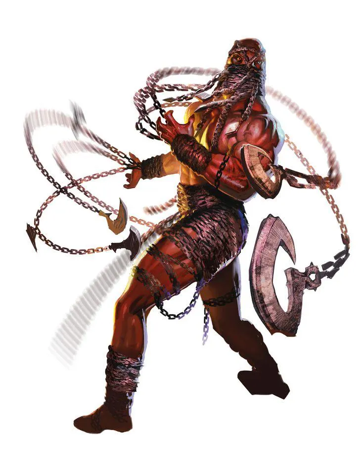

## Bloco de estatísticas: Diabo das Correntes

*Corruptor Médio (diabo), leal e mau*

**Classe de Armadura** 16 (armadura natural)  
**Pontos de Vida** 85 (10d8 + 40)  
**Deslocamento** 9 m

| FOR | DES | CON | INT | SAB | CAR |
| :---: | :---: | :---: | :---: | :---: | :---: |
| 18 (+4) | 15 (+2) | 18 (+4) | 11 (+0) | 12 (+1) | 14 (+2) |

**Testes de Resistência** Con +7, Sab +4, Car +5  
**Resistência a Dano** frio; concussão, cortante e perfurante de ataques não-mágicos que não sejam de prata  
**Imunidade a Dano** fogo, veneno  
**Imunidade a Condição** envenenado  
**Sentidos** visão no escuro 36 m, Percepção passiva 11  
**Idiomas** Infernal, telepatia 36 m  
**Nível de Desafio** 8 (3.900 XP)

***Resistência à Magia***. O diabo possui vantagem nos testes de resistência contra magias e outros efeitos mágicos.

***Visão Diabólica***. Escuridão mágica não impede a visão no escuro do diabo.

### Ações

***Ataques Múltiplos***. O diabo realiza dois ataques com suas correntes.

***Corrente***. *Ataque Corpo-a-Corpo com Arma*: +8 para atingir, alcance 3 m, um alvo. *Acerto*: 11 (2d6 + 4) de dano cortante. O alvo fica agarrado (CD 14 para escapar) se o diabo não estiver agarrando outra criatura ainda. Até o agarrão acabar, o alvo fica impedido e sofre 7 (2d6) de dano perfurante no começo de cada um dos turnos dele.

***Animar Correntes (Recarrega depois de um Descanso Curto ou***

***Longo)***. Até quatro correntes que o diabo possa ver, a até 18 metros dele, magicamente brotam farpas afiadas como navalhas e se anima sob o controle do diabo, considerando que as correntes não estejam sendo usadas ou carregadas. Cada corrente animada é um objeto com CA 20, 20 pontos de vida, resistência a dano perfurante e imunidade a dano psíquico e trovejante. Quando o diabo usa seus Ataques Múltiplos no turno dele, ele pode usar cada corrente animada para realizar um ataque de corrente adicional. Uma corrente animada pode agarrar uma criatura sozinha, mas ela não realiza ataques enquanto estiver agarrando. Uma corrente animada reverte a seu estado inanimado se for reduzida a 0 pontos de vida ou se o diabo for incapacitado ou morrer.

### Reações

***Dissimulação Enervante***. Quando uma criatura que o diabo possa ver, começar o turno dela a até 9 metros do diabo, ele pode criar uma ilusão parecida com um dos entes queridos ou inimigos odiados falecidos da criatura. Se a criatura puder ver o diabo, ela deve ser bem sucedida num teste de resistência de Sabedoria CD 14 ou ficará amedrontada até o início do próximo turno dela.

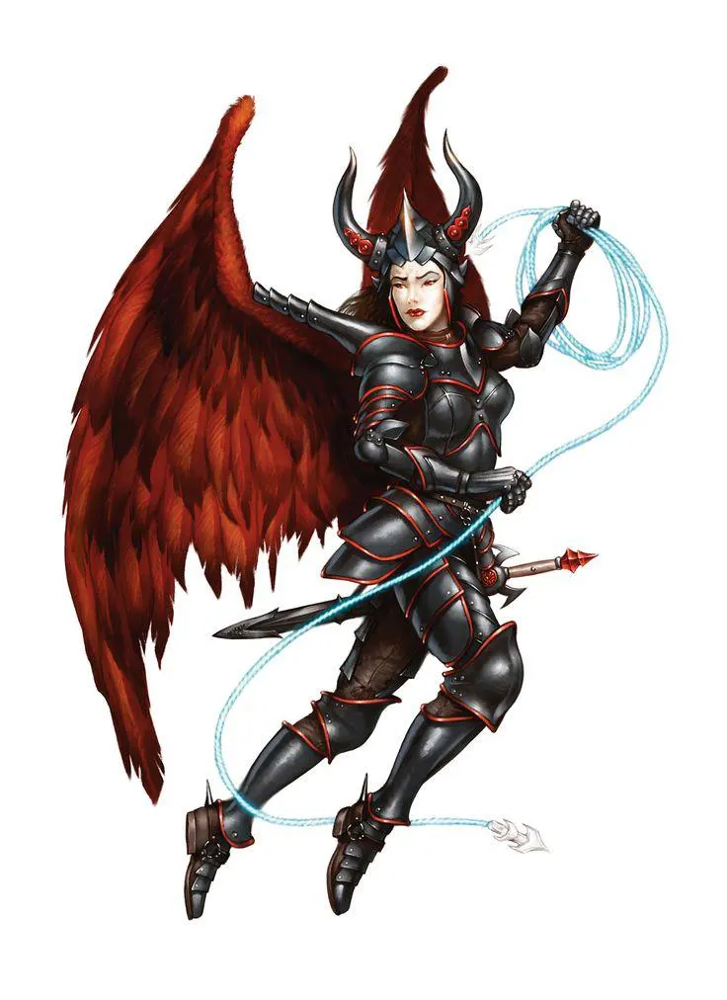

### Variação: Corda de Estrangulamento

Algumas erínias carregam uma *corda de estrangulamento* (detalhada no *Guia do Mestre*). Quando uma erínia dessas usa seus Ataques Múltiplos, ela pode usar a corda no lugar de dois ataques desses.

## Bloco de estatísticas: Erínia

*Corruptor Médio (diabo), leal e mau*

**Classe de Armadura** 18 (placas)  
**Pontos de Vida** 153 (18d8 + 72)  
**Deslocamento** 9 m, voo 27 m

| FOR | DES | CON | INT | SAB | CAR |
| :---: | :---: | :---: | :---: | :---: | :---: |
| 18 (+4) | 16 (+3) | 18 (+4) | 14 (+2) | 14 (+2) | 18 (+4) |

**Testes de Resistência** Des +7, Con +8, Sab +6, Car +8  
**Resistência a Dano** frio; concussão, cortante e perfurante de ataques não-mágicos que não sejam de prata  
**Imunidade a Dano** fogo, veneno  
**Imunidade a Condição** envenenado  
**Sentidos** visão no escuro 36 m, Percepção passiva 12  
**Idiomas** Infernal, telepatia 36 m  
**Nível de Desafio** 12 (8.400 XP)

***Arma Infernal***. Os ataques de armas da erínia são mágicos e causam 13 (3d8) de dano de veneno extra quanto atingem (inclusos no ataque).

***Resistência à Magia***. A erínia possui vantagem nos testes de resistência contra magias e outros efeitos mágicos.

### Ações

***Ataques Múltiplos***. A erínia realiza três ataques.

***Espada Longa***. *Ataque Corpo-a-Corpo com Arma*: +8 para atingir, alcance 1,5 m, um alvo. *Acerto*: 8 (1d8 + 4) de dano cortante, ou 9 (1d10 +4) de dano cortante se for usada com as duas mãos, mais 13 (3d8) de dano de veneno

***Arco Longo***. *Ataque à Distância com Arma*: +7 para atingir, distância 45 m/180 m, um alvo. *Acerto*: 7 (1d8 + 3) de dano perfurante mais 13 (3d8) de dano de veneno e o alvo deve ser em sucedido num teste de resistência de Constituição CD 14 ou ficará envenenado. O veneno até ser removido pela magia *restauração menor* ou mágica similar.

### Reações

***Aparar***. A erínia adiciona 4 à sua CA contra um ataque corpo-a-corpo que poderia atingi-la. Para tanto, a erínia deve poder ver o atacante e estar empunhando uma arma corpo-a-corpo.

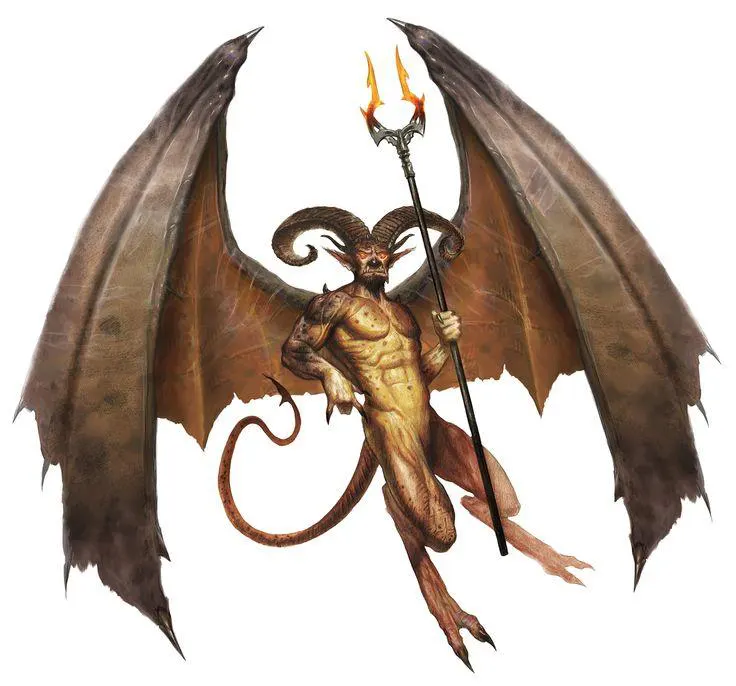

## Bloco de estatísticas: Diabo de Chifres

*Corruptor Grande (diabo), leal e mau*

**Classe de Armadura** 18 (armadura natural)  
**Pontos de Vida** 178 (17d10 + 85)  
**Deslocamento** 6 m, voo 18 m

| FOR | DES | CON | INT | SAB | CAR |
| :---: | :---: | :---: | :---: | :---: | :---: |
| 22 (+6) | 17 (+3) | 21 (+5) | 12 (+1) | 16 (+3) | 17 (+3) |

**Testes de Resistência** For +10, Des +7, Sab +7, Car +7  
**Resistência a Dano** frio; concussão, cortante e perfurante de ataques não-mágicos que não sejam de prata  
**Imunidade a Dano** fogo, veneno  
**Imunidade a Condição** envenenado  
**Sentidos** visão no escuro 36 m, Percepção passiva 13  
**Idiomas** Infernal, telepatia 36 m  
**Nível de Desafio** 11 (7.200 XP)

***Resistência à Magia***. O diabo possui vantagem nos testes de resistência contra magias e outros efeitos mágicos.

***Visão Diabólica***. Escuridão mágica não impede a visão no escuro do diabo.

### Ações

***Ataques Múltiplos***. O diabo realiza três ataques corpo-a-corpo: dois com seu garfo e um com sua cauda. Ele pode usar Arremessar Chamas no lugar de um ataque corpo-a-corpo.

***Garfo***. *Ataque Corpo-a-Corpo com Arma*: +10 para atingir, alcance 3 m, um alvo. *Acerto*: 15 (2d8 + 6) de dano perfurante.

***Cauda***. *Ataque Corpo-a-Corpo com Arma*: +10 para atingir, alcance 3 m, um alvo. *Acerto*: 10 (1d8 + 6) de dano perfurante. Se o alvo for uma criatura diferente de um morto-vivo ou constructo, ele deve ser bem sucedido num teste de resistência de Constituição CD 17 ou perderá 10 (3d6) pontos de vida no começo de cada um dos turnos dele devido a um ferimento infernal. Cada vez que o diabo atingir o alvo com esse ataque, o dano causado pelo ferimento aumenta em 10 (3d6). Qualquer criatura pode usar uma ação para estancar o ferimento com um teste bem sucedido de Sabedoria (Medicina) CD 12. O ferimento também se fecha se o alvo receber cura mágica.

***Arremessas Chamas***. *Ataque à Distância com Magia*: +7 para atingir, distância 45 m, um alvo. *Acerto*: 14 (4d6) de dano de fogo. Se o alvo for um objeto inflamável que não esteja sendo vestido ou carregado, ele pega fogo.

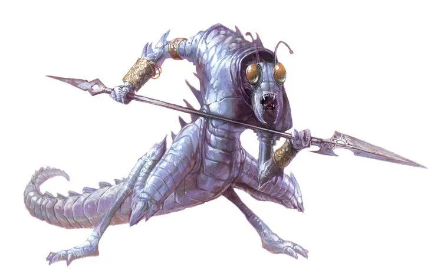

## Bloco de estatísticas: Diabo do Gelo

*Corruptor Grande (diabo), leal e mau*

**Classe de Armadura** 18 (armadura natural)  
**Pontos de Vida** 180 (19d10 + 76)  
**Deslocamento** 12 m

| FOR | DES | CON | INT | SAB | CAR |
| :---: | :---: | :---: | :---: | :---: | :---: |
| 21 (+5) | 14 (+2) | 18 (+4) | 18 (+4) | 15 (+2) | 18 (+4) |

**Testes de Resistência** Des +7, Con +9, Sab +7, Car +9  
**Resistência a Dano** concussão, cortante e perfurante de ataques não-mágicos que não sejam de prata  
**Imunidade a Dano** fogo, frio, veneno  
**Imunidade a Condição** envenenado  
**Sentidos** percepção às cegas 18 m, visão no escuro 36 m, Percepção passiva 12  
**Idiomas** Infernal, telepatia 36 m  
**Nível de Desafio** 14 (11.500 XP)

***Resistência à Magia***. O diabo possui vantagem nos testes de resistência contra magias e outros efeitos mágicos.

***Visão Diabólica***. Escuridão mágica não impede a visão no escuro do diabo.

### Ações

***Ataques Múltiplos***. O diabo realiza três ataques: um com sua mordida, um com suas garras e um com sua cauda.

***Mordida***. *Ataque Corpo-a-Corpo com Arma*: +10 para atingir, alcance 1,5 m, um alvo. *Acerto*: 12 (2d6 + 5) de dano perfurante mais 10 (3d6) de dano de frio.

### Variação: Diabo do Gelo com Lança

Alguns diabos do gelo tem as seguintes opções de ação.

***Ataques Múltiplos***. O diabo realiza dois ataques: um com sua lança e um com sua cauda.

***Lança de Gelo***. *Ataque Corpo-a-Corpo com Arma*: +10 para atingir, alcance 3 m, um alvo. *Acerto*: 14 (2d8 + 5) de dano perfurante mais 10 (3d6) de dano de frio. Se o alvo for uma criatura, ele deve ser bem sucedido num teste de resistência de Constituição CD 15, ou por 1 minuto, seu deslocamento será reduzido em 3 metros; ele pode realizar ou uma ação ou uma ação bônus a cada turno, mas não ambas; e ele não pode realizar ações. O alvo pode repetir o teste de resistência no final de cada um dos turnos dele, terminando o efeito se obtiver sucesso.

***Garras***. *Ataque Corpo-a-Corpo com Arma*: +10 para atingir, alcance 1,5 m, um alvo. *Acerto*: 10 (2d4 + 5) de dano cortante mais 10 (3d6) de dano de frio.

***Cauda***. *Ataque Corpo-a-Corpo com Arma*: +10 para atingir, alcance 3 m, um alvo. *Acerto*: 12 (2d6 + 5) de dano de concussão mais 10 (3d6) de dano de frio.

***Muralha de Gelo (Recarrega 6)***. O diabo magicamente forma uma muralha opaca de gelo em uma superfície sólida que ele possa ver, a até 18 metros dele. A muralha tem 30 centímetros de espessura e até 9 metros de comprimento por 3 metros de altura ou ela é uma redoma hemisférica de 6 metros de diâmetro. Quando a muralha aparece, cada criatura no espaço dela é empurrada para fora até a rota mais curta. A criatura escolhe de que lado da muralha irá ficar, a não ser que a criatura esteja incapacitada. A criatura, então, realiza um teste de resistência de Destreza CD 17, sofrendo 35 (10d6) de dano de frio se falhar na resistência, ou metade desse dano se obtiver sucesso. A muralha dura por 1 minuto ou até o diabo estar incapacitado ou morrer. A muralha pode sofrer dano e ser rompida; cada seção de 3 metros tem CD 5, 30 pontos de vida, vulnerabilidade a fogo e imunidade a dano de ácido, frio, necrótico, psíquico, veneno. Se uma sessão for destruída, ela deixa uma camada de ar gelado no espaço ocupado pela muralha. Sempre que uma criatura acabar se movendo através do ar gelado em um turno, voluntariamente ou não, a criatura deve realizar um teste de resistência de Constituição CD 17, sofre 17 (5d6) de dano de frio se falhar na resistência, ou metade desse dano se obtiver sucesso. O ar gelado se dissipa quando o resto da muralha desaparecer.

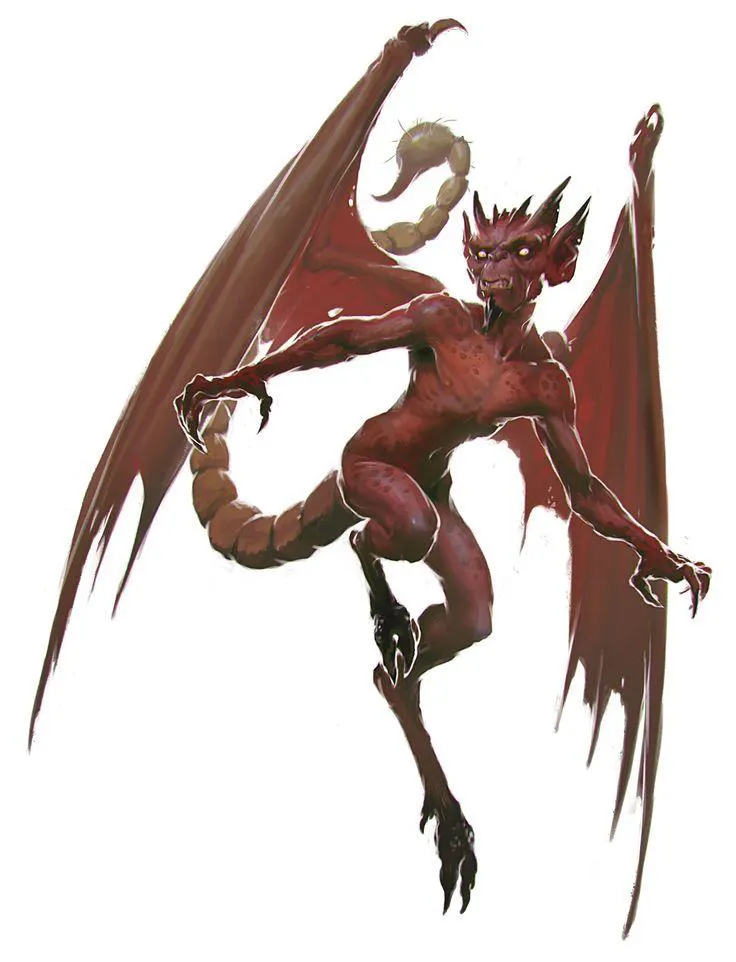

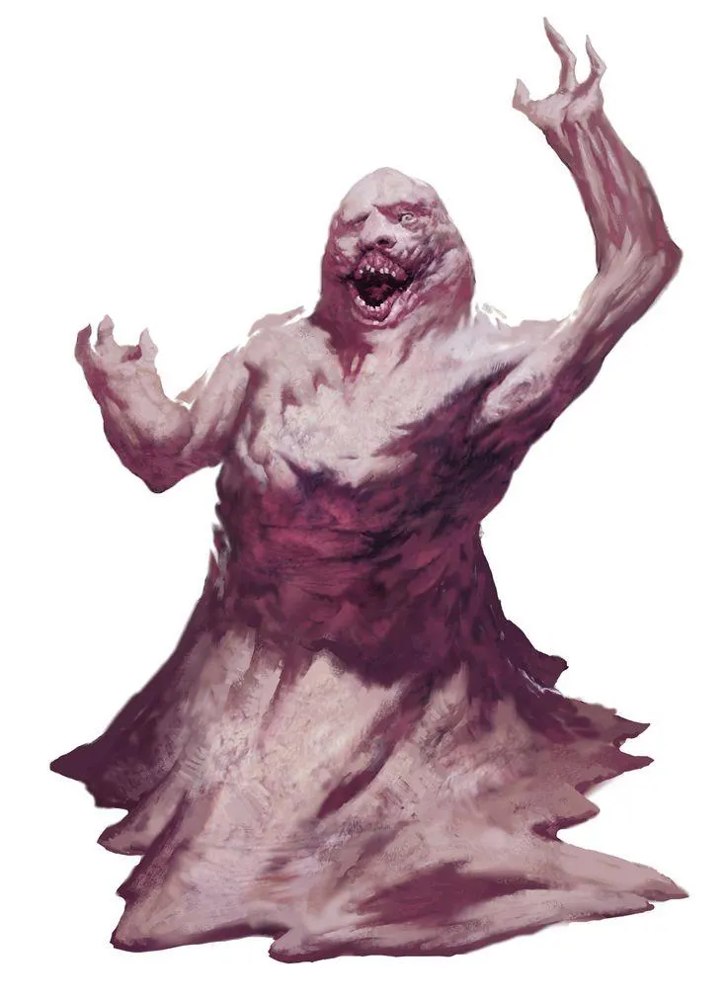

## Bloco de estatísticas: Diabrete

*Corruptor Miúdo (diabo, metamorfo), leal e mau*

**Classe de Armadura** 13  
**Pontos de Vida** 10 (3d4 + 3)  
**Deslocamento** 6 m, voo 12 m

| FOR | DES | CON | INT | SAB | CAR |
| :---: | :---: | :---: | :---: | :---: | :---: |
| 6 (–2) | 17 (+3) | 13 (+1) | 11 (+0) | 12 (+1) | 14 (+2) |

**Perícias** Enganação +4, Furtividade +5, Intuição +3, Persuasão +4  
**Resistência a Dano** frio; concussão, cortante e perfurante de ataques não-mágicos que não sejam de prata  
**Imunidade a Dano** fogo, veneno  
**Sentidos** visão no escuro 18 m, Percepção passiva 11  
**Idiomas** Infernal, Comum  
**Nível de Desafio** 1 (200 XP)

***Metamorfo***. O diabrete pode usar sua ação para se metamorfosear nas formas de besta de um rato (deslocamento 6 m), corvo (6 m, voo 18 m) ou aranha (6 m, escalada 12 m), ou em sua forma verdadeira. Suas estatísticas são as mesmas em todas as formas, no entanto, seu ataque é diferente em algumas delas. Qualquer equipamento carregado não será transformado. Se for morto, o diabrete volta a sua forma de diabo.

***Resistência à Magia***. O diabrete tem vantagem em testes de resistência contra magias e outros efeitos mágicos.

***Visão de Diabo***. Escuridão mágica não impede a visão no escuro do diabrete.

### Ações

***Ferrão (Mordida em Forma de Besta)***. *Ataque Corpo-a-Corpo com* *Arma*: +5 para atingir, alcance 1,5 m, uma criatura. *Acerto*: 5 (1d4 + 3) de dano perfurante e o alvo deve realizar um teste de resistência de Constituição CD 11, sofrendo 10 (3d6) de dano de veneno se falhar na resistência ou metade desse dano se obtiver sucesso.

***Invisibilidade***. O diabrete fica invisível até ele atacar ou sua concentração acabar. Qualquer coisa que o diabrete invisível estiver carregando ou vestindo fica invisível contanto que permaneça em contato com ele.

## Bloco de estatísticas: Lêmure

*Corruptor Médio (diabo), leal e mau*

**Classe de Armadura** 7  
**Pontos de Vida** 13 (3d8)  
**Deslocamento** 4,5 m

| FOR | DES | CON | INT | SAB | CAR |
| :---: | :---: | :---: | :---: | :---: | :---: |
| 10 (+0) | 5 (–3) | 11 (+0) | 1 (–5) | 11 (+0) | 3 (–4) |

**Resistência a Dano** frio  
**Imunidade a Dano** fogo, veneno  
**Imunidade a Condição** amedrontado, enfeitiçado, envenenado  
**Sentidos** visão no escuro 36 m, Percepção passiva 10  
**Idiomas** compreende infernal mas não pode falar  
**Nível de Desafio** 0 (10 XP)

***Rejuvenescimento Infernal***. Um lêmure que mora nos Nove Infernos volta a vida com todos os seus pontos de vida em 1d10 dias, a não ser que seja morto por uma criatura de tendência boa ou que tenha a magia *bênção* conjurada sobre ela ou se seus restos mortais forem aspergidos com água benta.

***Visão Diabólica***. Escuridão mágica não impede a visão no escuro do lêmure.

### Ações

***Punho***. *Ataque Corpo-a-Corpo com Arma*: +3 para atingir, alcance 1,5 m, um alvo. *Acerto*: 2 (1d4) de dano de concussão.

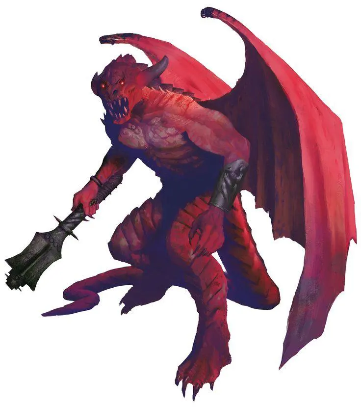

## Bloco de estatísticas: Senhor das Profundezas

*Corruptor Grande (diabo), leal e mau*

**Classe de Armadura** 19 (armadura natural)  
**Pontos de Vida** 300 (24d10 + 168)  
**Deslocamento** 9 m, voo 18 m

| FOR | DES | CON | INT | SAB | CAR |
| :---: | :---: | :---: | :---: | :---: | :---: |
| 26 (+8) | 14 (+2) | 24 (+7) | 22 (+6) | 18 (+4) | 24 (+7) |

**Testes de Resistência** Des +8, Con +13, Sab +10  
**Resistência a Dano** frio; concussão, cortante e perfurante de ataques não-mágicos que não sejam de prata  
**Imunidade a Dano** fogo, veneno  
**Imunidade a Condição** envenenado  
**Sentidos** visão verdadeira 36 m, Percepção passiva 14  
**Idiomas** Infernal, telepatia 36 m  
**Nível de Desafio** 20 (25.000 XP)

***Arma Mágica***. Os ataques com armas do senhor das profundezas são mágicos.

***Aura de Medo***. Qualquer criatura hostil ao senhor das profundezas que comece seu turno a até 6 metros dele, deve realizar um teste de resistência de Sabedoria CD 21, a não ser que o senhor das profundezas esteja incapacitado. Se falhar na resistência, a criatura ficará amedrontada até o início do próximo turno dela. Se uma criatura for bem sucedida, ela fica imune a Aura de Medo do senhor das profundezas pelas próximas 24 horas.

***Resistência à Magia***. O senhor das profundezas possui vantagem nos testes de resistência contra magias e outros efeitos mágicos.

***Conjuração Inata***. A habilidade de conjuração do senhor das profundezas é Carisma (CD de resistência de magia 21). O senhor das profundezas pode conjurar, inatamente, as seguintes magias, sem necessidade de componentes materiais:

À vontade: *bola de fogo, detectar magia* 3/dia cada: *imobilizar monstro, muralha de fogo*

### Ações

***Ataques Múltiplos***. O senhor das profundezas realiza quatro ataques: um com sua mordida, um com sua garra, um com sua maça e um com sua cauda.

***Mordida***. *Ataque Corpo-a-Corpo com Arma*: +14 para atingir, alcance 1,5 m, um alvo. *Acerto*: 22 (4d6 + 8) de dano perfurante. O alvo deve ser bem sucedido num teste de resistência de Constituição CD 21 ou ficará envenenado. Enquanto estiver envenenado dessa forma, o alvo não pode recuperar pontos de vida e sofre 21 (6d6) de dano de veneno no início de cada um dos turnos dele. O alvo envenenado pode repetir o teste de resistência no final de cada um dos seus turnos, terminando o efeito sobre si caso obtenha sucesso.

***Garra***. *Ataque Corpo-a-Corpo com Arma*: +14 para atingir, alcance 3 m, um alvo. *Acerto*: 17 (2d8 + 8) de dano cortante.

***Maça***. *Ataque Corpo-a-Corpo com Arma*: +14 para atingir, alcance 3 m, um alvo. *Acerto*: 15 (2d6 + 8) de dano de concussão mais 21 (6d6) de dano de fogo.

***Cauda***. *Ataque Corpo-a-Corpo com Arma*: +14 para atingir, alcance 3 m, um alvo. *Acerto*: 24 (3d10 + 8) de dano de concussão.

## Bloco de estatísticas: Diabo dos Espinhos

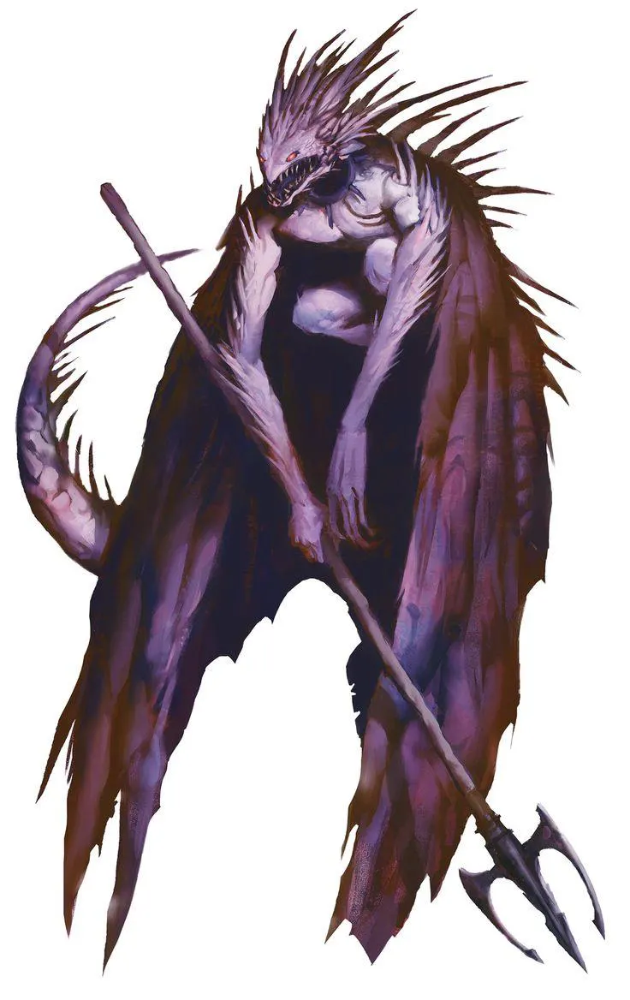

*Corruptor Pequeno (diabo), leal e mau*

**Classe de Armadura** 13 (armadura natural)  
**Pontos de Vida** 22 (5d6 + 5)  
**Deslocamento** 6 m, voo 12 m

| FOR | DES | CON | INT | SAB | CAR |
| :---: | :---: | :---: | :---: | :---: | :---: |
| 10 (+0) | 15 (+2) | 12 (+1) | 11 (+0) | 14 (+2) | 8 (–1) |

**Resistência a Dano** frio; concussão, cortante e perfurante de ataques não-mágicos que não sejam de prata  
**Imunidade a Dano** fogo, veneno  
**Imunidade a Condição** envenenado  
**Sentidos** visão no escuro 36 m, Percepção passiva 12  
**Idiomas** Infernal, telepatia 36 m  
**Nível de Desafio** 2 (450 XP)

***Espinhos Limitados***. O diabo possui doze espinhos de cauda. Espinhos gastos crescem novamente enquanto o diabo termina um descanso longo.

***Resistência à Magia***. O diabo possui vantagem nos testes de resistência contra magias e outros efeitos mágicos.

***Sobrevoo***. O diabo não provoca um ataque de oportunidade quando voa para fora do alcance de um inimigo.

***Visão Diabólica***. Escuridão mágica não impede a visão no escuro do diabo.

### Ações

***Ataques Múltiplos***. O diabo realiza dois ataques: um com sua mordida e um com seu garfo ou dois com seus espinhos de cauda.

***Mordida***. *Ataque Corpo-a-Corpo com Arma*: +2 para atingir, alcance 1,5 m, um alvo. *Acerto*: 5 (2d4) de dano perfurante.

***Garfo***. *Ataque Corpo-a-Corpo com Arma*: +2 para atingir, alcance 1,5 m, um alvo. *Acerto*: 3 (1d6) de dano perfurante.

***Espinho de Cauda***. *Ataque à Distância com Arma*: +4 para atingir, distância 12/48 m, um alvo. *Acerto*: 4 (1d4 + 2) de dano perfurante mais 3 (1d6) de dano de fogo.
