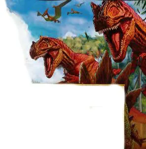
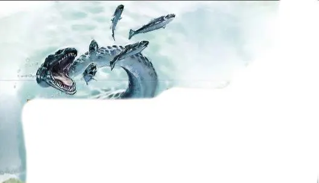

# Dinossauros

Os dinossauros, ou beemotes, estão entre os repteis mais antigos do mundo. Dinossauros predatórios são caçadores selvagens e territorialistas. Dinossauros herbívoros são menos agressivos, mas eles podem atacar para defender seus filhotes ou se assustados ou importunados.

Os dinossauros existem em diversos tamanhos e formatos. As variações maiores geralmente possuem coloração parda, enquanto que os dinossauros menores possuem listras coloridas similares aos pássaros. Os dinossauros vagueiam por áreas áridas e isoladas raramente visitadas por humanoides, incluindo vales de montanhosos remotos, platôs inacessíveis, ilhas tropicais e charcos profundos.

### Alossauro

O alossauro é um predador de grande porte, força e velocidade. Ele pode perseguir praticamente qualquer presa em terreno aberto, saltando para derrubar as criaturas com garras terríveis.

### Anquilossauro

Uma couraça de placas grossas cobre o corpo do anquilossauro comedor de plantas, que se defende contra os predadores com uma cauda protuberante que desfere golpes devastadores. Algumas variações de anquilossauros possuem caudas espinhosas que causam dano perfurante, ao invés de dano de concussão.

### Plesiossauro

Um plesiossauro é um dinossauro marinho cujo corpo compacto é guiado por poderosas nadadeiras. Predatório e agressivo, ele ataca qualquer criatura que encontrar. Seu pescoço flexível tem um terço do seu comprimento total, permitindo que ele dobre-o em qualquer direção para desferir poderosas mordidas.

### Pteranodonte

Esses repteis voadores possuem uma envergadura de asa entre 4,5 metros e 6 metros e, geralmente, mergulham atrás de pequenas presas marinhas, no entanto, eles são oportunistas e atacarão qualquer criatura comestível. Um pteranodonte não possui dentes, ao invés, ele usa seu bico afiado para golpear as presas muito grandes para se engolir de uma vez.

### Tiranossauro

Esse enorme predador aterroriza todas as outras criaturas em seu território. Apesar de seu tamanho e peso, um tiranossauro é um corredor veloz. Ele persegue qualquer coisa que ele ache que possa comer e existem poucas criaturas que ele não tentará devorar inteiras. Enquanto ronda atrás de uma presa em potencial, um tiranossauro sobrevive de carcaças e de quaisquer criaturas menores, as quais ele tenta espantar para roubar sua refeição.

### Tricerátops

Um dos dinossauros herbívoros mais agressivos, o tricerátops possui um crânio que se expandiu formando uma placa óssea protetora. Com seus grandes chifres e velocidade formidável, um tricerátops golpeia e atropela possíveis predadores até a morte.

## Bloco de estatísticas: Alossauro

*Besta Grande, imparcial*

**Classe de Armadura** 13 (armadura natural)  
**Pontos de Vida** 51 (6d10 + 18)  
**Deslocamento** 12 m

| FOR | DES | CON | INT | SAB | CAR |
| :---: | :---: | :---: | :---: | :---: | :---: |
| 19 (+4) | 13 (+1) | 17 (+3) | 2 (–4) | 12 (+1) | 5 (–3) |

**Perícias** Percepção +5  
**Sentidos** Percepção passiva 15  
**Idiomas** –  
**Nível de Desafio** 2 (450 XP)

***Bote***. Se o alossauro se mover, pelo menos, 9 metros em linha reta em direção de uma criatura e atingi-la, no mesmo turno, o alvo deve ser bem sucedido num teste de resistência de Força CD 13 para não cair no chão. Se o alvo cair no chão, o alossauro pode realizar um ataque de mordida contra ele, com uma ação bônus.

### Ações

***Mordida***. *Ataque Corpo-a-Corpo com Arma*: +6 para atingir, alcance 1,5 m, um alvo. *Acerto*: 15 (2d10 + 4) de dano perfurante.

***Garra***. *Ataque Corpo-a-Corpo com Arma*: +6 para atingir, alcance 1,5 m, um alvo. *Acerto*: 8 (1d8 + 4) de dano cortante.

## Bloco de estatísticas: Anquilossauro

*Besta Enorme, imparcial*

**Classe de Armadura** 15 (armadura natural)  
**Pontos de Vida** 68 (8d12 + 16)  
**Deslocamento** 9 m

| FOR | DES | CON | INT | SAB | CAR |
| :---: | :---: | :---: | :---: | :---: | :---: |
| 19 (+4) | 11 (+0) | 15 (+2) | 2 (–4) | 12 (+1) | 5 (–3) |

**Sentidos** Percepção passiva 11  
**Idiomas** –  
**Nível de Desafio** 3 (700 XP)

### Ações

***Cauda***. *Ataque Corpo-a-Corpo com Arma*: +7 para atingir, alcance 3 m, um alvo. *Acerto*: 18 (4d6 + 4) de dano de concussão. Se o alvo for uma criatura, ela deve ser bem sucedida num teste de resistência de Força CD 14 ou será derrubada no chão.

## Bloco de estatísticas: Plesiossauro

*Besta Grande, imparcial*

**Classe de Armadura** 13 (armadura natural)  
**Pontos de Vida** 68 (8d10 + 24)  
**Deslocamento** 6 m, natação 12 m

| FOR | DES | CON | INT | SAB | CAR |
| :---: | :---: | :---: | :---: | :---: | :---: |
| 18 (+4) | 15 (+2) | 16 (+3) | 2 (–4) | 12 (+1) | 5 (–3) |

**Perícias** Furtividade +4, Percepção +3  
**Sentidos** Percepção passiva 13  
**Idiomas** –  
**Nível de Desafio** 2 (450 XP)

***Prender a Respiração***. O plesiossauro pode prender a respiração por 1 hora.

### Ações

***Mordida***. *Ataque Corpo-a-Corpo com Arma*: +6 para atingir, alcance 3 m, um alvo. *Acerto*: 14 (3d6 + 4) de dano perfurante.

## Bloco de estatísticas: Tiranossauro

*Besta Enorme, imparcial*

**Classe de Armadura** 13 (armadura natural)  
**Pontos de Vida** 136 (13d12 + 52)  
**Deslocamento** 15 m

| FOR | DES | CON | INT | SAB | CAR |
| :---: | :---: | :---: | :---: | :---: | :---: |
| 25 (+7) | 10 (+0) | 19 (+4) | 2 (–4) | 12 (+1) | 9 (–1) |

**Perícias** Percepção +4  
**Sentidos** Percepção passiva 14  
**Idiomas** –  
**Nível de Desafio** 8 (3.900 XP)

### Ações

***Ataques Múltiplos***. O tiranossauro realiza dois ataques: um com sua mordida e um com sua cauda. Ele não pode realizar ambos ataques contra o mesmo alvo.

***Mordida***. *Ataque Corpo-a-Corpo com Arma*: +10 para atingir, alcance 3 m, um alvo. *Acerto*: 33 (4d12 + 7) de dano perfurante. Se o alvo for uma criatura Média ou menor, ela está agarrada (CD 17 para escapar). Enquanto o agarrão durar, o alvo está impedido e o tiranossauro não pode morder outro alvo.

***Cauda***. *Ataque Corpo-a-Corpo com Arma*: +10 para atingir, alcance 3 m, um alvo. *Acerto*: 20 (3d8 + 7) de dano de concussão.

## Bloco de estatísticas: Pteranodonte

*Besta Média, imparcial*

**Classe de Armadura** 13 (armadura natural)  
**Pontos de Vida** 13 (3d8)  
**Deslocamento** 3 m, voo 18 m

| FOR | DES | CON | INT | SAB | CAR |
| :---: | :---: | :---: | :---: | :---: | :---: |
| 12 (+1) | 15 (+2) | 10 (+0) | 2 (–4) | 9 (–1) | 5 (–3) |

**Perícias** Percepção +1  
**Sentidos** Percepção passiva 11  
**Idiomas** –  
**Nível de Desafio** 1/4 (50 XP)

***Sobrevoo***. O pteranodonte não provoca um ataque de oportunidade quando voo para fora do alcance de um inimigo.

### Ações

***Bicada***. *Ataque Corpo-a-Corpo com Arma*: +3 para atingir, alcance 1,5 m, um alvo. *Acerto*: 6 (2d4 + 1) de dano perfurante.

## Bloco de estatísticas: Tricerátops

*Besta Enorme, imparcial*

**Classe de Armadura** 13 (armadura natural)  
**Pontos de Vida** 95 (10d12 + 30)  
**Deslocamento** 15 m

| FOR | DES | CON | INT | SAB | CAR |
| :---: | :---: | :---: | :---: | :---: | :---: |
| 22 (+6) | 9 (–1) | 17 (+3) | 2 (–4) | 11 (+0) | 5 (–3) |

**Sentidos** Percepção passiva 10  
**Idiomas** –  
**Nível de Desafio** 5 (1.800 XP)

***Atropelar em Investida***. Se o tricerátops se mover, pelo menos 6 metros, em linha reta até uma criatura e então atingi-la com um ataque de chifres no mesmo turno, o alvo deve ser bem sucedido num teste de resistência de Força CD 13 para não cair no chão. Se o alvo cair no chão, o tricerátops pode realizar um ataque de pisotear contra ele, com uma ação bônus.

### Ações

***Chifres***. *Ataque Corpo-a-Corpo com Arma*: +9 para atingir, alcance 1,5 m, um alvo. *Acerto*: 24 (4d8 + 6) de dano perfurante.

***Pisotear***. *Ataque Corpo-a-Corpo com Arma*: +9 para atingir, alcance 1,5 m, uma criatura caída. *Acerto*: 22 (3d10 + 6) de dano de concussão.
