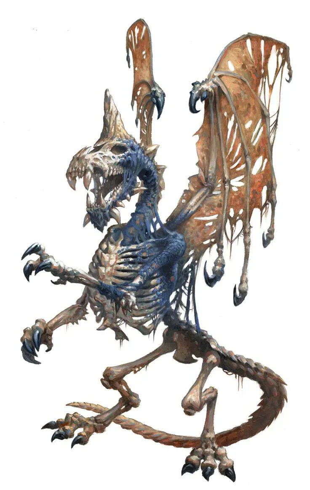

# Dracolich

Mesmo sendo tão longevos quanto são, todos os dragões devem eventualmente morrer. Esse pensamento não se encaixa bem para muitos dragões, alguns deles permitem ser transformados por energia necromântica e rituais ancestrais em poderosos dracoliches mortos-vivos. Apenas os dragões mais narcisistas escolhem esse caminho, sabendo que ao fazê-lo, romperão todos os laços com sua espécie e com os deuses dragões.

***Além da Morte***. Um dracolich mantem sua forma e tamanho após se transformar, sua pele e escamas se grudam aos seus ossos ou simplesmente caem deixando uma forma esquelética para trás. Seus olhos aparecem como pontos brilhantes de luz flutuando em órbitas sombrias, insinuando a malevolência de sua mente morta-viva.

Embora muitos dragões busquem objetivos apenas de destruição e dominação, os dracoliches são mais nefastos que os piores dragões, desejando dominar todos. Um dracolich é um diabólico tirano inteligente que constrói complexas teias de tramas sórdidas, atraindo servos motivados pela ganancia e cobiça por poder. Agindo das sombras e conspirando ativamente para manter sua existência em segredo, um dracolich é um oponente esperto e desafiador.

***Filactérias de Dracoliches***. Criar um dracolich requer a cooperação do dragão e de um grupo de arcanos ou cultistas que possam realizar o ritual apropriado. Durante o ritual, o dragão consome uma infusão tóxica que o mata instantaneamente. Os conjuradores presentes então capturam seu espírito e o transferem para uma gema especial que funciona como a filactéria de um lich. À medida que a carne do dragão se decompõe, o espírito dentro da gema retorna para animar os ossos do dragão.

Caso a forma física do dracolich seja destruída a qualquer momento, seu espírito retorna para a gema, contanto que ambos estejam no mesmo plano. Se a gema entrar em contato com o cadáver de outro dragão, o espírito do dracolich pode possuir esse cadáver para se tornar um novo dracolich. Se a gema do espírito do dracolich for levada para outro plano, o espírito do dracolich não terá para onde ir quando seu corpo morto-vivo for destruído e simplesmente passa para o além-vida.

### Modelo Dracolich

Apenas um dragão verdadeiro ancião ou adulto pode ser transformado em um dracolich. Dragões mais jovens que tentem passar pela transformação morrem, assim como outras criaturas que não sejam dragões verdadeiros mas possuam o tipo dragão, como os pseudodragões e wyverns. Um dragão das sombras não pode ser transformado em um dracolich, pois ele já perdeu muito de sua forma física.

Quando um dragão se torna um dracolich, ele mantem suas estatísticas exceto pelas descritas abaixo. O dragão perde qualquer característica, como Anfíbio, que necessite de uma fisiologia viva. O dracolich pode manter ou perder quaisquer ou todas as suas ações de covil ou as inerentes, como o Mestre achar adequado.

***Tipo***. O tipo do dracolich muda de dragão para morto-vivo e ele não precisa mais respirar, comer, beber ou dormir.

***Resistência a Dano***. O dracolich tem resistência a dano necrótico.

***Imunidade a Dano***. O dracolich possui imunidade a veneno. Ele também mantem quaisquer imunidades que ele possuía antes de se tornar um dracolich.

***Imunidade a Condição***. O dracolich não pode ser amedrontado, enfeitiçado, envenenado ou paralisado. Ele também não sofre de exaustão.

***Resistência à Magia***. O dracolich possui vantagem em testes de resistência contra magias e outros efeitos mágicos.

## Bloco de estatísticas: Dracolich Azul Adulto

*Morto-vivo Enorme, leal e mau*

**Classe de Armadura** 19 (armadura natural)  
**Pontos de Vida** 225 (18d12 + 108)  
**Deslocamento** 12 m, escavação 9 m, voo 24 m

| FOR | DES | CON | INT | SAB | CAR |
| :---: | :---: | :---: | :---: | :---: | :---: |
| 25 (+7) | 10 (+0) | 23 (+6) | 16 (+3) | 15 (+2) | 19 (+4) |

**Testes de Resistência** Des +5, Con +11, Sab +7, Car +9  
**Perícias** Furtividade +5, Percepção +12  
**Resistência a Dano** necrótico  
**Imunidade a Dano** elétrico, veneno  
**Imunidade a Condição** amedrontado, enfeitiçado, envenenado, paralisado  
**Sentidos** percepção às cegas 18 m, visão no escuro 36 m, Percepção passiva 22  
**Idiomas** Comum, Dracônico  
**Nível de Desafio** 17 (18.000 XP)

***Resistência à Magia***. O dracolich possui vantagem nos testes de resistência contra magias e outros efeitos mágicos.

***Resistência Lendária (3/Dia)***. Se o dracolich falhar em um teste de resistência, ele pode escolher obter sucesso, no lugar.

### Ações

***Ataques Múltiplos***. O dracolich pode usar sua Presença Aterradora, ele pode então, realizar três ataques: um com sua mordida e dois com suas garras.

***Mordida***. *Ataque Corpo-a-Corpo com Arma*: +12 para atingir, alcance 3 m, um alvo. *Acerto*: 18 (2d10 + 7) de dano perfurante mais 5 (1d10) de dano elétrico.

***Garra***. *Ataque Corpo-a-Corpo com Arma*: +12 para atingir, alcance 1,5 m, um alvo. *Acerto*: 14 (2d6 + 7) de dano cortante.
