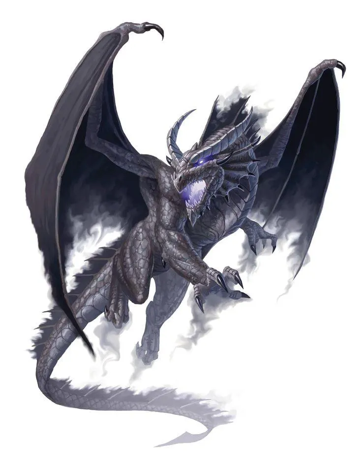

# Dragão das Sombras

Dragões das sombras são dragões verdadeiros que ou nasceram na Umbra ou se transformaram por anos passados dentro dos seus confins sombrios. Alguns dragões das sombras abraçam a Umbra por suas paisagens ermas e desolação. Outros buscam retornar ao Plano Material, sedentos em espalhar a escuridão e mal do Plano das Sombras.

***Portais Sombrios***. Portais para a Umbra se manifestam em locais abandonados e em trevas profundas de cavernas subterrâneas. Os dragões que repousam em tais locais, frequentemente encontram esses portais e acabam sendo transportados para um novo reino. Dragões anciões que dormem em seus covis por meses ou anos a fio podem acabar sendo arrebatados, sem nem mesmo saber que um portal havia se formado sem seu conhecimento enquanto dormiam.

***Reformado em Sombras***. A transformação em um dragão das sombras acontece num período de anos, durante o qual as escamas do dragão perdem seu lustre e adquirem um matiz de carvão. Suas asas de couro tornam-se translucidas, seus olhos empalidecem tornando-se poços de cinza opalescente. Os dragões das sombras consideram a luz solar detestável, e eles ficam mais fracos sob a luz plena do que sob a escuridão. A escuridão faz o dragão se tornar uma sombra espectral do seu eu anterior.

***Cauda***. *Ataque Corpo-a-Corpo com Arma*: +12 para atingir, alcance 4,5 m, um alvo. *Acerto*: 16 (2d8 + 7) de dano de concussão.

***Presença Aterradora***. Cada criatura, à escolha do dracolich, que esteja a até 36 metros do dracolich e esteja ciente disso, deve ser bem sucedida num teste de resistência de Sabedoria CD 18 ou ficará amedrontada por 1 minuto. Uma criatura pode repetir o teste de resistência no final de cada um dos turnos dela, terminando o efeito sobre si, caso obtenha sucesso. Se o teste de resistência de uma criatura for bem sucedido ou caso o efeito termine sobre ela, a criatura ficará imune a Presença Aterradora do dracolich pelas próximas 24 horas.

***Sopro Elétrico (Recarrega 5–6)***. O dracolich pode expelir eletricidade em uma linha com 27 metros de comprimento e 1,5 metro de largura. Cada criatura na linha deve ser bem sucedida num teste de resistência de Destreza CD 20, sofrendo 66 (12d10) de dano elétrico se falhar na resistência, ou metade desse dano caso obtenha sucesso.

### Ações Lendárias

O dracolich pode realizar 3 ações lendárias, escolhidas dentre as opções abaixo. Apenas uma ação lendária pode ser usada por vez e apenas no final do turno de outra criatura. O dracolich recupera as ações lendárias gastas no começo do turno dele.

**Detectar**. O dracolich realiza um teste de Sabedoria (Percepção).  
**Ataque com Cauda**. O dracolich realiza um ataque de cauda.  
**Ataque com Asas (Custa 2 Ações).** O dracolich bate suas asas esfarrapadas. Cada criatura a até 3 metros do dracolich deve ser bem sucedida num teste de resistência de Destreza CD 21 ou sofrerá 14 (2d6 + 7) de dano de concussão e cairá no chão. Após bater suas asas, o dracolich pode voar até metade do seu deslocamento de voo.

A natureza mágica dos dragões detêm uma atração pela Umbra, que parece, de alguma forma, desejar a força e majestade desses grandes repteis. A Umbra também causa um efeito desalentador em seus habitantes, de tal forma que quanto mais tempo uma criatura permanece no plano, mais adaptada ao mal-estar do plano ela fica. Quando meses e anos se passarem para um dragão na Umbra, ele se tornará consciente da transformação que ocorre com ele e, mesmo assim, não poderá fazer nada para impedi-la.

***De Volta ao Mundo***. Um dragão das sombras está tão impregnado com o poder da Umbra que mesmo retornar para o Plano Material não poderá desfazer a transformação. Alguns dragões das sombras tentam atrair outras criaturas do reino mortal de volta para a Umbra para que lhe façam companhia, pelo menos até se cansarem de seus convidados e devora-los. Outros ficam felizes por deixarem a Umbra para trás para sempre, entendendo que tesouros e poder são mais fáceis de conseguir no Plano Material.

### Modelo Dragão das Sombras

Apenas dragões verdadeiros podem se transformar em dragões das sombras e apenas se eles nascerem na Umbra ou permanecerem nela por vários anos. Um dragão das sombras não pode se transformar em um dragão das sombras, já que ele perde sua natureza dracônica quando se torna um morto-vivo.

Quando um dragão se torna um dragão das sombras, ele mantem suas estatísticas, exceto pelas descritas abaixo. O dragão das sombras pode manter ou perder quaisquer ou todas as suas ações de covil ou as inerentes, como o Mestre achar adequado.

***Resistência a Dano***. O dragão tem resistência a dano necrótico.

***Proficiência em Perícia: Furtividade***. O bônus de proficiência do dragão é dobrado em seus testes de Destreza (Furtividade).

***Sombra Viva***. Enquanto estiver na penumbra ou escuridão, o dragão possui resistência a danos que não sejam de energia, psíquico e radiante.

***Furtividade Sombria***. Enquanto estiver na penumbra ou escuridão, o dragão pode realizar a ação Esconder-se com uma ação bônus.

***Sensibilidade à Luz Solar***. Enquanto estiver sob luz solar, o dragão tem desvantagem nas jogada de ataque, assim como em testes de Sabedoria (Percepção) que tenham a ver com visão.

***Nova Ação: Mordida***. Se o dragão causa dano de ácido, elétrico, fogo, frio ou veneno com sua mordida, mude o tipo de dano para necrótico.

***Nova Ação: Sopro Sombrio***. Qualquer arma de sopro que cause dano possuída pelo dragão causará dano necrótico no lugar do tipo de dano original. Um humanoide que seja reduzido a 0 pontos de vida por esse dano morre e uma sombra morta-viva se ergue do corpo e age imediatamente após a contagem de iniciativa do dragão. A sombra está sob controle do dragão.

## Bloco de estatísticas: Dragão Vermelho das Sombras Jovem

*Dragão Grande, caótico e mau*

**Classe de Armadura** 18 (armadura natural)  
**Pontos de Vida** 178 (17d10 + 85)  
**Deslocamento** 12 m, escalada 12 m, voo 24 m

| FOR | DES | CON | INT | SAB | CAR |
| :---: | :---: | :---: | :---: | :---: | :---: |
| 23 (+6) | 10 (+0) | 21 (+5) | 14 (+2) | 11 (+0) | 19 (+4) |

**Testes de Resistência** Des +4, Con +9, Sab +4, Car +8  
**Perícias** Furtividade +8, Percepção +8  
**Resistência a Dano** necrótico  
**Imunidade a Dano** fogo  
**Sentidos** percepção às cegas 9 m, visão no escuro 36 m, Percepção passiva 13  
**Idiomas** Comum, Dracônico  
**Nível de Desafio** 13 (10.000 XP)

***Sombra Viva***. Enquanto estiver na penumbra ou escuridão, o dragão possui resistência a danos que não sejam de energia, psíquico e radiante.

***Furtividade Sombria***. Enquanto estiver na penumbra ou escuridão, o dragão pode realizar a ação Esconder-se com uma ação bônus.

***Sensibilidade à Luz Solar***. Enquanto estiver sob luz solar, o dragão tem desvantagem nas jogada de ataque, assim como em testes de Sabedoria (Percepção) que tenham a ver com visão.

### Ações

***Ataques Múltiplos***. O dragão realizar três ataques: um com sua mordida e dois com suas garras.

***Mordida***. *Ataque Corpo-a-Corpo com Arma*: +10 para atingir, alcance 3 m, um alvo. *Acerto*: 17 (2d10 + 6) de dano perfurante mais 3 (1d6) de dano necrótico.

***Garra***. *Ataque Corpo-a-Corpo com Arma*: +10 para atingir, alcance 1,5 m, um alvo. *Acerto*: 13 (2d6 + 6) de dano cortante.

***Sopro Sombrio (Recarrega 5–6)***. O dragão pode expelir fogo sombrio num cone de 9 metros. Cada criatura na área deve realizar um teste de resistência de Destreza CD 18, sofrendo 56 (16d6) de dano necrótico se falhar na resistência, ou metade desse dano caso obtenha sucesso. Um humanoide reduzido a 0 pontos de vida por esse dano morre e uma sombra morta-viva se ergue do corpo e age imediatamente após a contagem de iniciativa do dragão. A sombra está sob controle do dragão.
