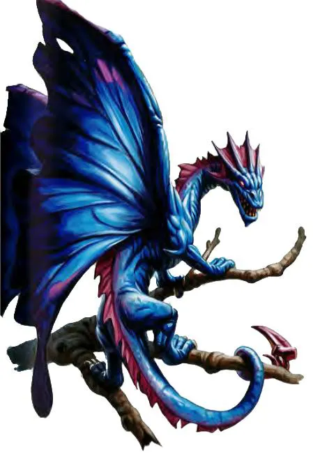

# Dragão-Fada

## Bloco de estatísticas: Dragão-Fada

*Dragão Miúdo, caótico e bom*

**Classe de Armadura** 15  
**Pontos de Vida** 14 (4d4 + 4)  
**Deslocamento** 3 m, voo 18 m

| FOR | DES | CON | INT | SAB | CAR |
| :---: | :---: | :---: | :---: | :---: | :---: |
| 3 (–4) | 20 (+5) | 13 (+1) | 14 (+2) | 12 (+1) | 16 (+3) |

**Perícias** Arcanismo +4, Furtividade +7, Percepção +3  
**Sentidos** visão no escuro 18 m, Percepção passiva 13  
**Idiomas** Dracônico, Silvestre  
**Nível de Desafio** 1 (200 XP) para o dragão-fada vermelho, laranja ou amarelo; 2 (450 XP) para o dragão fada verde, azul, anil ou violeta

***Invisibilidade Superior***. Com uma ação bônus, o dragão pode ficar magicamente invisível até sua concentração acabar (como se estivesse se concentrando em uma magia). Qualquer equipamento que o dragão esteja vestindo ou carregando fica invisível com ele.

***Resistência à Magia***. O dragão possui vantagem nos testes de resistência contra magias e outros efeitos mágicos.

***Telepatia Limitada***. Usando telepatia, o dragão pode se comunicar magicamente com qualquer outro dragão-fada a até 18 metros dele.

Um dragão-fada é um dragão do tamanho de um gato com asas de borboleta. Ele possui um largo sorriso de dentes afiados e expressa sua satisfação balançando sua cauda, sua alegria some apenas se ele for atacado.

***Brincalhões Invisíveis***. O único indício da presença de um dragão-fada é uma risadinha abafada. O dragão fica fora da vista, observando invisível enquanto suas vítimas lidam com suas brincadeiras. Quando sua diversão acaba, o dragão pode se revelar, a depender da disposição de sua “presa”.

***Amigável e Brilhante***. Um dragão-fada possui uma mente afiada, um carinho por tesouros e boa companhia e um senso de humor endiabrado. Viajantes podem brincar com a natureza dracônica de um dragão-fada ao oferecer “tesouros” em forma de doces, pães e bugigangas em troca de informações ou passagem segura por seu território.

***As Cores da Idade***. As escamas de um dragão-fada mudam de matiz quando ele envelhece, passando por todas as cores do arco-íris. Todos os dragões-fada possuem habilidade de conjuração inata, ganhando novas magias enquanto amadurecem.

**Cor do Dragão** **Faixa Etária** Vermelho 5 anos ou menos Laranja 6–10 anos Amarelo 11–20 anos Verde 21–30 anos Azul 31–40 anos Anil 41–50 anos Violeta 51 anos ou mais

***Conjuração Inata***. A habilidade de conjuração do dragão é Carisma (CD de resistência de magia 13). Ele pode conjurar uma quantidade de magia, inatamente, sem necessidade de componentes materiais. Conforme o dragão envelhece e muda de cor, ele ganha magias adicionais, como mostrado na tabela abaixo.

Vermelho, 1/dia cada: *globos de luz, ilusão menor, mãos mágicas* Laranja, 1/dia: *leque cromático* Amarelo, 1/dia: *reflexos* Verde, 1/dia: *sugestão* Azul, 1/dia: *imagem maior* Anil, 1/dia: *terreno alucinógeno* Violeta, 1/dia: *metamorfose*

### Ações

***Mordida***. *Ataque Corpo-a-Corpo com Arma*: +7 para atingir, alcance 1,5 m, um alvo. *Acerto*: 1 de dano perfurante.

***Sopro de Euforia (Recarrega 5–6)***. O dragão expele uma lufada de gás eufórico em uma criatura a até 1,5 metro dele. O alvo deve ser bem sucedido num teste de resistência de Sabedoria CD 11 ou, por 1 minuto, não poderá realizar reações e deve jogar um d6 no início de cada um dos turnos dele para determinar seu comportamento durante o turno:

**1–4**. O alvo não realiza nenhuma ação ou reação e usa todo o seu movimento para se deslocar em uma direção aleatória.  
**5–6**. O alvo não se move e a única coisa que ele pode fazer no turno dele é realizar um teste de resistência de Sabedoria CD 11, terminando o efeito sobre se, caso obtenha sucesso.
